# Admin Guide

The web server consists of two subcomponents: 

1. Web service 
2. API Service

Web service and API service listens on 443 for HTTPS connections for the published tenant portal (<tenantname>.instasafe.com). InstaSafe Admin, Company Admin(s) and user(s) login into Web Console and they can perform authorized operations based on their roles.

The policies configured on the web get pushed to the database for future use and to tenant controllers for immediate application. The API service provides authentication and authorization assistance for the agent. As a 1st step of the connection establishment phase, InstaSafe Agent (ISA) connects to the API server to establish mutual trust between ISA and Instasafe Cloud. The SSL certificates and key files generated during the ISA installation phase will be used by ISA for this verification.   API server verifies the ISA client by examining the client certificate, and ISA verifies the InstaSafe Cloud Cert by the reference of CA certificate.     For Authentication type = Cert + Password, credentials are sent to API server and API server contacts the respective agents(running along with API server) like AD agent for AD users and AD agent contacts the company AD server via LDAP request to validate the user credentials. 

On successfully establishing Mutual identity, API server pushes the details of device check and device binding verifications to ISA to validate. If these verifications are successful, ISA tries to establish a DTLS tunnel with InstaSafe controller as per the controller IP and port available in the configuration file.
The Web Console includes options for configuring the connections, such as setting up Users, Groups, Applications, Access Control List (ACL) and various reporting. It also includes options for monitoring the status of the connections, troubleshooting any issues that may arise, and viewing logs of connection activity.

The web-based interface allows users and administrators to manage, monitor, and configure their connections and devices, remotely and easily.

When you enter into the admin section these are the major sub-section

# Dashboard

The Instasafe ISA console dashboard provides a centralized interface for managing and monitoring various components of the Instasafe ISA solution. Here are the components that one can find on the dashboard

1. Online Gateways - It shows the ratio of number of online gateways to total number of gateways 
1. Online Users - This shows the ratio of number of online users to total number of users
1. User Subscription - This is the ratio of number of users subscribed to total user subscriptions
1. Subscription Renewal - This section shows the subscription renewal date
1. Top Data Usages (in KB) - This graph shows the data usage by Instasafe gateways and Instasafe Helper in KB
1. Top Data Usages (in minutes) - This graph shows the data usage by Instasafe gateways and Instasafe Helper in minutes

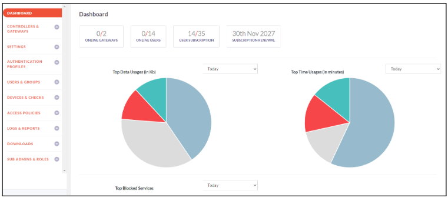

# Controllers and Gateways

**Controllers**

InstaSafe Controller is the key module in the InstaSafe Cloud that enforces authentication and access control for network connectivity. It is also  the central point to which InstaSafe Agent and Gateway establish an independent DTLS tunnel. It enforces policies and accepts/denies application access based on the configured policies.

The below steps will assist you in adding the Controller to the Console

1. Click on Controllers and Gateways -> Controllers
1. Click on Add Controller
1. Select the Cloud Server name from the list
1. Enter a custom name for the controller
1. Select the Protocol - UDP or TCP
1. Provide the Port number and Internal Network IP
1. Select the Netmask bits
1. Click on Save and Add New to add the controller successfully

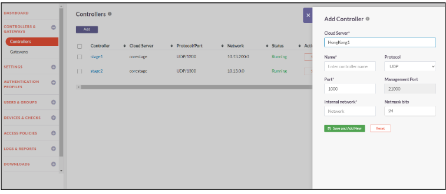

**Gateway**

The InstaSafe Secure Access Gateway is a lightweight software module that serves as an access point within the corporate infrastructure and allows secure access to application servers hosted there. It can be installed on a generic server or virtual machine in every on premise or cloud-hosted datacentre.

The Gateway establishes an outbound connection to the InstaSafe Controller which means that the firewall at the datacentre requires no inbound ports to be open, thus making the Gateway itself and the underlying network invisible to the outside world.

The below steps will assist you with creating a new Gateway profile

1. Login to Console
1. Click on Controllers and Gateways -> Gateways
1. Click on Add
1. Enter Gateway Name, Location of Gateway, Backup Gateway Name and Private IP of Protected Network
1. Click on Add More
1. Click on Click on Save and Add new to create your Gateway Profile
1. Gateway Profile created successfully

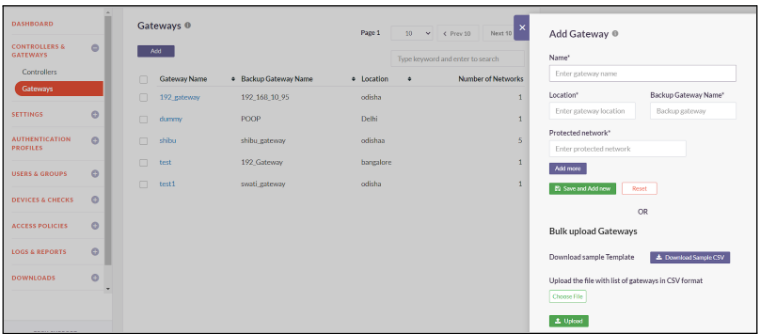

# Settings

Admin can configure global settings like Internal DNS & WINS server information, company banner, user activation policy, external SIEM etc. which is used or referred by InstaSafe solution. 

**Company Details**

Company Admin can populate informations like Company name, Company Address, logo, Access URL, Company banner, Business contact, Tech Contact and Renewal using this option.

1. Click on Settings -> Company Details
1. Enter Company Name, Secure Access Custom URL, Address and Company logo
1. Click on Save to save the company details
1. Add Business Contact, Tech Contact and Renewal Contact details
1. Admin can add multiple contacts

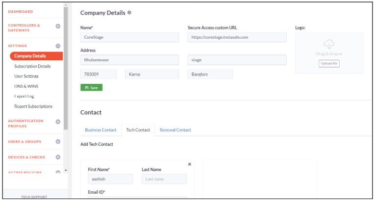

**Subscription Details**

This sub-options gives the InstaSafe subscription information of past and present. Through this sub-option, Admin can configure reminders to be sent via email informing upcoming InstaSafe subscription due. Admin can set subscription expiry reminder to 1 week, 2 week or 1 month prior to the subscription expiry. Any number of Emails can be set to receive the subscription expiry reminder.

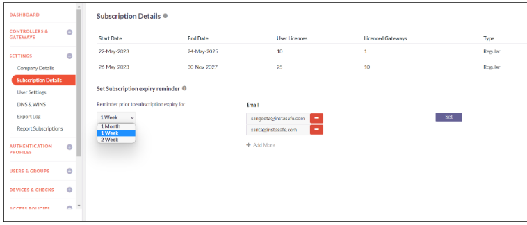

**User Settings**

InstaSafe Secure Access allows you to specify various settings for provisioned users. The guide below will assist you in managing these settings

1. Click on Settings -> User Settings
1. Active Users - Set the Activation Method
        -   Automatically on first login
        -   Immediately on provisioning
        -   on (Select the Activation Date and Time)
1. Inactive Users - Set the activity to be performed since the last login day of Inactive Users
        -   Warning
        -   Suspend
        -   Delete
1. Also Notify - Admin can set multiple emails to notify about the inactive users
1. Force User Disconnect - Admin can set the hours after which user will be forcibly disconnected
1. Admin can Bypass MFA for certain Public IPs and also Allow Direct Access from certain Public IPs
1. Idle Timeout - Specify the duration in minutes or hours after which idle users should get logged out

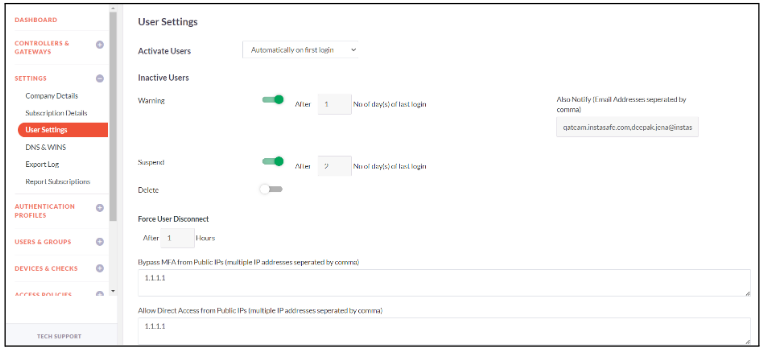

**DNS & WINS**

Admin can configure On-Premise DNS and WINS. InstaSafe solution propagates these settings to user devices and InstaSafe Gateways for name resolution.

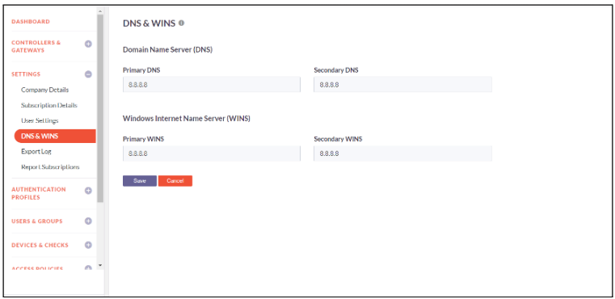

**Export Log**

Company Admin can configure SIEM server via this sub-options for InstaSafe to push the logs to the external SIEM servers like Splunk, QRadar, Syslog, Arcsight for consumption. The guide below will assist you to configure Export Log

1. Click on Settings -> Export Log -> Add
1. Populate the SIEM server name, IPs, Protocol, port and log type
1. Click on Save and Add New
1. Export Log configured successfully

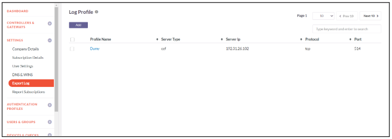

**Report Subscriptions**

Report subscription refers to an arrangement where an individual or organization signs up to receive regular reports or updates on a particular topic or area of interest. This subscription-based service ensures that subscribers receive relevant information on a recurring basis delivered through email. The guide below will assist you in scheduling report subscriptions

1. Click on Settings -> Report Subscriptions -> Add
1. Select the required reports that is to be scheduled
1. Select the frequency of the report email as Once, Daily, Weekly or Monthly
1. Schedule the date and time for the report to be send to email
1. Enter the Email Address to which report will be sent. Multiple Email Address can be entered separated by commas

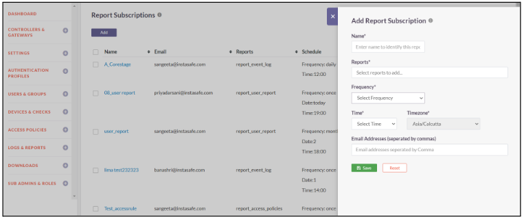

# Authentication Profiles

**LDAP Profile**

InstaSafe Secure Access (ISA) facilitates multi-directory support and allows you to make use of LDAP servers for the purpose of provisioning users in the ISA console. The guides below will assist you in creating an authentication profile to use LDAP servers for the purpose of provisioning and authenticating users

The guides below will assist you in creating a LDAP authentication profile

1. Click on Authentication Profiles -> LDAP Profile
1. Click on Add
1. Enter a custom Name for the profile
1. Select the Gateway
1. Enter Primary Server IP and Backup Server IP
1. Enter the Bind User and Bind User Password
1. Specify the Base DN and set the Filter
1. Select Authentication Type as Certificate or Password + Certs
1. Enter the Domain name and Port number of the LDAP server
1. Click on Save and Add New to add the LDAP Profile
1. LDAP profile added successfully

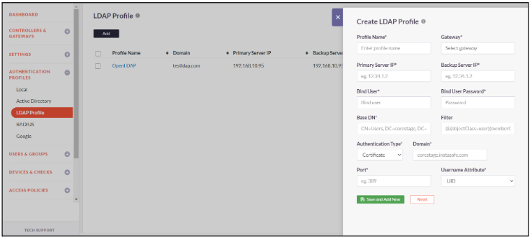

**Active Directory**

InstaSafe Secure Access (ISA) facilitates multi-directory support and allows you to make use of a corporate Active Directory for the purpose of provisioning users in the ISA console. The guides below will assist you in creating an authentication profile to use Active Directory servers for the purpose of provisioning and authenticating users.

1. The guides below will assist you in creating a Active Directory authentication profile
1. Click on Authentication Profiles -> Active Directory Profile
1. Click on Add
1. Enter a custom Name for the profile
1. Enter Domain name and select the Gateway
1. Enter Primary Server IP and Backup Server IP
1. Enter the Bind User and Bind User Password
1. Specify the Base DN and set the Filter
1. Enable toggle AD profile requires SSL/TSL secure connection
1. Enter Primary DNS Server IP, Secondary DNS Server IP, Primary WINS Server IP and Secondary WINS Server IP 
1. Select Authentication Type as Certificate or Password + Certs
1. Click on Save and Add New to add the AD Profile
1. AD profile added successfully

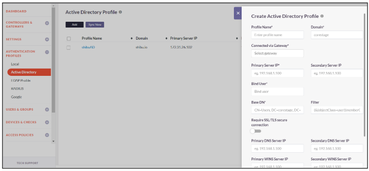

**Local**

InstaSafe Secure Access (ISA) allows you to provision users locally within the console itself, thus serving as an IAM. 

You can specify the password policy for the users following the guide below

- Click on Authentication Profiles -> Local
- Click on Edit to make changes the Local Profile Configuration
- Configure the profile password as per your requirement and click on Save
- Local Profile password policy updated successfully

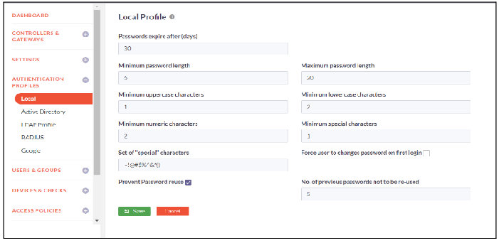

# Users and Groups

**Users**

A User is a person that has been provisioned in the InstaSafe Secure Access console through any of the authentication profiles.

The guides below will assist you with provisioning users locally in the console.

1. Click on Users & Groups -> Users
1. Click on Add to add a new user
1. Enter First Name, Last Name and Username for the new user
1. Enter Email ID and Mobile Number of the user
1. Select Activation Method from the dropdown
1. Immediately on provisioning
1. Automatically on first login
1. On date time
1. Set Password for the user
1. Select Authentication type from the dropdown
1. Certificate
1. Password + Certs
1. Toggle the Two Factor Authentication if you want to enable 2FA for the user
1. Add the user groups in Member of Groups to which the user will be added.
1. Toggle the button to Enable Device Checks in the group level
1. Select the device checks that you want to enable for the user group
1. Toggle the button to Enable Device Bind
1. Select the device that you want to bind to the user
1. Toggle the button to Enable GeoLocation
1. Select the list of countries from where users can login
1. Toggle the button to Enable Device updates
1. Select the device update that will be updated to the user
1. Click on Save and Add New
1. User added successfully

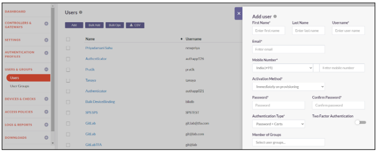

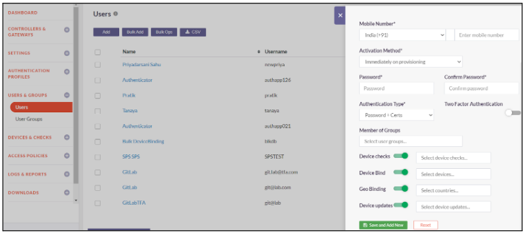

**User Groups**

Users in InstaSafe Secure Access can be logically grouped based on their roles in the organization. This makes it easier to administer security policies and define access rules.

The guides below will assist you with creating a new User Group.

1. Click on Users & Groups -> User Groups
1. To add a new user group, click on Add
1. Enter a group name and description
1. In users, select all the users that you want to add to the group
1. Toggle the button to Enable Two Factor Authentication in the group level 
1. Toggle the button to Enable Device Checks in the group level
1. Select the device checks that you want to enable for the user group
1. Toggle the button to Enable GeoLocation
1. Select the list of countries from where users can login
1. Toggle the button to Enable Device updates
1. Select the device update that will be updated to the user group
1. Click on Save and Add New
1. User Group created successfully

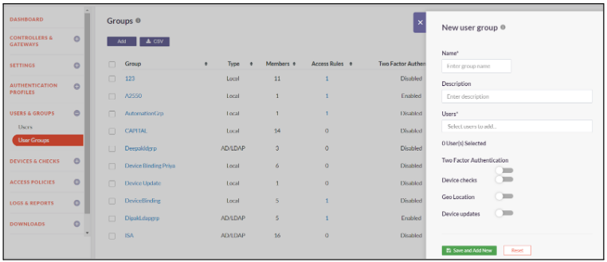

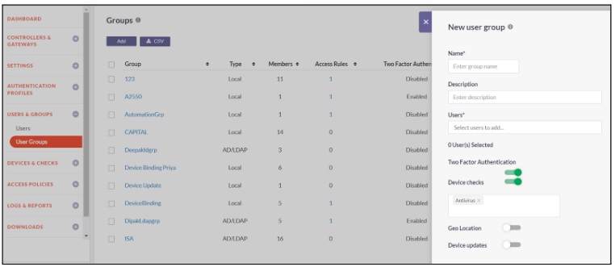

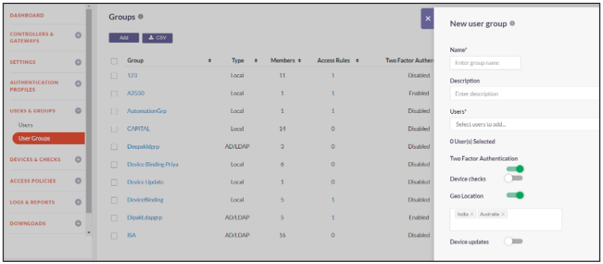

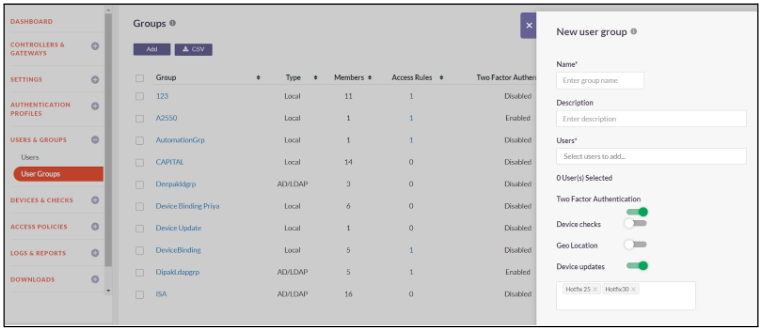

# Devices & Checks

**Device**

Instasafe Secure Access automatically captures certain device identification details when the User Agent is installed on an end-point. Using these parameters, it is possible to enforce ‘Device Binding’ on particular users. This would ensure that those users are limited to making use of only specific devices registered in the ISA console thus eliminating attacks due to stolen or shared passwords.

The guide below will assist you with manually registering user devices

1. Click on Devices & Checks -> Devices
1. Click on Add 
1. Enter a Name for the Device
1. Select the OS from the dropdown
1. Enter MAC Address, Serial Number and UUID (Universally Unique Identifier) of the device
1. Click on Save and Add New
1. Device registered successfully

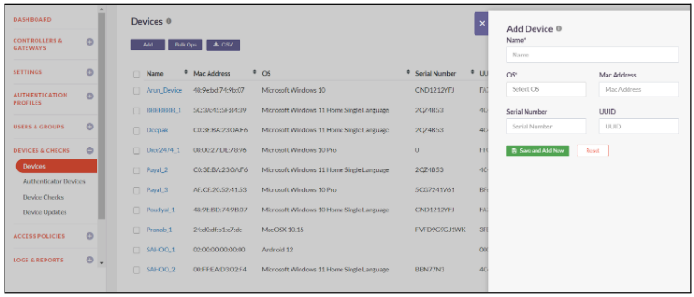

**Authenticator Devices**

Instasafe Authenticator App is a mobile application that generates one-time passwords (OTP) or authentication codes for two-factor authentication (2FA) purposes. This app provide an additional layer of security for online accounts by requiring users to provide both their regular password and a temporary code generated by the authenticator app.

InstaSafe Authenticator Devices provides information of the user and device on which the authenticator app is installed. It also provides the date and time of app installation. Admin can receive the csv file through email.

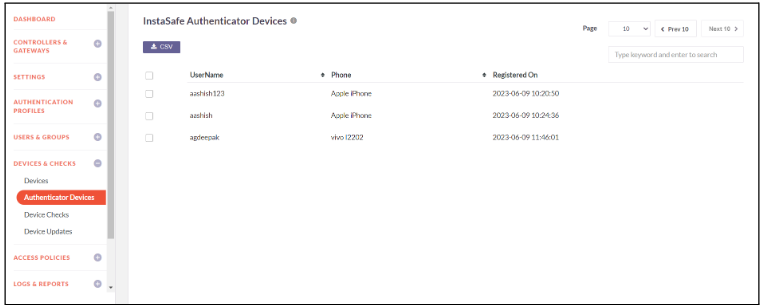

**Device Checks**

InstaSafe Secure Access allows you to define rules that would validate the devices for certain mandatory compliance which would govern whether or not the device is allowed to connect. Thus, non-compliant endpoints are prevented from connecting and accessing applications.

The guide below will assist you with creating a new Device Check rule.

1. Click on Devices & Checks -> Device Checks
1. Click on Add
1. Add a Rule Name and OS on which the device check rule will be applied
1. Select the Check to be enforced for the rule from the dropdown list
1. Enter the Check Value for the Check in the text box
1. Click on Save and Add New to create a device check rule
1. Device Check created successfully

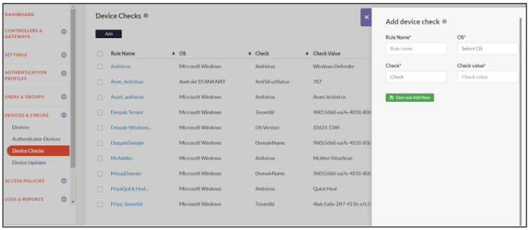

**Device updates**

Device Update is a feature in the ISA that allows users to apply updates, such as hotfixes or additional security layers, to their devices. It enables the creation and assignment of device updates to individual users or user groups. These updates, typically delivered in the form of MSI files, provide small changes, bug fixes, or security enhancements to improve the overall functionality and security of the ISA. Users can conveniently install these updates through the Device Update feature.

The following steps will assist you with creating a new Device Update Profile.

1. Click on the Devices & Checks ->Device Updates
1. Click on the Add Button
1. Enter the profile name
1. Select the required MSI file from your local system
1. Put argument as Zero(0) in the Argument field
1. Schedule the installation as per your convenience
1. Select Post Validation Check as “Registry Key Present”
1. Enter the valid path in the “post Validation Check value”
1. Keep the state as “Enabled”
1. Click on the “Save and Add New” button to successfully create a new Device Update profile 

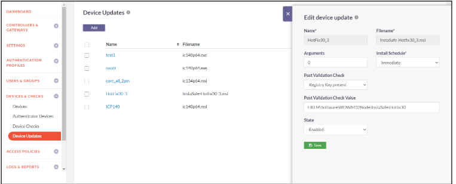

# Access Policies

**Access Rules**

Access control rules are used to allow access to specific Applications or Application Groups from particular Users or User Groups. These are identity based rules that permit access on the basis of the Role of the users in the organization as opposed to parameters like source IP address.

The guides below will assist you with creating a new Access Rule

1. Click on Access Policies-> Access Rules
1. Click on Add to add a rule
1. Enter a Name for the access rule
1. Select the Source Type from the dropdown. The source types are
         - User
         - User Group
         - Application
1. If Source Type is User, select users from the dropdown for whom you want to create access rule
1. If Source Type is User Group, select user groups from the dropdown for those you want to create access rule
1. If Source Type is Application, Enter the IP address/Network of the source application and choose the services that you want to enable for the Application.
1. Select the Destination Type from the dropdown. The destination types are
        - Application 
        - Application Group       
1. If Destination Type is Application, Enter the IP address/Network of the destination application and choose the services that you want to enable for the Application.
1. If Destination Type is Application Group, Enter the destination application groups.
1. Select Action you want to enforce on the access rule. Action can be Allow or Deny
1. Click on Save and Add New
1. New Access Rule created successfully

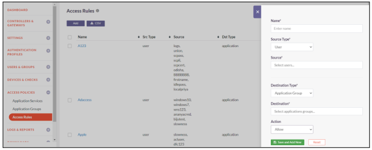

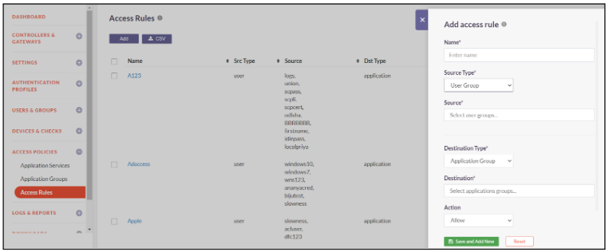

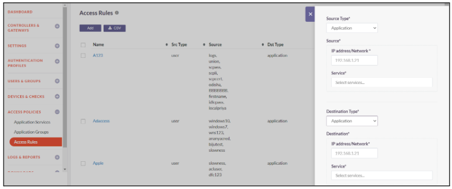

**Application Groups**

InstaSafe Secure Access allows you to add Application groups and the corresponding Application Services you wish to allow into Groups for ease of management and defining Access Rules. The guides below will assist you with creating a new Application Group.

The guide below will assist you with creating a new Application Group

1. Click on Access Policies -> Application Groups
1. Click on Add to add a new application group
1. Enter a custom Name
1. Enter the private IP address/Network of the application server that you want to add to this new group
1. Select the Application Service you want to allow for this application server
1. Click on Add More to add more applications server to the Application group
1. Click on Save and Add New to create a new application Group
1. Application Group created successfully

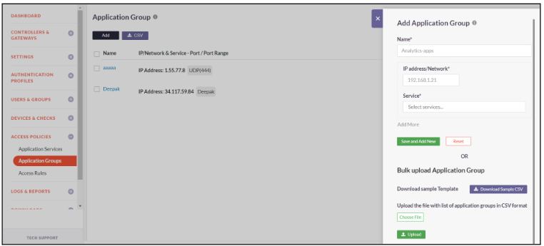

**Application Services**

Application Services are simply a way of defining the kind of interactions you wish to allow to your Application Servers by means of TCP/UDP ports.

The guides below will assist you with creating a new Application Service

1. Click on Access Policies -> Application Service
1. Click on Add to add new application service
1. Enter a custom Name
1. Select the Protocol type and the Port number
1. Click on Save and Add New
1. Application Service added successfully

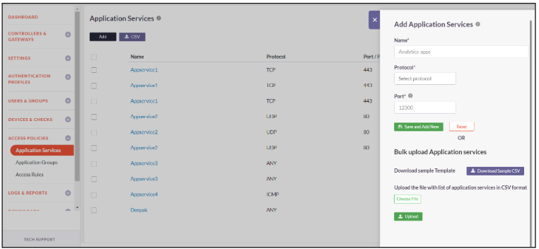

# Logs and Reports

InstaSafe Secure Access allows you to conveniently access comprehensive on-demand information regarding historic and current user activity as well as other records with the help of several log files and also generate extensive reports in various formats for a time frame of your specification.

**Live Users**

This Report displays all the users currently connected to the InstaSafe controller via the InstaSafe User Agent installed in their device (windows, macOs, Linux, Android).

The Report provides user details such as username (login id), user group he/she belongs to, Login time, end point public IP address and Private IP address installed by InstaSafe solution.

The displayed report can be downloaded as a csv file for offline use by clicking CSV button.

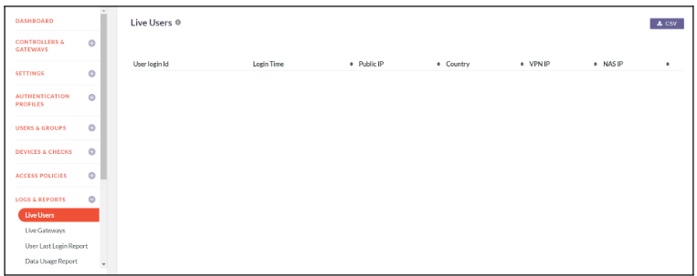

**Live Gateways**

This Report displays the currently connected InstaSafe Gateways to the InstaSafe controller.

The report provides details such as Gateway Name, time when gateway connected to InstaSafe Controller, Gateway public IP and Private IP address installed by InstaSafe solution.

The displayed report can be downloaded as a csv file for offline use by clicking CSV button

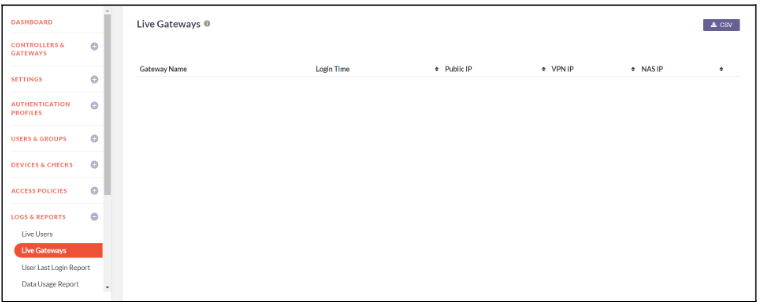

**User Last Login Report**

This Report displays the last login date and time of all the users.

The displayed report can be downloaded as a csv file for offline use by clicking CSV button.

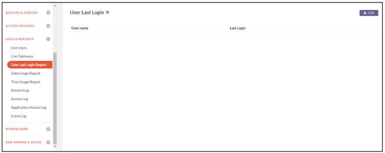

**Data Usage Report**

This Report displays the Users and Gateway Data usage information like data received & data transmitted.

This information can be obtained for the following duration: Today, Week, Month or by providing a Date Range. The displayed report can be downloaded as a csv file for offline use by clicking CSV button.

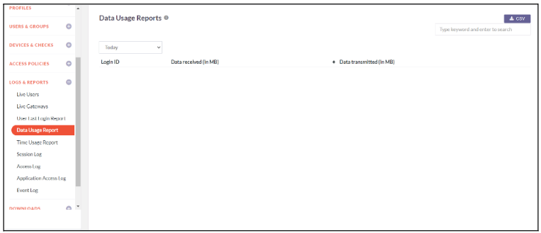

**Time Usage Report**

This Report displays the connection duration of the Users and Gateway to InstaSafe Controller.

This information can be obtained for the following duration: Today, Week, Month or by providing a Date Range. The displayed report can be downloaded as a csv file for offline use by clicking CSV button.

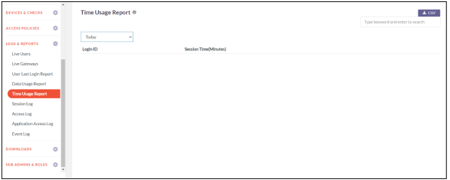

**Session Log**

This Report displays the User and Instasafe Gateway session details like username, Login-time, Logout-time, Public IP, ISA IP, Upload data and Download Data.

This information can be obtained for the following duration: Today, Week, Month or by providing a Date Range. The displayed report can be downloaded as a csv file for offline use by clicking CSV button.

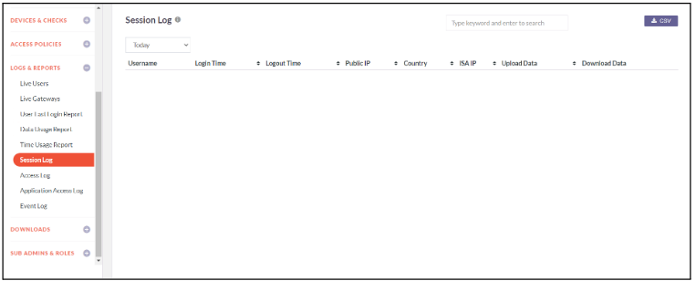

**Access Log**

This Report displays Portal Access information like user name, the portal resources this user accessed and when.

This information can be obtained for the following duration: Today, Week, Month or by providing a Date Range. The displayed report can be downloaded as a csv file for offline use by clicking CSV button.

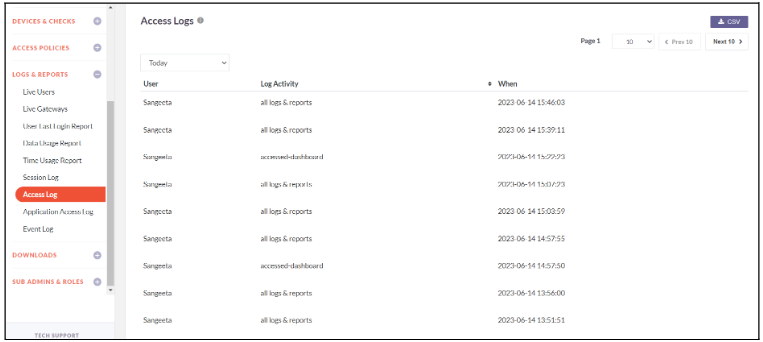

**Application Access Log**

This Report displays the Application(s) that the user(s) is accessing and have been accessed. The report gives information like username, users source IP, Application's IP address, Port and Protocol and the date when the user accessed this application.

This information can be obtained for the following duration: Today, Week, Month or by providing a Date Range. The displayed report can be downloaded as a csv file for offline use by clicking CSV button.

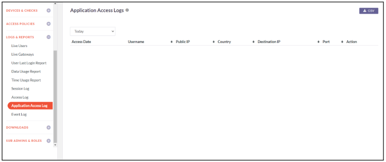

**Event Log**

This Report displays Events like gateway addition/deletion, restarting controller, users added/delete etc.

This information can be obtained for the following duration: Today, Week, Month or by providing a Date Range. The displayed report can be downloaded as a csv file for offline use by clicking CSV button.

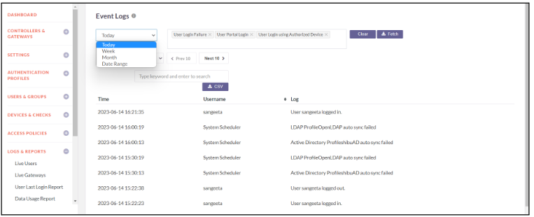

# Downloads

**User Agent**

A User Agent is a lightweight software client that must be installed on the endpoint devices and allows users to request access to applications. The Agent will connect you to the appropriate applications only after the multitude of security checks have been carried out to authenticate and authorize both user and device.

The guides below will assist you with creating a new User Agent

1. Click on downloads -> User Agents
1. Search for the required user
1. According to the OS of the user, download the appropriate User Agent
1. User agent downloaded successfully

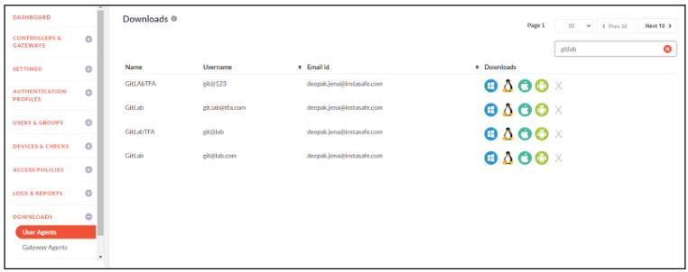

**Instasafe Gateway Agent**

The InstaSafe Gateway Agent is a lightweight software agent that sits in front of your on-premise or cloud hosted applications.

The below steps will assist you with downloading the appropriate Gateway Agent.

1. Login to the console
1. Click on downloads -> Gateway Agents
1. Select the required Gateway Name
1. Download the Gateway Agent as per the required Operating System i.e. Linux/Windows/Mac
1. Gateway Agent downloaded successfully.

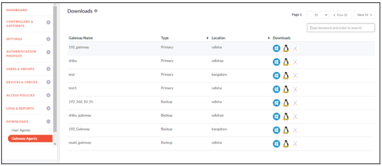

# Sub Admins and Roles

**Sub Admin Roles**

Sub-Admins roles are configured to do a particular activity and have limited access. The access could be defined by the Company Admins and  can be controlled with certain level of authorization depending on Read or Write of any sections like User, Application, ACL, Controller, Gateway.

1. Click on Sub Admins and Roles -> Sub Admin Roles
1. Click on Add
1. Enter a custom role name and select the rights to be provided for the role
1. Click on Save and Add New to successfully add the role

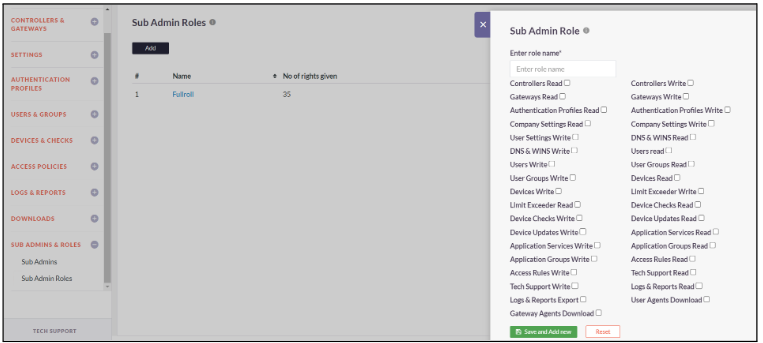

**Sub Admins**

Sub admins are users provisioned in the InstaSafe Secure Access console that can be given certain elevated privileges to the console in order to perform specific tasks. The below steps will assist you in providing the sub admin role to a user

1. Click on Sub Admins and Roles -> Sub Admin
1. Click on Add
1. Select the User from the dropdown
1. Select Type as Sub Admin and the Select Role
1. Click on Save and Add New to successfully add a Sub Admin

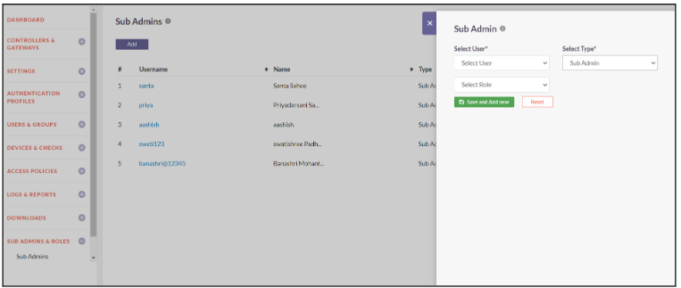

