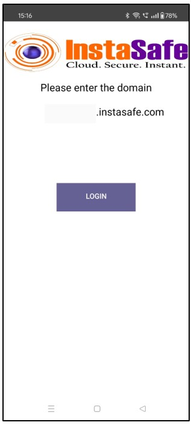
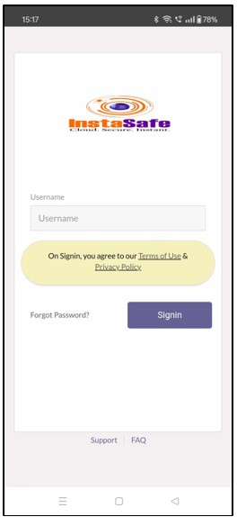
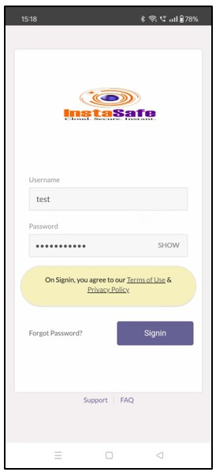
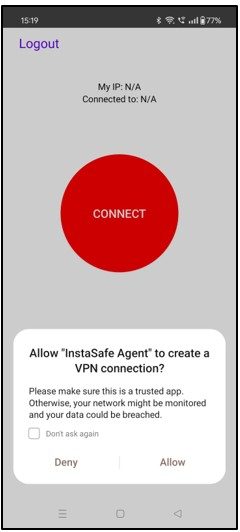
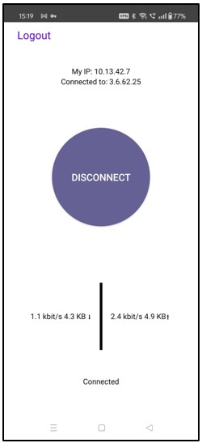

# **ISA Agent Download and Installation**

## **Install the ISA Agent (MSI) on Microsoft Windows**

This Article provides guidance on how to install the ISA Agent (MSI) on Windows.

  **Step 1: Install the ISA Agent**

The Administrators of organization's InstaSafe Secure Access (ISA) account will provide you with the MSI package to install the ISA App along with the appropriate credentials to be used. Run the ‘InstaSafe-Agent.msi’ file by simply double-clicking it.

  **Step 2: Configure the ISA Agent**

Once the installation is complete, locate the InstaSafe Folder. Windows 64 Bit path: C:\Program Files (x86)\InstaSafe\ Windows 32 Bit path: C:\ProgramFiles\InstaSafe\ Navigate to the ‘bin’ folder. Right click the file ‘clientconfig.exe’, and select 'Run as Administrator' 

You would now be prompted to enter the Login URL unique to your company. This would typically be <>.instasafe.com where <> would be replaced by organization's name as provisioned in the ISA portal. In case of any clarifications needed with regards to this, please reach out to the Admins of your organization.

In case Two Factor Authentication has been configured, an OTP will be sent to your registered email ID and mobile number which would need to be entered in order to proceed.

A pop-up window appears informing that the InstaSafe Agent installation is complete and to start InstaSafe Agent. Click on OK to close the window.

**Step 5: Connect the ISA Agent**

A shortcut named 'InstaSafe Agent' would get created on the desktop. 

Double click and run, to launch the ISA Agent. 

Depending on the 'Authentication Type' selected by the Admins, users might be prompted to enter their credentials in order to connect the ISA Agent. Enter your credentials once again and click on OK. 

In case Two Factor Authentication has been configured, an OTP will be sent to your registered email ID and mobile number which would need to be entered in order to proceed. This would need to be repeated each time you wish to connect.

Once successfully connected, a pop-up appears with the message that the agent is connected, displaying the IP address assigned to your connection. You will now be able to access the resources made available to you using either their IP addresses or NetBIOS names. 

Double click the icon to bring up the real time connection status.
The real time connection status display several logs that are useful for troubleshooting any issues that might crop up.

With the ISA App connected, you should now be able to access your organization's internal applications as per the Access Policies defined. 

The resources that can be accessed by the user can be viewed in the routing table. Here is an example of the Windows routing table. 

It is expected that the Admins of the organization provide all users a list of their individual network entitlements, the respective FQDNs/IP Addresses of the application servers and their login details. 

In case you are unable to install the ISA App by following these steps, please contact your organization's IT Team If you are an Admin of the organization's ISA Account and need assistance, contact [InstaSafe Support](https://support.instasafe.com/portal/en/signin).

**Install the ISA Agent on Microsoft Windows**

The below steps provide guidance on how to install the ISA Agent on Windows.

The ISA App is unique to every organization. The windows installer for an organization would only work for users provisioned in that specific ISA Account. Elevated Admin Privileges along with internet access would be required at the time of installation.

**Step 1:** Login to the ISA Portal

Once the Administrators of your organization provision your User Profile in the InstaSafe Secure Access (ISA) Management Console, a Welcome Email would be sent on your registered email ID. Click on ‘Company Signin’.

The ISA portal (https://<>.instasafe.com) specific to your organization would open up. You could make use of the credentials provided by your organization's Admins to login to the portal. 

In case Two Factor Authentication has been configured, an OTP will be sent to your registered email ID and mobile number which would need to be entered in order to proceed. 

Depending on the type of deployment setup opted for by the organization, these credentials may either be the Domain Credentials (synced with the corporate IAM) or created locally in the ISA Management Console by the Admins. In some cases, the Admins might even allow users to set their own ISA passwords. In this case, users would receive an email through which they could set their own passwords, in addition to the regular 'welcome email'. It is expected that the Admins convey this information to all users of the organization that would be making use of the ISA solution. Users that are locally provisioned can change their passwords within the ISA portal once logged in.

**Step 2:** Download the ISA User Agent

Once logged in, non-admin users are presented with a web page featuring download options for different operating systems. Click on Download Section then the Microsoft Windows icon to download the agent software.

Save the file to your local drive and double-click to begin the installation process. 

In some cases, the Admins might silently deploy and install the ISA App on the end-points using GPOs or an SCCM. In such a scenario, users might only be required to configure the ISA App with their credentials on their respective devices. However, that is out of scope for this guide.

**Step 3:** Install the ISA Agent

Run the downloaded executable file (as Administrator)

At the InstaSafe End-user Subscription Agreement window, please read the agreement. To proceed further, you need to click on the I Agree button. In case you do not agree on the agreement, please click the Cancel button to exit the installation.

Click on ‘Close’ once the installation is complete.

**Step 4:** Configure the ISA Agent

On clicking Close, you will be prompted to enter your credentials. These must be the same that was entered when downloading the installation file. Click on Submit.

In case Two Factor Authentication has been configured, an OTP will be sent to your registered email ID and mobile number which would need to be entered in order to proceed.

A pop-up window appears informing that the InstaSafe Agent installation is complete and to start InstaSafe Agent. Click on OK to close the window.

**Step 5:** Connect the ISA Agent

A shortcut named 'InstaSafe Agent' would get created on the desktop. 

Double click and run, to launch the ISA Agent. 

Depending on the 'Authentication Type' selected by the Admins, users might be prompted to enter their credentials in order to connect the ISA Agent. Enter your credentials once again and click on OK. 

In case Two Factor Authentication has been configured, an OTP will be sent to your registered email ID and mobile number which would need to be entered in order to proceed. This would need to be repeated each time you wish to connect.

Once successfully connected, a pop-up appears with the message that the agent is connected, displaying the IP address assigned to your connection. You will now be able to access the resources made available to you using either their IP addresses or NetBIOS names. 

Double click the icon to bring up the real time connection status.
The real time connection status display several logs that are useful for troubleshooting any issues that might crop up.

With the ISA App connected, you should now be able to access your organization's internal applications as per the Access Policies defined. 

The resources that can be accessed by the user can be viewed in the routing table. Here is an example of the Windows routing table. 

It is expected that the Admins of the organization provide all users a list of their individual network entitlements, the respective FQDNs/IP Addresses of the application servers and their login details. 

In case you are unable to install the ISA App by following these steps, please contact your organization's IT Team If you are an Admin of the organization's ISA Account and need assistance, contact [InstaSafe Support](https://support.instasafe.com/portal/en/signin).

## **Install the ISA Agent on macOS**

The below steps provide guidance on how to install the ISA Agent on macOS.

**Step 1:** Login to the ISA Portal

Once the Administrators of your organization provision your User Profile in the InstaSafe Secure Access (ISA) Management Console, a Welcome Email would be sent on your registered email ID. Click on ‘Company Signin’.

The ISA portal (https://<>.instasafe.com) specific to your organization would open up. You could make use of the credentials provided by your organization's Admins to login to the portal.

In case Two Factor Authentication has been configured, an OTP will be sent to your registered email ID and mobile number which would need to be entered in order to proceed.

Depending on the type of deployment setup opted for by the organization, these credentials may either be the Domain Credentials (synced with the corporate IAM) or created locally in the ISA Management Console by the Admins. In some cases, the Admins might even allow users to set their own ISA passwords. In this case, users would receive an email through which they could set their own passwords, in addition to the regular 'welcome email'. It is expected that the Admins convey this information to all users of the organization that would be making use of the ISA solution. Users that are locally provisioned can change their passwords within the ISA portal once logged in.

**Step 2:** Download the ISA Agent 

Once logged in, you can download the respective installation file depending on your device OS. This guide focuses on the macOS Installation of the ISA Agent. 

Click on 'MacOS' to download the dmg file of the ISA Agent.

**Step 3:** Install the ISA Agent

Click on the agent which gets downloaded in Downloads Folder

The end user must thoroughly read the agreement and click 'Agree' to proceed with the installation process.

A volume (DMG) appears on the dashboard. Inside the volume (DMG), there are two applications:

a) InstaSafe Agent - This is the agent which, when clicked, leads to the installation of the agent, followed by the connection of the agent.

b) Uninstall Instasafe - This is used to uninstall the previous agent present on the end user's system.
Double click the file InstaSafe.dmg in the new window that opens up and enter your local system administrator account credentials if prompted. 

Double click on the InstaSafe agent for the installation process.

Enter the system credentials

Click on ‘Launch’

Click on ‘Setup now’

Enter the url which should be in format “company.instasafe.com”

The web client appears. Enter the valid username. If the username is valid, the password placeholder will appear. Enter the valid password, then click on the "Sign In" button.

A prompt will appear stating "Installation Success". This indicates that the InstaSafe agent has been successfully installed on the end user's system.

**Step 4:** Connect the ISA Agent

Instasafe Agent can be seen in “Menu bar” 

Right Click on the agent and select “Connect iperf”

Enter the admin credentials

The web client appears. Enter the valid username and password and click on ‘sign in’.

The agent UI starts to connect. You can confirm this when you see the agent UI quickly changing color from white to red and then to white. Wait for sometime for the agent to get connected.

The agent UI will turn to green which indicated that the agent is connected and notification will pop up saying “name of the tenant is now connected”

With the ISA Agent connected, you should now be able to access your organization's internal applications as per the Access Policies defined. 

It is expected that the Admins of the organization provide all users a list of their individual network entitlements, the respective FQDNs/IP Addresses of the application servers and their login details.

In case you are unable to install the ISA Agent by following these steps, please contact your organization's IT Team If you are an Admin of the organization's ISA Account and need assistance, contact InstaSafe Support.

## **Install the ISA Agent on Linux (CLI)**

_Prerequisites for Installation_

1. The User must have sudo access to the system in order to install the ISA Agent
1. During installation, the system should have access to the InstaSafe libraries and Linux repositories/mirrors so that the relevant packages could be downloaded over the internet
1. It is recommended to carry out an 'apt update' or 'yum check-update' depending on the Linux distro used, in order to download and update package information from all configured sources 
1. The 'Authentication Type' for the user profile must be set to 'Certificate' in the Admin Management Console in order for the ISA Agent to connect as expected

_Note_

1. The Linux installation file of the ISA Agent is unique to every user profile, unlike Windows, Android or iOS where the installer is common across all users of the organization
1. It would not be possible to login to the ISA Portal from the Linux CLI, even via a command-line web browsing tool like 'link' or 'lynx'. The end-user would need to login to the ISA Portal from a computer with a graphical interface, download the Linux installation file and transfer it to the Linux CLI system

**Step 1:** Login to the ISA Portal

Once the Administrators of your organization provision your User Profile in the InstaSafe Secure Access (ISA) Management Console, a Welcome Email would be sent on your registered email ID. Click on ‘Company Signin’.

The ISA portal (https://<<company>>.instasafe.com) specific to your organization would open up. You could make use of the credentials provided by your organization's Admins to login to the portal.

In case Two Factor Authentication has been configured, an OTP will be sent to your registered email ID and mobile number which would need to be entered in order to proceed.

Depending on the type of deployment setup opted for by the organization, these credentials may either be the Domain Credentials (synced with the corporate IAM) or created locally in the ISA Management Console by the Admins. In some cases, the Admins might even allow users to set their own ISA passwords. In this case, users would receive an email through which they could set their own passwords, in addition to the regular 'Welcome email'. 

It is expected that the Admins convey this information to all users of the organization that would be making use of the ISA solution.
Users that are locally provisioned can change their passwords within the ISA portal once logged in.

**Step 2:** Download the ISA Agent

Once logged in, you can download the respective installation file depending on your device OS. This guide focuses on the Linux CLI Installation of the ISA Agent.

Click on 'Linux' to download the Linux executable file (shell script) of the ISA Agent. Once downloaded, the installation file could be transferred to the target Linux CLI system.

The installation file for Linux is unique to every user, and tied to the user profile. The installer downloaded for one user must not be used for installation by another user.

**Step 3:** Install the ISA Agent

Locate the Linux installation file (shell script) of the ISA Agent 

Type in the command "sudo sh <filename>.sh" without the inverted commas and replace <filename> with the name of the downloaded shell script file

Then hit 'Enter'. You may be prompted for sudo credentials in order to proceed with the installation.

Once completed, you should receive the message 'Installation Complete'.

**Step 4:** Connect the ISA Agent

The ISA Agent will connect automatically. The InstaSafe Logs can be viewed by entering the command "sudo cat /var/log/instasafe*" without the inverted commas in Terminal. These logs indicate the connection status and are useful for troubleshooting any issues that might crop up.

The 'Certificate' Authentication Type would permit the ISA Agent to connect automatically every time the system boots up.

The InstaSafe IP assigned can be checked by using the "ifconfig" command.

With the ISA Agent connected, you should now be able to access your organization's internal applications as per the Access Policies defined.

It is expected that the Admins of the organization provide all users a list of their individual network entitlements, the respective FQDNs/IP Addresses of the application servers and their login details.

In case you are unable to install the ISA Agent by following these steps, please contact your organization's IT Team.

If you are an Admin of the organization's ISA Account and need assistance, contact [InstaSafe Support](https://support.instasafe.com/portal/en/signin).

**Installing the ISA Agent on Linux (GUI)**

_Prerequisites for Installation_

1. Users must have sudo access to the system in order to install the ISA Agent
1. During installation, the system should have access to the InstaSafe libraries and Linux repositories/mirrors so that the relevant packages could be downloaded over the internet
1. It is recommended to carry out an 'apt update' or 'yum check-update' depending on the Linux distro used, in order to download and update package information from all configured sources.

_Note_

1. The Linux installation file of the ISA Agent is unique to every user profile, unlike Windows, Android or iOS where the installer is common across all users of the organization
1. The ISA Agent GUI for Linux is presently available only for Ubuntu

**Step 1:** Login to the ISA Portal

Once the Administrators of your organization provision your User Profile in the InstaSafe Secure Access (ISA) Management Console, a Welcome Email would be sent on your registered email ID. Click on ‘Company Signin’.

The ISA portal (https://<<company>>.instasafe.com) specific to your organization would open up. You could make use of the credentials provided by your organization's Admins to login to the portal.

In case Two Factor Authentication has been configured, an OTP will be sent to your registered email ID and mobile number which would need to be entered in order to proceed.

Depending on the type of deployment setup opted for by the organization, these credentials may either be the Domain Credentials (synced with the corporate IAM) or created locally in the ISA Management Console by the Admins. In some cases, the Admins might even allow users to set their own ISA passwords. In this case, users would receive an email through which they could set their own passwords, in addition to the regular 'Welcome email'. 

It is expected that the Admins convey this information to all users of the organization that would be making use of the ISA solution.

Users that are locally provisioned can change their passwords within the ISA portal once logged in.

**Step 2:** Download the ISA Agent

Once logged in, you can download the respective installation file depending on your device OS. This guide focuses on the Linux GUI Installation of the ISA Agent.

Click on 'Linux' to download the Linux executable file (shell script) of the ISA Agent

The installation file for Linux is unique to every user, and tied to the user profile. The installer downloaded for one user must not be used for installation by another user.

**Step 3:** Install the ISA Agent

Locate the downloaded Linux shell script in File Manager

Right Click anywhere in the open File Manager window and click 'Open in Terminal'

In the Terminal window that opens up, type in the command "sudo sh <filename>.sh" without the inverted commas and replace <filename> with the name of the downloaded shell script file
Then hit 'Enter'. You may be prompted for sudo credentials in order to proceed with the installation

Once completed, you should receive the message 'Installation Complete'

**Step 4:** Connect the ISA Agent

Go to Applications and double click 'InstaSafe Agent' to launch the ISA Agent.

An UI opens up, click on 'Connect’.

Depending on the Authentication Type configured for your profile in the InstaSafe Management Console by your organization's Admins, you may or may not be prompted for Authentication. This guide focuses on the 'Password + Certs' Authentication Type that would prompt for Authentication in order to connect the ISA Agent

Enter your credentials (same as the one used to login to the ISA portal) in the window that pops-up

In case Two Factor Authentication has been configured, an OTP received on your registered email ID and mobile number would need to be entered

Once the Authentication is successfully completed, the ISA Agent will Connect.

The InstaSafe logs can be viewed by entering the command "sudo cat /var/log/instasafe*" without the inverted commas in Terminal. These logs indicate the connection status and are useful for troubleshooting any issues that might crop up

The InstaSafe IP assigned can be checked by using the "ifconfig" command in Terminal

With the ISA App connected, you should now be able to access your organization's internal applications as per the Access Policies defined

It is expected that the Admins of the organization provide all users a list of their individual network entitlements, the respective FQDNs/IP Addresses of the application servers and their login details

In case you are unable to install the ISA Agent by following these steps, please contact your organization's IT Team

If you are an Admin of the organization's ISA Account and need assistance, contact [InstaSafe Support](https://support.instasafe.com/portal/en/signin)

## **Install the ISA iOS App**

**Step 1:** Login to the ISA Portal

Once the Administrators of your organization provision your User Profile in the InstaSafe Secure Access (ISA) Management Console, a Welcome Email would be sent on your registered email ID. Click on ‘Company Signin’.

The ISA portal (https://<<company>>.instasafe.com) specific to your organization would open up. You could make use of the credentials provided by your organization's Admins to login to the portal.

In case Two Factor Authentication has been configured, an OTP will be sent to your registered email ID and mobile number which would need to be entered in order to proceed.

Depending on the type of deployment setup opted for by the organization, these credentials may either be the Domain Credentials (synced with the corporate IAM) or created locally in the ISA Management Console by the Admins. In some cases, the Admins might even allow users to set their own ISA passwords. In this case, users would receive an email through which they could set their own passwords, in addition to the regular 'welcome email'. 

It is expected that the Admins convey this information to all users of the organization that would be making use of the ISA solution.

Users that are locally provisioned can change their passwords within the ISA portal once logged in.

**Step 2:** Download the ISA App

Once logged in, you can download the ISA Agent depending on your device OS. This guide focuses on the installation of the ISA iOS App.

Clicking on 'iOS' will direct you to the Apple App Store page of the ISA App. The link for this is 

In some cases, the Admins might silently deploy the ISA App across company owned devices with the help of a Mobile Device Management solution and we can skip directly to Step 4.

**Step 3:** Install the ISA App

Click on ‘Get’ to download of the ISA App

Click on Install to begin installation of the ISA App

Once installed, Click on Open 

Read the **Terms and Conditions** and click on Accept

**Step 4:** Configure the ISA App

In order to configure the ISA App with a particular user profile, the following details need to be entered

- Domain: <<company>> which is part of the ISA portal URL for you organization
- Username: same as the username used to login to the ISA portal
- Password: same as the password used to login to the ISA portal

Enter the domain and click on Login

Enter the username and password and click on 'Signin'

After login, click on Connect

Enter the password and click on Submit to connect the ISA Agent

The ISA Agent is now connected

'Comapany' and 'Username' fields are case sensitive. Kindly contact the Admin of your organization's ISA account in case the credentials provided don't work.

In case Two Factor Authentication has been configured, an OTP will be sent to your registered email ID and mobile number which would need to be entered in order to proceed.

**Step 5:** Connect the ISA App

Once logged in, you can connect the ISA App

With the ISA App connected, you should now be able to access your organization's internal applications as per the Access Policies defined.

Depending on the 'Authentication Type' selected by the Admins, you might be prompted to enter your credentials in order to connect the ISA App during subsequent connection attempts.

In case Two Factor Authentication has been configured, an OTP will be sent to your registered email ID and mobile number which would need to be entered.

This would need to be repeated each time you wish to connect.

It is expected that the Admins of the organization provide all users a list of their individual network entitlements, the respective FQDNs/IP Addresses of the application servers and their login details.

In case you are unable to install the ISA App by following these steps, please contact your organization's IT Team.
If you are an Admin of the organization's ISA Account and need assistance, contact [InstaSafe Support](https://support.instasafe.com/portal/en/signin)

## **Install the ISA Android App**

**Step 1:** Login to the ISA Portal

Once the Administrators of your organization provision your User Profile in the InstaSafe Secure Access (ISA) Management Console, a Welcome Email would be sent on your registered email ID. Click on ‘Company Signin’.

The ISA portal (https://<<company>>.instasafe.com) specific to your organization would open up. You could make use of the credentials provided by your organization's Admins to login to the portal.

In case Two Factor Authentication has been configured, an OTP will be sent to your registered email ID and mobile number which would need to be entered in order to proceed.

Depending on the type of deployment setup opted for by the organization, these credentials may either be the Domain Credentials (synced with the corporate IAM) or created locally in the ISA Management Console by the Admins. In some cases, the Admins might even allow users to set their own ISA passwords. In this case, users would receive an email through which they could set their own passwords, in addition to the regular 'welcome email'.

It is expected that the Admins convey this information to all users of the organization that would be making use of the ISA solution.

Users that are locally provisioned can change their passwords within the ISA portal once logged in.

**Step 2:** Download the ISA App

Once logged in, you can download the ISA App depending on your device OS. This guide focuses on the installation of the ISA Android App.

Clicking on 'Android' will direct you to the Google Playstore page of the ISA Android App. The link to download the app fron Playstore [Android App](https://play.google.com/store/search?q=instasafe+isa+agent&c=apps)

In some cases, the Admins might silently deploy the ISA App across company owned devices with the help of a Mobile Device Management solution and we can skip directly to Step 4.

**Step 3:** Install the ISA App

Click on ‘Install’ to begin installation of the ISA App.

Once the ISA App is Installed and launched, click on "Allow' to grant the required permissions.

Without granting these permissions, the app may not function normally. In case this step is missed for some reason, you can always grant these permissions at a later stage from within the App settings.

**Step 4:** Configure the ISA App

- Enter the <<company>> which is part of the ISA portal URL for you organization

Click on 'Login'

Enter the username and password

- Username: same as the username used to login to the ISA portal

- Password: same as the password used to login to the ISA portal

'Company' and 'Username' fields are case sensitive. Kindly contact the Admin of your organization's ISA account in case the credentials provided don't work.

In case Two Factor Authentication has been configured, an OTP will be sent to your registered email ID and mobile number which would need to be entered in order to proceed.

**Step 5:** Connect the ISA App

Once the authentication has been successfully completed, you will be taken to the connect page.

Click on the 'Connect' option. Android Security throws up a routine warning message whenever a VPN App tries to connect. 

Click on 'OK' to allow the connection

Once successfully connected, 'Connected!' will be displayed.

With the ISA App connected, you should be able to access your organization's internal applications as per the Access Policies defined.

Depending on the 'Authentication Type' selected by the Admins, you might be prompted to enter your credentials in order to connect the ISA App during subsequent connection attempts.

In case Two Factor Authentication has been configured, an OTP will be sent to your registered email ID and mobile number which would need to be entered.

This would need to be repeated each time you wish to connect.

It is expected that the Admins of the organization provide all users a list of their individual network entitlements, the respective FQDNs/IP Addresses of the application servers and their login details.

In case you are unable to install the ISA App by following these steps, please contact your organization's IT Team.

If you are an Admin of the organization's ISA Account and need assistance, contact [InstaSafe Support](https://support.instasafe.com/portal/en/signin)

