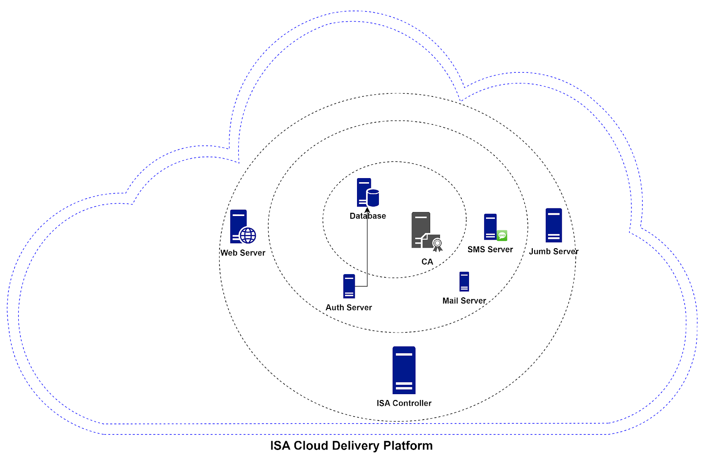
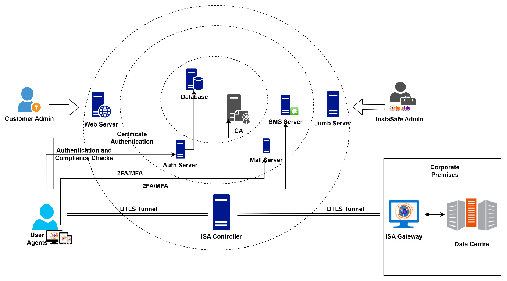

# InstaSafe Cloud Delivery Platform

**InstaSafe Cloud**

InstaSafe Cloud provides options to configure, authenticate, monitor and provide access control. InstaSafe Controller comprises multiple components that is explained below.

**Controller**

InstaSafe Controller is one of the key modules in the InstaSafe Cloud infrastructure that enforces access control for network connectivity. It is also the central point to which InstaSafe User Agent and Gateway Agent establish independent DTLS tunnels. It enforces policies and accepts/denies application access based on the configured policies. 

The Controllers are provisioned in multiple cloud providers in various geo locations. The Controllers are strategically placed as close as possible to customer premises to ensure minimum latency Each tenant requires the provisioning of one or more Controllers. 

The Controller IP and the port number is pushed to the ISA Agent in the configuration file, after authentication and compliant checks are successfully completed.  In the context of ISA User Agents, the Controller's role commences after the User Agent successfully completes authentication, Geo Location check, Device Binding check, Device Check, and secondary authentication, such as 2FA/MFA. 

The Controller listens on the IP address and the TCP or UDP port for tunnel establishment requests. The ISA Agents initiates the connection to the Controller and the Controller identifies the organization based on the signature in the first UDP packet it receives and proceeds to establish the tunnel. 

The Controller is responsible for tasks such as: 

- Allocate IP addresses and routes to the ISA User Agent.
- Route data between the Agent and the private network
- Enforce security policies.

**Web Portal**

The web server consists of two subcomponents: the Web service and the API service. These services both listen on 443 for HTTPS connections for the published tenant portal, tenant name.instasafe.com. InstaSafe admins, company admins, and users log into the web portal and they can perform authorized operations based on their roles.

The policies configured on the portal get pushed to the database for future use and to tenant controllers for immediate application. The API service provides authentication and authorization assistance for the Agent. 

As a first step of the connection establishment phase, InstaSafe Agent connects to the API server to establish mutual trust between the Agent and the InstaSafe Cloud. The TLS certificates and static key files generated when the User Agent is downloaded will be used by the Agent for authentication and verification. The API server verifies the Agent by examining the client certificate, and the Agent validates the InstaSafe server certificate using the CA certificate contained in the configuration file. 

For Authentication type set to Cert + Password, credentials are sent to the API server. If the user belongs to the local database, the user is authenticated by the API server. If the user belongs to Active Directory (AD) the credentials are forwarded to the AD for authentication. The API server verifies the Agent device for compliance checks, such as Geo Binding, Device Binding, Device Checks, and multi-factor authentication. 

Once these verifications are successful, the IP address and port number of the Controller is inserted into the Agent configuration file. The Agent establishes a DTLS tunnel with the Controller’s IP address and port number. 

The web portal administrator can perform the following in the web portal:

1. Add users and user group 
1. Configure authentication and device compliance checks on the user or user group profile. 
1. Create access rules.
1. Set up reporting profiles.
1. Monitor the status of connections. 
1. View logs. 

**Public Key Infrastructure (PKI)**

The PKI server generates certificates and revocation lists for the User Agent, Gateways Agents and Controllers. The certificates issued by the PKI are trusted to converse with each other. This module uses OpenSSL for this purpose. 

**Scheduler**

The scheduler runs routine tasks like directory synchronization, scheduled reports in the background. 

**Job Processor**

The job processor performs certain tasks asynchronously in the background so that the console is available for other operations. The tasks include report downloads and bulk operations. 

**AAA Module**

This module handles authentication, authorization and accounting of the users trying to connect and access resources.

**Database**

There are three databases used:

- Console database: This database is used to store user information, Gateways, devices, applications, and access policies.
- Authentication database: To store information related to user authentication
- Log database: For authentication, authorization, and accounting. Reports are generated based on the information available in the logs.

**Notification Module**

This module is used to send notification by email and SMS via APIs to third party providers to administrators and users. The notifications include alerts, reports and OTPs.

**Gateway Agent**

InstaSafe Secure Access (ISA) Gateway Agent is a software that acts as the entry and exit point for user access. It is responsible for encrypting and decrypting data sent over the secure connection, as well as routing data between the ISA User Agent and the private network. The ISA Gateway Agent establishes a DTLS tunnel with the ISA Controller to route traffic between the User Agents and the private network. 

Gateways are deployed at the edge of a private network, and are used to connect remote clients or networks to the private network. It can also be used to connect two separate private networks together, such as in site-to-site configuration. 

The Gateway Agent script or installation file contains the following relevant information:

1. Client certificate 
1. Client private key
1. CA certificate to verify the server certificate 
1. Static key for HMAC operation
1. Domain name and port number of the Controller 

The ISA Gateway Agent connection establishment process:

1. The Agent makes an outbound connection to the domain name of the Controller on the port number in the configuration file. 
1. Agent establishes a DTLS tunnel with the Controller after mutual authentication using the certificates and static key in the configuration file.  
1. Data traffic from the User Agents is routed through the tunnel via the Controller to the Gateway, decrypted, and forwarded to the corporate resource. 

**User Agent**

The ISA User Agent is a software that is installed on users’ devices, such as laptops or smartphones. The Agent connects to the ISA Cloud Delivery Platform for the authentication and authorization process. 

Once successfully authenticated, the Agent establishes a DTLS tunnel with the ISA Controller to access the remote network. The Agent runs as a service in the user computer. The agent can be configured to auto-connect whenever the computer is turned on.

For the supported platforms to install the ISA User Agent, refer to the article, Platforms Supported for Endpoint Agent Installation.

The ISA User Agent authentication, authorisation, and connection establishment process:

1. Agent connects to domain name.instasafe.com on TCP port 443. 
1. Username and password authentication 
1. Geo Binding check
1. Device Binding check
1. Device Check 
1. Secondary authentication (2FA/MFA)
1. Configuration file company name.conf is stored on Agent end-point device. The configuration file has the following information:
    - Client certificate, 
    - Client private key, 
    - CA certificate to verify the server certificate, 
    - Static key for HMAC operation
    - Domain name and port number of the Controller 
1. Agent connects to the domain name of the Controller on the port number in the configuration file. 
1. Agent establishes a DTLS tunnel with the Controller after mutual authentication using the certificates and static key in the configuration file.  
1. Data traffic is routed through the tunnel via the Controller to the Gateway and decrypted and forwarded to the corporate resource. 

