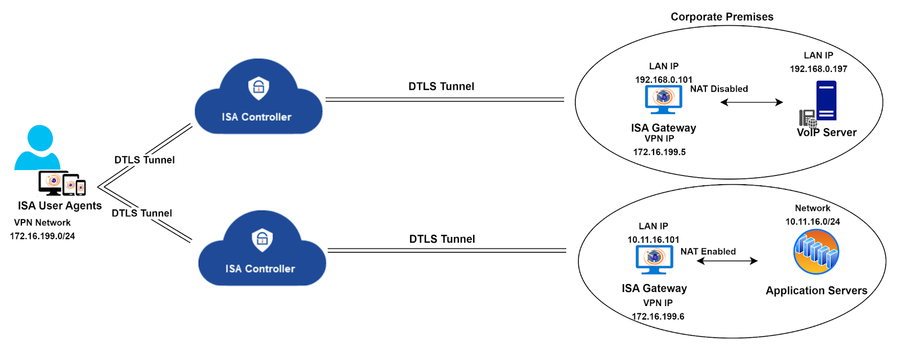

# Twin Tunnel Configuration in ISA Deployment: A Technical Overview

The twin tunnel configuration is an advanced setup designed for specific circumstances within the ISA deployment framework. In the standard ISA deployment, a single ISA Controller serves as a conduit between remote users and the corporate resources they aim to access. InstaSafe strategically provisions the Controller based on proximity to the customer environment, aiming to minimize traffic latency. Resource allocation for the Controller, including processing power, memory, storage, and bandwidth, is calculated considering factors such as customer requirements, user base, and the nature of accessed resources.

However, in certain network environments, the nature of the traffic traversing the tunnel may require the deployment of multiple Gateways to ensure optimal traffic flow. A notable example is documented in the article [Configuring the ISA Gateway for VOIP traffic](https://docs.instasafe.io/Instasafe%20Secure%20Access%20Documentation/019-Configuring_the_ISA_Gateway_for_VOIP_traffic/).

In the described scenario, where traffic is segregated by deploying two Gateways to route specific types of traffic, the processing burden on a single Controller may lead to operational overhead, potentially impacting traffic flow quality. To address this, the solution involves provisioning two Controllers in addition to the two Gateways, ensuring the seamless flow of traffic.

Twin Tunnel Configuration Diagram:

Results of the twin tunnel configuration implementation:

**Controller Provisioning:** Two Controllers are provisioned and configured in the backend system.

**User Profile Configuration:** Users intended for the twin tunnel connection must have the twin tunnel option enabled in their user profiles on the web portal.

**Agent Installation:** ISA User Agent installation on each end-point device includes

- Two Agent configuration files
- Two InstaSafe services
- Two virtual Tap/Tun Adapters (one for each Controller)

**Tunnel Establishment:** The Agent establishes a tunnel with each Controller, with one tunnel dedicated to voice traffic and the other for data traffic, aligning with the scenario illustrated in the diagram.

This twin tunnel configuration provides a solution for specific network scenarios, ensuring optimized traffic flow and resource utilization.
