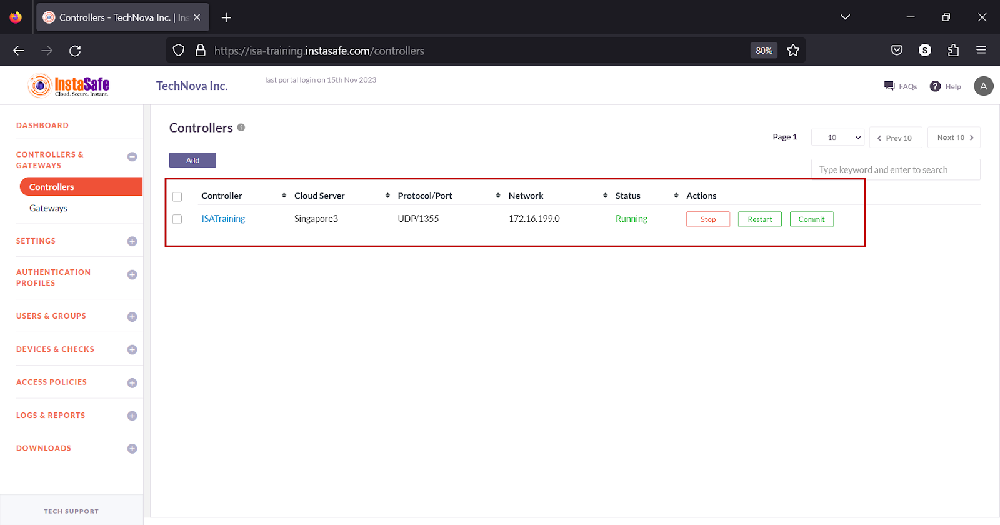

# Performing Operations of the ISA Controller

**When to perform start, stop, restart, and commit operations of the ISA Controller**

The ISA web portal administrator can perform the following operations on the Controller:

**Start** - To initiate or activate a Controller. It allows the Controller to begin its operations or perform its designated tasks. Starting a Controller means enabling its functionality. 

**Stop** - To halt or terminate the operation of a Controller. It instructs the Controller to cease its activities and enter a state of inactivity or standby.

**Restart** - To refresh or reset a controller. When issued, it causes the controller to stop its current operation, followed by an immediate start, effectively rebooting the controller. This can help resolve Agent connectivity issues.

**Commit** - Typically used in a version control or configuration management context. It is used to confirm and apply changes that have been made to a system or configuration. Once committed, the changes become permanent and are often saved in a version history or configuration database.

By default, when a Controller is added on the web portal, its status is **Stopped**. It must be manually started by clicking **Start**. When the controller status is **Running**, it signifies that the Controller is in active mode. In this state, the Controller is actively performing its designated functions, tasks, or processes, and is ready to receive and respond to input, commands, or requests. This status indicates that the controller is actively engaged in its role and is available for its intended purposes.

Except in high availability deployments, the Controller must remain in active mode. If a Controller is stopped, User and Gateway Agent connectivity is lost. 

_When a new Gateway is added or any information in the Gateway is changed, the pending changes must be committed by clicking the Commit button and the Controller must be restarted by clicking Restart._ 

It is recommended to commit and restart the Controller in the following scenarios:

When a device is deleted.

When an authentication profile is added.

When a Gateway Agent is unable to connect to the Controller.

When a User Agent is unable to connect to the Controller.

When a User Agent is unable to access corporate resources.

