# **Deploying the ISA Controller**

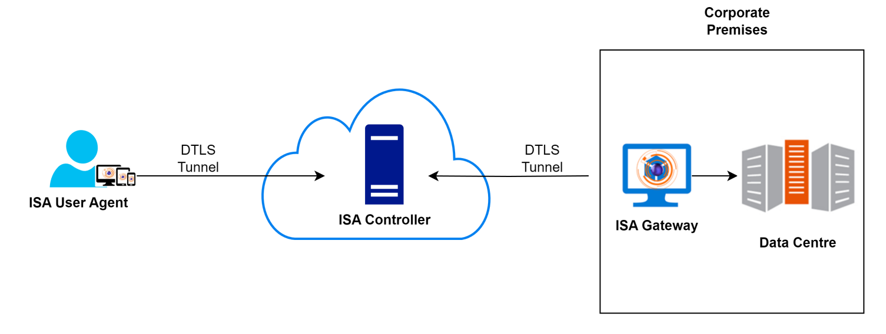

The InstaSafe Controller plays a pivotal role within the InstaSafe Cloud, serving as the central module for enforcing access control in network connectivity. It acts as the central point to which InstaSafe Agents and Gateway Agents establish independent DTLS tunnels. The Controller is responsible for implementing policies, deciding whether to allow or deny application access based on the configured access rules. In the context of ISA User Agents, the Controller's role commences after the User Agent successfully completes authentication, Geo Location check, Device Binding check, Device Check, and secondary authentication, such as 2FA/MFA.

## **Provisioning the Controller**

ISA Controllers are provisioned on either single or multiple cloud servers, strategically located at various geo-locations depending on the deployment. The selection of the cloud server is based on proximity to customer premises in order to minimize latency. Each tenant necessitates the provisioning of one or more Controllers. The decision to provision more than one Controller is contingent upon the customer's user license requirements. In cases where the number of users exceeds 1000, multiple Controllers are provisioned. Server selection for Controller deployment considers not only proximity to customer premises but also factors in the availability of processing and memory capacity on the servers.

##  **Add a Controller on the ISA Portal**

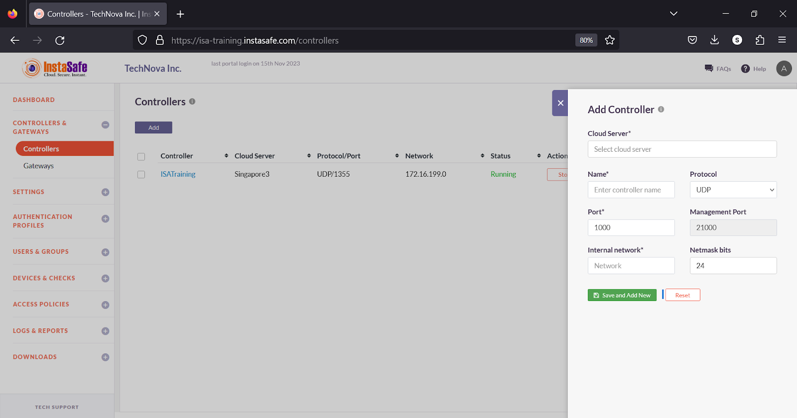

After the Controller is provisioned, the cloud server is selected during the creation of the Controller on the web portal. A public IP address is automatically assigned based on the chosen cloud server, and a unique port number is assigned for its identification. Each Controller within the same cloud server must have a unique port number. While both TCP and UDP ports are supported, using UDP is recommended.
When adding the Controller on the portal, an internal network is assigned. The size of the network is determined by the number of user licenses required. The IP addressing schema is chosen as per the customer's internal network. IP addresses from this network are later allocated to the virtual tunnel adapters on the end-user and Gateway devices. 

Upon adding the Controller on the portal, it actively listens on the public IP address assigned by the cloud server and the designated port number. When a User or Gateway Agent connects to the ISA web server, the domain name of the public IP address and the port number are appended to the Agent configuration file after the successful completion of user authentication and device compliance checks.

**Controller Start/Stop, Restart, and Commit Operations**

The ISA web portal administrator can perform the following operations on the Controller:

**Start** - To initiate or activate a Controller. It allows the Controller to begin its operations or perform its designated tasks. Starting a Controller means enabling its functionality. 

**Stop** - To halt or terminate the operation of a Controller. It instructs the Controller to cease its activities and enter a state of inactivity or standby.

**Restart** - To refresh or reset a controller. When issued, it causes the controller to stop its current operation, followed by an immediate start, effectively rebooting the controller. This can help resolve Agent connectivity issues.

**Commit** - Typically used in a version control or configuration management context. It is used to confirm and apply changes that have been made to a system or configuration. Once committed, the changes become permanent and are often saved in a version history or configuration database.

By default, when a Controller is added on the web portal, its status is **Stopped**. It must be manually started by clicking **Start**. When the controller status is **Running**, it signifies that the Controller is in active mode. In this state, the Controller is actively performing its designated functions, tasks, or processes, and is ready to receive and respond to input, commands, or requests. This status indicates that the controller is actively engaged in its role and is available for its intended purposes.

Except in high availability deployments, the Controller must remain in active mode. If a Controller is stopped, User and Gateway Agent connectivity is lost. 

When a new Gateway is added or any information in the Gateway changed, the pending changes must be committed by clicking **Commit** and the Controller must be restarted by clicking **Restart**. 

In addition, it is recommended to commit and restart the Controller in the following scenarios:

When a device is deleted.

When an authentication profile is added.

When the Gateway Agent is unable to connect to the Controller.

When the User Agent is unable to connect to the Controller.

When the User Agent is unable to access corporate resources. 

**Types of Controller Deployments**

**Cloud Deployment:** Both the Controller and Gateway are deployed on the cloud.

**Hybrid Deployment:** In this setup, the ISA web portal resides on the cloud, while the Controller is deployed on-premises. As the Controller also serves as a Gateway, a separate Gateway is not required in hybrid deployments.

**On-Premises Deployment:** All components of InstaSafe Secure Access, including the web portal, Controller, Gateway, SMS gateway, and email server, are installed on-premises. Currently, only VMWare Workstation is supported for on-premises deployments. For on-premises deployments, a Virtual Machine Disk (VMDK) file is shared with the customer. The image is preallocated with 4 CPU cores, 4 MB memory, and 8 GB storage. Storage can be extended based on usage requirements.

**Active and Passive Modes**

**Active Mode** - When the Controller status is Running, the Controller is in active mode. In this state, the controller is actively performing its designated functions, tasks, or processes, and it is ready to receive and respond to input, commands, or requests. This status indicates that the Controller is actively engaged in its role and is available for its intended purposes.

**Passive Mode** - When the Controller status is Stopped, the Controller is in passive mode. In this state, the Controller is not actively performing its designated functions, tasks, or processes. It is temporarily inactive, not responsive to input, commands, or requests, and is essentially on standby or in a state of rest. The Stopped status implies that the Controller is not actively engaged in its role at that moment, and is not currently available for its intended purposes.

**Active-Passive Deployment**

In deployments demanding high availability for all critical systems, ISA can be configured in Active-Passive mode to ensure redundancy. In such setups, multiple Controllers are deployed across distinct cloud servers, each configured with identical network sizes and port numbers.

For example, when an active Controller is deployed in Cloud Server A with a 10.10.0.0/16 network and listening on UDP port 1355, a passive Controller is simultaneously deployed in Cloud Server B with the same 10.10.0.0/16 network and listening on UDP port 1355. In the event that Cloud Server A needs to be shut down, the Controller in Cloud Server B can be manually activated, providing a manual active-passive deployment mechanism. When Cloud Server A is shut down, users connected to the Controller deployed therein will be disconnected and must be reconnected to the new Controller in Cloud Server B. 

**Active-Active Deployment** 

In deployments where the user count exceeds 1000, a strategy of deploying multiple Controllers is employed to effectively distribute the load. For instance, if there are 5000 users, five Controllers are deployed to ensure optimal performance and efficient resource utilization.

## **How to Use the ISA Controller?**

**When to perform start, stop, restart, and commit operations of the ISA Controller**

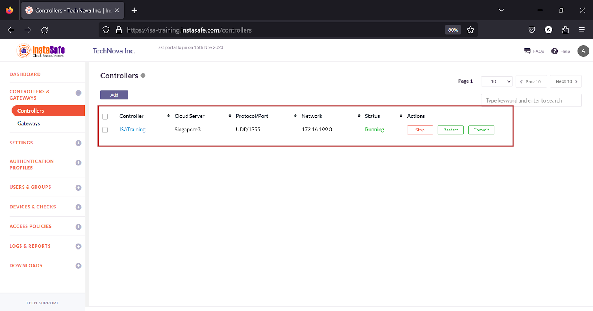

The ISA web portal administrator can perform the following operations on the Controller:

**Start** - To initiate or activate a Controller. It allows the Controller to begin its operations or perform its designated tasks. Starting a Controller means enabling its functionality. 

**Stop** - To halt or terminate the operation of a Controller. It instructs the Controller to cease its activities and enter a state of inactivity or standby.

**Restart** - To refresh or reset a controller. When issued, it causes the controller to stop its current operation, followed by an immediate start, effectively rebooting the controller. This can help resolve Agent connectivity issues.

**Commit** - Typically used in a version control or configuration management context. It is used to confirm and apply changes that have been made to a system or configuration. Once committed, the changes become permanent and are often saved in a version history or configuration database.

By default, when a Controller is added on the web portal, its status is **Stopped**. It must be manually started by clicking **Start**. When the controller status is **Running**, it signifies that the Controller is in active mode. In this state, the Controller is actively performing its designated functions, tasks, or processes, and is ready to receive and respond to input, commands, or requests. This status indicates that the controller is actively engaged in its role and is available for its intended purposes.

Except in high availability deployments, the Controller must remain in active mode. If a Controller is stopped, User and Gateway Agent connectivity is lost. 

When a new Gateway is added or any information in the Gateway is changed, the pending changes must be committed by clicking the Commit button and the Controller must be restarted by clicking Restart

It is recommended to commit and restart the Controller in the following scenarios:

When a device is deleted.

When an authentication profile is added.

When a Gateway Agent is unable to connect to the Controller.

When a User Agent is unable to connect to the Controller.

When a User Agent is unable to access corporate resources.

##  **Add a Gateway  on the ISA Portal**

Before deploying the ISA Gateway at the corporate network edge, a Gateway profile must be created on the ISA web console. When creating the profile, you can specify the IP addresses of your internal resources and services that need to be accessed by remote users.

This article describes the step-by-step process of creating a Gateway profile.

**Steps to setup Gateway**

1.Login to the ISA web console with your administrator credentials

2.After logging in, navigate to the CONTROLLERS & GATEWAYS > Gateways page.

3.Here, click on the Add button at the top of the page.

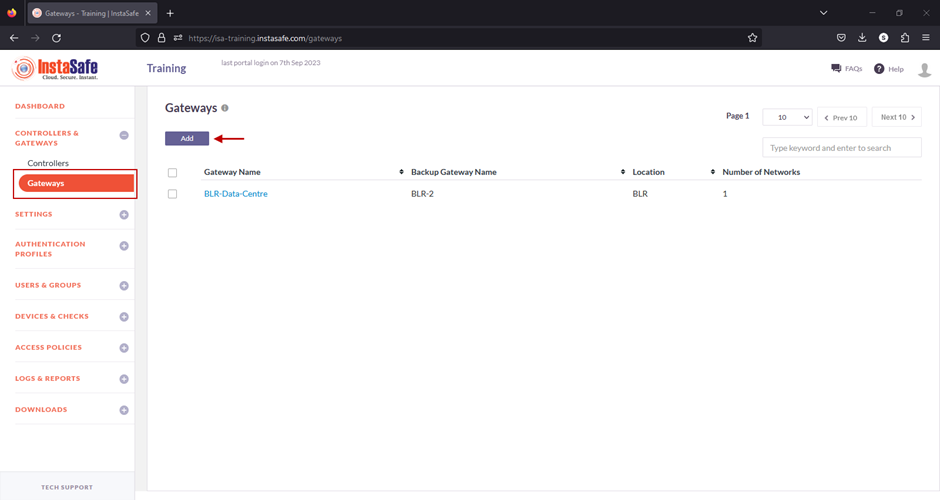

4.On the Add Gateway window, enter the following information:

- Name: Give a name for the Gateway. The name must allow an administrator to easily identify the nature and purpose of the Gateway. The name must not have spaces. In the example below, the name Mumbai-Data-Centre is separated by hyphens.
- Location: This is the name of the location of the resources.
- Backup Gateway Name: Enter the name of the back-up Gateway. It is best-practice to deploy a back-up Gateway to ensure uninterrupted flow of traffic in the event of failure of the primary Gateway.
- Protected Network: Enter here the internal IP address and/or the IP subnet-ID of the resource or resources that is required to be accessed by your remote users. The IP addresses must be entered using the slash notation with the subnet ID. For example, to add a single host of IP address 192.168.1.1, enter 192.168.1.1/32; to add a subnet enter the subnet id followed by slash and the network id 192.168.1.0/24. In this example, the subnet 192.168.0.0/24 has been entered.
- Add More: More than one resource can be added to the Gateway profile.
- Click on Save and Add new to create the Gateway profile.
- Optionally, under Bulk upload Gateways you may add multiple Gateways at once by uploading a file with the Gateway names and other information in CSV format. Click on Download Sample CSV for the format for bulk-adding Gateways.

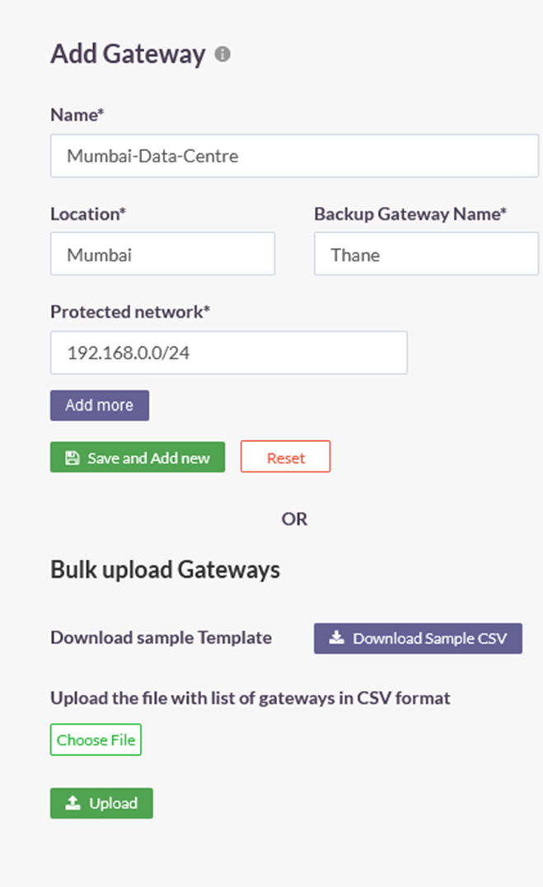

5.Once created, the Gateway will be listed on this page with Gateway Name, Backup Gateway Name, Location, and Number of Networks. In this example, the number of networks is one.

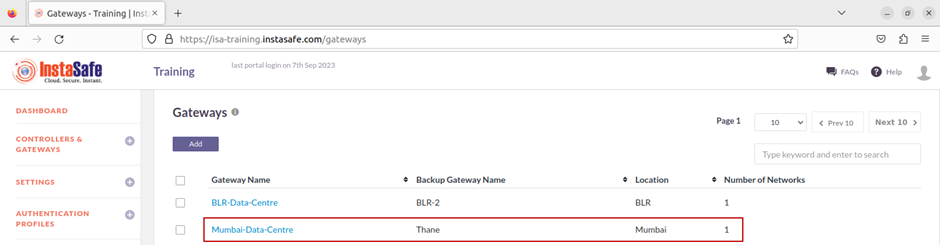

6.Next, on the left-side menu, under Downloads, click on Gateway Agents.

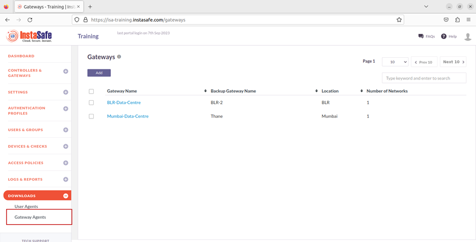

7.On the Downloads page, you can see all the Gateways added and their respective back-up Gateways listed by Name, Type, and Location.

Further, under Downloads, you can download the Gateway Agent software for each Gateway. The Gateway Agent software can be downloaded for Windows, Linux, and OS X operating systems. 

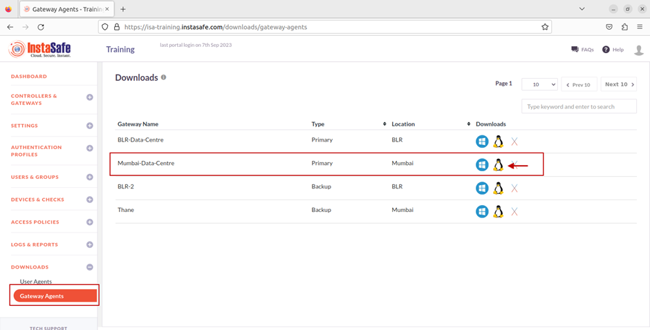

## **How to Configure Gateway for VOIP traffic ?**

The ISA Gateway Agent is ideally deployed at the edge of a corporate network to connect remote clients or networks to the private corporate network. A DTLS tunnel, providing Datagram Transport Layer Security, is established between the Gateway and the ISA Controller, and all traffic between remote clients and the corporate network is routed through it. 

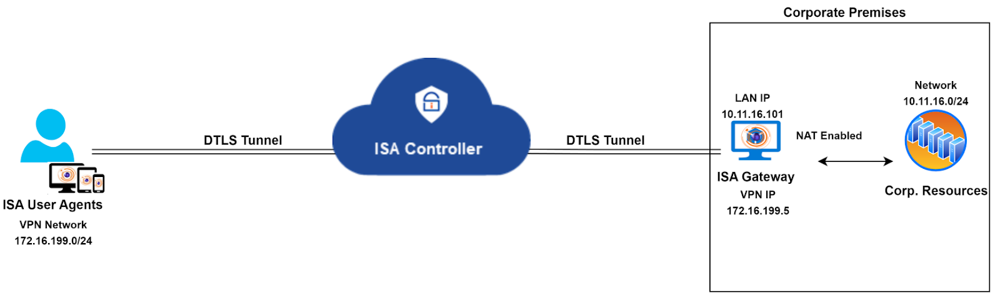

The ISA Gateway Agent performs network address translation (NAT) to translate the source IP address of incoming traffic from remote clients to the IP address of its physical interface (e.g., eth0, enp0s3), before forwarding the packet, with the translated origin IP address, to the corporate network. NAT is similarly applied to the source IP address of traffic from the corporate network.

**NAT and VoIP Traffic**

While this enhances the security of remote access connections, certain application traffic, like VoIP, experiences issues due to NAT. For instance, a hosted VoIP server in the private network and installed clients on remote end-user systems result in severe VoIP traffic issues.

In such scenarios, it's advisable to disable NAT on the ISA Gateway. This ensures that VoIP server traffic is routed through the VPN tunnel without altering the server's source IP address. Traffic from VoIP clients reaching the Gateway is then routed to the server without changing the source IP address.

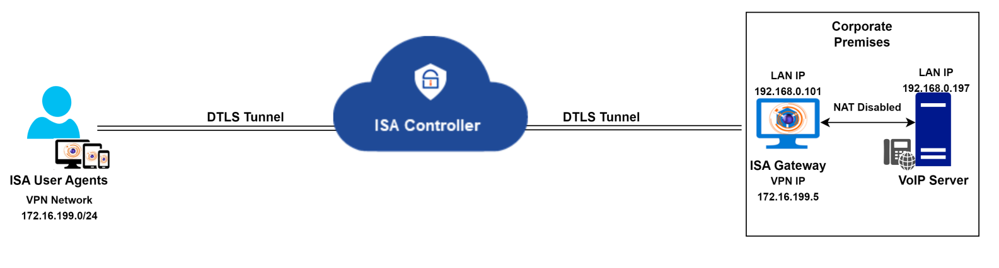

**Route for return traffic from the VoIP server**

To ensure smooth voice traffic between the server and clients, an additional change is required at the corporate network. When NAT is disabled, the source IP address will be the VPN or virtual IP address of remote clients. The server is unaware of the path to reach this IP, so it will send return traffic to the default gateway configured on its adapter.

One solution is to change the server's default gateway to that of the Gateway, ensuring correct routing of return traffic. Another option is to add a specific route in the server, directing all traffic with the destination as the VPN network to the Gateway IP. A third option is to add the route in a router between the server and the Gateway.

_Here's an example of adding a static route for reverse traffic in a Windows PC:_

_route add -p 172.16.199.0 mask 255.255.255.0 192.168.0.101_

This command creates a persistent static route to forward all traffic destined for the VPN network (172.16.199.0/24) to the ISA Gateway with the IP address 192.168.0.101.

**Need for segregating voice and non-voice (or data) traffic**

The above solution envisions a scenario where only VoIP traffic traverses the VPN tunnel, and remote users do not access any other application within the corporate network. However, in the real world, this is seldom the case. In most remote access networks, users require access to a variety of data, including VoIP. In a network where VoIP is only one of many required remote-access applications, the above solution may not be suitable. 

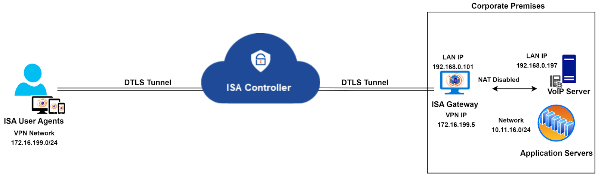

Instead of adapting the entire network to fit this solution, an alternative method is to segregate VoIP traffic from other traffic by deploying two Gateways and hosting the VoIP server behind one and all other servers behind another.

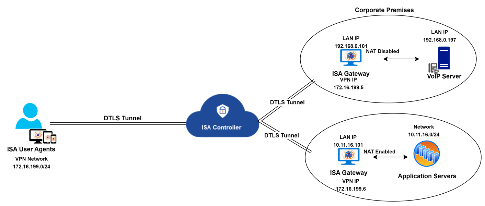

The diagram above illustrates the segregation of voice and non-voice traffic by deploying two Gateways. NAT is disabled on the Gateway hosting the VoIP server, while NAT is enabled on the Gateway with other servers. Both Gateways connect to the same Controller. A static route must be created on the VoIP server to reach the VPN network, as explained earlier.

While the solution outlined here addresses the traffic segregation needs, it may not be universally applicable to all customer infrastructures. In cases where constraints prevent the implementation of this solution, InstaSafe Support can propose customized alternatives tailored to specific infrastructure requirements.