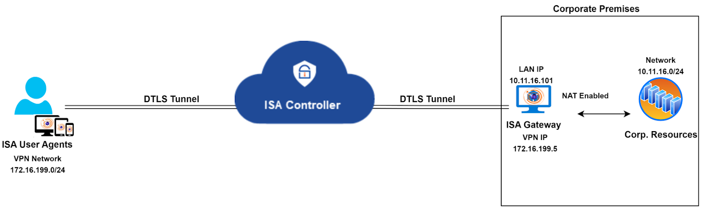
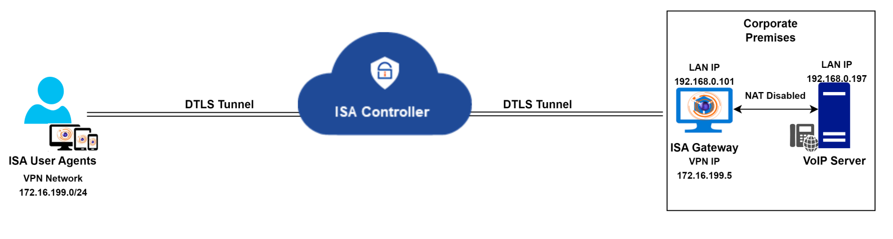
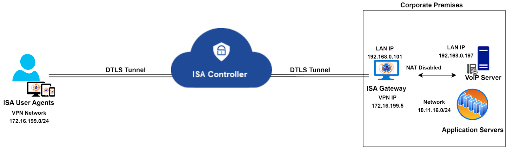
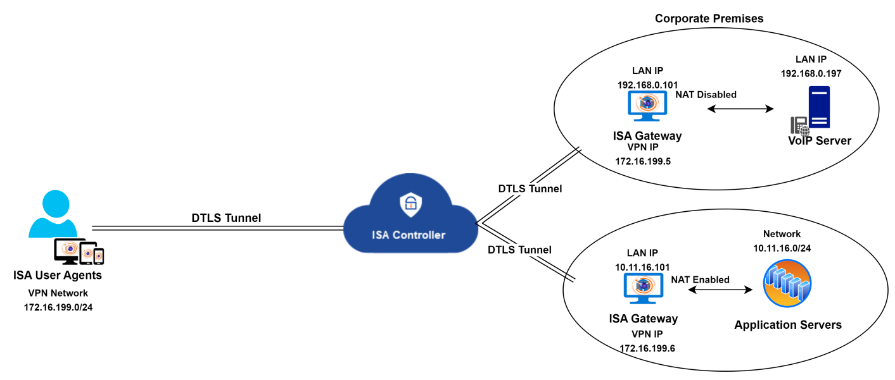

# Configuring the ISA Gateway for VOIP traffic

The ISA Gateway Agent is ideally deployed at the edge of a corporate network to connect remote clients or networks to the private corporate network. A DTLS tunnel, providing Datagram Transport Layer Security, is established between the Gateway and the ISA Controller, and all traffic between remote clients and the corporate network is routed through it. 

The ISA Gateway Agent performs network address translation (NAT) to translate the source IP address of incoming traffic from remote clients to the IP address of its physical interface (e.g., eth0, enp0s3), before forwarding the packet, with the translated origin IP address, to the corporate network. NAT is similarly applied to the source IP address of traffic from the corporate network.

**NAT and VoIP Traffic**

While this enhances the security of remote access connections, certain application traffic, like VoIP, experiences issues due to NAT. For instance, a hosted VoIP server in the private network and installed clients on remote end-user systems result in severe VoIP traffic issues.

In such scenarios, it's advisable to disable NAT on the ISA Gateway. This ensures that VoIP server traffic is routed through the VPN tunnel without altering the server's source IP address. Traffic from VoIP clients reaching the Gateway is then routed to the server without changing the source IP address.

**Route for return traffic from the VoIP server**

To ensure smooth voice traffic between the server and clients, an additional change is required at the corporate network. When NAT is disabled, the source IP address will be the VPN or virtual IP address of remote clients. The server is unaware of the path to reach this IP, so it will send return traffic to the default gateway configured on its adapter.

One solution is to change the server's default gateway to that of the Gateway, ensuring correct routing of return traffic. Another option is to add a specific route in the server, directing all traffic with the destination as the VPN network to the Gateway IP. A third option is to add the route in a router between the server and the Gateway.

_Here's an example of adding a static route for reverse traffic in a Windows PC:_

_route add -p 172.16.199.0 mask 255.255.255.0 192.168.0.101_

This command creates a persistent static route to forward all traffic destined for the VPN network (172.16.199.0/24) to the ISA Gateway with the IP address 192.168.0.101.

**Need for segregating voice and non-voice (or data) traffic**

The above solution envisions a scenario where only VoIP traffic traverses the VPN tunnel, and remote users do not access any other application within the corporate network. However, in the real world, this is seldom the case. In most remote access networks, users require access to a variety of data, including VoIP. In a network where VoIP is only one of many required remote-access applications, the above solution may not be suitable. 

Instead of adapting the entire network to fit this solution, an alternative method is to segregate VoIP traffic from other traffic by deploying two Gateways and hosting the VoIP server behind one and all other servers behind another.

The diagram above illustrates the segregation of voice and non-voice traffic by deploying two Gateways. NAT is disabled on the Gateway hosting the VoIP server, while NAT is enabled on the Gateway with other servers. Both Gateways connect to the same Controller. A static route must be created on the VoIP server to reach the VPN network, as explained earlier.

While the solution outlined here addresses the traffic segregation needs, it may not be universally applicable to all customer infrastructures. In cases where constraints prevent the implementation of this solution, InstaSafe Support can propose customized alternatives tailored to specific infrastructure requirements.