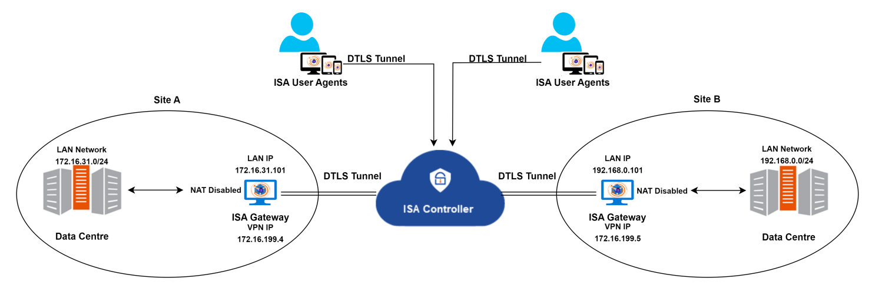
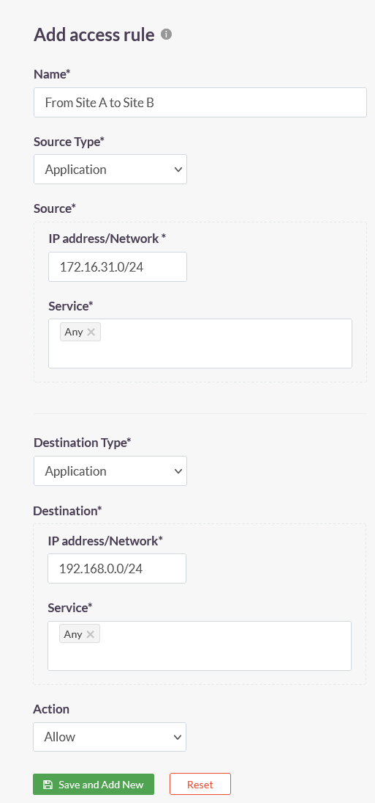
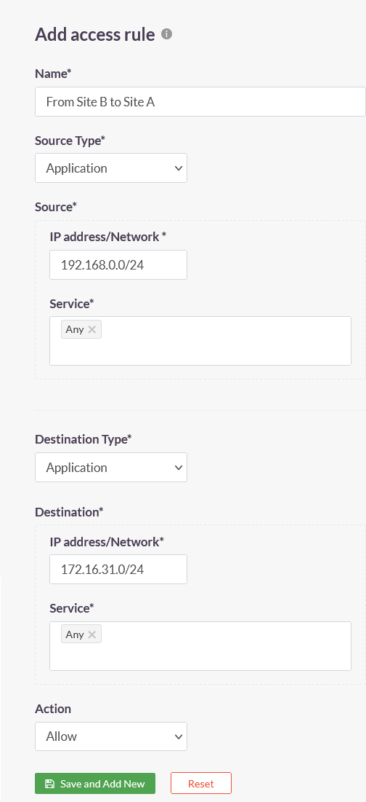

# Configuring Site-to-Site Connectivity with InstaSafe Secure Access

**Introduction**

InstaSafe Secure Access (ISA) provides site-to-site connectivity with advanced security features and simplified configuration. This article outlines the essential steps and features for configuring ISA site-to-site connectivity.

**When is ISA Site-to-Site Connectivity Required?**

**Interconnecting Corporate Networks:** When seamless communication between two corporate networks is required, ISA facilitates secure data exchange with minimal configuration overhead.

**Industrial Monitoring and Devices:** In industrial settings, where devices at one site need to monitor client devices at another, ISA ensures a secure and efficient connection.

**As a Replacement or Backup Solution:** ISA site-to-site VPN can be deployed as an alternative to existing IPsec or SSL/TLS VPN setups or as a backup to MPLS VPNs. 

**Features of ISA Site-to-Site Connection**

**Shared Outbound Tunnel:** Each Gateway establishes a shared outbound tunnel, processing all-encrypted network traffic.

**Identity and Trust Establishment:** ISA employs certificate verification using ISA’s managed PKI setup, ensuring secure identity and trust between Gateways.

**Private IP Addresses:** All devices within the ISA setup can securely use private IP addresses, enhancing network privacy.

**User Agent Elimination:** ISA eliminates the need for User Agents on servers at each site, simplifying deployment.

**Bi-directional Access:** Facilitates both server-to-server and server-to-end user communication for comprehensive connectivity.

**Centralized Monitoring:** All logs are accessible through a unified console with robust monitoring, reporting capabilities, and real-time alerts.

## Configuration

For the purpose of this article, we use the following architecture to configure site-to-site connection between two sites.

**Topology**

|        | Site A | Site B |
| ------ | ------ | ------ |
|  Internal network |  172.16.31.0/24 | 192.168.0.0/24 |
|  Gateway LAN IP   |  172.16.31.101  | 192.168.0.101  |
|  Gateway VPN IP   |  172.16.199.4   | 172.16.199.5   |
|  VPN Network      |  172.16.199.0/24                 |

**Task List**

1.Disable NAT on the Gateways at both sites. For more information on disabling NAT on Linux and Windows, refer to the following articles – 

2.Since NAT is disabled at the Gateway, the servers must be made aware of the path to take to reach the servers at the other site. To this end, it is necessary to add routes for traffic from the servers to reach the Gateway. The traffic could be initiated by the servers or return traffic. Add the route either in each server or in the routing device between the servers and the Gateway. Keeping with the above topology, the following routes must be added to the Windows routing table at each site: 

|        |        |
| ------ | ------ |
| Site A | route add 192.168.0.0 mask 255.255.255.0 172.16.199.4 -p |
| Site B | route add 172.16.31.0 mask 255.255.255.0 172.16.199.5 -p |

3.Create the following access rules on the **ACCESS POLICIES > Access Rules** page of the ISA web portal.

| Access Rule 1 | Access Rule 2 |
| ------ | ------ |
| | |

**Conclusion**

ISA's site-to-site VPN connectivity is simple to configure without compromising on security. The VPN can replace existing traditional IPsec or SSL/TLS VPNs or be backup for MPLS VPN. 
