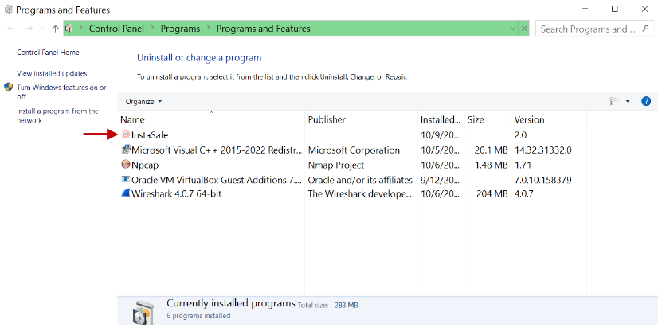
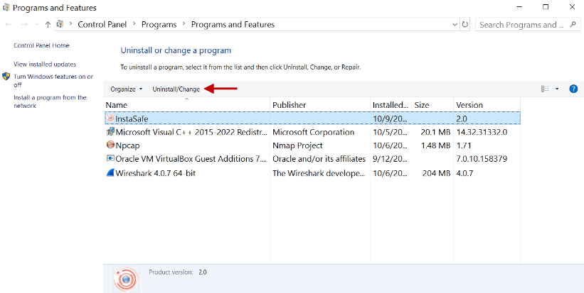
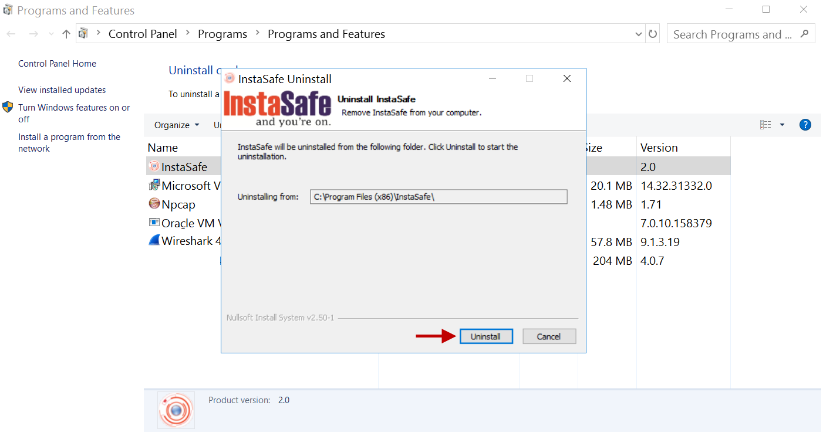
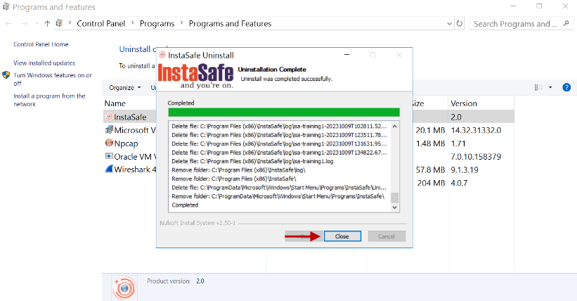

# Uninstalling the InstaSafe Gateway Agent

- Login into the server using administrator credentials.
- Open **Programs and Features** from Control Panel.
- Select **InstaSafe**.

- Click **Uninstall/Change**.

- In the **Uninstall InstaSafe** window, click **Uninstall**.

- Click **Close**.

- Make sure the InstaSafe folder is deleted under C:\Program Files (x86)

In the event you are unable to uninstall InstaSafe Gateway Agent by following these steps, contact your organization's IT Team. 

If you are an administrator of the organization's ISA Account and need assistance, contact [InstaSafe Support](support@instasafe.com)