# Configuring NAT on the ISA Gateway (Windows Server)

One of the prerequisites for deploying the ISA Gateway Agent in a Windows Server is to add the Routing and Remote Access Server (RRAS) role. The RRAS role allows the administrator to configure network address translation (NAT), among other functions.  When NAT is enabled on the Gateway, it translates the source IP address of incoming traffic from the outside to that of the IP address of its physical public facing interface, before forwarding the packet to the destination server or resource.
Before NAT is enabled, the source IP address of the incoming traffic forwarded by the Gateway Agent, after decryption, will retain the IP address of the Tap-Windows Adapter V9 virtual interface. The remote corporate resources will be unable to route the return traffic without further routing configuration.

Here is the screen shot of the Wireshark capture done on the physical interface when a remote user tries to ping a corporate resource without NAT enabled on the Gateway. Notice how the source IP address is that of the virtual interface and no replies are received on the interface from the remote resource.

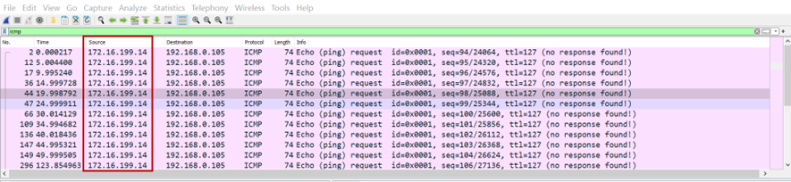

**Configuring NAT on the Routing and Remote Access Server**

1.On the Server Manager screen, click **Tools** and select **Routing and Remote Access** from the drop-down.

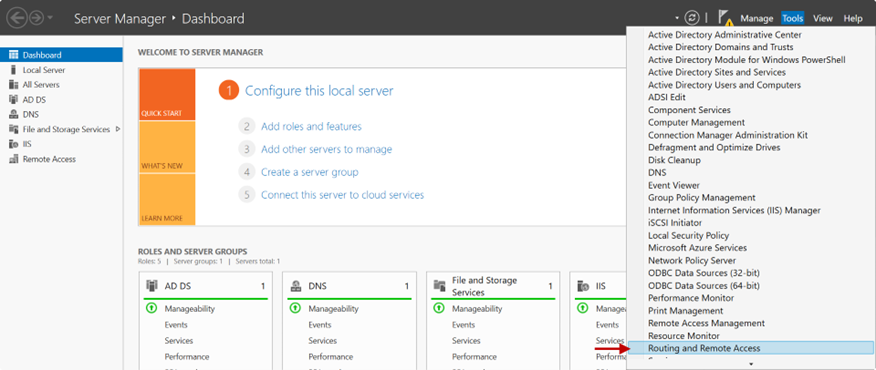

2.Right-click on the server’s name. In this example, _Win2k16_

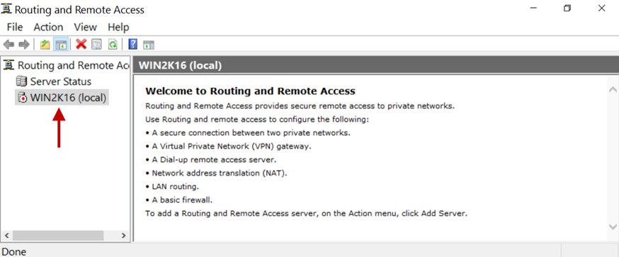

3.Click on **Configure and Enable Routing and Remote Access**.

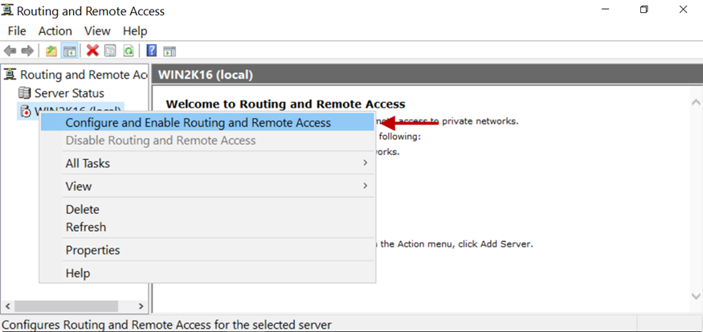

4.In the Configuration window, select the Network address translation (NAT) radio button. 

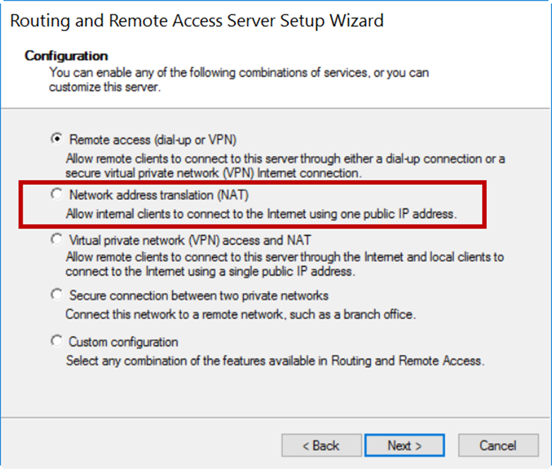

5.Click **Next**.

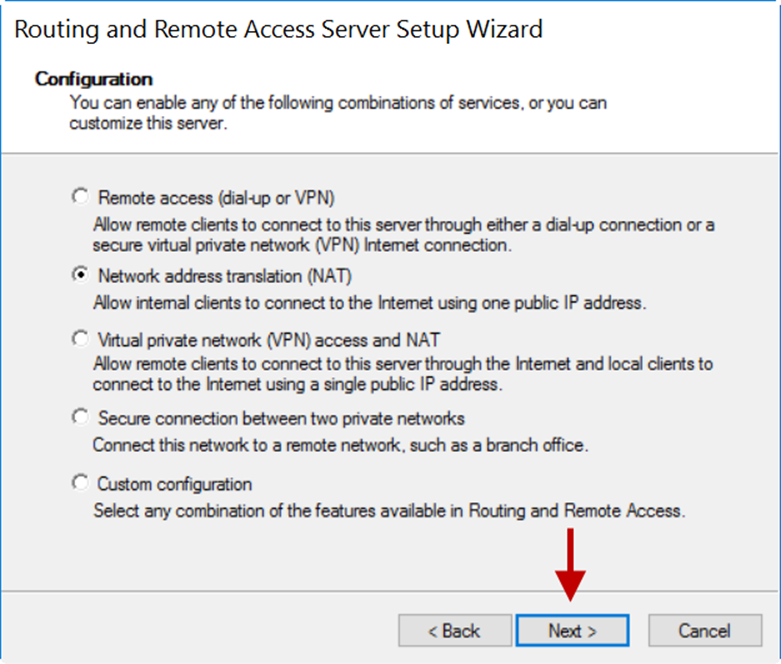

6.On the **NAT Internet Connection** window, select the public interface. In this example, it is _Ethernet_ with an IP address of _192.168.0.101_.

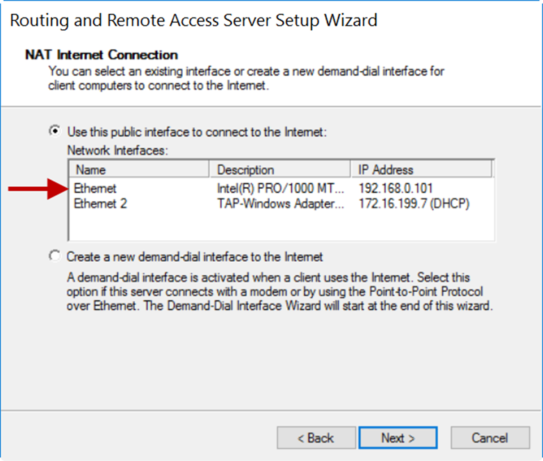

7.Click **Next**.      

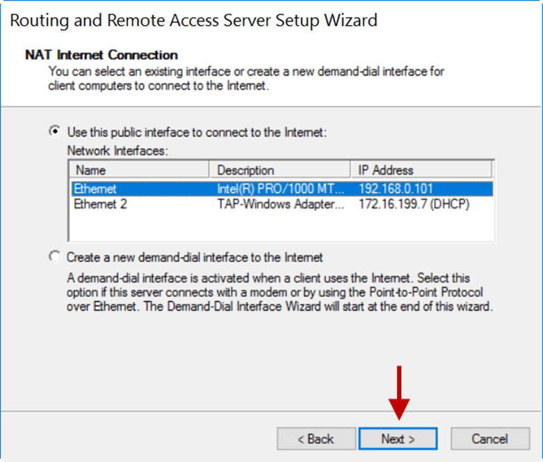

8.On the next window, click **Finish**.

9.Expand the server’s name and expand **IPv4**.

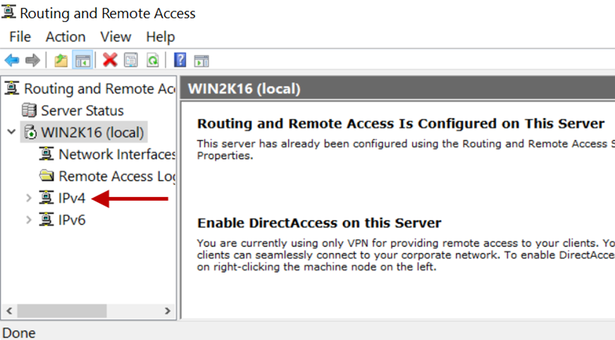

10.Select **NAT** and right-click the physical interface selected for NAT.

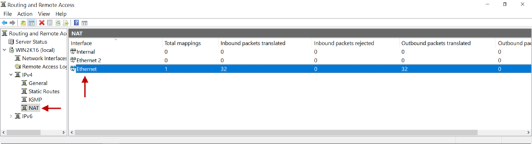

11.Click **Show Mappings**.

12.On the mapping table, you will see inbound packets translated on the interface selected for NAT.

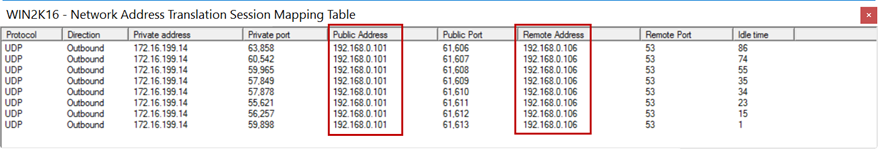

13.Ping from a remote user to an internal resource will receive replies now. Here is a Wireshark capture. Notice the source IP address is of the physical interface selected for NAT.

**Disable/Delete NAT**

There are instances when the source IP address must remain unchanged, for example, for VoIP traffic. In such cases, NAT should be disabled. To disable NAT, right-click on the **Routing and Remote Access** > server name > **IPv4** > interface name > **NAT** and click **Delete**.

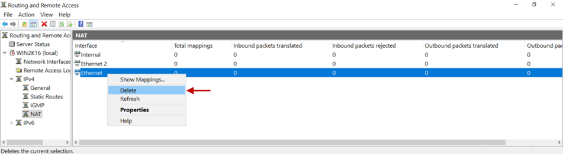

In case you are unable to configure NAT on the Gateway by following these steps, contact your organization's IT Team.

If you are the administrator of the organization's ISA Account and need assistance, contact [support@instasafe.com](support@instasafe.com)
