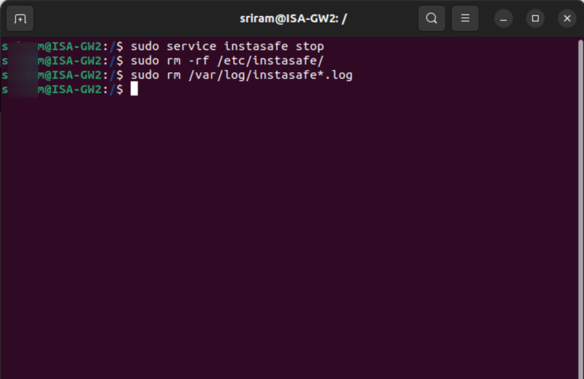

# Uninstalling the ISA Gateway Agent from Linux

In certain circumstances, the ISA Gateway Agent, due to various reasons, may need to be changed. Before installing the Agent on a new Gateway, the Gateway Agent must be uninstalled.
Login to the server as a user with root privileges
Open Terminal
Enter the command _sudo service instasafe stop_ to stop the Instasafe Agent service.
Enter the command _sudo rm -rf /etc/instasafe/_ to remove the Instasafe directory and its contents recursively.
Enter the command _sudo rm /var/log/instasafe*.log_ to remove any Instasafe log files with filename starting with “instasafe”.

The above steps will completely remove the Gateway Agent from the server.  In case you are not unable to uninstall the ISA Gateway Agent by following these steps, contact your organization's IT Team.

If you are the administrator of the ISA Account and need assistance, contact [support@instasafe.com](support@instasafe.com)
