# Installing the ISA Gateway Agent on Linux

InstaSafe Secure Access (ISA) Gateway Agent is a software that acts as the entry and exit point for user access. Gateways are deployed at the edge of a private network, and are used to connect remote clients or networks to the private network.  It is responsible for encrypting and decrypting data sent over the secure connection, as well as routing the data between the client and the private network. 

The ISA Gateway must be provisioned on a physical or virtual server at each of the data centres where applications and other services are hosted that are remotely accessed by users. To ensure redundancy, it is recommended to provision a backup Gateway as well. This ensures that unforeseen issues like hardware failure or OS corruption do not lead to network downtime.

Both the primary and back-up Gateways must be configured with static IP addresses. These IP addresses must be given to the InstaSafe administrator for the purpose of opening the required ports in the controller to accept the connection from the Gateway Agents.

Although the Agent software can be installed on other OSs, such as Microsoft Windows servers, best practice recommends that it be installed on a Linux server due to ease of installation and it being open-source. This KB describes the installation process on an Ubuntu desktop VM.

For the prerequisites for installing the Gateway Agent, refer to KB article Prerequisites for installing ISAGateway Agent.

1.Log into the ISA web portal using admin credentials.

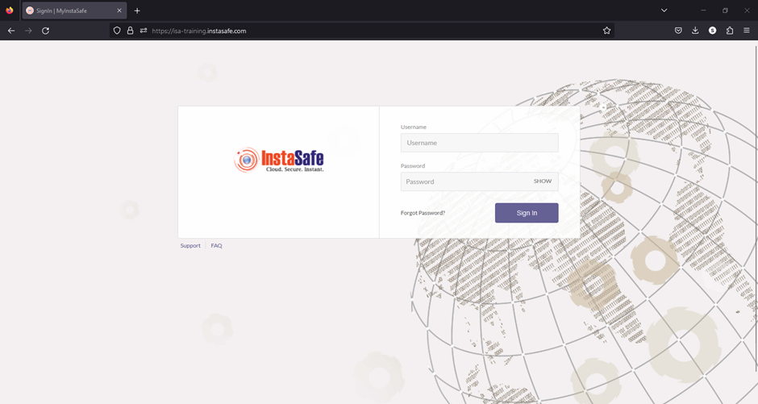

2.On the left-side menu, navigate to the **CONTROLLERS & GATEWAYS > Gateways** page.  Listed here are two Gateways added. This KB article will describe the process of installing the Gateway Agent for _Mumbai-Data-Centre_.

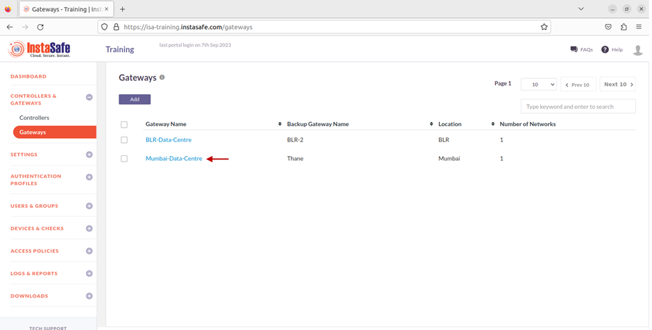

3.Next, on the left-side menu, under **Downloads**, click on **Gateway Agents**.

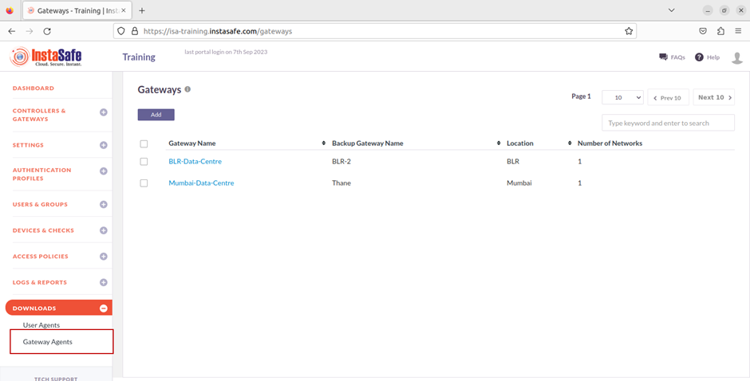

4.Listed here are the Gateway Agents and their respective back-up Gateway Agents. Click on the Linux icon to download the Agent script to the local disk. 

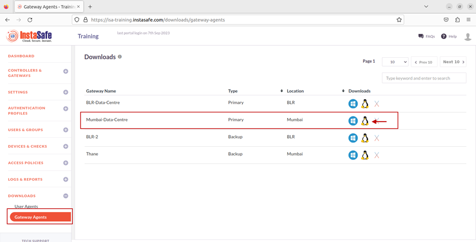

5.The file has been downloaded. 

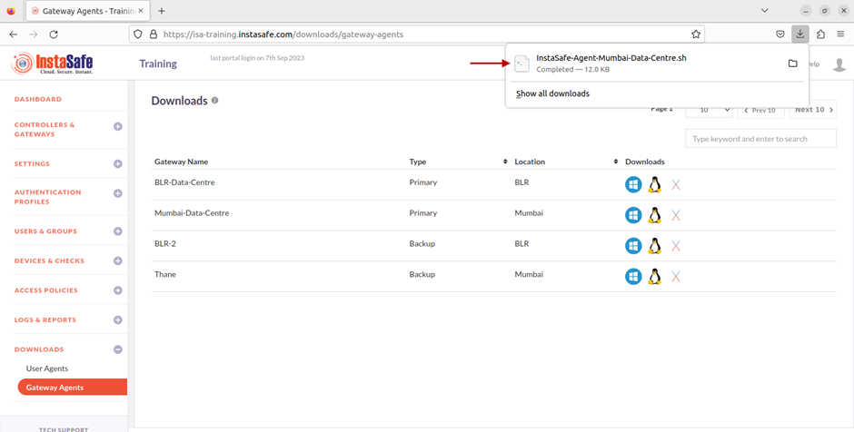

6.Open Terminal and navigate to the folder where the script is downloaded.

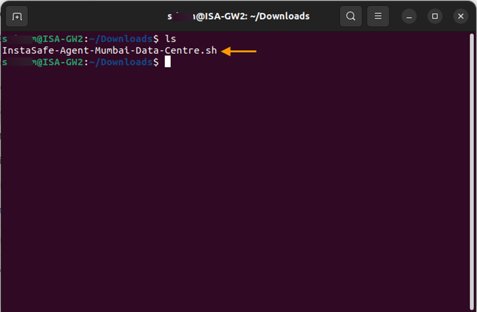

7.Set the read and write permission to the script file by entering the command: **_chmod 700 <name of the script file>_**

8.Execute the script by entering the command: **_sudo sh <name of the script file>_**

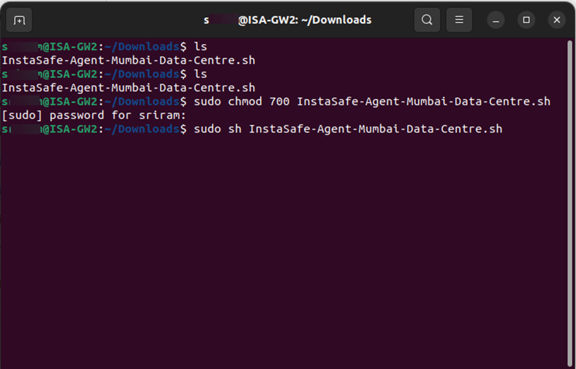

9.The installation will begin.

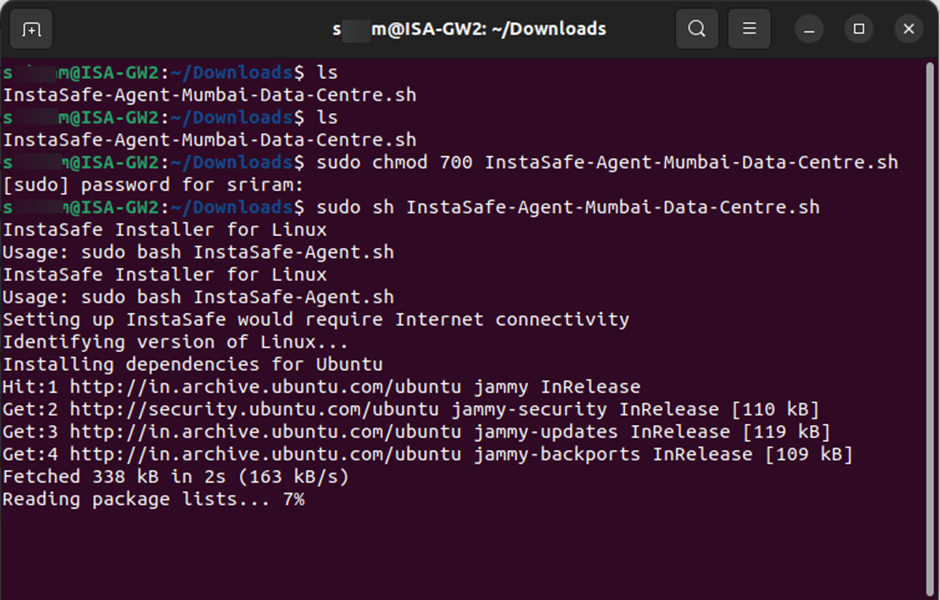

10.After the installation is completed successfully, check the status of the Instasafe Agent service by entering the command: _**sudo service Instasafe status**_

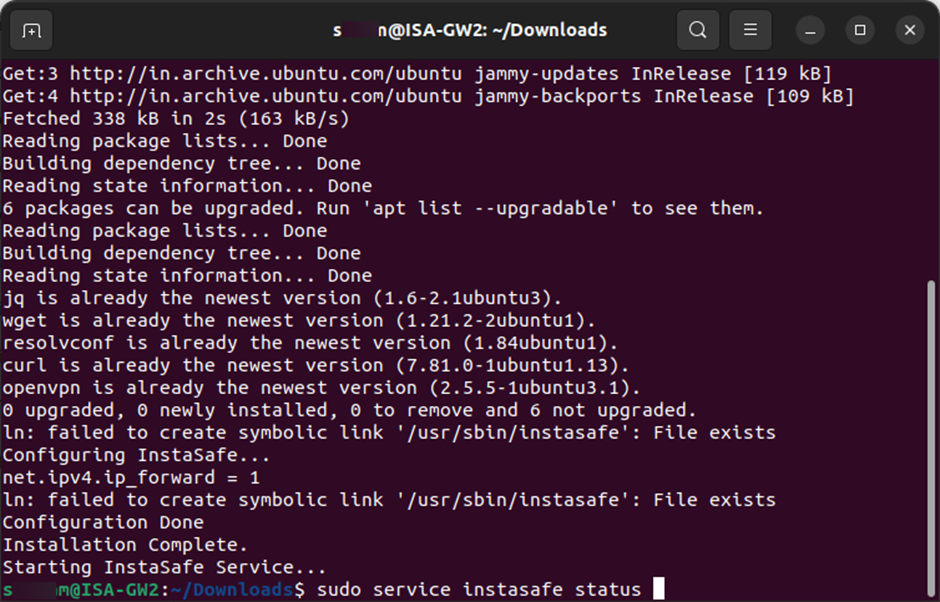

11.Here is a snapshot of the status indicating that the Instasafe Agent has successfully started and an outbound connection to the ISA controller has been made by the Instasafe Gateway Agent. 

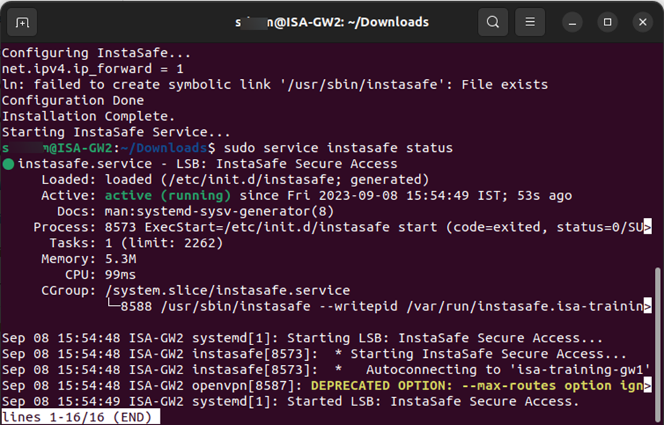

12.Enter **_ifconfig or ip addr_** to view the interfaces. If the installation is successful and the Instasafe service has started, a virtual interface, **_tun0_**, with its virtual IP address should be displayed.

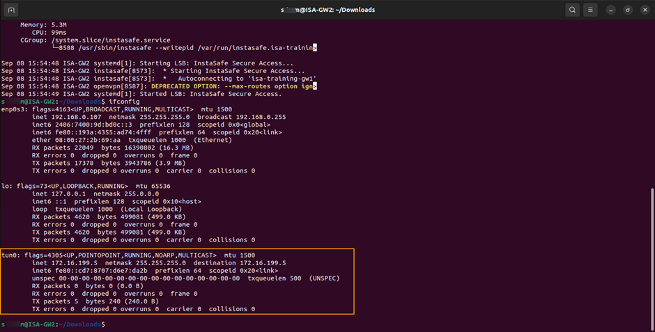

The Gateway Agent will initiate an outbound connection to the ISA Controller and establish a secure connection. 

In case you are unable to install the Agent by following these steps, contact your organization's IT Team.
If you are the administrator of the organization's ISA Account and need assistance, contact [support@instasafe.com](support@instasafe.com).
