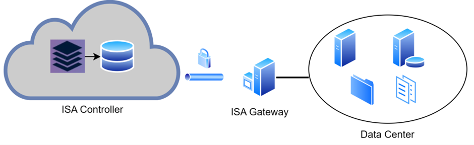

# Prerequisites for Installing ISA Gateway Agent

**ISA Gateway Agent**

InstaSafe Secure Access (ISA) Gateway Agent is a software that acts as the entry and exit point for user access.

Gateways are deployed at the edge of a private network, and are used to connect remote clients or networks to the private network. 

It is responsible for encrypting and decrypting data sent over the secure connection, as well as routing the data between the client and the private network. 

Gateways use DTLS protocol to establish and secure the connection. It can also be used to connect two separate private networks together, such as in a site-to-site configuration.

**Hardware Prerequisites**

- The ISA Gateway must be provisioned on a physical or virtual server at each of the data centres where applications and other services are hosted that are remotely accessed by users.

- To ensure redundancy, it is recommended to provision a backup Gateway as well. This ensures that unforeseen issues like hardware failure or OS corruption do not lead to downtime.

**Software Prerequisites**

- Ensure the date and time is set correctly. Refer [this article](https://help.ubuntu.com/stable/ubuntu-help/clock-set.html.en) on how to set data and time on Ubuntu.
- Ensure the time zone is set correctly. 
- The Ubuntu server must have the latest updates.
- Operating system requirements:

|        |        |
| ------ | ------ |
|  OS           |  Ubuntu 20.04 LTS - Ubuntu 22.04 LTS (https://ubuntu.com/download/server)|
|  OS Type      |  64-bit      |
| Memory        |  2 GB (minimum) |
| Disk Size     |  10 GB (minimum) free space |
| CPU           |  1 x Dual Core processor (x64 based AMD) |

**Network Prerequisites**

- Firewall rules must be updated to allow outgoing connections to the following IP addresses and port numbers.

| Source | Destination | Port | Direction |
| ------ | ------ | ------ | ------ |
|  ISA Gateway IP |  13.234.13.233, 3.6.62.25, 13.234.125.194, 3.6.127.45 | UDP Ports* | Outbound |
|  ISA Gateway IP |  35.154.170.140      | TCP 443 | Outbound |

**_*The IP addresses and port numbers are unique to every deployment and shall be provided by the InstaSafe Tech Team._**

Unrestricted Internet access must be provided at the time of installation so that relevant packages and repositories could be downloaded. It is recommended to provide direct Internet access instead of via a proxy.