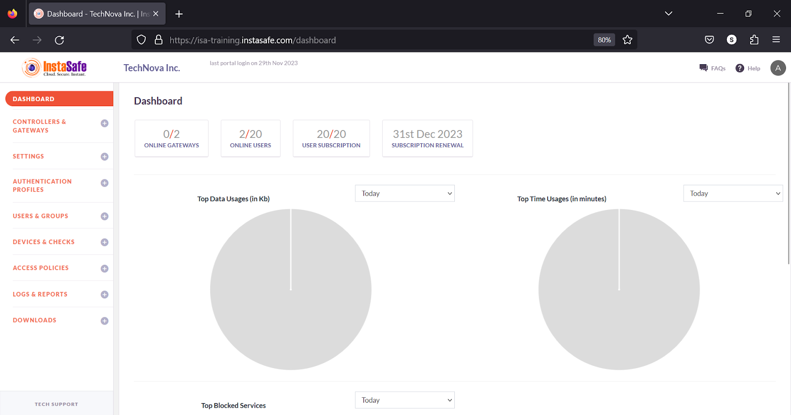

# **Dashboard**

Upon logging into the ISA web portal, administrators are directed to the Dashboard, which shows a comprehensive snapshot of user activity. 

The page comprises the following key information:

ONLINE GATEWAYS: Displays the number of active Gateways out of the total added to the portal.

ONLINE USERS: Displays the count of live users from the total user base . This does not include the users or administrators logged into the web portal.

USER SUBSCRIPTION: Shows the number of users added to the portal in relation to the total user licenses.

SUBSCRIPTION RENEWAL: Displays the expiry date of license subscriptions. If multiple subscriptions are added, the earliest date is shown here.  

Top Data Usages (in KB): Shows data usage for the selected date, with options to view by Today, Week, or Month.

Top Time Usages (in minutes): Shows time usage for the selected date, with options to view by Today, Week, or Month.

Top Blocked Services: Shows blocked services for the selected date, with options to view by Today, Week, or Month. by Today, Week, or Month.

