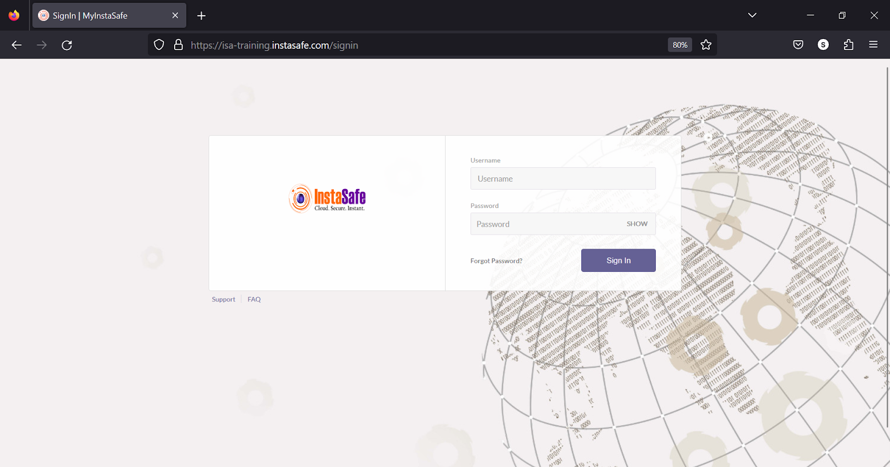
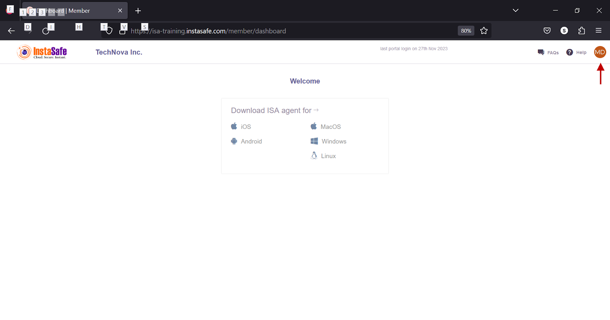
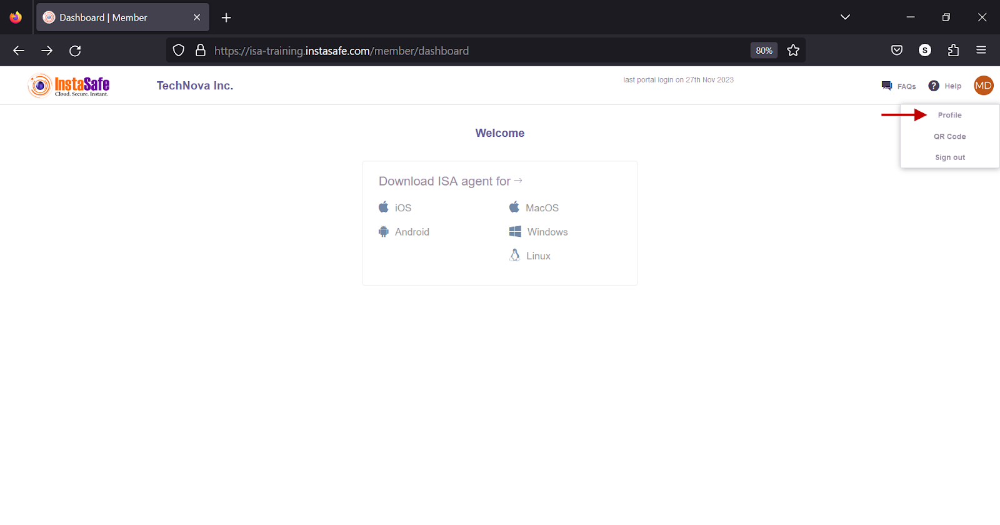
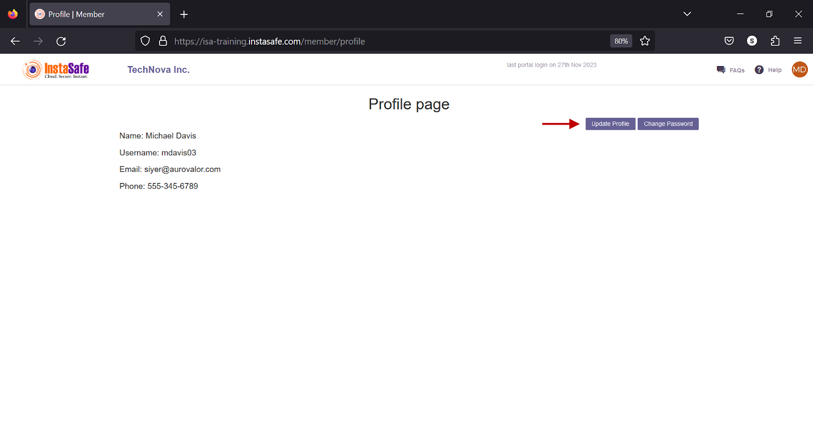
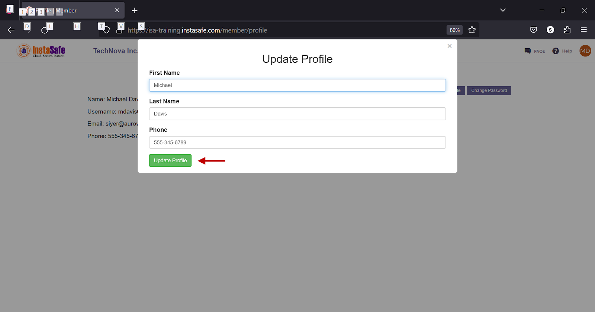

# **Changing phone number of User**

Users can update their phone number stored in their profile on the ISA web portal in the following manner:

1.Login to the ISA web portal 

2.Click on the drop-down in the far right-hand corner of the page. 

3.Click Profile

4.Click Update Profile

5.In the Update Profile window, change the phone number and click Update Profile

