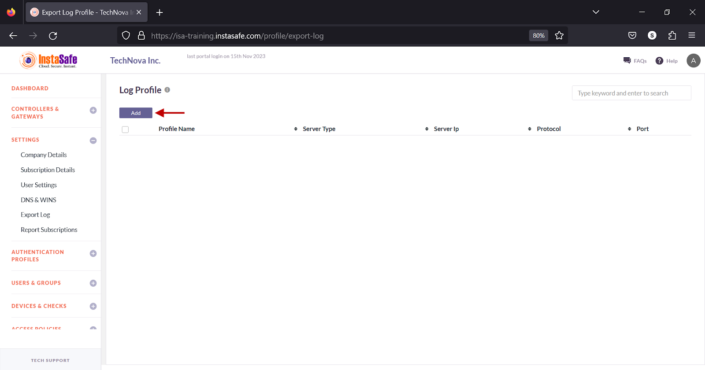
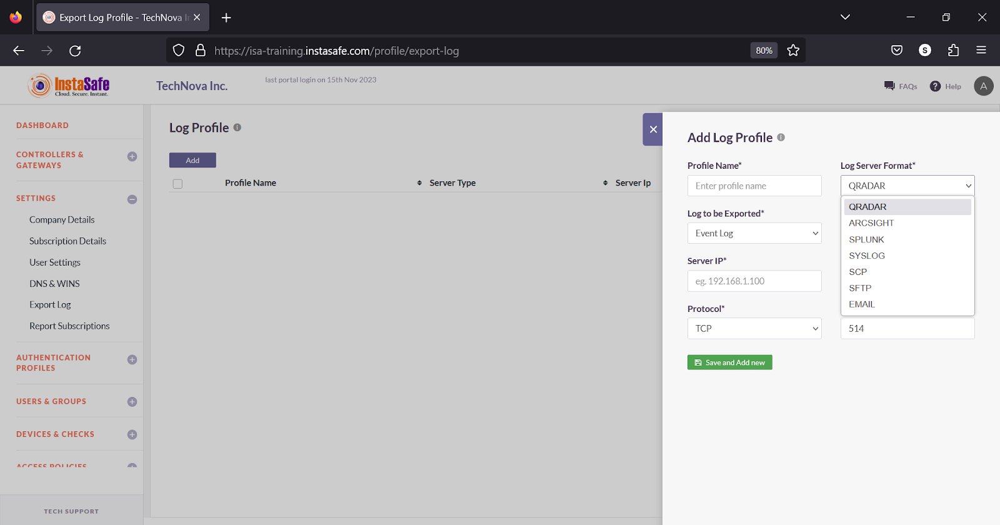
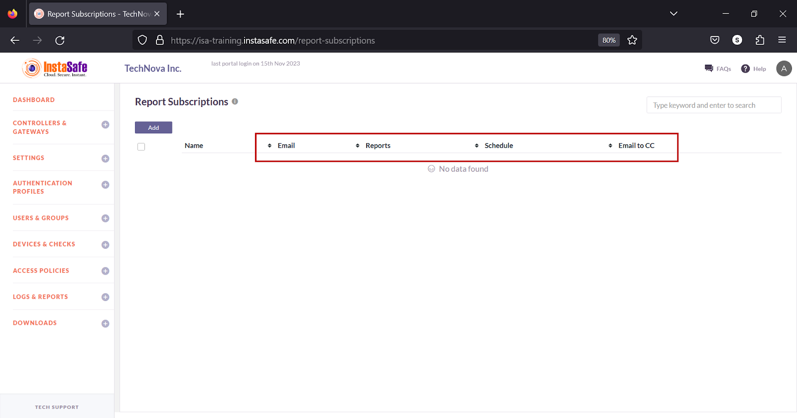
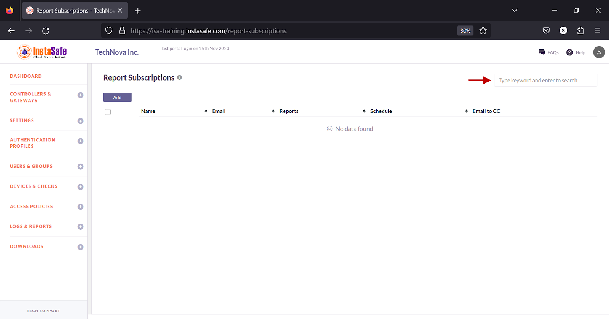

# Configuring Export Log

The Settings > Export Log page allows the ISA web portal administrator to add log profiles to export logs from the ISA web portal to external log management solutions or email. 
The following predefined log server formats are available:

| Name of Log Manager    | Protocol (default) | Port Number |
| ------    | ------     | ------           |
|  QRadar   | TCP        |  22              | 
|  ArcSight | TCP & UDP  |  TCP 515 or 8515 & UDP 514 or 8514  |
|  Splunk   | TCP or UDP |  8088            |
|  Syslog   | TCP        |  514             |
|  SCP      | TCP        |  22              |
|  SFTP     | TCP        |  22              |
|  Email    |  NA        |  NA              |

1.On the Export Log page, click Add.

2.In the Log Profile window, under Profile Name, enter a name for the profile. The maximum number of characters allowed in the field is 50. 

3.Click the Log Server Format drop-down to select the log server. 

4.Click the Log to be Exported drop-down and select Event Log or Session Log, or App Access Log.

5.Click the Timezone drop-down and select either Asia/Calcutta or UTC.

6.In the Server IP field, enter the IP address of the log server.

7.In the Backup Server IP field, enter the IP address of the backup log server.

8.Click the Protocol drop-down, select TCP or UDP

9.In the Port field, enter the port number the server is listening on. 

10.If SCP or SFTP is selected under Log Server Format, in the User Name field, enter the username of the user configured on the server. 

11.If SCP or SFTP is selected under Log Server Format, in the Remote Path field enter the path the log file must be saved. 

12.If Email is selected under Log Server Format, enter one or more email addresses to send the log files to. 

13.Click Save and Add new.

**Sorting the Log Profiles**

You can sort the list by Email, Reports, Schedule, or Email CC. Click the up/down arrow alongside the headers.

**Search Log Profiles**

You can search the list by name by entering it in the search box. 

