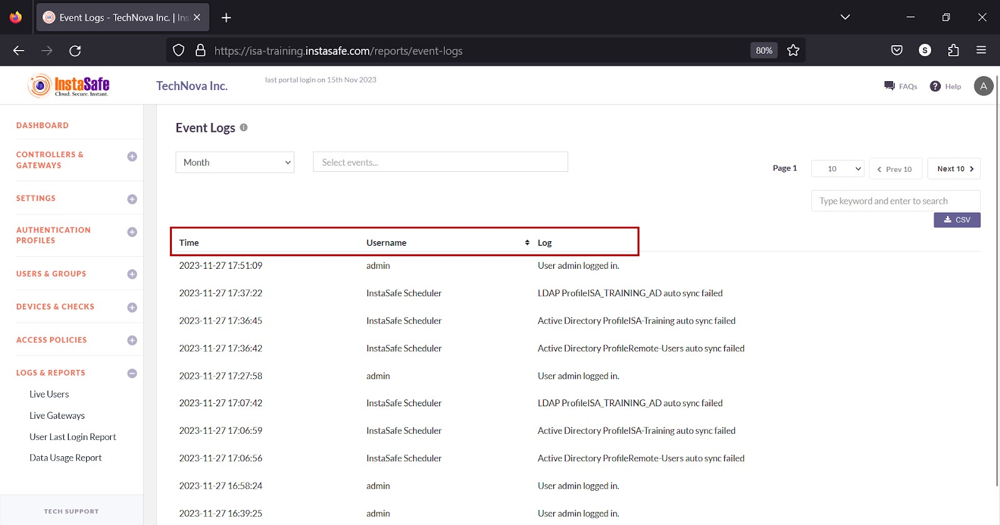
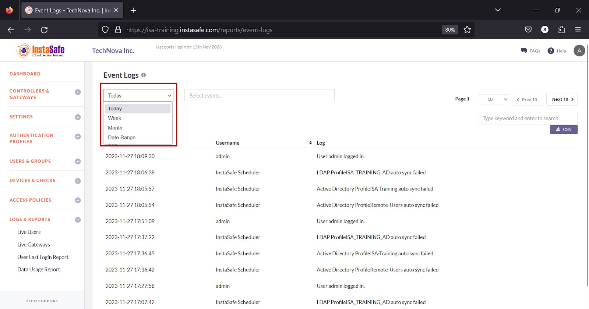
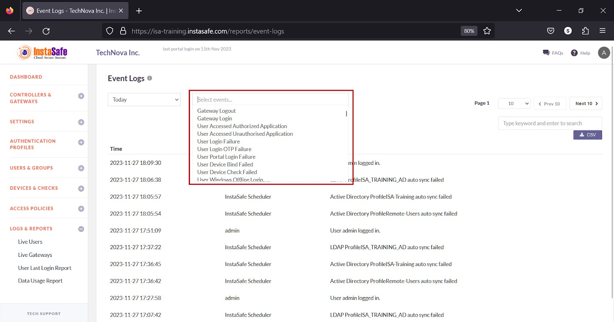
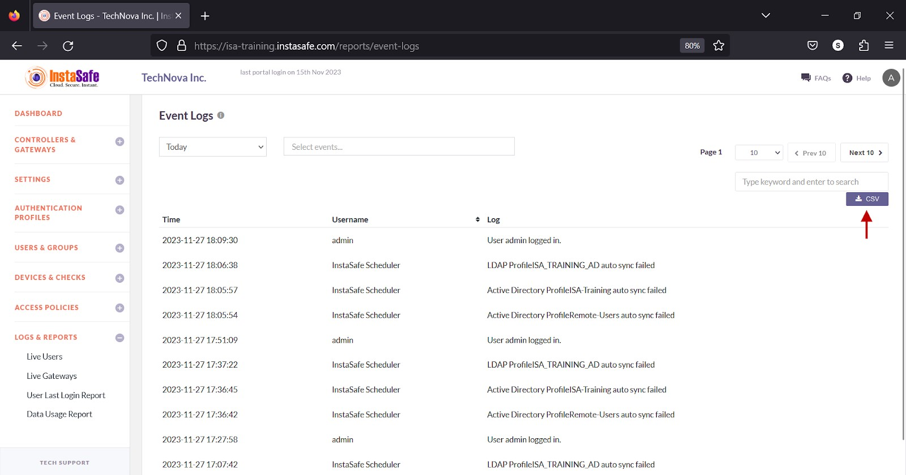
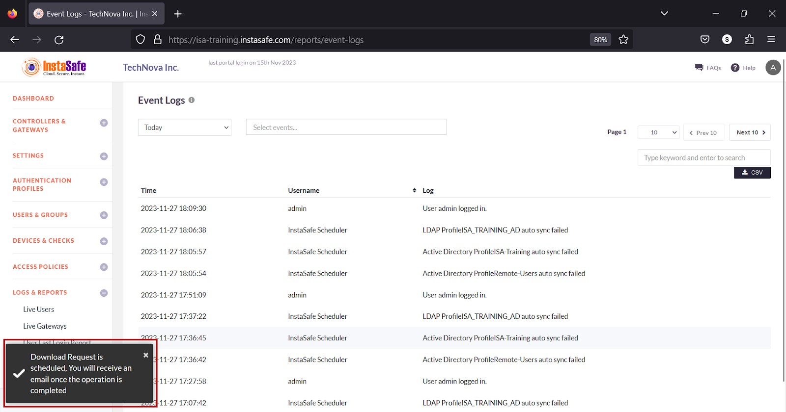
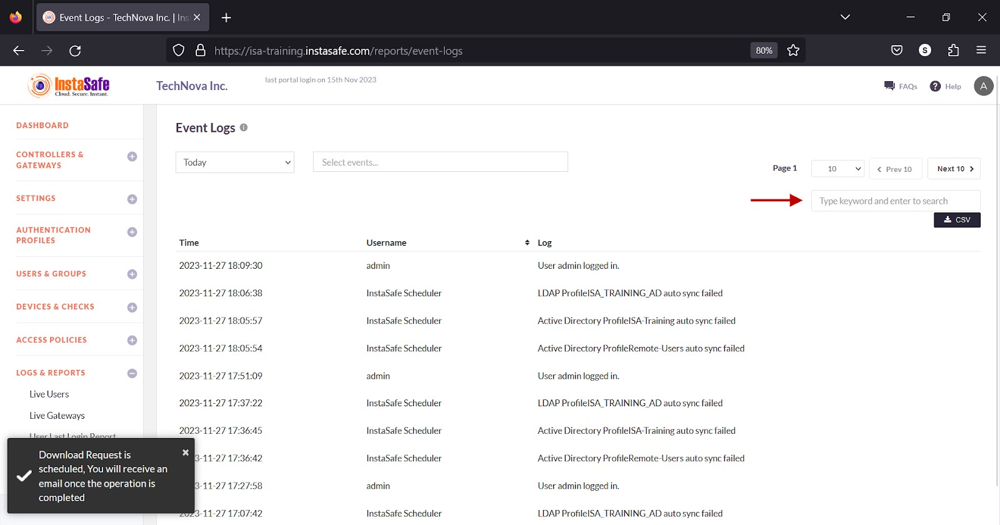
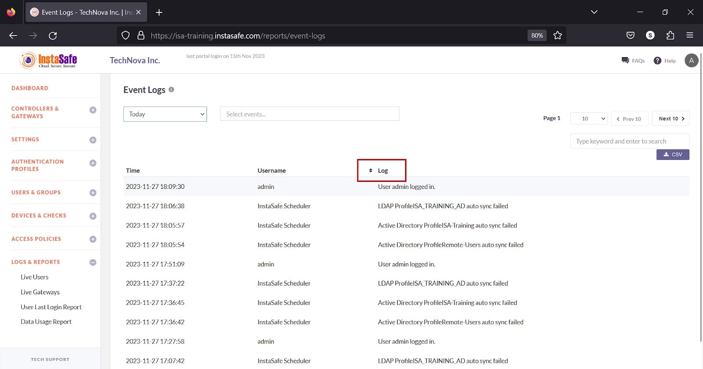

# Event Logs

The **LOGS & REPORTS > Event Log** page lists the event logs. 

By default, the following information is listed on the page

**Time** – The time of the event in YYYY:MM:DD HH:MM:SS 

**Username** – The username of the user.   
   
**Log** – The details of the event 

**View Event Logs**

- The drop-down at the top of the page has options to view the events by Today, Week, Month, and Date Range. 

- Click the Search events drop-down to select the events you want to view.  More than one event can be added in the field.

The following 121 events can be viewed. 

|        |        |        |
| ------ | ------ | ------ |
| Gateway Logout  | Gateway Login | User Accessed Authorized Application|
| User Accessed Unauthorised Application | User Login Failure  | User Portal Login Failure |
| User Login OTP Failure | User Device Bind Failed | User Device Check Failed |
| User Windows Offline Login | User Windows Invalid Credentials | Device Suspended |
| User Agent Login | User Agent Logout| User Agent Login Failure |
| Device Activated | User Installed Agent Successfully | AD User |
| AD User Group    | User Agent Configuration Update   |Gateway Agent Configuration Update |
| User Device Check Authorized | Device Approved | User Login using Authorized Device |
| User Login via OTP Success | User Agent Login Attempt | Device Pending Approval |
| Company Added |   New Admin added |   New Subscription added |
| ISC server edited | ISC server added | updated controller |
| updated gateway   | started controller | restarted controller |
| User Portal Login | User Portal Logout | deleted controller(s) |
| deleted gateway   | updated gateway   | deleted active directory |
| added ldap        | updated ldap      | deleted ldap |
| added radius      | updated radius    | updated company details |
| updated company banner | updated business contact | updated tech contact |
| updated renewal contact | updated dns-wns details | changed password |
| added new user | deleted a company user | searched in group |
| added group    | updated group          | deleted group  |
| added device check | deleted device check | added ACL |
| updated ACL details | deleted ACL | updated application group |
| deleted application group | added application service | deleted application service |
| added application group | added active directory | added controller |
| updated active directory | added gateway | stopped controller |
| commited controller | User Edit | Device Check Edit |
| Device Delete | Google Delete | Google Edit |
| Google Add | SubAdmin Role Add | SubAdmin Role Edit |
| SubAdmin Role Delete | SubAdmin Add | SubAdmin Delete | 
| SubAdmin Disable | SubAdmin Enable | Report Subscription Add |
| Report Subscription Update | Report Subscription Delete | Device Add |
| Device Edit | Active Directory Sync Success | Active Directory Sync Failure |
| LDAP Sync Success | LDAP Sync Failure | Gateway downloaded |
|User downloaded | User Password Reset | User Password Changed |
| User viewed QR code | User Profile Updated | User Account confirmed |
| deleted radius | User Settings Updated | User Suspended |
| User Activated | Export Log Added | Export Log Updated |
| Export Log Deleted | Local Password Policy Updated | updated application service |
| User force disconnected | Gateway force disconnected | User Device Registered |
| user geo binding failure | User Windows MFA Success | User Windows MFA Failure |
| User Windows MFA Bypass  |

**Download Session Log List** 

ISA web portal administrators can download the event logs by **Today, Week, Month,** or **Date Range** by clicking the **CSV** button at the top of the page. After setting the date, select the events from the drop-down list. An email with the link to download the file in CSV format is sent to the logged-in administrator’s email address. 

1.Select the drop-down to select the date. 

2.Click the **Search events** drop-down and select the events. 

3.Click the **CSV** button.

4.A message that an email is scheduled to be sent to the administrator’s email address is displayed. 

5.Click Download File within the email.

6.View the file in a spreadsheet application.

**Navigating the Event Logs page**

The **Event Log** page allows easy pagination for viewing a large number of events. You can view the list by using the navigation control bar at the top right of the page. 

Click the drop-down box to select the number of events to be displayed on the **Event Log** page. By default, it is set to display 10 entries.. You can change it to display either 30 or 50.

Click the **Next** button to view the next page of events. Click the **Prev** button to view the previous page. 

**Searching Event Logs**

You can search the list by name by entering it in the search box. 

**Sorting the Session Log**

You can sort the list by **Log**. Click the up/down arrow alongside the header field. 

**Conclusion**

The **Event Log** page is useful for the ISA web portal administrators to track events.
