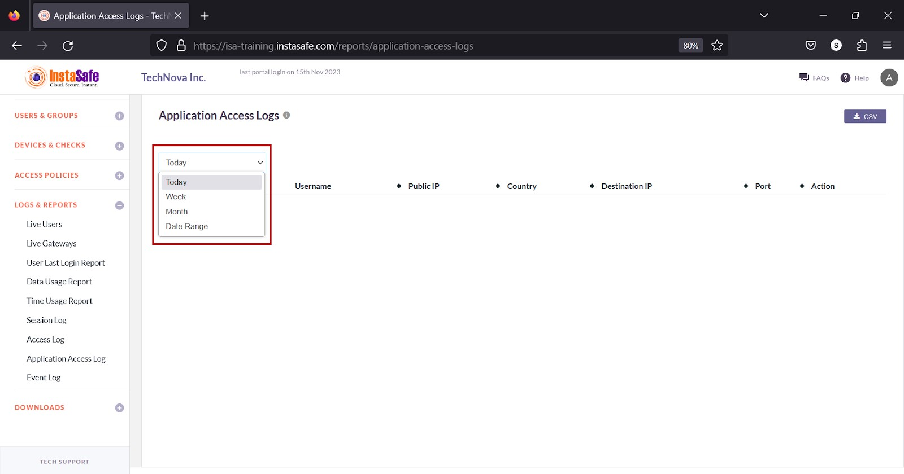
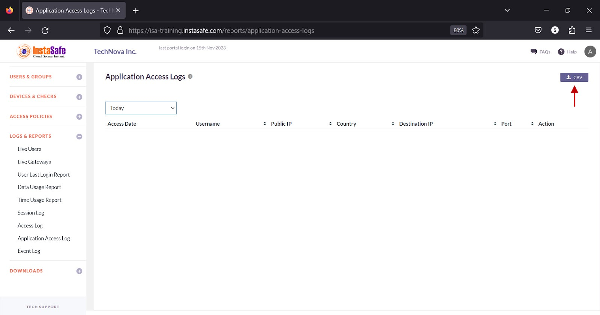
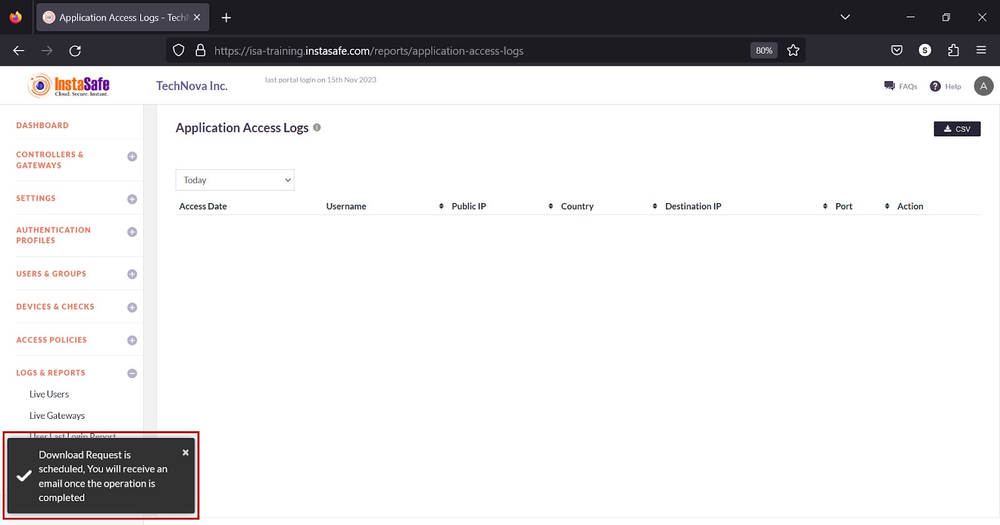
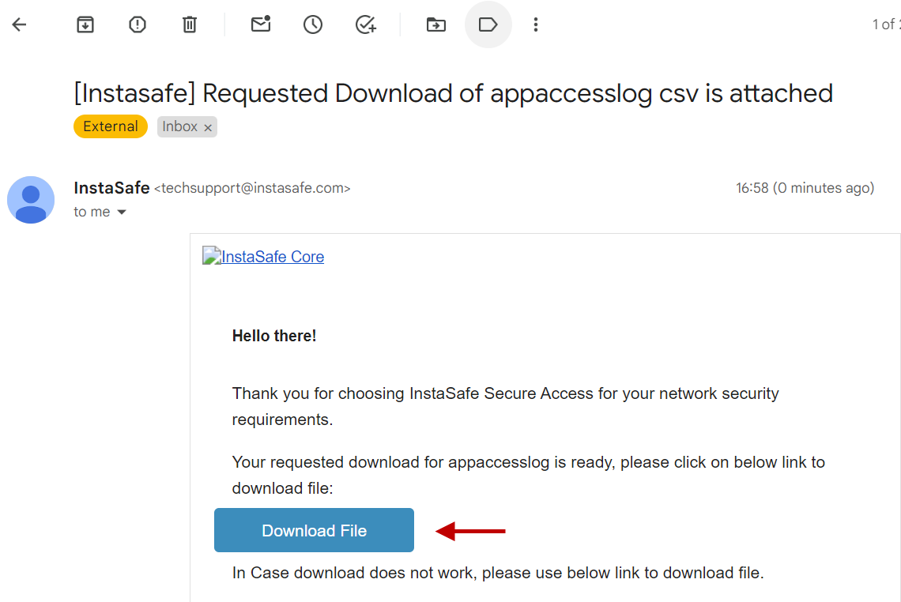
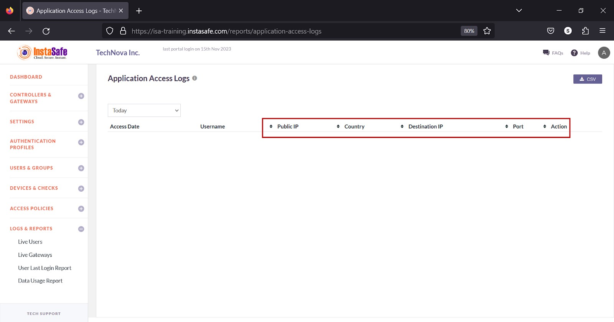

# Application Access Log

The **LOGS & REPORTS** > **Application Access Log** page lists the users who remotely accessed corporate resources. 

**Application Access Logs**

The following information is listed under this section:

**Access Date** – The date on which the resource was accessed in the YYYY-MM-DD HH:MM:SS format.

**Username** – The username of the user who accessed the resource.

**Public IP** – The public IP address of the user.

**Country** – The name of the country where the user accessed the resource from. 

**Destination IP** – The internal IP address of the resource.

**Port** – The port number of the resource.  

**Action** – Allowed or Denied. 

**View Application Access Log**

The drop-down at the top of the page has options to view the log by **Today**, **Week**, **Month**, and **Date Range**.

**Download Application Access Log List** 

ISA web portal administrators can download the complete list of application access by Today, Week, Month, and Date Range and click the CSV button at the top of the page. An email with the link to download the file in CSV format is sent to the logged-in administrator’s email address. The file has the following information:

**Access Date** – The date the resource was accessed in the YYYY-MM-DD HH:MM:SS format.

**Username** – The username of the user who accessed the resource.

**Public IP** – The public IP address of the user.

**Country** – The name of the country where the user accessed the resource from. 

**Destination IP** – The internal IP address of the resource.

**Port** – The port number of the resource.  

**Action** – Allowed or Denied.

1.Click the CSV button.

2.A message that an email is scheduled to be sent to the administrator’s email address is displayed. 

3.Click **Download File** within the email.

4.View the file in a spreadsheet application.

**Sorting the Application Access Log**

You can sort the list by **Public IP**, **Country**, **Destination IP**, **Port**, or **Action**. Click the up/down arrow alongside respective header fields. 

**Conclusion**

The Application Access Log is useful for the ISA web portal administrators to track user access to corporate resources. 