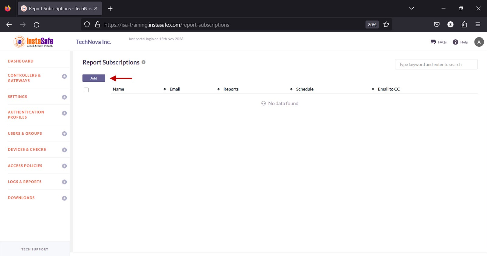
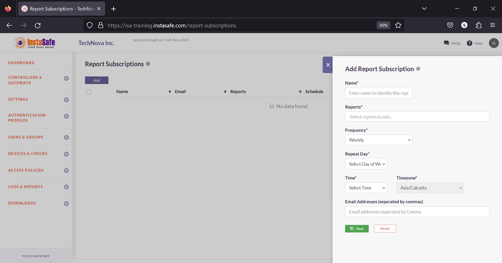
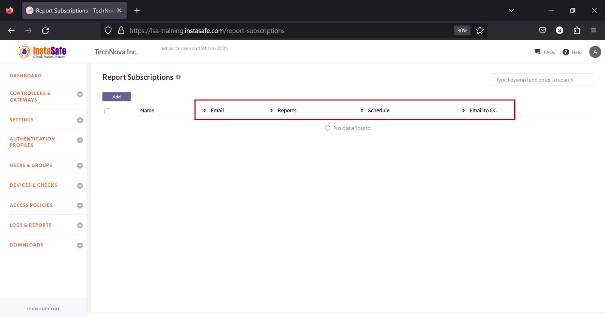
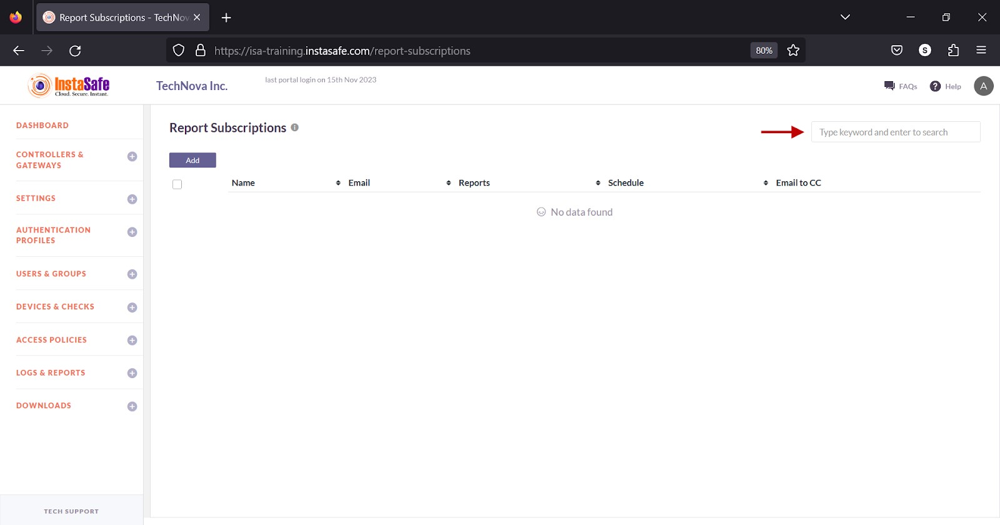

----
comments: true
---
# Configuring Report Subscriptions

The **Settings > Report Subscriptions** page allows the ISA web portal administrator to add profiles to send periodic reports by email to various recipients. 
The following reports can be added to the profile:

|        |        |        |
| ------ | ------ | ------ |
| Live Users |Event Log |Access Policies |
| Live Gateways | User Last Login Report | Controllers |
| Data Usage | User Report | Auth Profile Report |
| Time Usage | Gateways | Auth Profile Group Report |
| Login Failures | User Group | Device Checks | 
| Session Log | Devices | Device Updates |
| Portal Access Log | Application Services | Authenticator Devices |
| Application Access Log | Application Groups| Advance User CSV |

- On the Report Subscriptions page, click Add.

- In the Add Report Subscriptions window, enter the following information:

Name – Enter a name for the report

Reports – Click the drop-down and select one or more reports. 

Frequency – Select Once, Daily, Weekly, or Monthly from the drop-down.

Repeat Day – Select day of the week from the drop-down.

Time – Select a time from the drop-down. 

Timezone – This is predefined as Asia/Calcutta.

Email Addresses (separated by commas) – Enter one or more email addresses to send the report to. 

- Click Save and Add new.

**Sorting the Subscription Profiles**

You can sort the list by Email, Reports, Schedule, or Email CC. Click the up/down arrow alongside the headers.

**Search Log Profiles**

You can search the list by name by entering it in the search box. 

