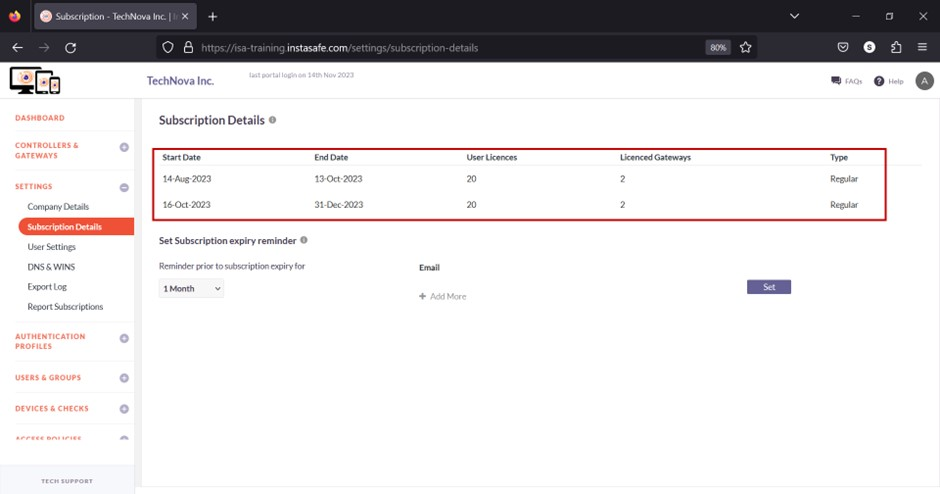
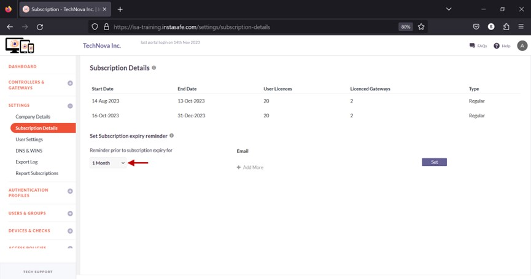
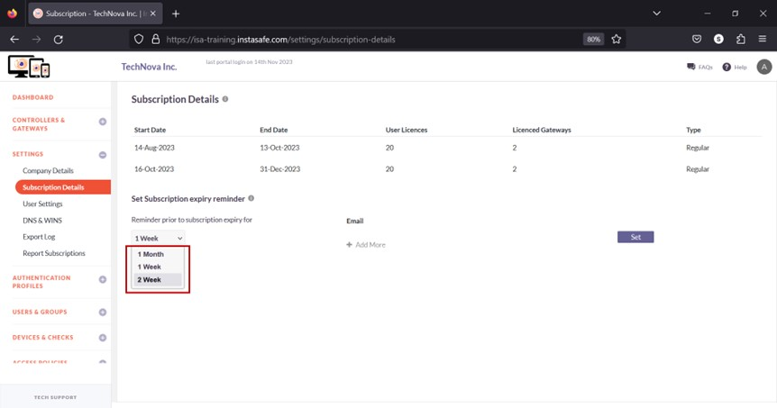
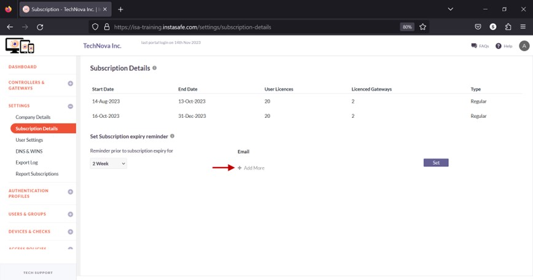
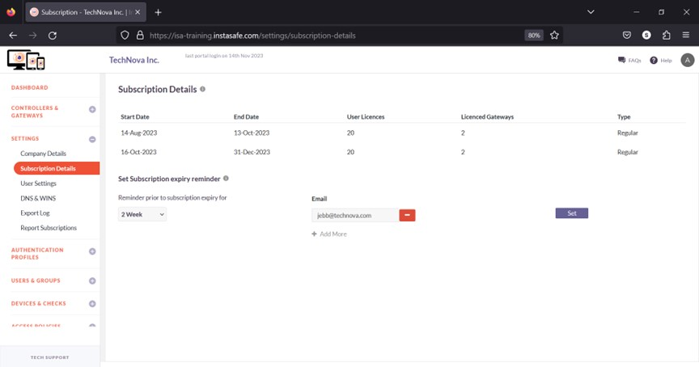

# How to View Subscription and Set Subscription Reminders on the ISA Web Portal

The **Subscription Details** page under the **SETTINGS** menu allows the ISA web portal administrator to view the number of user and gateway licenses and their expiration dates. The administrator can set a reminder to remind the administrator by email before a license expires.

**Subscription Details**

The following information is listed under this section:

- Start Date – The beginning date of the subscription.
- End Date – The expiry date of the subscription.
- User Licences – The number of user licenses. This number dictates the number of users that can be managed on the Users page under the USERS & GROUPS menu.
- Licenced Gateways – The number of gateway licenses. This number dictates the number of gateways that can be added on the Gateways page under CONTROLLERS & GATEWAYS.
- Type – There are two types of licenses, Trial and Regular.

**Set Subscription expiry reminder**

- On this section, click the drop-down under Reminder prior to subscription expiry.

- Select the date before expiration for an email to be sent. The options are Month, 1 Week, and 2 Week. 

- Click Add More under Email.

- Enter the email address. 

- Click Set to save. 

**Conclusion**

The **Subscription Details** page allows the administrator to view user and gateway licenses and set a reminder to notify by email before the expiration of licenses.
