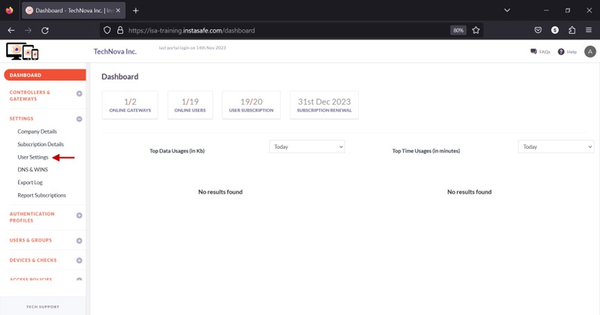
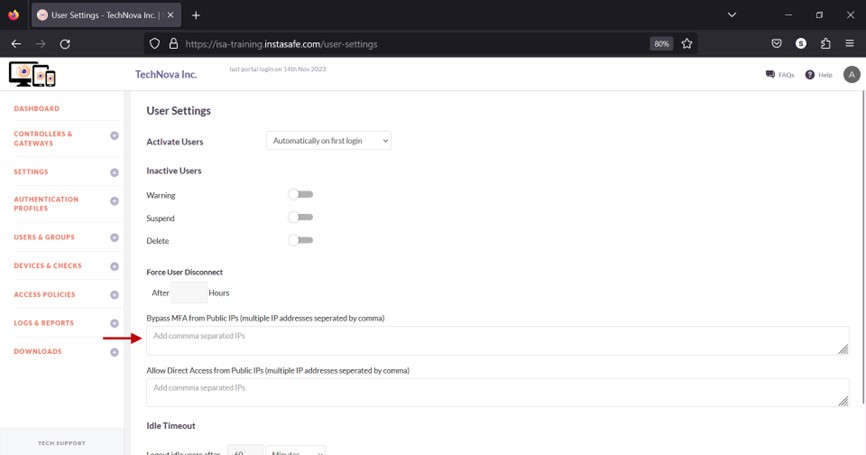
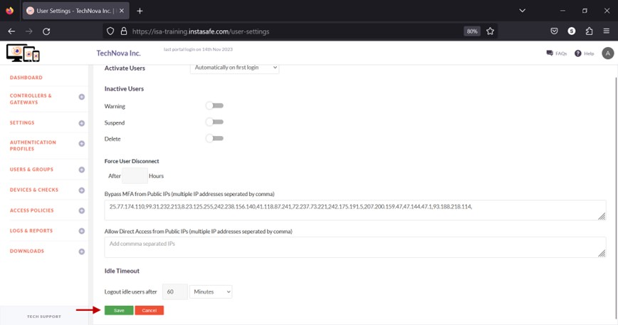

# Bypass Multi-Factor Authentication (MFA) by IP address

The **Bypass MFA from Public IPs** option on the User Settings page allows the ISA web portal administrator to exclude users from Two-Factor or Multi-Factor Authentication (2FA or MFA) by public IP addresses. The IP addresses configured under this option are not prompted for 2FA or MFA.

- Navigate to the **User Settings** page under the **SETTINGS** menu.

- In the text box under Bypass MFA from Public IPs (multiple IP addresses separated by comma), enter the public IP addresses of the users to be excluded from MFA. Multiple IP addresses can be entered separated by commas. 

- Click Save.

