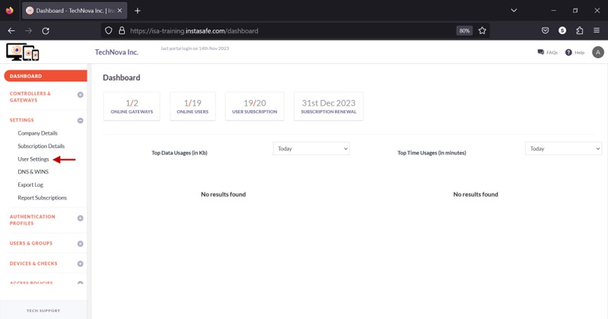
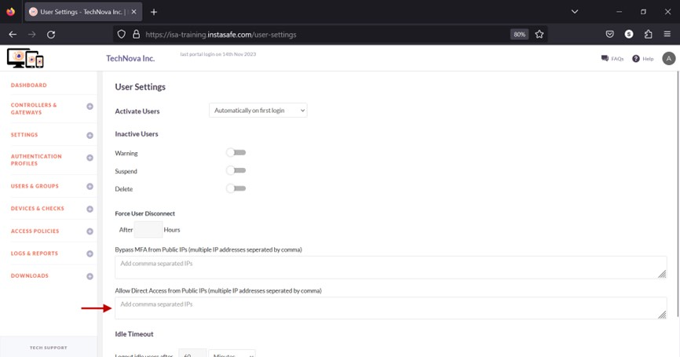
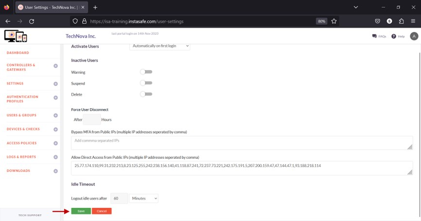

# Allow Direct Access to Corporate Resources

When users are on company premises, they can directly access corporate resources through the corporate network, either wired or using corporate Wi-Fi. However, in specific scenarios, such as in Always-On mode, the ISA User Agent may remain connected to the ISA Controller even when the user is on company premises. In these cases, corporate resources are accessed through the secure tunnel instead of directly via the corporate network. In such instances, enabling the 'Allow Direct Access from Public IPs' option prevents access to corporate resources through the secure tunnel established by the ISA User Agent, forcing the user to access the resource directly.

- Navigate to the User Settings page under the SETTINGS menu.

- In the text box under Allow Direct Access from Public IPs (multiple IP addresses separated by comma), enter the public IP addresses of the users who require direct access. Multiple IP addresses can be entered separated by commas. 

- Click Save.

