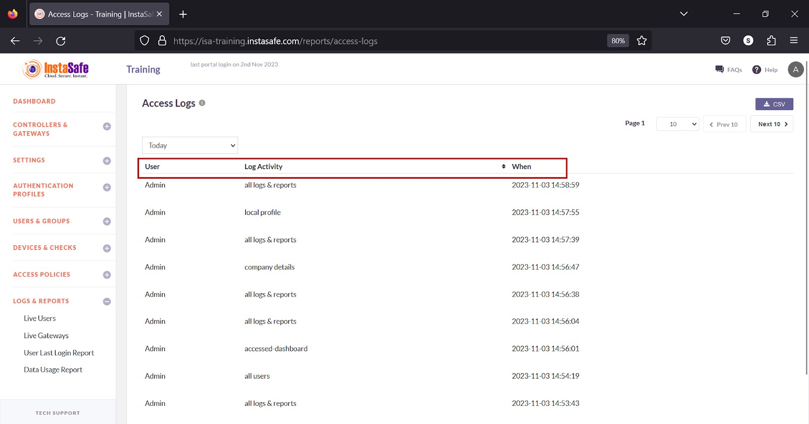
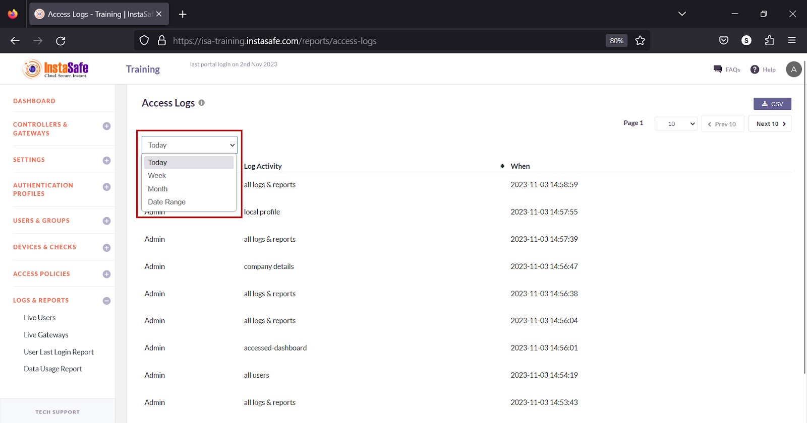
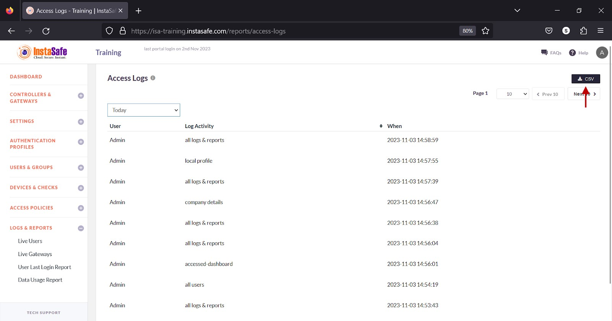
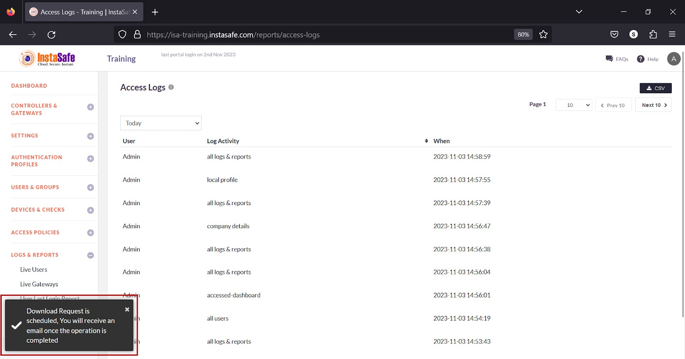
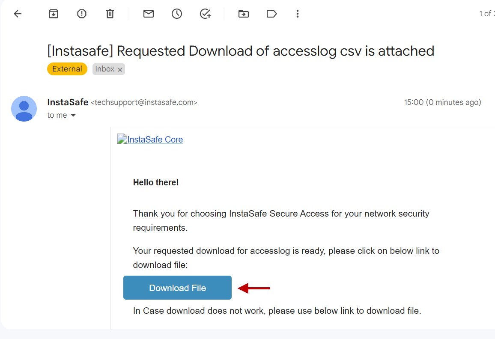
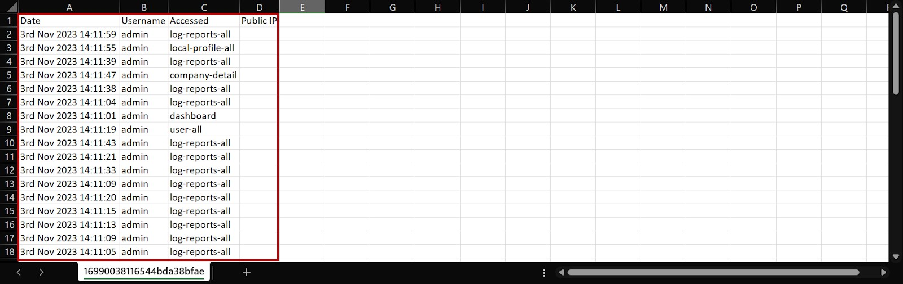
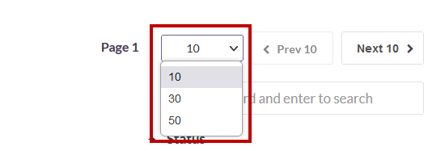
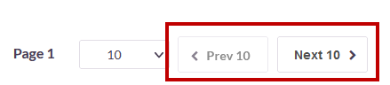
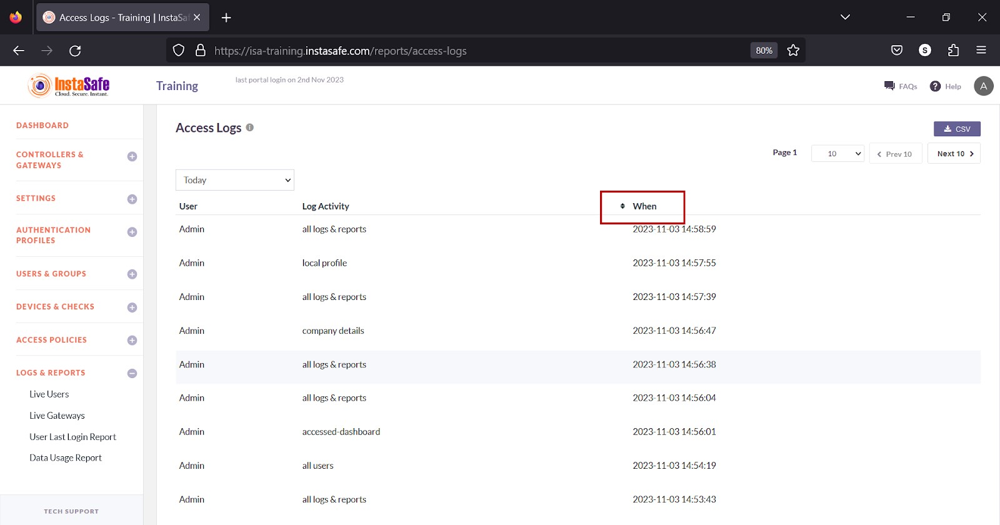

# Access Log

The **LOGS & REPORTS > Access Log** page lists the ISA web console login sessions. Each entry on the page contains the username of the user, the page on the web portal that the user was active on, and the duration the user was on that page. 

Information

The following information is listed on the page

**User** – The username of the user.

**Log Activity** – The name of the page on the portal.

**When** - The time when the user was on the page in YYYY:MM:DD HH:MM:SS format.

**View Access Log**

The drop-down at the top of the page has options to view the sessions by **Today, Week, Month, and Date Range.**

**Download Access Log List**

ISA web portal administrators can download the access log by **Today, Week, Month, and Date Range** by clicking the CSV button at the top of the page. An email with the link to download the file in **CSV** format is sent to the logged-in administrator’s email address. The file has the following information:

**User** – The username of the user.

**Log Activity** – The name of the page on the portal. 

**When** - The time when the user was on the page in YYYY:MM:DD HH:MM:SS format. 

**Public IP** – The public IP address of the logged-in user.

- Click the CSV button.

- A message that an email is scheduled to be sent to the administrator’s email address is displayed. 

- Click **Download File** within the email.

- View the file in a spreadsheet application.

**Navigating the Access Log**

The Access Log page allows easy pagination for viewing a large number of user sessions. You can view the list by using the navigation control bar at the top right of the page. 
Click the drop-down box to select the number of user sessions to be displayed on the Access Log page. By default, it is set to display 10 user sessions. You can change it to display either 30 or 50. 

Click the Next button to view the next page of sessions. Click the Prev button to view the previous page. 

**Sorting the Access Log**

You can sort the list by the **When** header. Click the up/down arrow alongside the header. 

**Conclusion**

The Access Log is useful for the ISA web console administrators to track web portal login sessions. 

