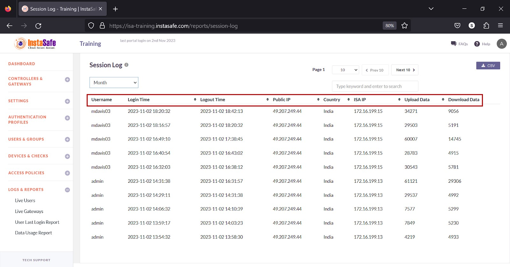
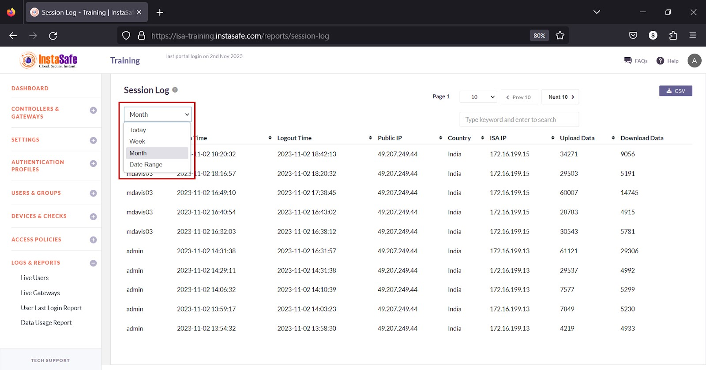
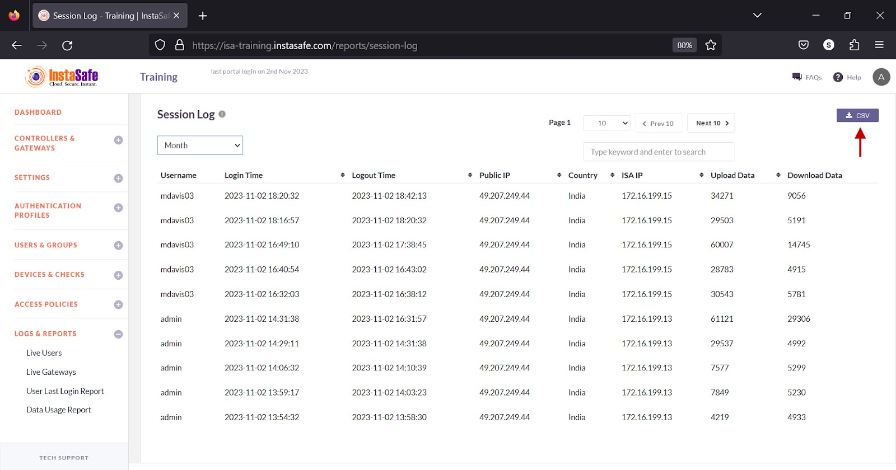
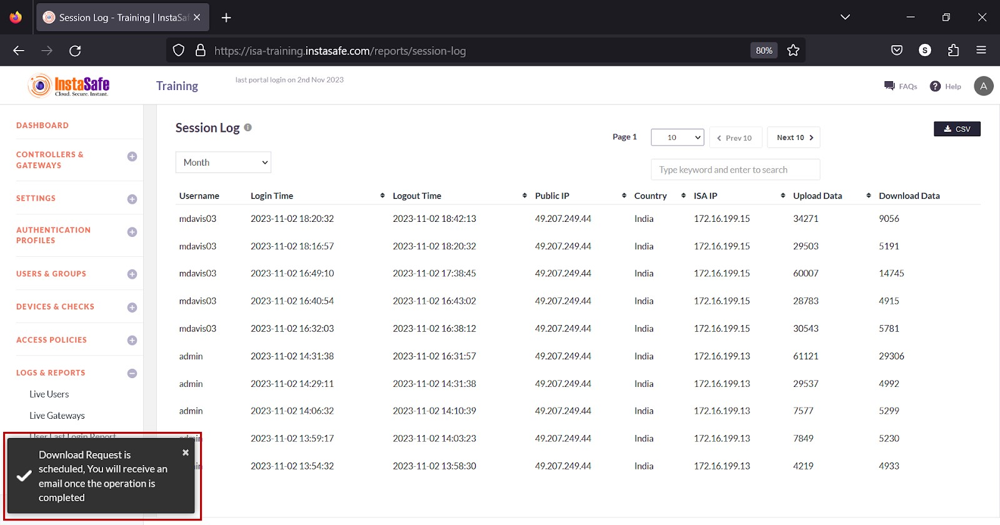
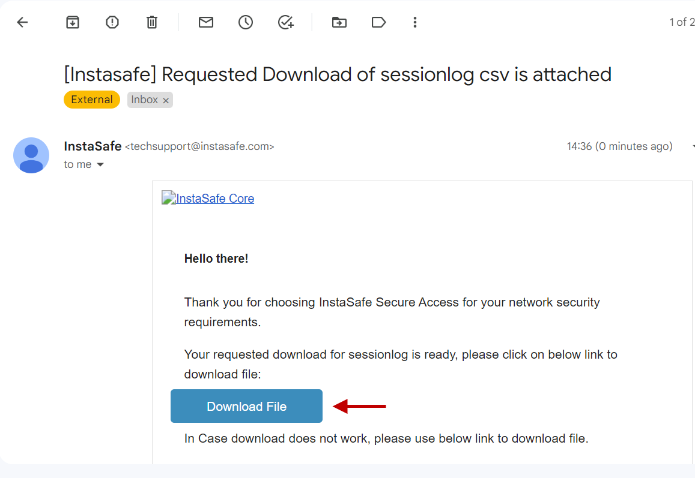
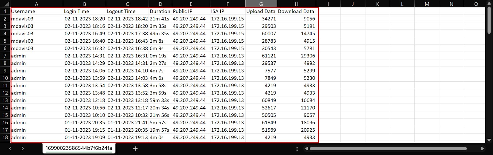
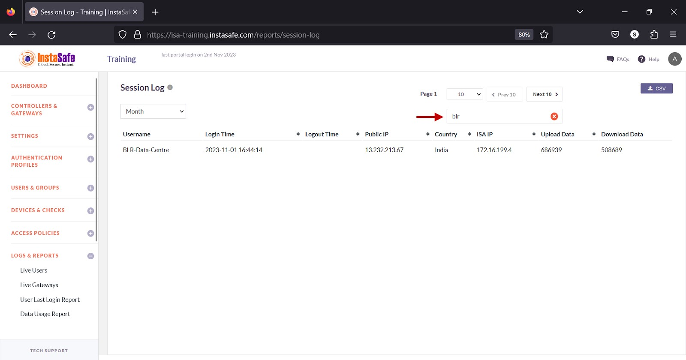
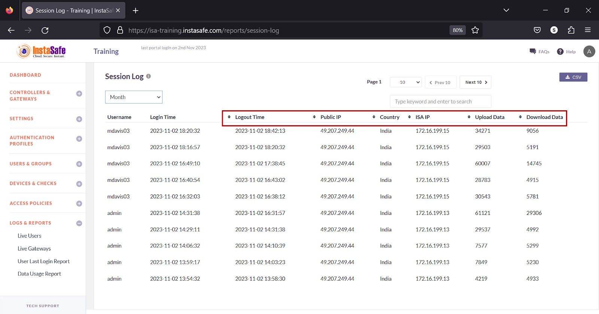

# Session Log

The **LOGS & REPORTS > Session Log** page lists the login sessions of users and Gateways. The page lists each session login and logout time of both users and Gateways. This report is useful for ISA web portal administrators to track logged-in sessions.

**Information**

The following information is listed on the page:

**Username** – The username or Gateway name. 

**Login Time** – The login time in YYYY:MM:DD HH:MM:SS 

**Logout Time** - The logout time in YYYY:MM:DD HH:MM:SS

**Public IP** – Public IP address of the connecting agent.

**Country** – Name of the country where the agent is connecting from. 

**ISA IP** – IP address of the virtual adapter. 

**Upload Data** – Data Transmitted during the session in kilobytes.

**Download Data** – Data Received during the session in kilobytes.

**View Session Log**

The drop-down at the top of the page has options to view the sessions by **Today, Week, Month, and Date Range.** 

**Download Session Log List**

ISA web portal administrators can download the complete list of session logs by **Today, Week, Month, and Date Range** by clicking the CSV button at the top of the page. An email with the link to download the file in **CSV** format is sent to the logged-in administrator’s email address. The file has the following information:

**Username** – The username or Gateway name.

**Login Time** – The login time in YYYY:MM:DD HH:MM:SS 

**Logout Time** - The logout time in YYYY:MM:DD HH:MM:SS

**Public IP** – Public IP address of the connecting agent.

**Country** – Name of the country where the agent is connecting from. 

**ISA IP** – IP address of the virtual adapter. 

**Upload Data** – Data Transmitted during the session in kilobytes.

**Download Data** – Data Received during the session in kilobytes. 

- Click the CSV button.

- A message that an email is scheduled to be sent to the administrator’s email address is displayed.

- Click Download File within the email.

- View the file in a spreadsheet application.

**Navigating the Session Log**

The **Session Log** page allows easy pagination for viewing a large number of user or Gateway sessions. You can view the list by using the navigation control bar at the top right of the page. 

Click the drop-down box to select the number of sessions to be displayed on the **Session Log** page. By default, it is set to display 10 user or Gateway sessions. You can change it to display either 30 or 50. 

Click the Next button to view the next page of sessions. Click the Prev button to view the previous page. 

You can search the list by name by entering it in the search box. 

**Sorting the Session Log**

You can sort the list by **Logout Time**, **Public IP**, **Country**, **ISA IP**, **Upload Data**, and **Download Data**. Click the up/down arrow alongside respective header fields.

**Conclusion**

The Session Log is useful for the ISA web portal administrators to track user and Gateway sessions.
