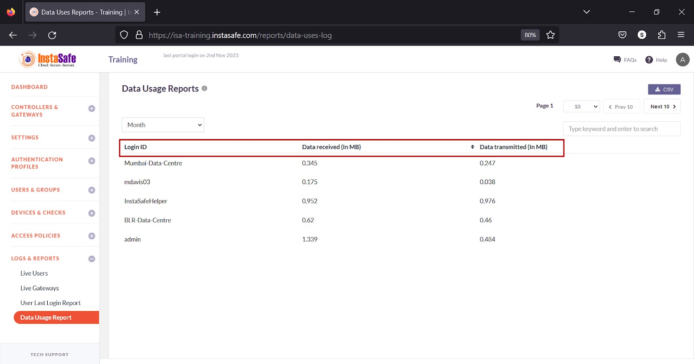
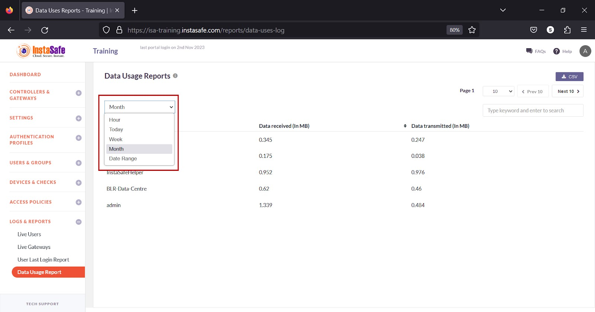
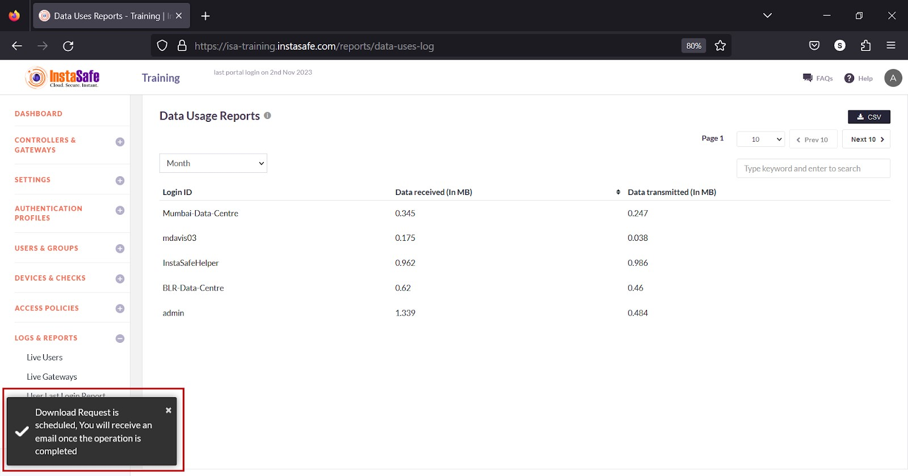
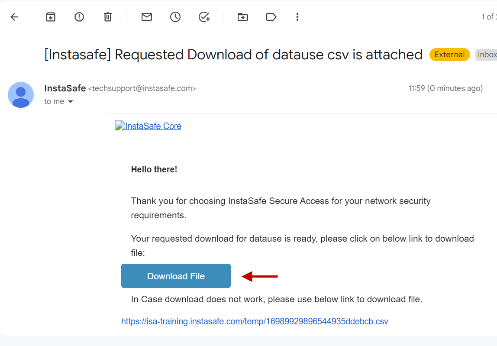
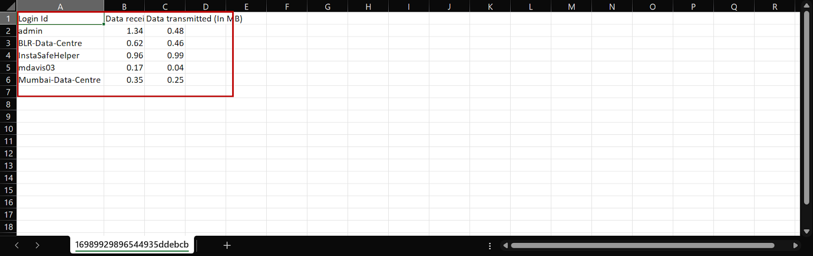
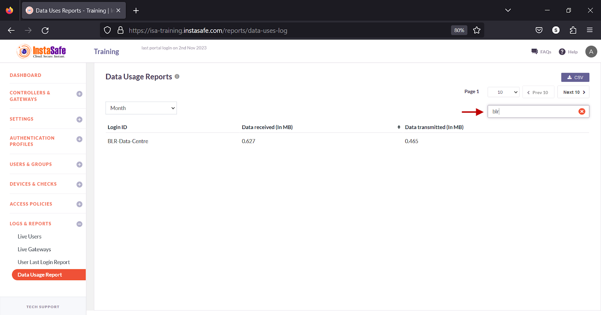

# Time Usage Report

The Time Usage Report page lists the session time of both users and Gateways for a given period. This report is useful for ISA web portal administrators to track logged-in sessions. 

**Information**

The following information is listed on the page

**Login ID** – The username or name of the Gateway.

**Session Time (Minutes)** – The logged-in session time in minutes of  the user’s device or Gateway for the period selected. 

**View Time Usage**

The drop-down at the top of the page has options to view session time by **Hour**, **Today**, **Week**, **Month**, and **Date Range**.

**Download Live Users List**

ISA web portal administrators can download the complete list of time usage by **Hour**, **Today**, **Week**, **Month**, and **Date Range** by clicking the CSV button at the top of the page. An email with the link to download the file in **CSV** format is sent to the logged-in administrator’s email address. The file has the following information:

**Login ID** – The username or name of the Gateway.

**Session Time (Minutes)** – The logged-in session time in minutes of  the user’s device or Gateway for the period selected. 

- Click the **CSV** button

- A message that an email is scheduled to be sent to the administrator’s email address is displayed.

- Click **Download File** within the email.

- View the file in a spreadsheet application.

**Navigating the Time Usage List**

The **Time Usage Report** page allows easy pagination for viewing a large number of user or Gateway sessions. You can view the list by using the navigation control bar at the top right of the page. 
Click the drop-down box to select the number of sessions to be displayed on the **Time Usage Report** page. By default, it is set to display 10 users or Gateways. You can change it to display either 30 or 50. 

Click the **Next** button to view the next page of sessions. Click the **Prev** button to view the previous page. 

You can search the list by name by entering it in the search box. 

**Conclusion**

The **Time Usage Report** is useful for ISA web portal administrators to  track user and Gateway sessions.

