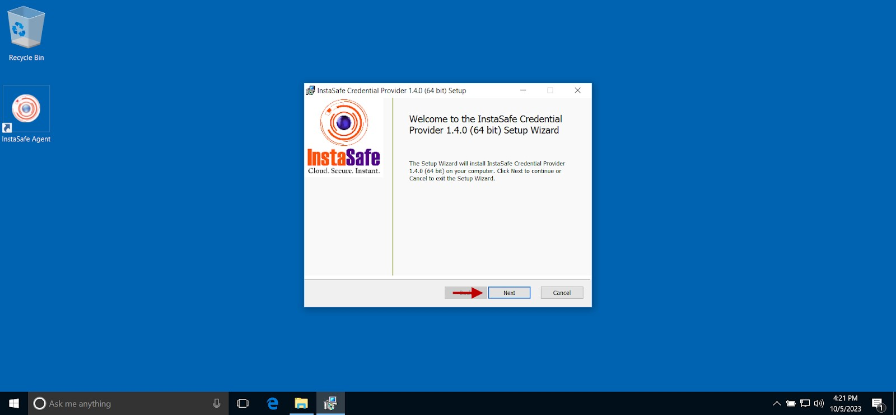
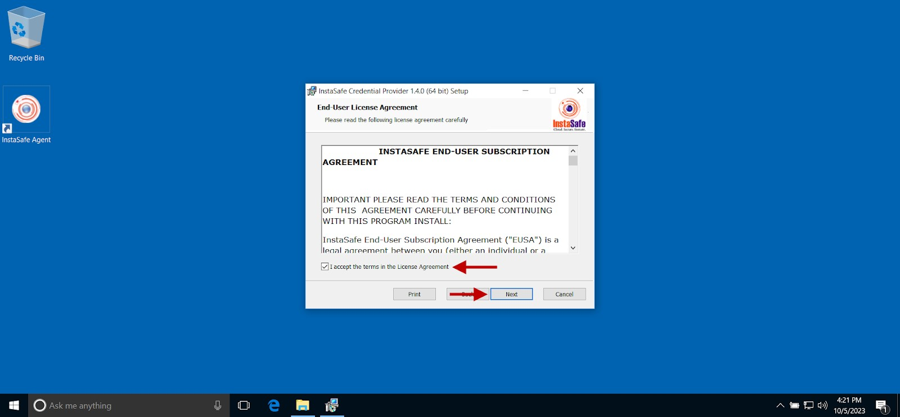
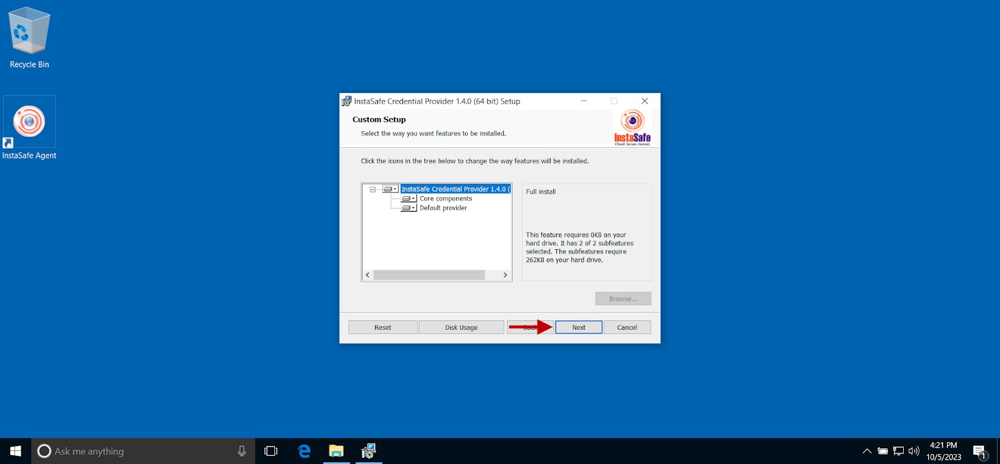
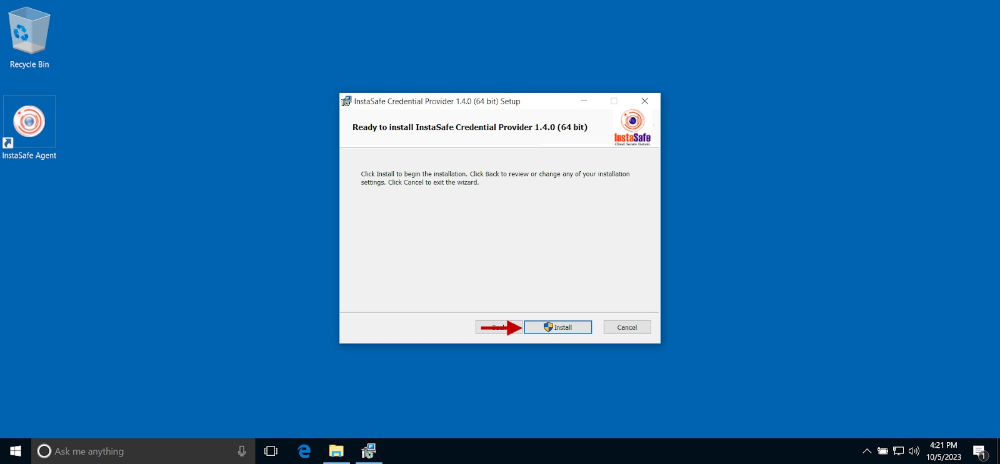
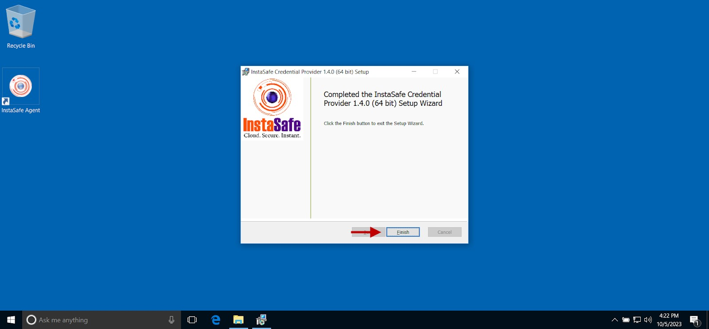
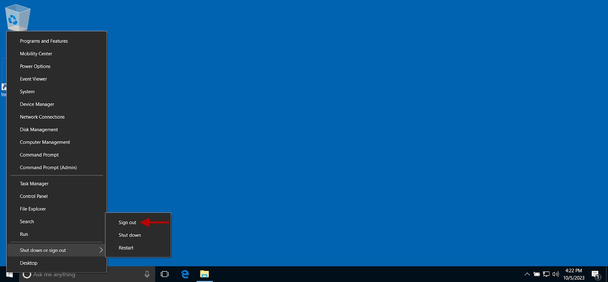
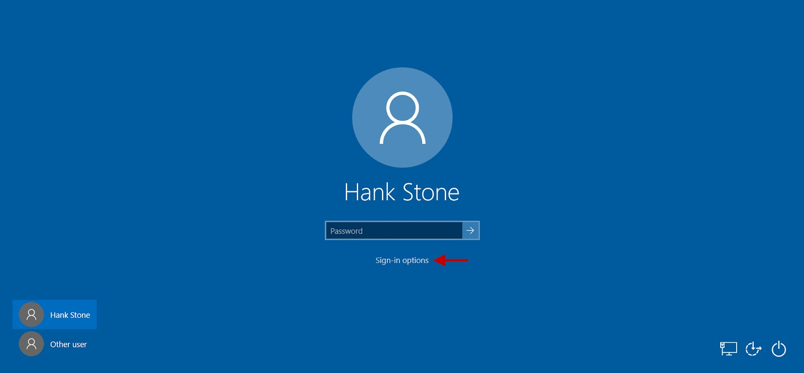
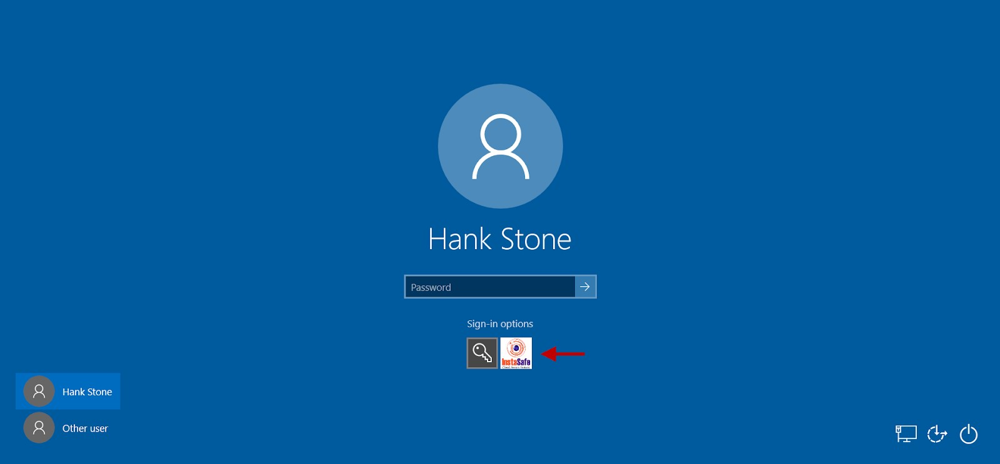
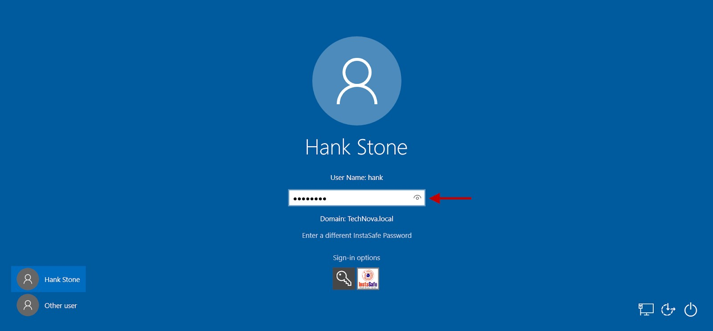
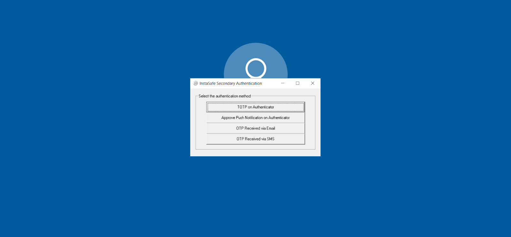

# Integrating InstaSafe Credential Provider (ICP) into Windows Authentication

InstaSafe Credential Provider (ICP) is a secure authentication solution that improves the logon security of Windows desktops, Windows servers, and Windows Terminal Servers by adding an additional authentication method when logging into Windows desktops. ICP can manage multiple kinds of secondary authentication methods for the domain users, such as TOTP via email, SMS, and authenticator apps, such as the InstaSafe Authenticator app, installed on mobile devices. Users will need to authenticate their identity with their Windows password and additionally with their token as the secondary authentication factor.

## **Prerequisites**

Ensure that the following conditions are fulfilled before configuring ICP: 

- The user or user group must have Authentication Type set to Certificate take advantage of Always-On mode. 
- The user or user group must have Two-Factor Authentication (TFA) enabled. If enabled at the group level, TFA could be disabled for those users that do not require TFA. 
- The ISA Gateway Agent must be connected to the ISA Controller. 
- If using a corporate authentication server, the ISA Gateway Agent must be able to access the authentication server. 
- The Windows PC must be installed with Microsoft Windows version 7 and above. Both 32-bit and 64-bit versions are supported. 
- It is recommended to allow Windows logon using cached credentials
- The latest version of the ISA User Agent must be installed on the client PC. Download the Agent from the ISA web console. 
- The user must either have administrator rights on the PC or must have in hand the credentials of the administrator for installing the ISA User Agent and ICP.  
- The feature “Extended Validation for Certs” must be enabled.  To verify, contact InstaSafe Support.
- Users who have enabled MS Hello PIN should ensure that the password for the said account is available with them during the login process. When users who use MS Hello PIN, select Login via InstaSafe tile and provide the Windows password . Further, MS Hello pin will work when Windows default login tile is selected.

## **How to install ICP ?**

- ICP can be integrated for both local and domain users.
- For Windows local users, the username must match the user created on the ISA web console. 
- For Windows local users, if the password is different from ISA local users, use the option Enter a different InstaSafe password to enter both the Windows local user password and the password set on the ISA web console for the ISA local user. 
- It is recommended to set the Authentication Type for the user or user group to Password to take advantage of the Always-On mode. Always-On mode has the following advantages:
    - The ISA User Agent prompts for the password only during installation of the Agent.  
    - The ISA User Agent is automatically connected at the start-up of the Windows PC on successful authentication using Multi-Factor Authentication (MFA).  
- Log into the Windows PC using domain credentials.
- Download and install the latest ISA User Agent that is available on the ISA web console.

- Download the latest version of ICP. 
- On the ICP setup wizard, click Next.

- On the InstaSafe End-User Subscription Agreement screen, enable the I accept the terms … checkbox and click Next. 

- On the Custom Setup screen, you may retain the default settings and click Next.

- Click Install to begin installation.

- Once the installation is completed, click Finish.

**Login with ICP**

- Sign out from the session.

- At the password prompt, click Sign-in options.

- Click the InstaSafe icon under Sign-in options.

- Enter the user’s domain password.

- Press Enter. 

- On the InstaSafe Secondary Authentication menu, select the method you wish to authenticate. For TOTP and push notification approval, an authenticator app, such as InstaSafe Authenticator, must be installed on a mobile device.   

- If OTP was selected as the secondary authentication method, enter the OTP received via email or SMS.

- Click Submit.

- The user will be successfully logged into the PC. 

**Conclusion**

InstaSafe Credential Provider (ICP) provides additional security to the Windows logon process by integrating Multi-Factor Authentication (MFA) to the process. MFA powered by InstaSafe adds an additional layer of cloud-enabled secondary authentication system to the existing security infrastructure to secure networks from account compromise.
