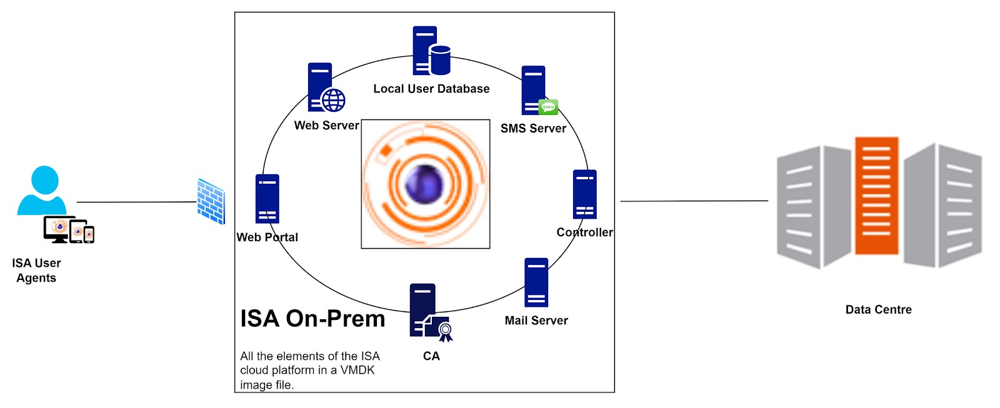

# ISA On-Prem Deployment

InstaSafe Secure Access (ISA) on-premises deployment extends the capabilities of the InstaSafe Cloud Delivery Platform (ICDP) into the customer's on-premises infrastructure. This will integrate InstaSafe enterprise remote access software solution into their corporate network.

**Key Technical Features**

**VMDK Image File:** A Virtual Machine Disk (VMDK) image file is provided to customers.

**Resource Allocation:** The image is pre-configured with 4 CPU cores, 4 MB memory, and 8 GB storage, with the option to expand storage as required. 

**Comprehensive Feature Set:** The image incorporates all basic features available in the ISA cloud infrastructure. Additional features are enabled based on customer specifications prior to sharing the image file.

**Unified Controller and Gateway:** In on-premises deployments, the ISA Controller and Gateway operate as a unified entity, performing the roles of both. The option to add a Controller is eliminated as the Controller is already incorporated within the image file. 

**Components Hosted Within the Image**

**Web Portal:** Accessible within (and outside of) the on-premises environment, providing a centralized interface for managing secure access.

**Web Server:** Facilitates secure communication between users and the ISA deployment.

**Authentication Server and Database:** Manages user authentication securely with an integrated database for streamlined access control.

**Controller:** Manages access control and data connection between the remote uses and the Gateway.

**PKI Server:** Provides Public Key Infrastructure for encryption and authentication.

**Mail Server and SMS Server:** Manages multi-factor authentication through email and SMS, enhancing overall security.

**Conclusion**

ISA on-premises deployment provides a comprehensive and integrated secure enterprise remote access solution customised as per customer requirements.

