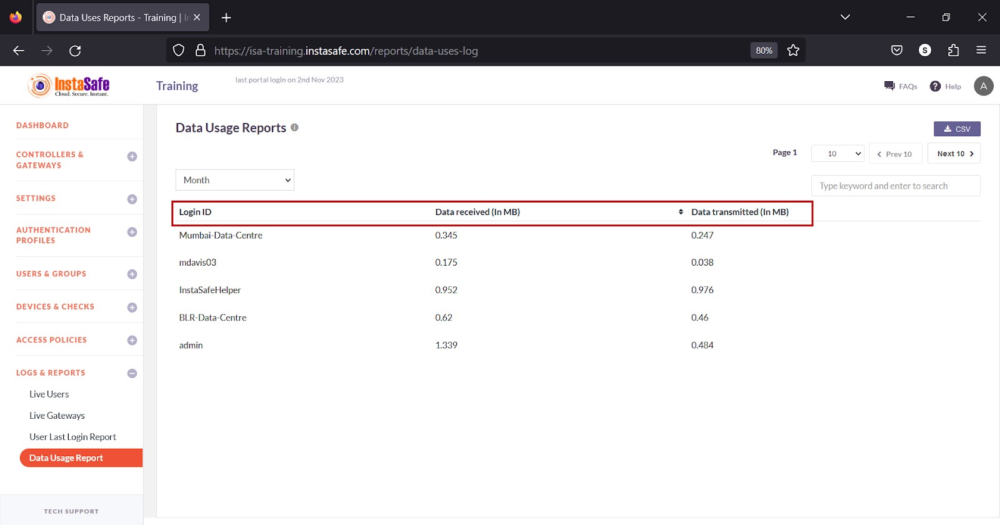
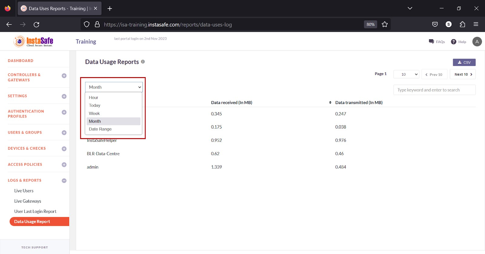
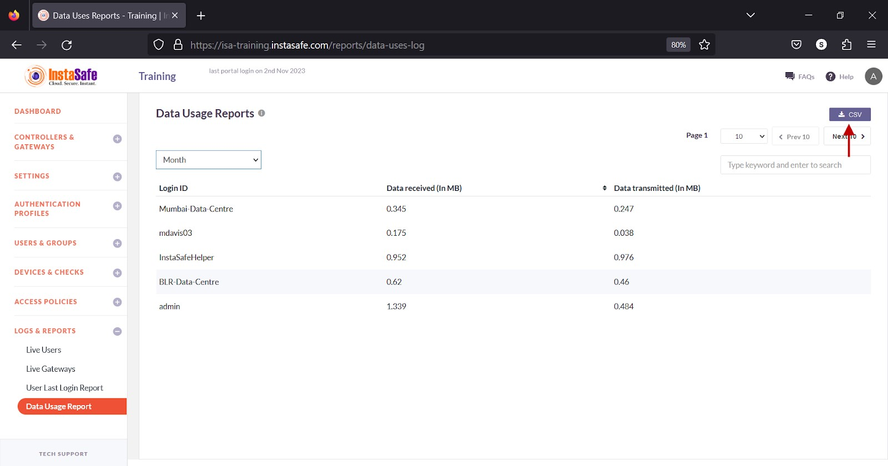
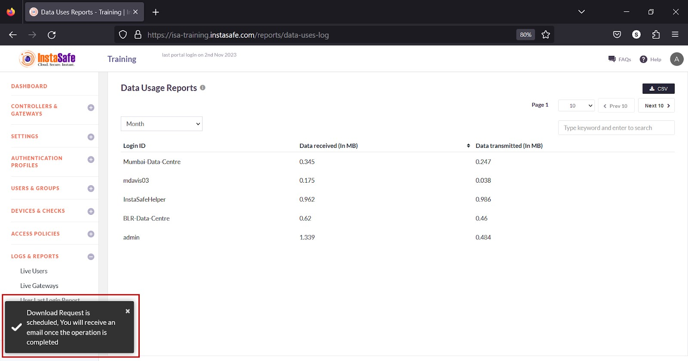
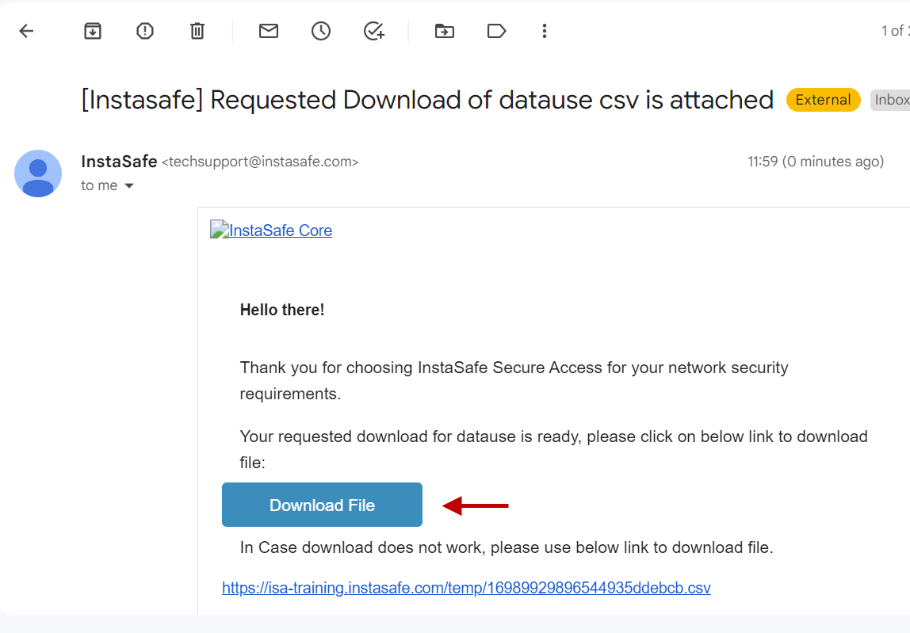
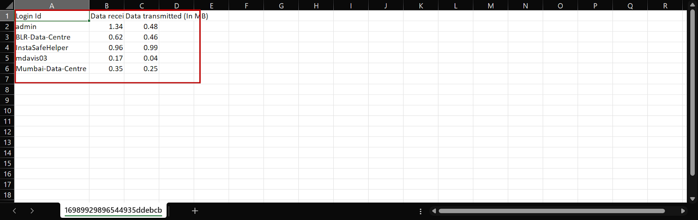

# Data Usage Report

The Data Usage Report page lists the data usage of both users and Gateways. This report is useful for ISA web portal administrators in facilitating the effective monitoring and management of data usage and resource allocation, ensuring efficient network operation and potential anomaly detection in data activities. 

**Information**

The following information is listed on the page:

1.Login ID – The username or name of the Gateway.

2.Data received (In MB) – The amount of data received in megabytes by the user’s device or Gateway for the period selected. 

3.Data transmitted (In MB) – The amount of data transmitted in megabytes by the user’s device or Gateway for the period selected. 

**View Data Usage**

The drop-down at the top of the page has options to view data usage by Hour, Today, Week, Month, and Date Range. 

**Download Live Users List**

ISA web portal administrators can download the complete list of data usage by Hour, Today, Week, Month, and Date Range by clicking the CSV button at the top of the page. An email with the link to download the file in CSV format is sent to the logged-in administrator’s email address. The file has the following information:

1.Login ID – The username or name of the Gateway.

2.Data received (In MB) – The amount of data received in megabytes by the user’s device or Gateway for the period selected. 

3.Data transmitted (In MB) – The amount of data transmitted in megabytes by the user’s device or Gateway for the period selected. 

- Click the CSV button.

- A message that an email is scheduled to be sent to the administrator’s email address is displayed.

- Click Download File within the email.

- View the file in a spreadsheet application.

**Navigating the Data Usage List**

The Data Usage page allows easy pagination for viewing a large number of users or Gateways. You can view the list by using the navigation control bar at the top right of the page. 
Click the drop-down box to select the number of users or Gateways to be displayed on the Data Usage page. By default, it is set to display 10 users or Gateways. You can change it to display either 30 or 50.

Click the Next button to view the next page of users or Gateways. Click the Prev button to view the previous page. 

You can search the list by name by entering it in the search box. 

