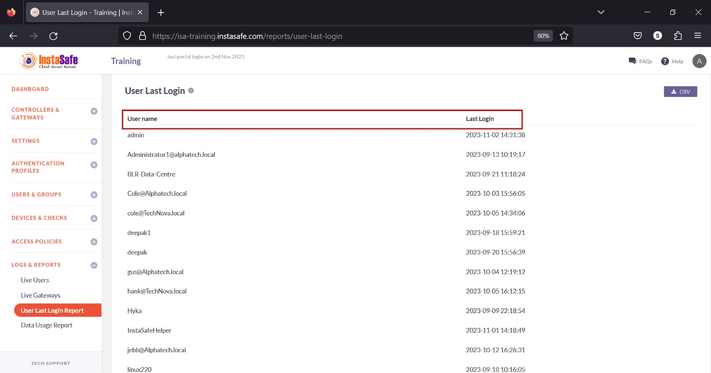
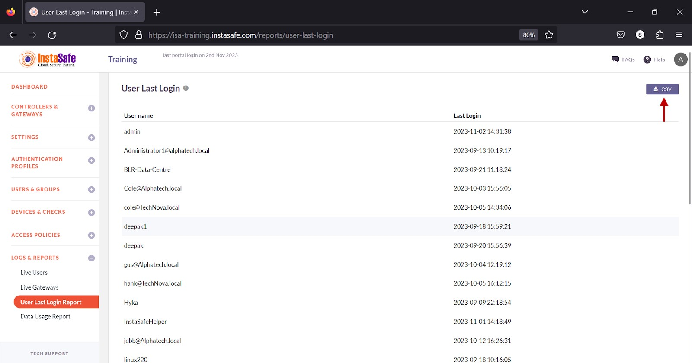
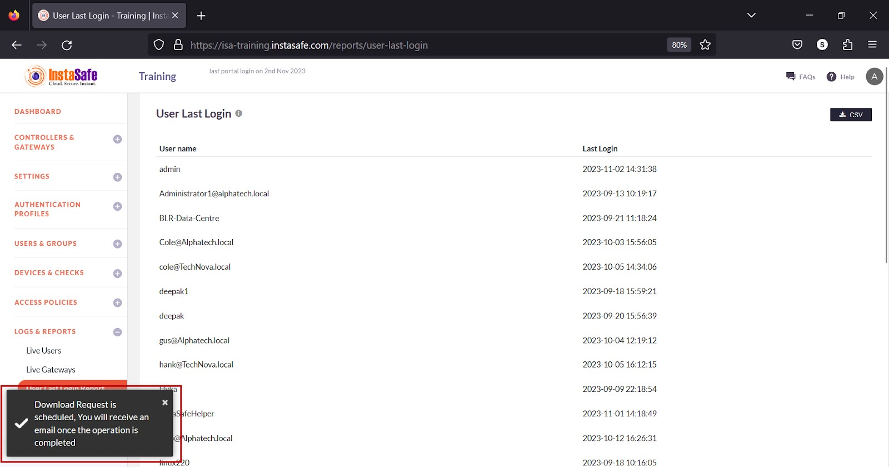
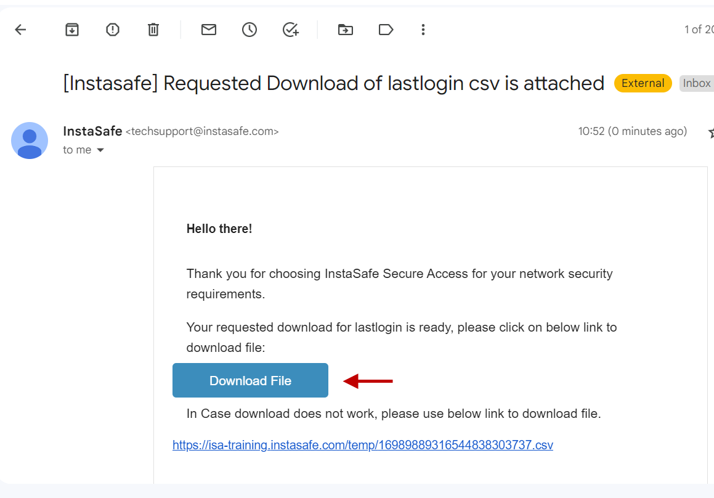
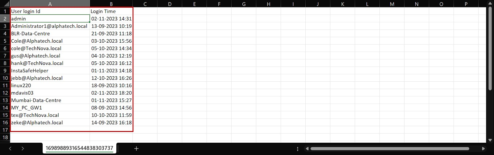

# User Last Login Report

The User Last Login Report page on the ISA web portal displays the list of users who connected via the ISA User Agent with the timestamp of their latest login.  The list also includes the name of Gateways and the timestamp of their latest successful connection. The page can be used by administrators to track user activity. 
Information

The following information is listed on the page

1.User name – The username and name of the Gateway. 

2.Last Login – The time of the user’s and Gateway’s latest successful connection in YYYY-MM-DD HH:MM:SS format.

**Download User Last Login Report**

ISA web portal administrators can download the complete list of users’ last login by clicking the CSV button on the User Last Login Report page. An email with the link to download the file in CSV format is sent to the logged-in administrator’s email address. The file has the following information:

1.User name – The username and name of the Gateways. 

2.Last Login – The time of the users’ and Gateways’ latest successful connection in YYYY-MM-DD HH:MM:SS format.

- Click the CSV button.

- A message that an email is scheduled to be sent to the administrator’s email address is displayed. 

- Click Download File within the email.

- View the file in a spreadsheet application.

**Conclusion**

The User Last Login Report is a valuable tool for administrators and system managers to efficiently track and manage user activity.
