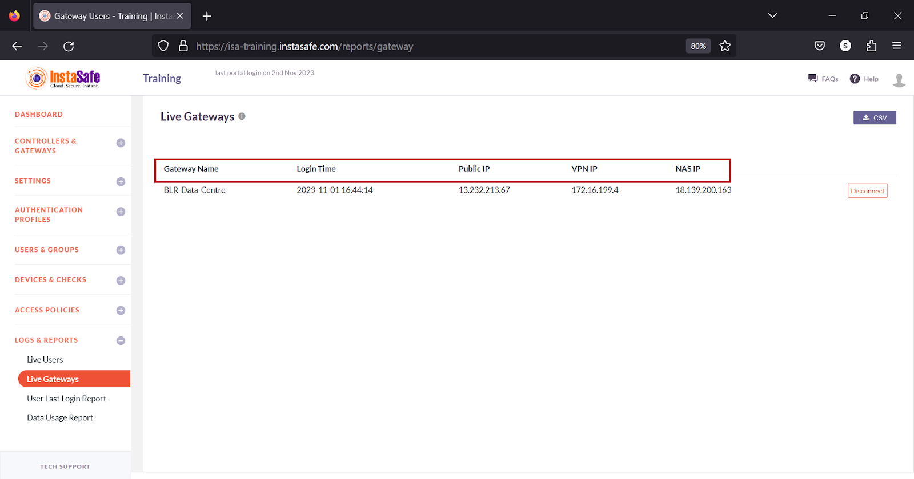
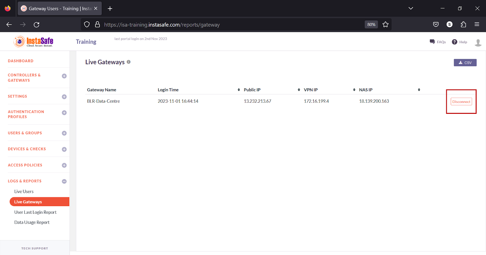
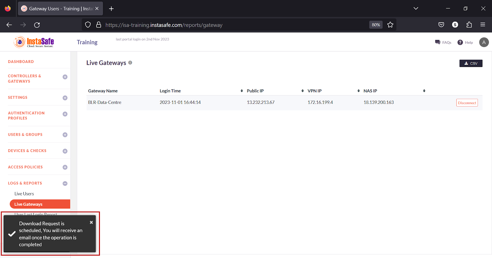
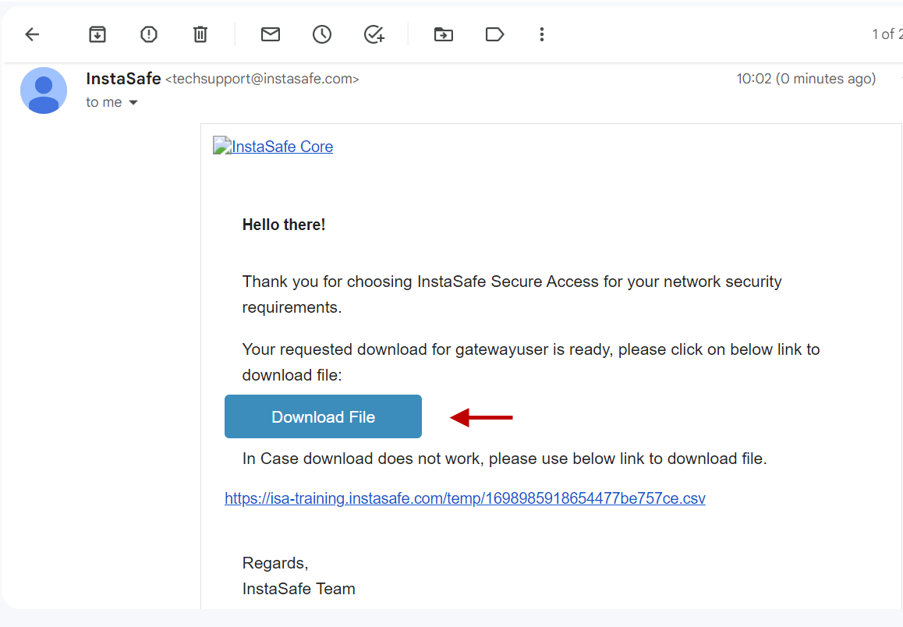
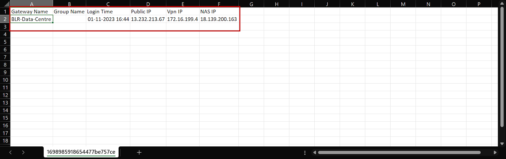
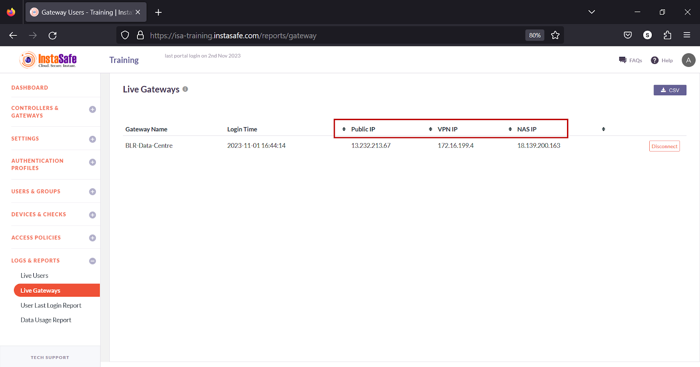

# Live Gateways

The Live Gateways page on the ISA web portal displays the list of Gateways currently connected. The page can be used by administrators to monitor Gateways in real-time and disconnect them, if required. 

The following information is listed on the page:

**1.Gateway Name** – The name of the Gateway. 

**2.Login Time** – The time the Gateway connected to the ISA Controller in YYYY-MM-DD HH:MM:SS format. 

**3.Public IP** – The public IP address of the Gateway. 

**4.VPN IP** – The virtual IP address assigned to the Gateway. 

**5.NAS IP** – The Network-Attached Storage IP address 

**Disconnect**

The Disconnect button will disconnect the Gateway Agent connection within two minutes of pressing the button.

**Download Live Gateways List**

ISA web portal administrators can download the complete list of live Gateways by clicking the CSV button on the Live Gateways page. An email with the link to download the file in CSV format is sent to the logged-in administrator’s email address. The file has the following information:

**1.Gateway Name** – The name of the Gateway. 

**2.Login Time** – The time the Gateway connected to the ISA Controller in YYYY-MM-DD HH:MM:SS format. 

**3.Public IP** – The public IP address of the Gateway. 

**4.VPN IP** – The virtual IP address assigned to the Gateway. 

**5.NAS IP** – The Network-Attached Storage IP address.

- Click the CSV button.

- A message that an email is scheduled to be sent to the administrator’s email address is displayed.

- Click Download File within the email.

- View the file in a spreadsheet application.

**Sorting the Live Gateways List**

You can sort the list by Public IP, VPN IP, or NAS IP. Click the up/down arrow alongside respective header fields. 

**Conclusion**

The Live Gateways page of the ISA web portal allows the administrator to view connected Gateways in real-time, disconnect them, and download the list of Gateways in CSV format. 
