## **Live Users**

The Live Users page on the ISA web portal displays the list of users currently logged in via ISA User Agents. The page can be used by administrators to monitor users in real-time and disconnect them, if required. ISA web portal logins are not listed on this page.  

**Information**

The following information is listed on the page

**1.User login Id** – The username used to connect using the ISA User Agent. The list also includes the built-in user daemon InstaSafeHelper. The InstaSafe Helper is a daemon service running in the background. The daemon helps in forming a tunnel between the ISA web portal and the ISA controller. When a configuration is performed on the portal, the daemon helps in syncing the configuration to the ISA Controller. 

**2.Login Time** – The login time of the user in YYYY-MM-DD HH:MM:SS format. 

**3.Public IP** – The public IP address of the user. 

**4.Country** – Name of the country the user is logged in from. 

**5.VPN IP** – The virtual IP address assigned to the user. 

**6.NAS IP** – The Network-Attached Storage IP address 

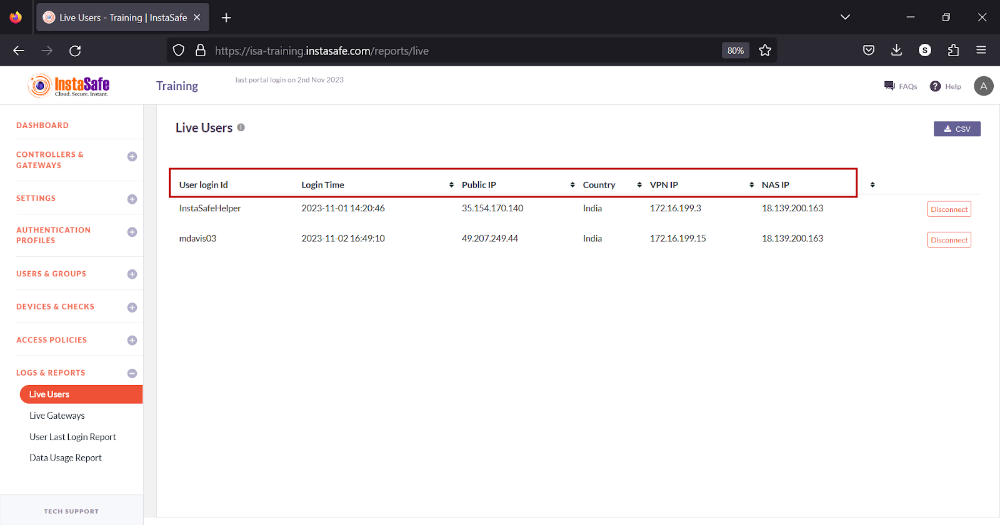

**Disconnect**

The Disconnect button will disconnect the ISA user agent connection within two minutes of pressing the button. 

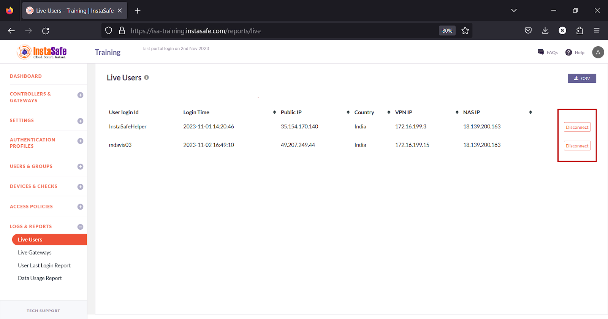

**Download Live Users List**

ISA web portal administrators can download the complete list of live users by clicking the CSV button on the Live Users page. An email with the link to download the file in CSV format is sent to the logged-in administrator’s email address. The file has the following information:

**1.User login Id** – The username used to connect using the ISA User Agent. 

**2.Group Name** - The name of the user group the user is a member of. 

**3.Login Time** – The login time of the user in YYYY-MM-DD HH:MM:SS format. 

**4.Public IP** – The public IP address of the user. 

**5.Country** – Name of the country the user is logged in from. 

**6.VPN IP** – The virtual IP address assigned to the user. 

**7.NAS IP** – The Network-Attached Storage IP address 

- Click the CSV button.

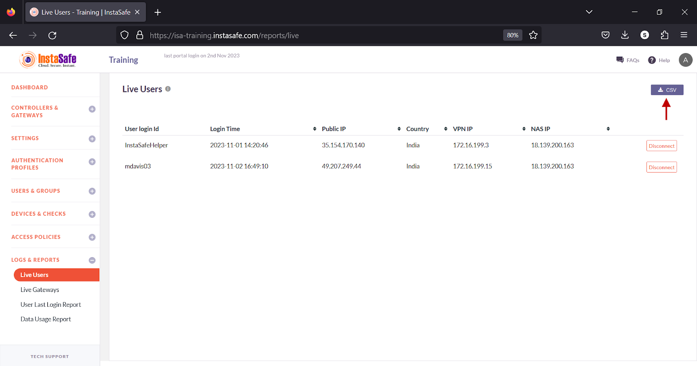

- A message that an email is scheduled to be sent to the administrator’s email address is displayed. 

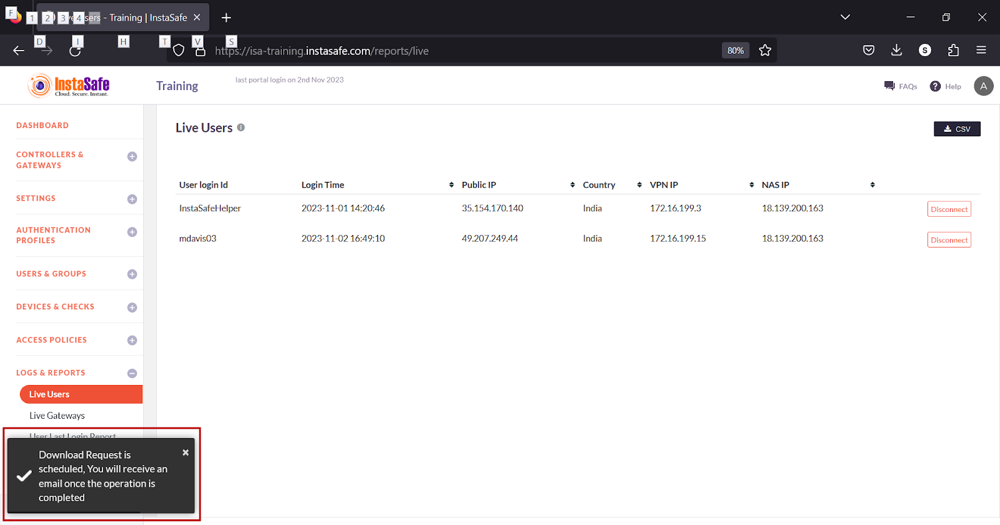

- Click Download File within the email.

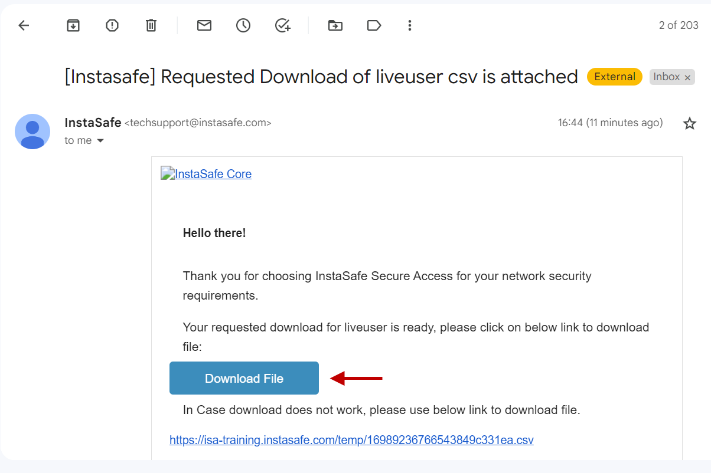

- View the file in a spreadsheet application.

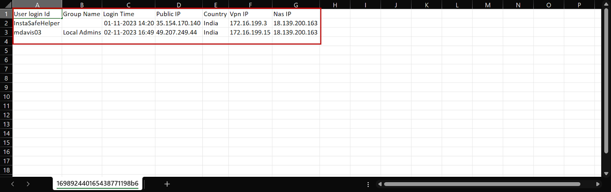

**Sorting the Live Users List**

You can list by Public IP, Country, VPN IP, or NAS IP. Click the up/down arrow alongside respective header fields. 

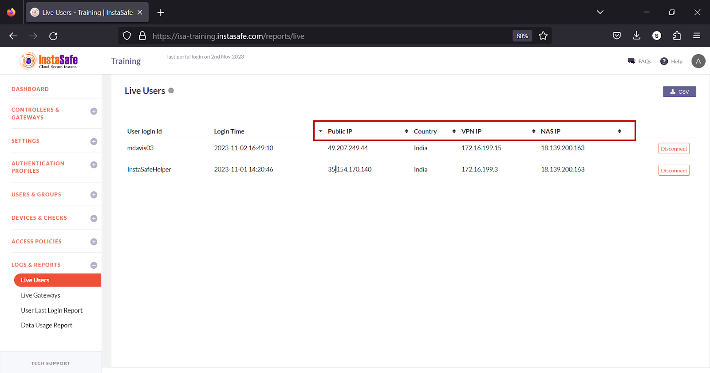

**Conclusion**

The Live users page of the ISA web portal allows the administrator to view connected users in real-time, disconnect them, and download the list of users in CSV format.

## **Live Gateways**

The Live Gateways page on the ISA web portal displays the list of Gateways currently connected. The page can be used by administrators to monitor Gateways in real-time and disconnect them, if required. 

The following information is listed on the page:

**1.Gateway Name** – The name of the Gateway. 

**2.Login Time** – The time the Gateway connected to the ISA Controller in YYYY-MM-DD HH:MM:SS format. 

**3.Public IP** – The public IP address of the Gateway. 

**4.VPN IP** – The virtual IP address assigned to the Gateway. 

**5.NAS IP** – The Network-Attached Storage IP address 

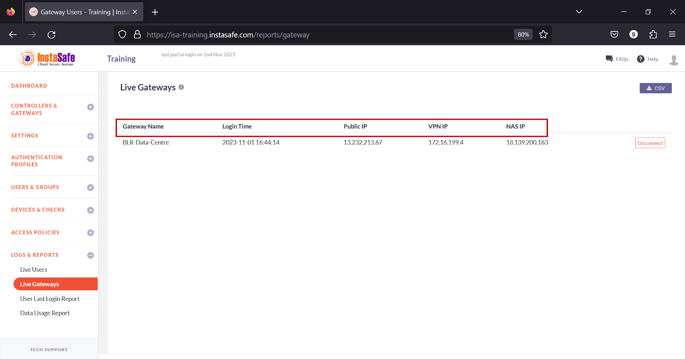

**Disconnect**

The Disconnect button will disconnect the Gateway Agent connection within two minutes of pressing the button.

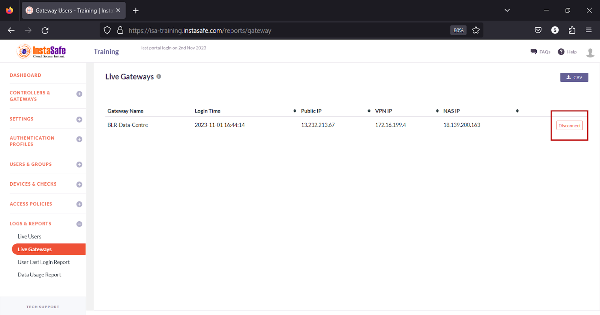

**Download Live Gateways List**

ISA web portal administrators can download the complete list of live Gateways by clicking the CSV button on the Live Gateways page. An email with the link to download the file in CSV format is sent to the logged-in administrator’s email address. The file has the following information:

**1.Gateway Name** – The name of the Gateway. 

**2.Login Time** – The time the Gateway connected to the ISA Controller in YYYY-MM-DD HH:MM:SS format. 

**3.Public IP** – The public IP address of the Gateway. 

**4.VPN IP** – The virtual IP address assigned to the Gateway. 

**5.NAS IP** – The Network-Attached Storage IP address.

- Click the CSV button.

- A message that an email is scheduled to be sent to the administrator’s email address is displayed.

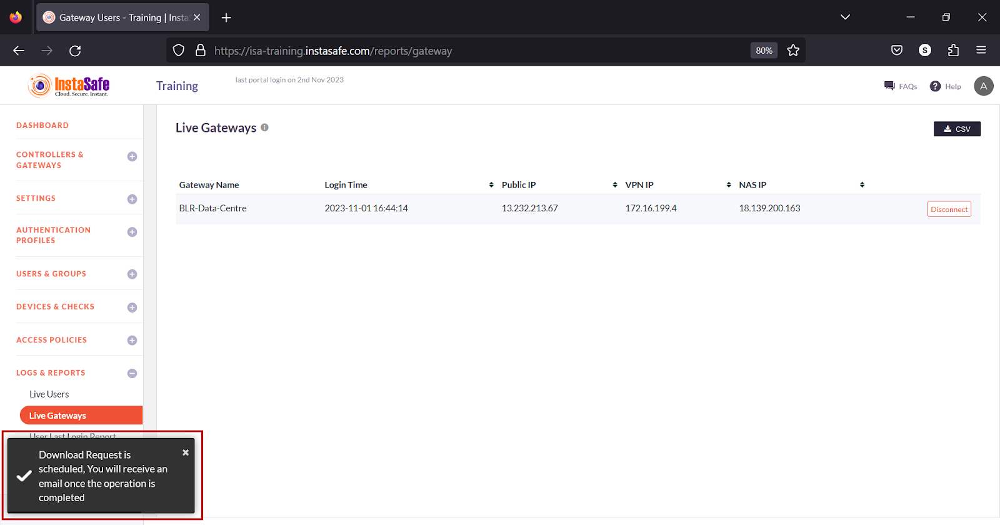

- Click Download File within the email.

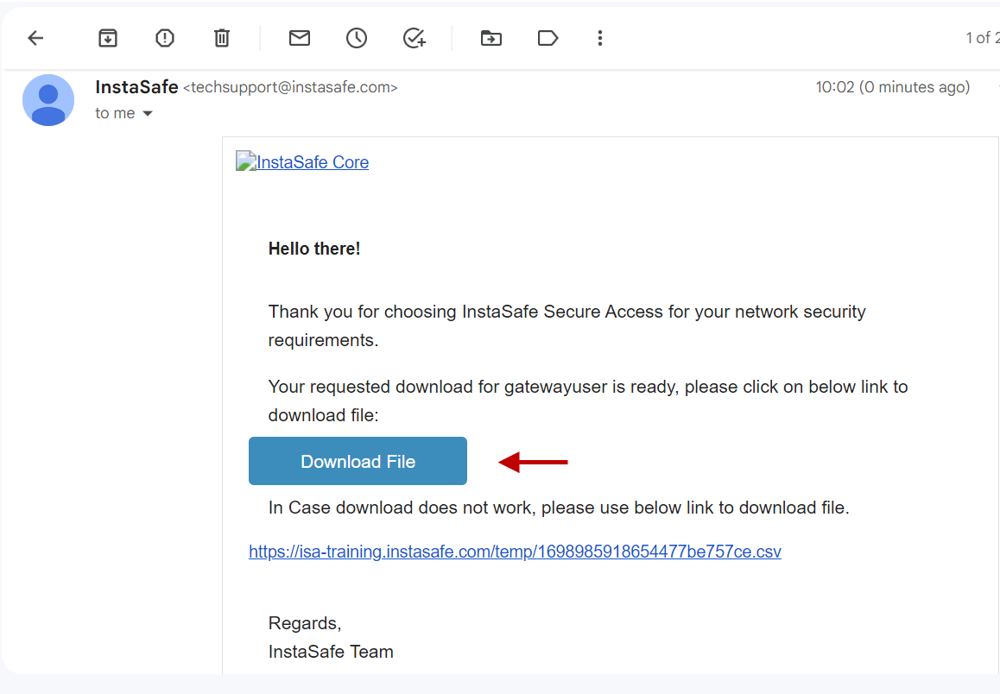

- View the file in a spreadsheet application.

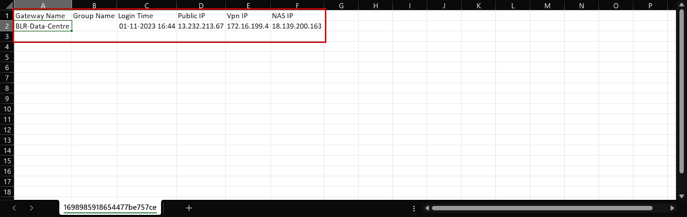

**Sorting the Live Gateways List**

You can sort the list by Public IP, VPN IP, or NAS IP. Click the up/down arrow alongside respective header fields. 

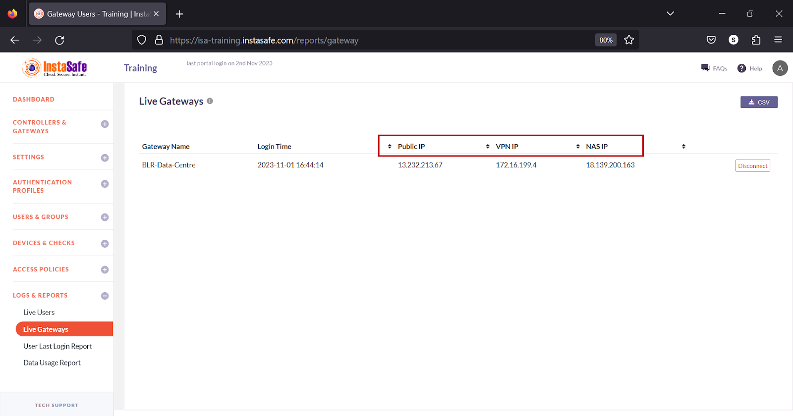

**Conclusion**

The Live Gateways page of the ISA web portal allows the administrator to view connected Gateways in real-time, disconnect them, and download the list of Gateways in CSV format. 

## **User Last Login Report**

The User Last Login Report page on the ISA web portal displays the list of users who connected via the ISA User Agent with the timestamp of their latest login.  The list also includes the name of Gateways and the timestamp of their latest successful connection. The page can be used by administrators to track user activity. 
Information

The following information is listed on the page

1.User name – The username and name of the Gateway. 

2.Last Login – The time of the user’s and Gateway’s latest successful connection in YYYY-MM-DD HH:MM:SS format.

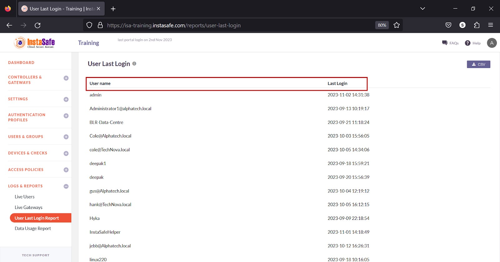

**Download User Last Login Report**

ISA web portal administrators can download the complete list of users’ last login by clicking the CSV button on the User Last Login Report page. An email with the link to download the file in CSV format is sent to the logged-in administrator’s email address. The file has the following information:

1.User name – The username and name of the Gateways. 

2.Last Login – The time of the users’ and Gateways’ latest successful connection in YYYY-MM-DD HH:MM:SS format.

- Click the CSV button.

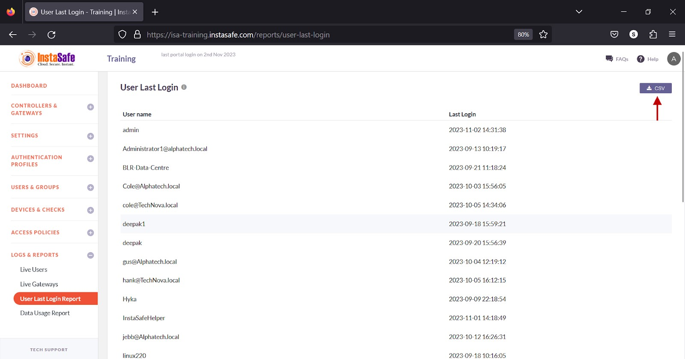

- A message that an email is scheduled to be sent to the administrator’s email address is displayed. 

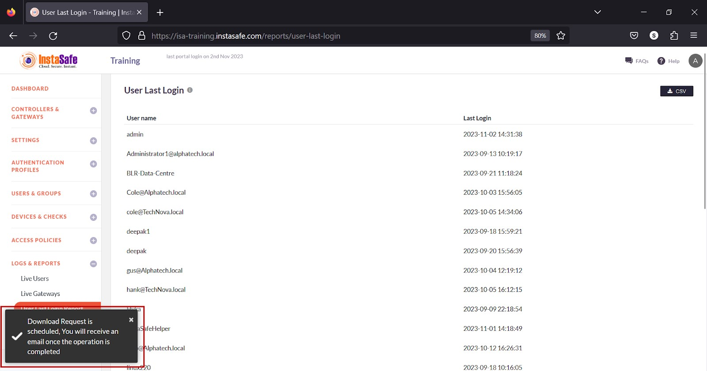

- Click Download File within the email.

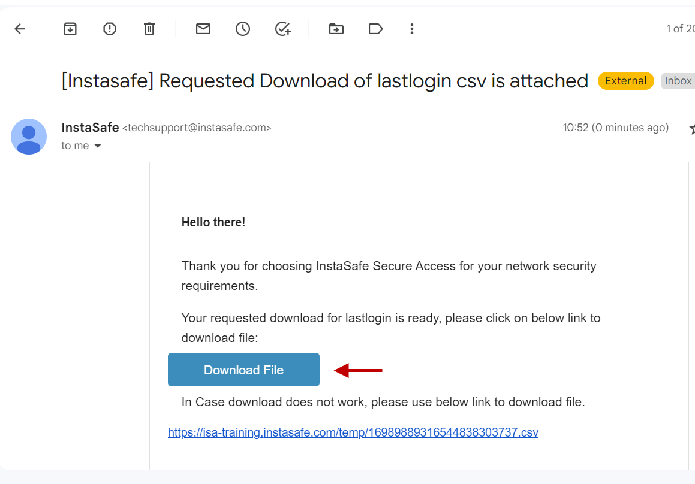

- View the file in a spreadsheet application.

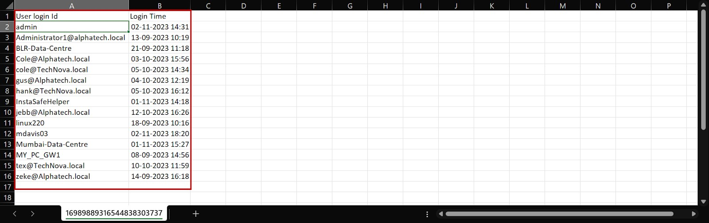

**Conclusion**

The User Last Login Report is a valuable tool for administrators and system managers to efficiently track and manage user activity.

## **Data Usage Report**

The Data Usage Report page lists the data usage of both users and Gateways. This report is useful for ISA web portal administrators in facilitating the effective monitoring and management of data usage and resource allocation, ensuring efficient network operation and potential anomaly detection in data activities. 

**Information**

The following information is listed on the page:

1.Login ID – The username or name of the Gateway.

2.Data received (In MB) – The amount of data received in megabytes by the user’s device or Gateway for the period selected. 

3.Data transmitted (In MB) – The amount of data transmitted in megabytes by the user’s device or Gateway for the period selected. 

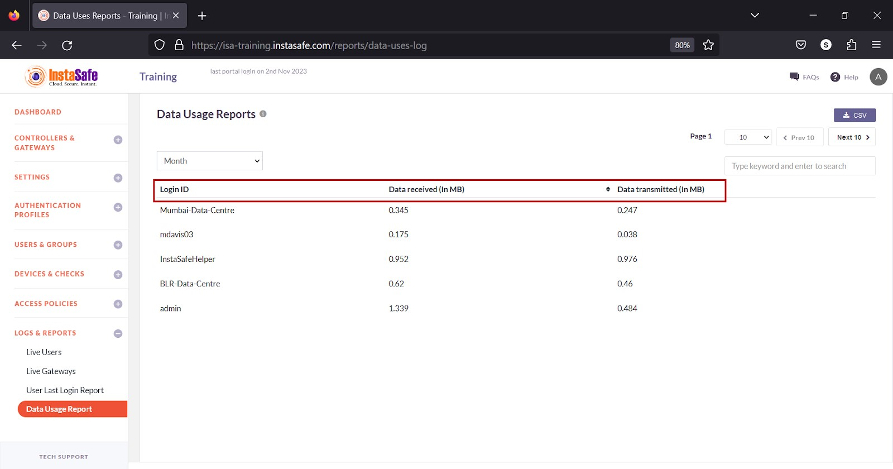

**View Data Usage**

The drop-down at the top of the page has options to view data usage by Hour, Today, Week, Month, and Date Range. 

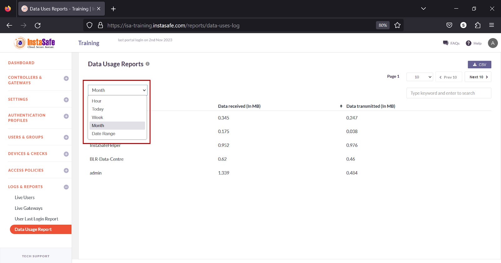

**Download Live Users List**

ISA web portal administrators can download the complete list of data usage by Hour, Today, Week, Month, and Date Range by clicking the CSV button at the top of the page. An email with the link to download the file in CSV format is sent to the logged-in administrator’s email address. The file has the following information:

1.Login ID – The username or name of the Gateway.

2.Data received (In MB) – The amount of data received in megabytes by the user’s device or Gateway for the period selected. 

3.Data transmitted (In MB) – The amount of data transmitted in megabytes by the user’s device or Gateway for the period selected. 

- Click the CSV button.

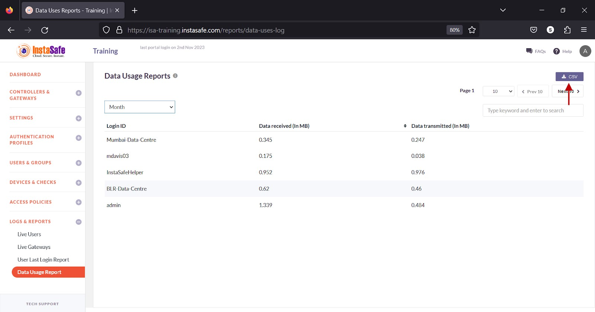

- A message that an email is scheduled to be sent to the administrator’s email address is displayed.

- Click Download File within the email.

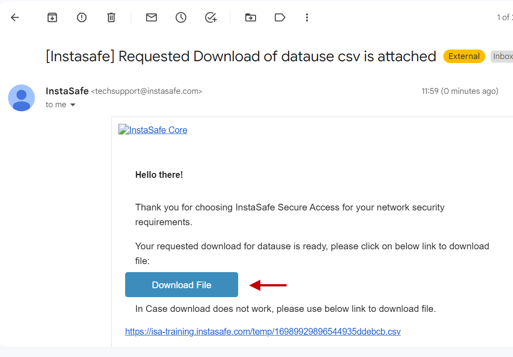

- View the file in a spreadsheet application.

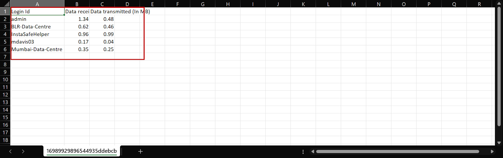

**Navigating the Data Usage List**

The Data Usage page allows easy pagination for viewing a large number of users or Gateways. You can view the list by using the navigation control bar at the top right of the page. 
Click the drop-down box to select the number of users or Gateways to be displayed on the Data Usage page. By default, it is set to display 10 users or Gateways. You can change it to display either 30 or 50.

Click the Next button to view the next page of users or Gateways. Click the Prev button to view the previous page. 

You can search the list by name by entering it in the search box. 

## **Time Usage Report**

The Time Usage Report page lists the session time of both users and Gateways for a given period. This report is useful for ISA web portal administrators to track logged-in sessions. 

**Information**

The following information is listed on the page

**Login ID** – The username or name of the Gateway.

**Session Time (Minutes)** – The logged-in session time in minutes of  the user’s device or Gateway for the period selected. 

**View Time Usage**

The drop-down at the top of the page has options to view session time by **Hour**, **Today**, **Week**, **Month**, and **Date Range**.

**Download Live Users List**

ISA web portal administrators can download the complete list of time usage by **Hour**, **Today**, **Week**, **Month**, and **Date Range** by clicking the CSV button at the top of the page. An email with the link to download the file in **CSV** format is sent to the logged-in administrator’s email address. The file has the following information:

**Login ID** – The username or name of the Gateway.

**Session Time (Minutes)** – The logged-in session time in minutes of  the user’s device or Gateway for the period selected. 

- Click the **CSV** button

- A message that an email is scheduled to be sent to the administrator’s email address is displayed.

- Click **Download File** within the email.

- View the file in a spreadsheet application.

**Navigating the Time Usage List**

The **Time Usage Report** page allows easy pagination for viewing a large number of user or Gateway sessions. You can view the list by using the navigation control bar at the top right of the page. 
Click the drop-down box to select the number of sessions to be displayed on the **Time Usage Report** page. By default, it is set to display 10 users or Gateways. You can change it to display either 30 or 50. 

Click the **Next** button to view the next page of sessions. Click the **Prev** button to view the previous page. 

You can search the list by name by entering it in the search box. 

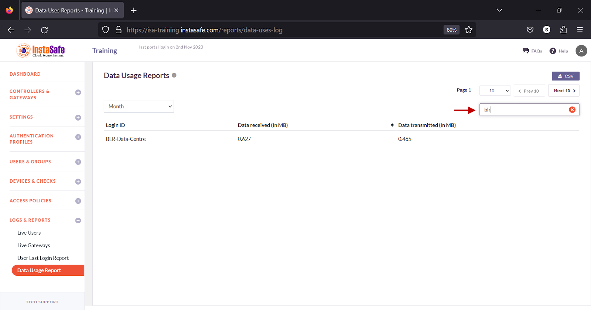

**Conclusion**

The **Time Usage Report** is useful for ISA web portal administrators to  track user and Gateway sessions.

## **Session Log**

The **LOGS & REPORTS > Session Log** page lists the login sessions of users and Gateways. The page lists each session login and logout time of both users and Gateways. This report is useful for ISA web portal administrators to track logged-in sessions.

**Information**

The following information is listed on the page:

**Username** – The username or Gateway name. 

**Login Time** – The login time in YYYY:MM:DD HH:MM:SS 

**Logout Time** - The logout time in YYYY:MM:DD HH:MM:SS

**Public IP** – Public IP address of the connecting agent.

**Country** – Name of the country where the agent is connecting from. 

**ISA IP** – IP address of the virtual adapter. 

**Upload Data** – Data Transmitted during the session in kilobytes.

**Download Data** – Data Received during the session in kilobytes.

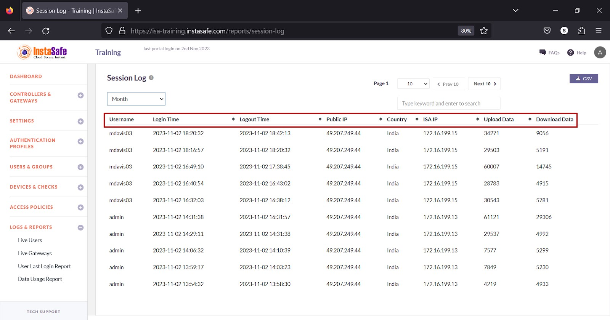

**View Session Log**

The drop-down at the top of the page has options to view the sessions by **Today, Week, Month, and Date Range.** 

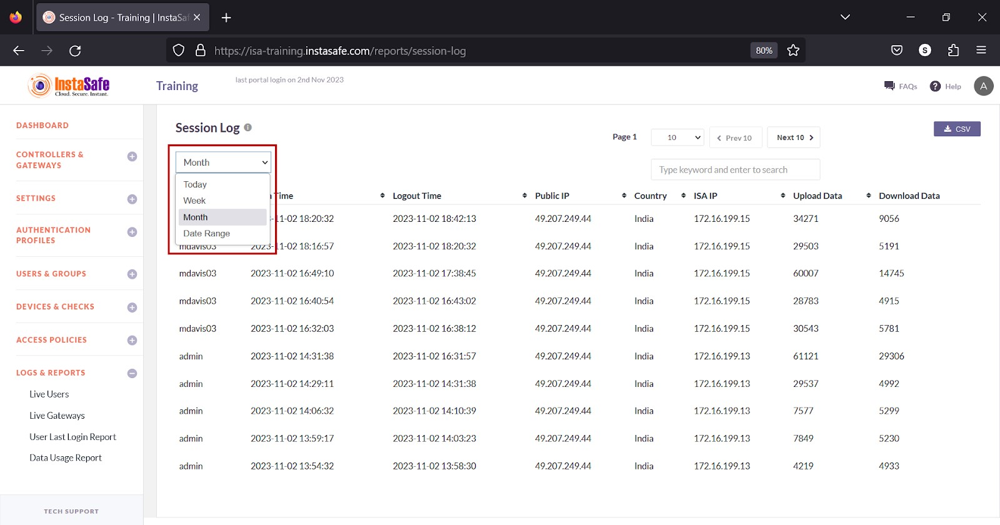

**Download Session Log List**

ISA web portal administrators can download the complete list of session logs by **Today, Week, Month, and Date Range** by clicking the CSV button at the top of the page. An email with the link to download the file in **CSV** format is sent to the logged-in administrator’s email address. The file has the following information:

**Username** – The username or Gateway name.

**Login Time** – The login time in YYYY:MM:DD HH:MM:SS 

**Logout Time** - The logout time in YYYY:MM:DD HH:MM:SS

**Public IP** – Public IP address of the connecting agent.

**Country** – Name of the country where the agent is connecting from. 

**ISA IP** – IP address of the virtual adapter. 

**Upload Data** – Data Transmitted during the session in kilobytes.

**Download Data** – Data Received during the session in kilobytes. 

- Click the CSV button.

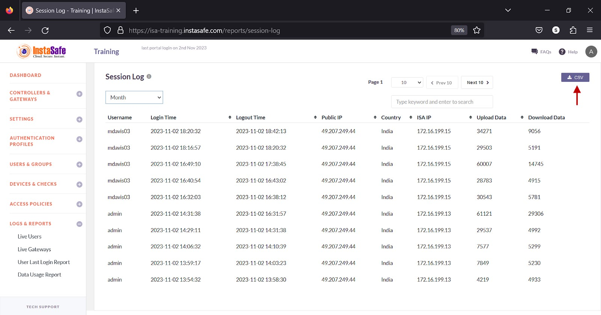

- A message that an email is scheduled to be sent to the administrator’s email address is displayed.

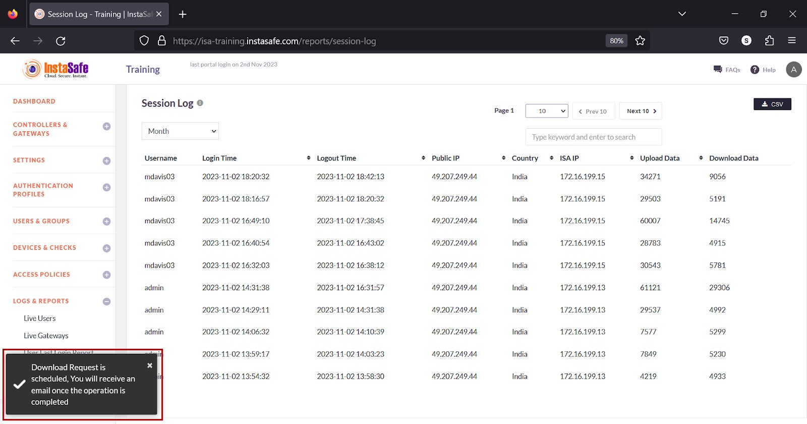

- Click Download File within the email.

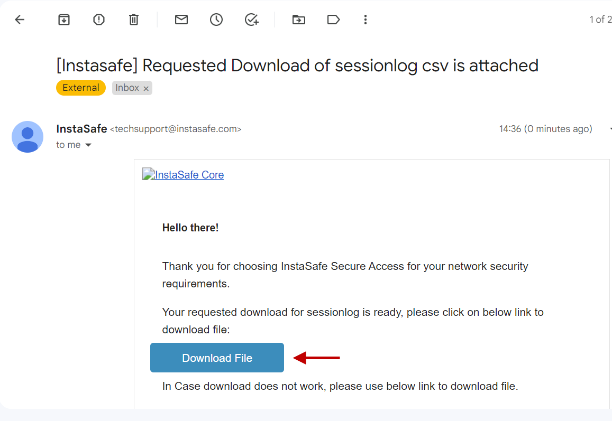

- View the file in a spreadsheet application.

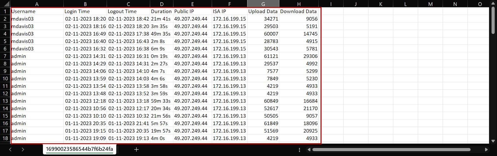

**Navigating the Session Log**

The **Session Log** page allows easy pagination for viewing a large number of user or Gateway sessions. You can view the list by using the navigation control bar at the top right of the page. 

Click the drop-down box to select the number of sessions to be displayed on the **Session Log** page. By default, it is set to display 10 user or Gateway sessions. You can change it to display either 30 or 50. 

Click the Next button to view the next page of sessions. Click the Prev button to view the previous page. 

You can search the list by name by entering it in the search box. 

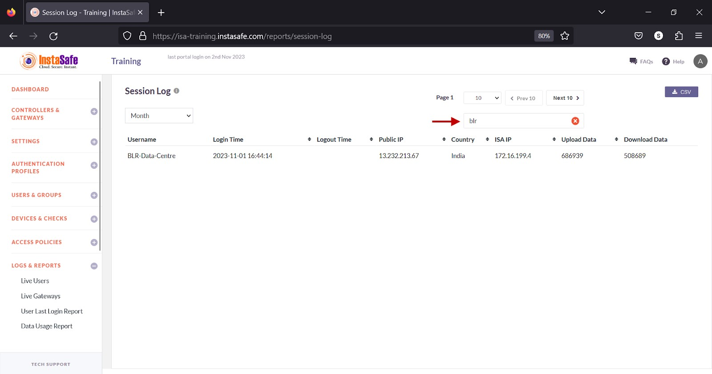

**Sorting the Session Log**

You can sort the list by **Logout Time**, **Public IP**, **Country**, **ISA IP**, **Upload Data**, and **Download Data**. Click the up/down arrow alongside respective header fields.

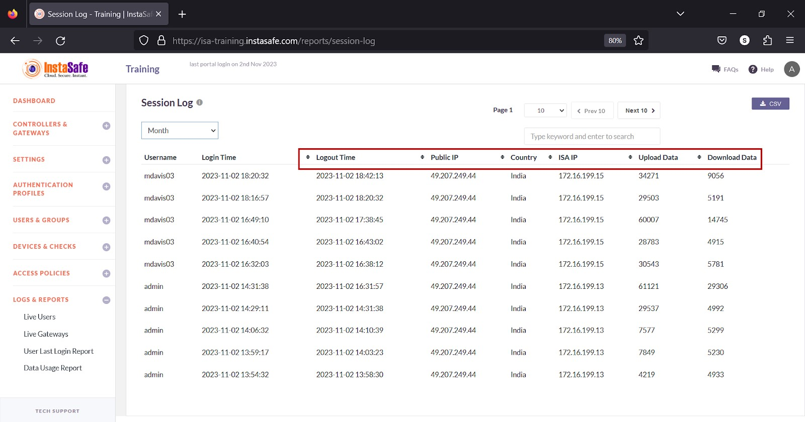

**Conclusion**

The Session Log is useful for the ISA web portal administrators to track user and Gateway sessions.

## **Access Log**

The **LOGS & REPORTS > Access Log** page lists the ISA web console login sessions. Each entry on the page contains the username of the user, the page on the web portal that the user was active on, and the duration the user was on that page. 

Information

The following information is listed on the page

**User** – The username of the user.

**Log Activity** – The name of the page on the portal.

**When** - The time when the user was on the page in YYYY:MM:DD HH:MM:SS format.

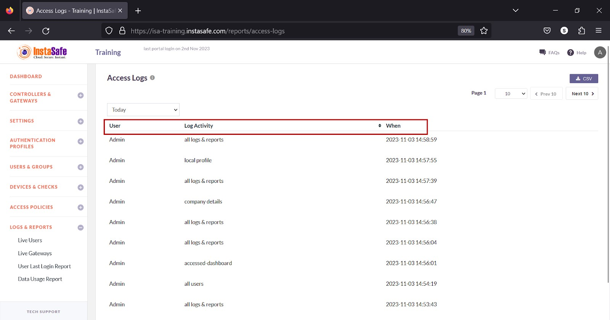

**View Access Log**

The drop-down at the top of the page has options to view the sessions by **Today, Week, Month, and Date Range.**

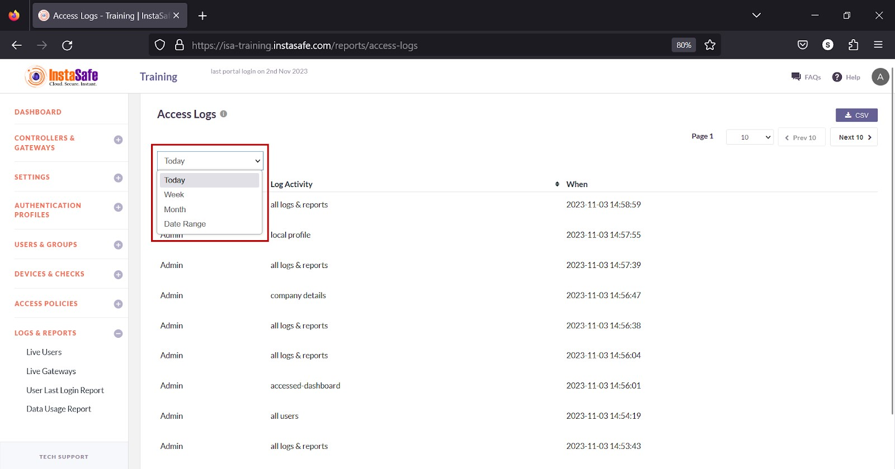

**Download Access Log List**

ISA web portal administrators can download the access log by **Today, Week, Month, and Date Range** by clicking the CSV button at the top of the page. An email with the link to download the file in **CSV** format is sent to the logged-in administrator’s email address. The file has the following information:

**User** – The username of the user.

**Log Activity** – The name of the page on the portal. 

**When** - The time when the user was on the page in YYYY:MM:DD HH:MM:SS format. 

**Public IP** – The public IP address of the logged-in user.

- Click the CSV button.

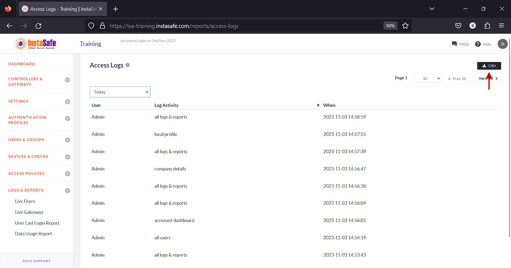

- A message that an email is scheduled to be sent to the administrator’s email address is displayed. 

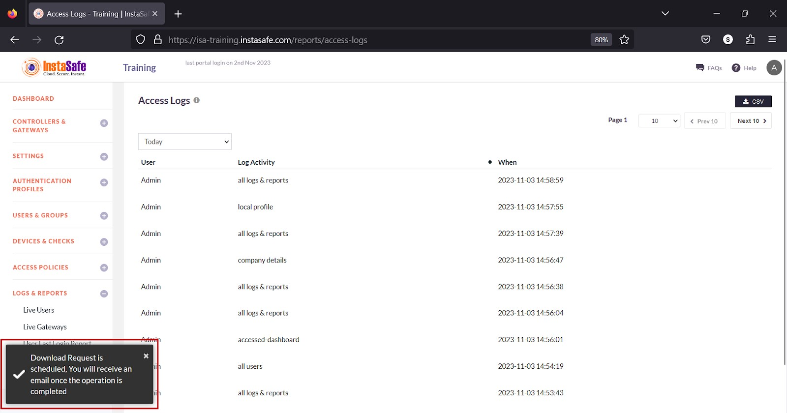

- Click **Download File** within the email.

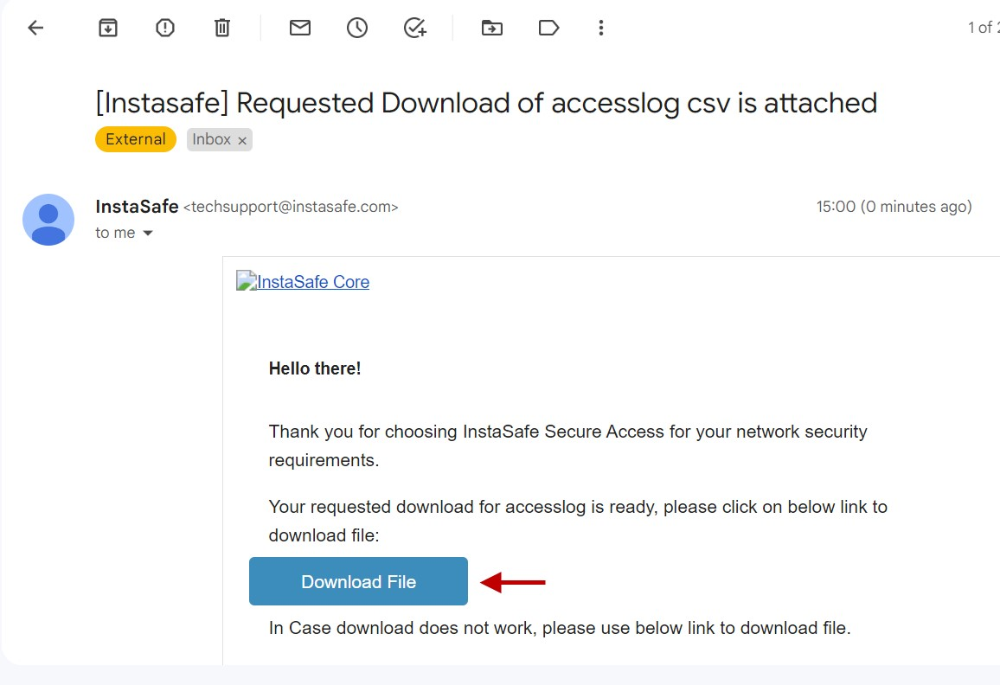

- View the file in a spreadsheet application.

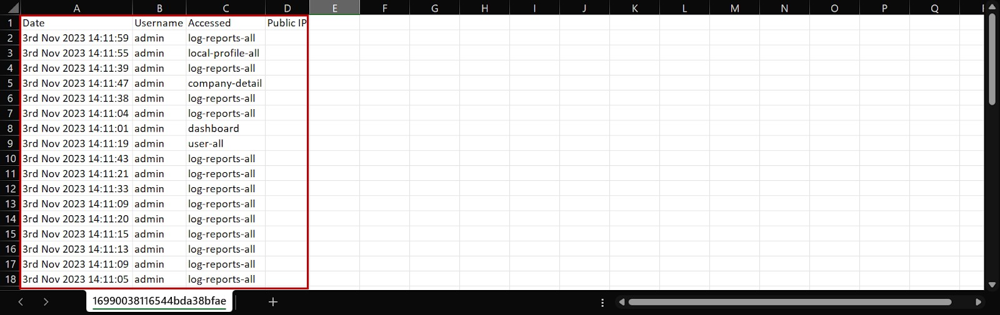

**Navigating the Access Log**

The Access Log page allows easy pagination for viewing a large number of user sessions. You can view the list by using the navigation control bar at the top right of the page. 
Click the drop-down box to select the number of user sessions to be displayed on the Access Log page. By default, it is set to display 10 user sessions. You can change it to display either 30 or 50. 

Click the Next button to view the next page of sessions. Click the Prev button to view the previous page. 

**Sorting the Access Log**

You can sort the list by the **When** header. Click the up/down arrow alongside the header. 

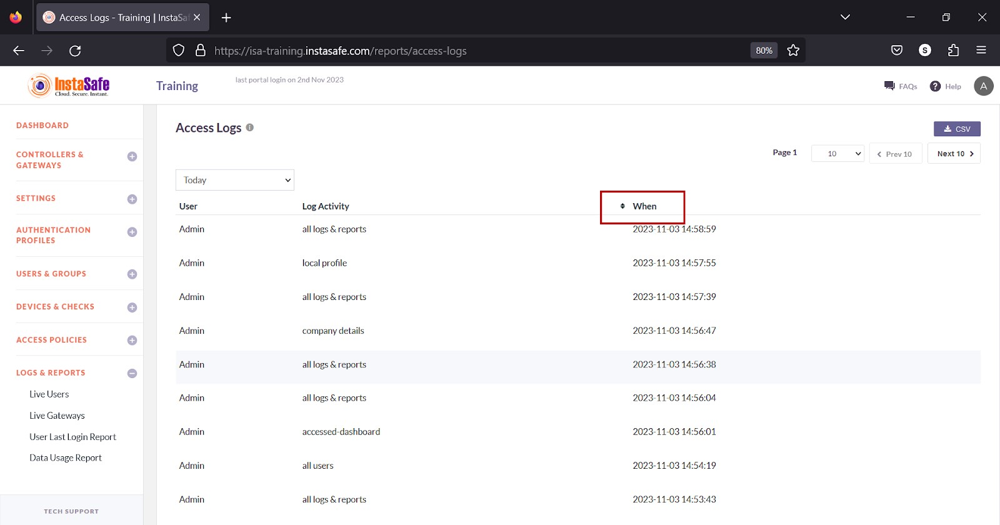

**Conclusion**

The Access Log is useful for the ISA web console administrators to track web portal login sessions. 

## **Application Access Log**

The **LOGS & REPORTS** > **Application Access Log** page lists the users who remotely accessed corporate resources. 

**Application Access Logs**

The following information is listed under this section:

**Access Date** – The date on which the resource was accessed in the YYYY-MM-DD HH:MM:SS format.

**Username** – The username of the user who accessed the resource.

**Public IP** – The public IP address of the user.

**Country** – The name of the country where the user accessed the resource from. 

**Destination IP** – The internal IP address of the resource.

**Port** – The port number of the resource.  

**Action** – Allowed or Denied. 

**View Application Access Log**

The drop-down at the top of the page has options to view the log by **Today**, **Week**, **Month**, and **Date Range**.

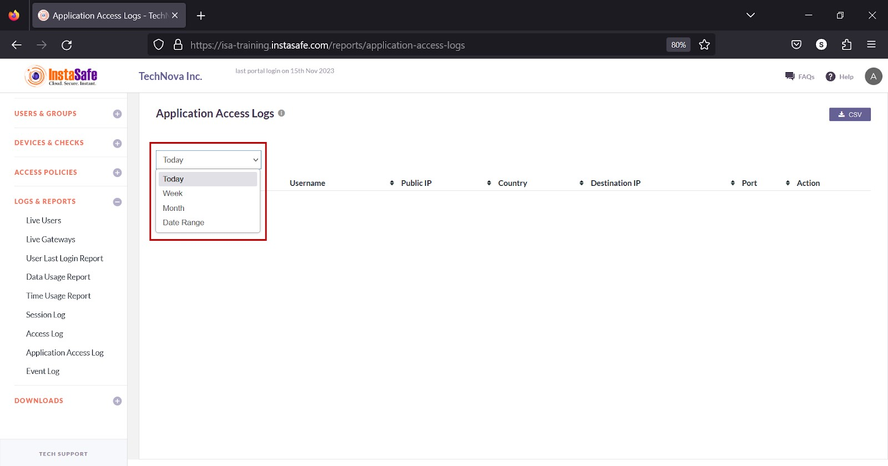

**Download Application Access Log List** 

ISA web portal administrators can download the complete list of application access by Today, Week, Month, and Date Range and click the CSV button at the top of the page. An email with the link to download the file in CSV format is sent to the logged-in administrator’s email address. The file has the following information:

**Access Date** – The date the resource was accessed in the YYYY-MM-DD HH:MM:SS format.

**Username** – The username of the user who accessed the resource.

**Public IP** – The public IP address of the user.

**Country** – The name of the country where the user accessed the resource from. 

**Destination IP** – The internal IP address of the resource.

**Port** – The port number of the resource.  

**Action** – Allowed or Denied.

1.Click the CSV button.

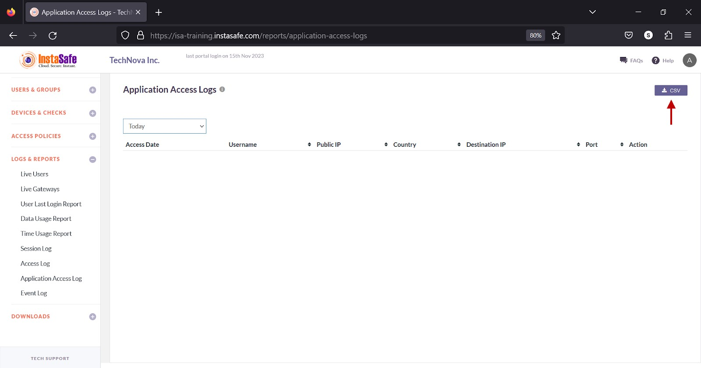

2.A message that an email is scheduled to be sent to the administrator’s email address is displayed. 

3.Click **Download File** within the email.

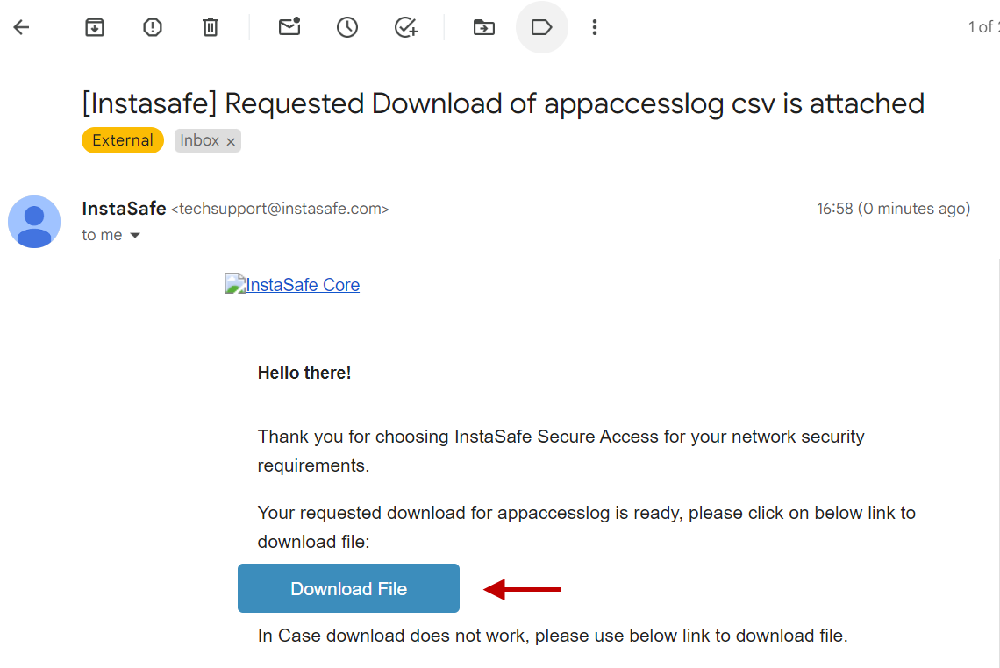

4.View the file in a spreadsheet application.

**Sorting the Application Access Log**

You can sort the list by **Public IP**, **Country**, **Destination IP**, **Port**, or **Action**. Click the up/down arrow alongside respective header fields. 

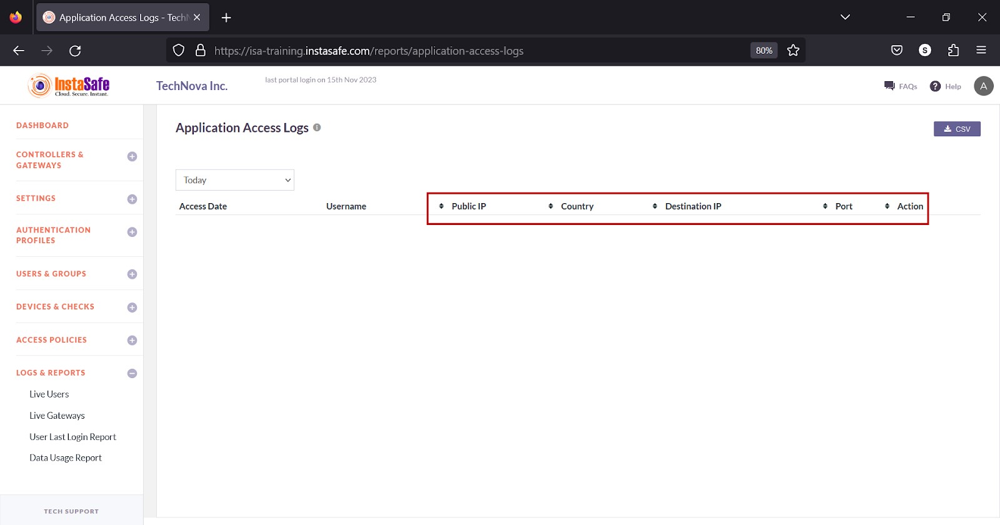

**Conclusion**

The Application Access Log is useful for the ISA web portal administrators to track user access to corporate resources. 

## **Event Logs**

The **LOGS & REPORTS > Event Log** page lists the event logs. 

By default, the following information is listed on the page

**Time** – The time of the event in YYYY:MM:DD HH:MM:SS 

**Username** – The username of the user.   
   
**Log** – The details of the event 

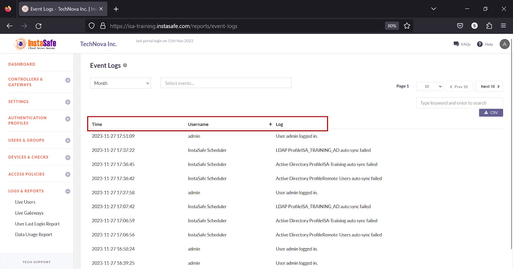

**View Event Logs**

- The drop-down at the top of the page has options to view the events by Today, Week, Month, and Date Range. 

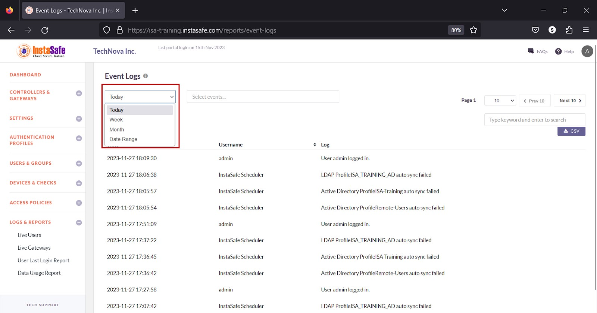

- Click the Search events drop-down to select the events you want to view.  More than one event can be added in the field.

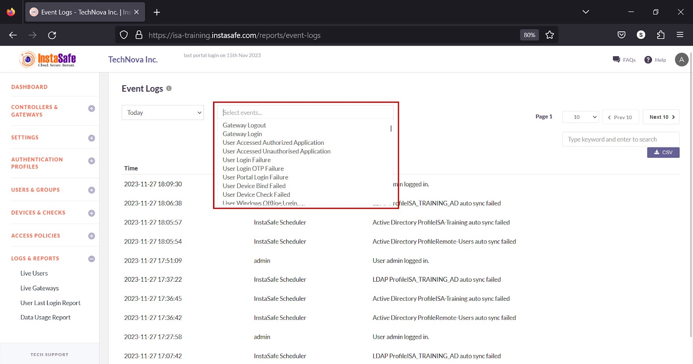

The following 121 events can be viewed. 

|        |        |        |
| ------ | ------ | ------ |
| Gateway Logout  | Gateway Login | User Accessed Authorized Application|
| User Accessed Unauthorised Application | User Login Failure  | User Portal Login Failure |
| User Login OTP Failure | User Device Bind Failed | User Device Check Failed |
| User Windows Offline Login | User Windows Invalid Credentials | Device Suspended |
| User Agent Login | User Agent Logout| User Agent Login Failure |
| Device Activated | User Installed Agent Successfully | AD User |
| AD User Group    | User Agent Configuration Update   |Gateway Agent Configuration Update |
| User Device Check Authorized | Device Approved | User Login using Authorized Device |
| User Login via OTP Success | User Agent Login Attempt | Device Pending Approval |
| Company Added |   New Admin added |   New Subscription added |
| ISC server edited | ISC server added | updated controller |
| updated gateway   | started controller | restarted controller |
| User Portal Login | User Portal Logout | deleted controller(s) |
| deleted gateway   | updated gateway   | deleted active directory |
| added ldap        | updated ldap      | deleted ldap |
| added radius      | updated radius    | updated company details |
| updated company banner | updated business contact | updated tech contact |
| updated renewal contact | updated dns-wns details | changed password |
| added new user | deleted a company user | searched in group |
| added group    | updated group          | deleted group  |
| added device check | deleted device check | added ACL |
| updated ACL details | deleted ACL | updated application group |
| deleted application group | added application service | deleted application service |
| added application group | added active directory | added controller |
| updated active directory | added gateway | stopped controller |
| commited controller | User Edit | Device Check Edit |
| Device Delete | Google Delete | Google Edit |
| Google Add | SubAdmin Role Add | SubAdmin Role Edit |
| SubAdmin Role Delete | SubAdmin Add | SubAdmin Delete | 
| SubAdmin Disable | SubAdmin Enable | Report Subscription Add |
| Report Subscription Update | Report Subscription Delete | Device Add |
| Device Edit | Active Directory Sync Success | Active Directory Sync Failure |
| LDAP Sync Success | LDAP Sync Failure | Gateway downloaded |
|User downloaded | User Password Reset | User Password Changed |
| User viewed QR code | User Profile Updated | User Account confirmed |
| deleted radius | User Settings Updated | User Suspended |
| User Activated | Export Log Added | Export Log Updated |
| Export Log Deleted | Local Password Policy Updated | updated application service |
| User force disconnected | Gateway force disconnected | User Device Registered |
| user geo binding failure | User Windows MFA Success | User Windows MFA Failure |
| User Windows MFA Bypass  |

**Download Session Log List** 

ISA web portal administrators can download the event logs by **Today, Week, Month,** or **Date Range** by clicking the **CSV** button at the top of the page. After setting the date, select the events from the drop-down list. An email with the link to download the file in CSV format is sent to the logged-in administrator’s email address. 

1.Select the drop-down to select the date. 

2.Click the **Search events** drop-down and select the events. 

3.Click the **CSV** button.

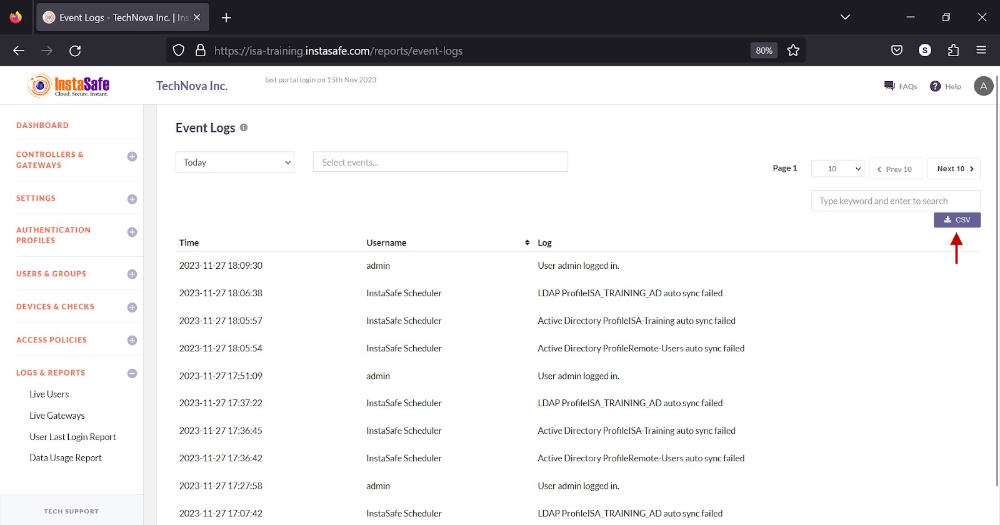

4.A message that an email is scheduled to be sent to the administrator’s email address is displayed. 

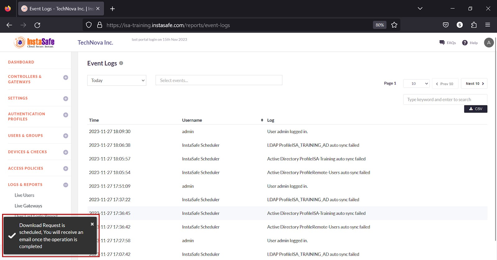

5.Click Download File within the email.

6.View the file in a spreadsheet application.

**Navigating the Event Logs page**

The **Event Log** page allows easy pagination for viewing a large number of events. You can view the list by using the navigation control bar at the top right of the page. 

Click the drop-down box to select the number of events to be displayed on the **Event Log** page. By default, it is set to display 10 entries.. You can change it to display either 30 or 50.

Click the **Next** button to view the next page of events. Click the **Prev** button to view the previous page. 

**Searching Event Logs**

You can search the list by name by entering it in the search box. 

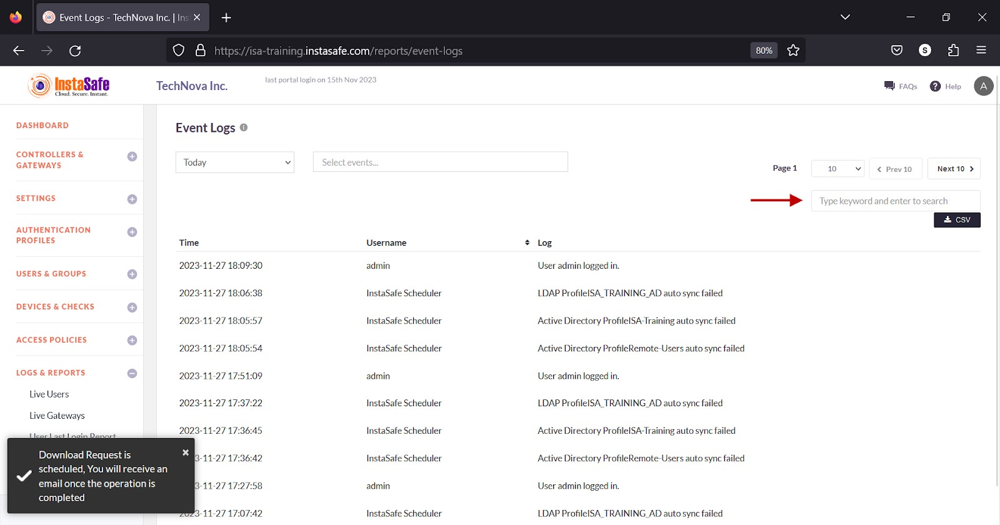

**Sorting the Session Log**

You can sort the list by **Log**. Click the up/down arrow alongside the header field. 

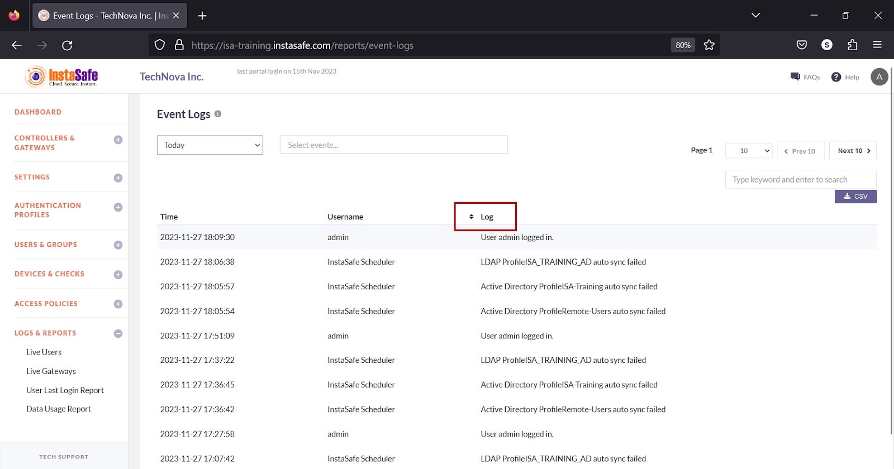

**Conclusion**

The **Event Log** page is useful for the ISA web portal administrators to track events.
