## **Manage Password Constraints for Local Users**

The Local Profile page under the Authentication Profiles menu allows the ISA web portal administrator to set password constraints for ISA local users. The options configured here will affect the local users on the USERS & GROUPS > Users page when setting passwords. 

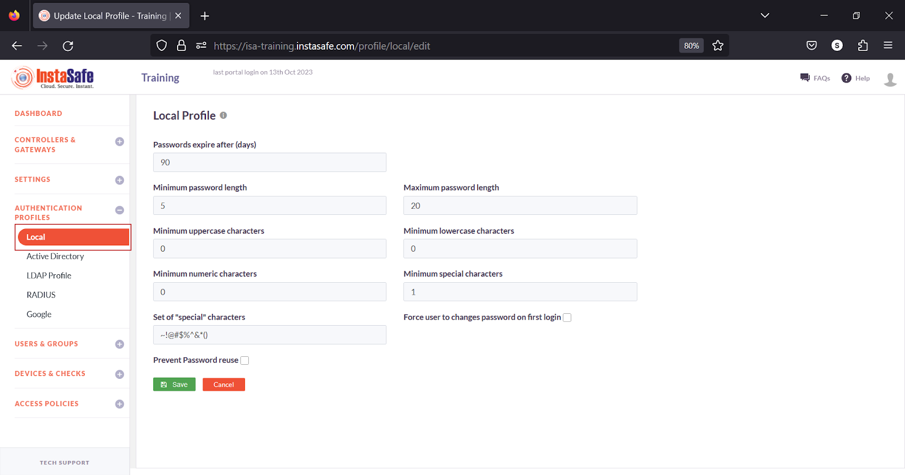
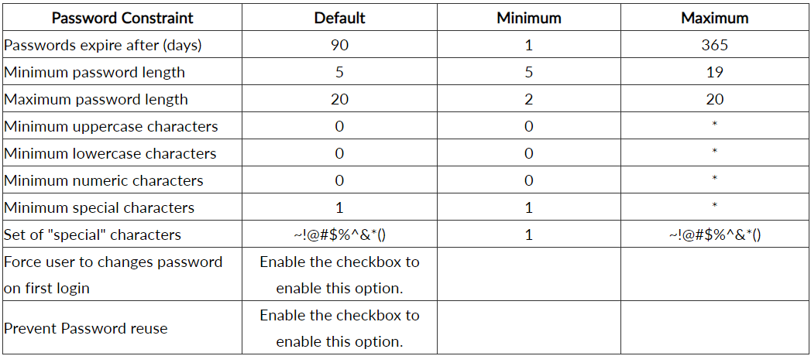

Note: The maximum number of uppercase, lowercase, numeric, and special characters depend on the password length and, when configuring one option, the length set for other options. For example, if password length is set to 8 characters and the minimum uppercase characters is set to 2 characters, the maximum lowercase characters that can be set is 5 and numeric characters cannot be set.  

## **AD Integration**

Microsoft Active Directory (AD): Microsoft Active Directory (AD) is a directory service developed by Microsoft for Windows domain networks. It provides authentication and authorization mechanisms, as well as a framework for organizing and managing resources in a networked environment.

AD stores information about network resources, including users, computers, and services, and allows administrators to manage access to these resources. It also enables network administrators to create and enforce security policies, and to automate network management tasks. AD is a core component of the Microsoft Windows Server operating system and is widely used in enterprise environments.

InstaSafe Secure Access (ISA) supports robust multi-directory support, enabling seamless integration with corporate Active Directory infrastructure for streamlined user provisioning within the ISA console.

This article provides a step-by-step guide on configuring an authentication profile that integrates Microsoft AD servers for user provisioning and authentication.

**Prerequisites for AD Integration**

For successfully integrating the AD profile with the AD server, ensure the following are adhered to:

- Since the AD profile’s connection request will be an inbound connection to the AD server, make sure TCP port number 389 is open on the Gateway firewall.
- Ensure the username and password used in AD integration is correct.
- The InstaSafe Gateway Agent must be able to communicate using its physical adapter’s private IP address with the AD server’s private IP address on TCP port number 389.

**Adding an AD Authentication Profile on the ISA Web Console**

1.Login to the ISA web console with administrator credentials

2.After logging in, on the left-hand menu click on AUTHENTICATION PROFILES

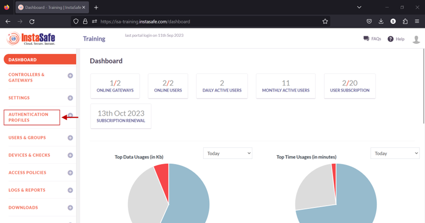

3.Under AUTHENTICATION PROFILES, click on Active Directory

4.On the Active Directory page, under Active Directory Profile click on the Add button

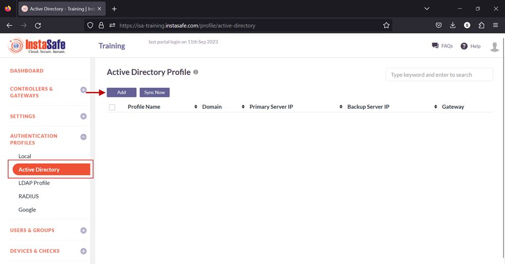

5.In the Create Active Directory Profile window, enter the following information under each field:

- **Profile Name:** Enter a descriptive name for this profile. The name must not contain spaces. This field must be filled-in.
- **Domain:** Enter the domain name of the network. For the purpose of this article, the domain name Alphatech.local has been entered. The domain name is not case sensitive. This field must be filled-in.
- **Connected Gateway:** Click on the field and select the Gateway name through which this server can be accessed. For this article, the Gateway BLR-Data-Centre has been selected. This field must be filled-in with the options available.  
- **Primary Server IP:** Enter the private IP address of the Windows server. This field must be filled-in. 
- **Secondary Server IP:** Enter the private IP address of the back-up Windows server.
- **Bind User:** Enter the username that will bind with AD. The username need not have administrator privileges. A normal user will suffice. This field must be filled-in.
- **Base DN:** Enter the Base DN of the domain. A Base DN can be the domain name of the network, entered in the format, for example, dc=alphatech,dc=local. Or it could include a container name. For example,cn=users,dc=alphatech,dc=local. This field is mandatory to be filled-in. Base DN helps AD in identifying where to begin the search for a user or user group. This field must be filled-in.
- **Filter:** An AD filter helps AD locate the user or user group. A filter specifies the conditions that must be met for a record to be included in the collection that results from a query. The filter entered on the picture below is (&(objectClass=user)(memberOf=CN=ISA-Training,CN=users,DC=alphatech,DC=local)) 

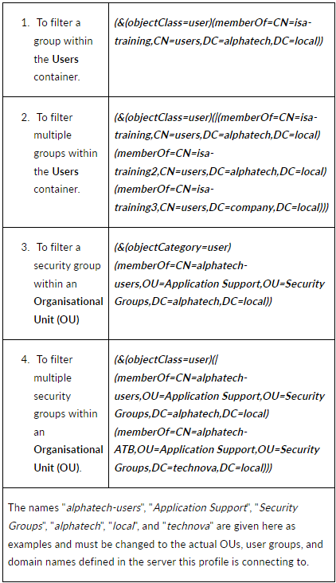

- **Require SSL/TLS secure connection:** Set this to disabled
- **Primary DNS Server IP:** Enter the IP address of the DNS server configured in the network
- **Secondary DNS Server IP:** Enter the IP address of the secondary DNS server configured in the network
- **Primary WINS Server IP:** Enter the IP address of the WINS server configured in the network
- **Secondary WINS Server IP:** Enter the IP address of the secondary WINS server configured in the network
- **Authentication Type:** The administrator has the option to select either Certificate or Password + Certs. The type set here will be the authentication method for the AD users.  This field must be filled-in with the options available.
- Click on **Save and Add** new to create this profile. This will create an AD profile and the new profile will be displayed on the page.
 
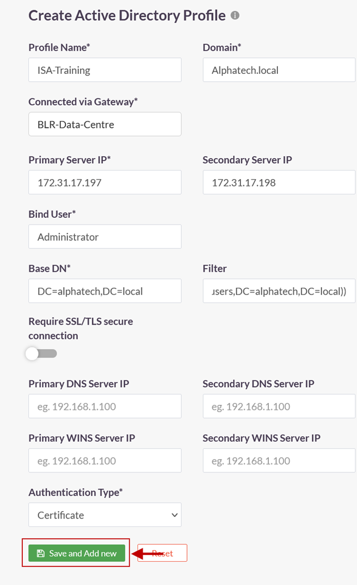

6.Click on the profile name of the AD profile.

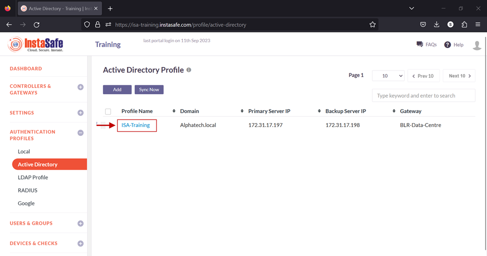

7.In the AD Profile window, Click on Set Password. 

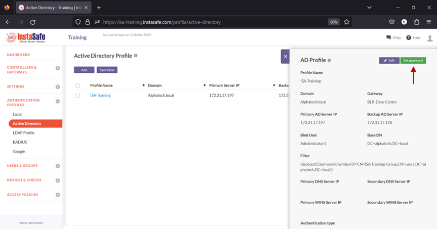

8.Under New Password, enter the password for the username set in the profile. In this article, it is Administrator.

9.Under Confirm Password, confirm the password.

10.Click on Save. 

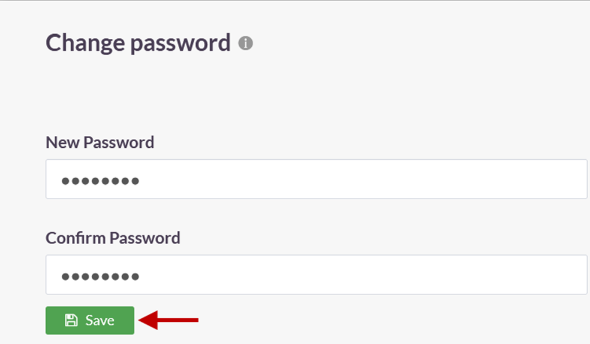

A notification on the bottom left-hand corner will indicate that the password is being set. **Note:** It is recommended to wait for a maximum of two minutes before syncing the profile. This is because, when the AD Profile is newly added or edited, the background daemon service, Instasafe Helper, will restart. The daemon might take a maximum of two minutes to restart. Therefore, after adding or editing the profile,  the sync may have a lag time of up to two minutes.

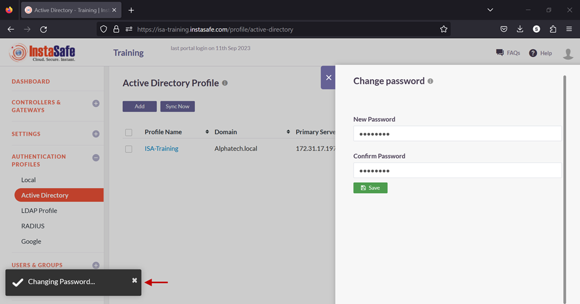

11.Enable the check-box of the newly created AD profile and click on Sync Now. 

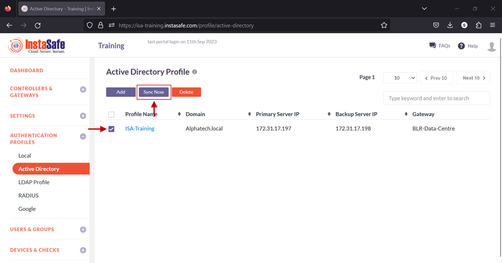

12.If the parameters in the profile have been set correctly, the profile will sync with AD and fetch the users and user groups from it. Note: The AD profile will sync with the AD server every one hour.

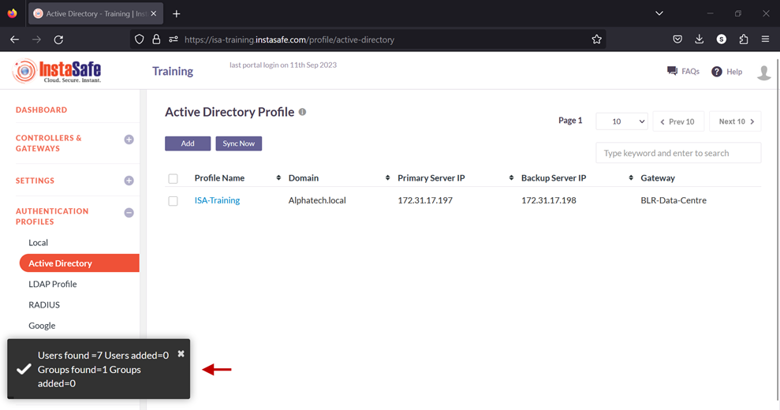

13.To view the imported users, on the left-side menu click on USERS & USER GROUPS and then click on Users.

14.You should be able to see the users imported from AD on this page. 

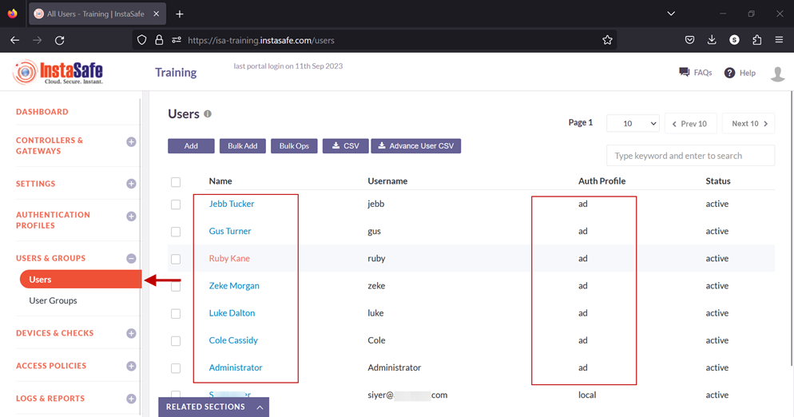

15.On the left-side menu, click on User Groups.

16.You should be able to see the user groups imported from AD on this page. 

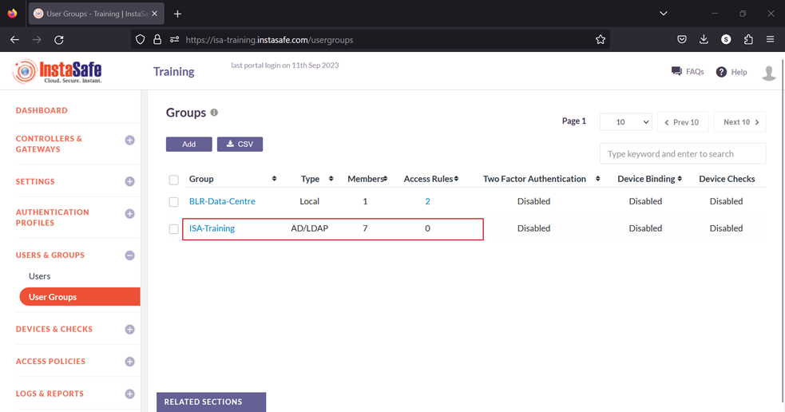

Now that the AD users and user groups are integrated into the ISA web console, further constraints and conditions such as Multi-factor Authentication (MFA), Device Binding, Device Checks, and Geo Binding can now be set. Further, to allow these users access to corporate resources, access rules must be created.    

## **Azure AD Integration**

- Log in to portal.azure.com and select Microsoft Entra ID

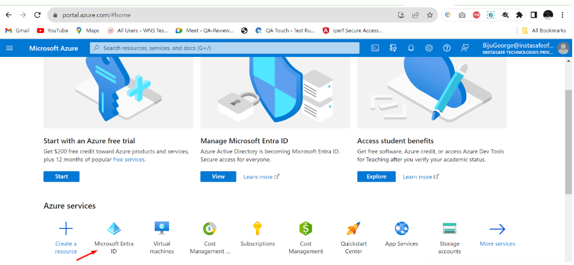

- Click on ‘App registrations’ in the dashboard panel on the left
- Then click on ‘New registration’, provide a custom name, and register the application

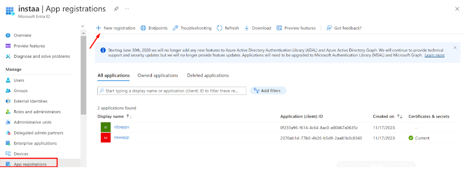

- After the new application is registered/created, select the application to expand
- Switch to the ‘API permissions’ tab
- Click on ‘Add a permission’ and grant permissions as per the screenshot below

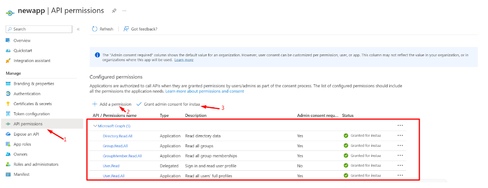

- Now, switch to the ‘Certificate and secrets’ section of the application and click on ‘Client secrets’ and then ‘+ New client secret’
- A new Client secret will be generated
- Make sure to copy the Value and save it carefully for later use (while configuring the Sync profile in the InstaSafe ISA portal)
- This Client secret value will only be displayed once at the time of generation, and won’t be visible again to Entra ID Admins (once viewed)

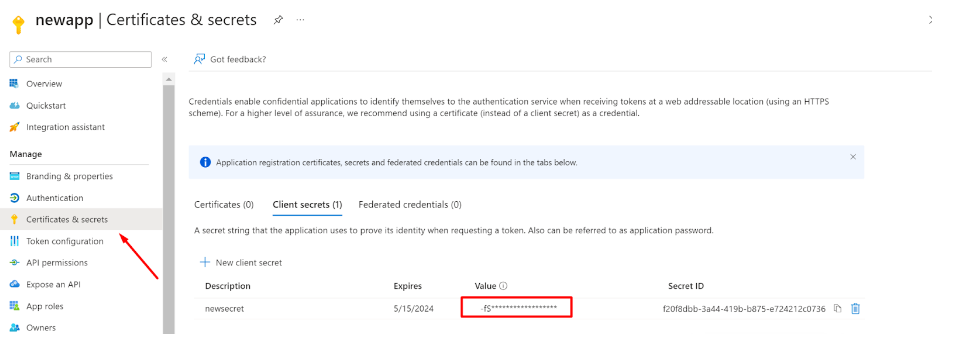

- Now, switch to the Overview section
- Copy the Application (client) ID for later use
- Copy the Directory (tenant) ID

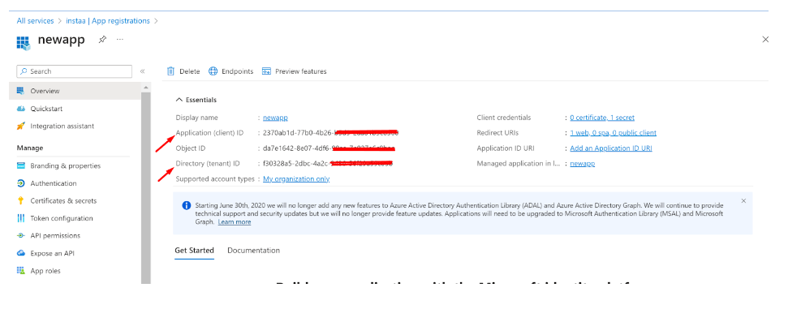

**User Sync**

- Login to the InstaSafe ISA Portal with Admin credentials
- Navigate to Authentication Profile >> Azure AD

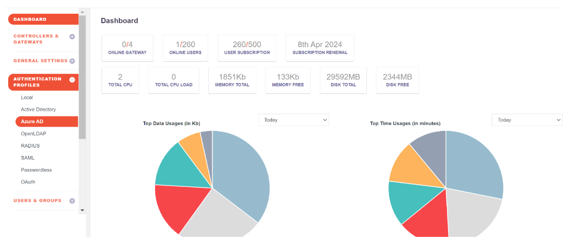

- Click on the Add button
- Fill up the details from Entra ID
    - Profile Name: <Any custom name>
    - Domain: abc.instasafe.com (example)
    - Tenant ID: <copied earlier>
    - Client Id: <copied earlier>
    - AzureAD Groups: <Name of the User Groups created for InstaSafe ISA>
Click the ‘Save and Add new’ button

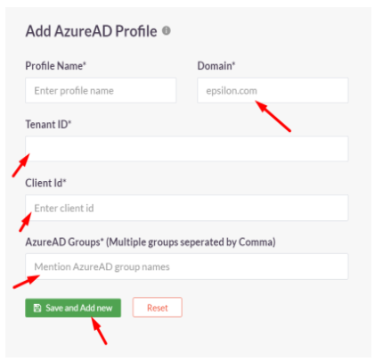

- Once the profile is created, Users and Groups from Entra ID can be synced to the InstaSafe ISA Portal by selecting the profile and clicking ‘Sync Now’

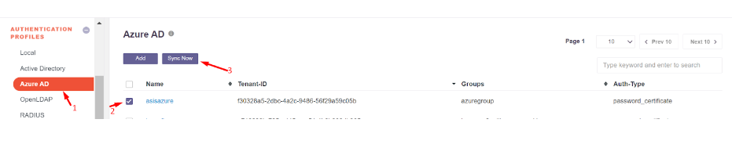

- After a successful sync, Users and Groups from Entra ID will be available in the InstaSafe ISA Portal

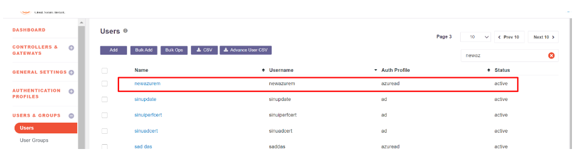

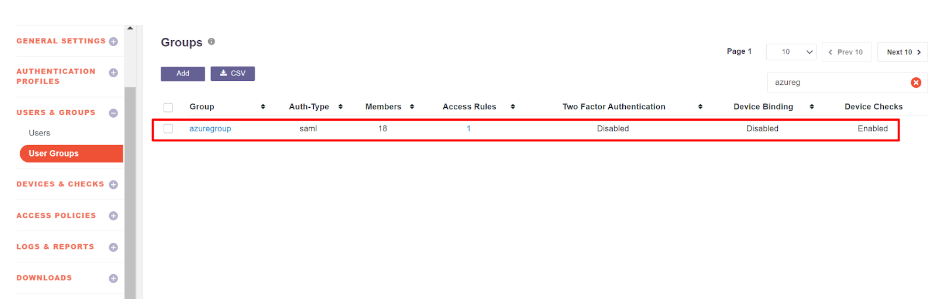

**User Authentication (SAML 2.0)**

In this step, SAML Authentication shall be configured where InstaSafe ISA shall serve as the Service Provider (SP) and Entra ID shall serve as the Identity Provider (IdP).

- Log in to portal.azure.com and select Microsoft Entra ID
- Click on ‘Enterprise applications’ in the dashboard panel on the left
- Click on ‘New application’

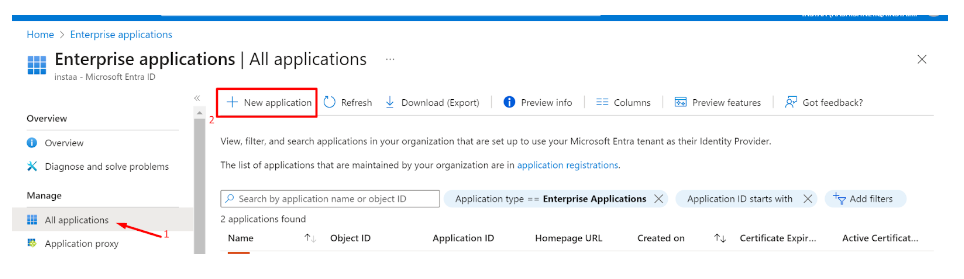

- Click on ‘Create your own application’
- Provide a custom name like instasafeisa and click ‘Create’

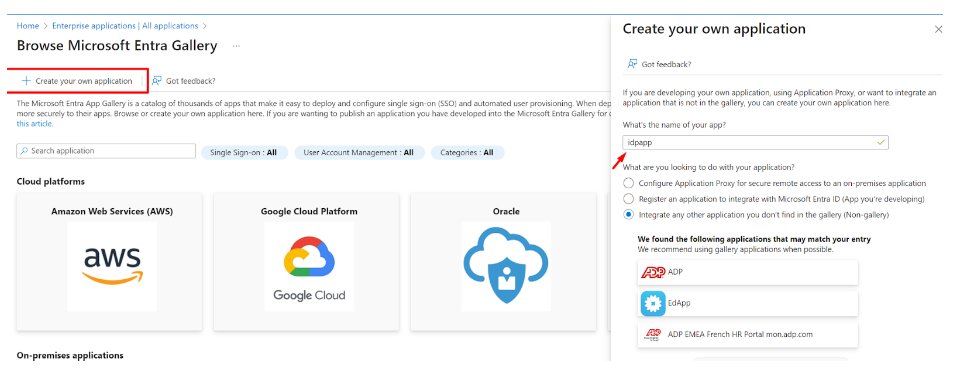

- Expand the newly created Application
- Click on ‘Single sign-on’ and then ‘Set up single sign on’

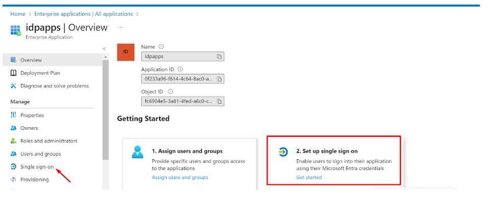

Fill up the details of your SP (InstaSafe ISA)

Identifier (Entity ID): http://abc.instasafe.com

Reply URL (ACS URL): https://abc.instasafe.com/api/saml/acs

Logout URL: https://abc.instasafe.com/api/saml/acs

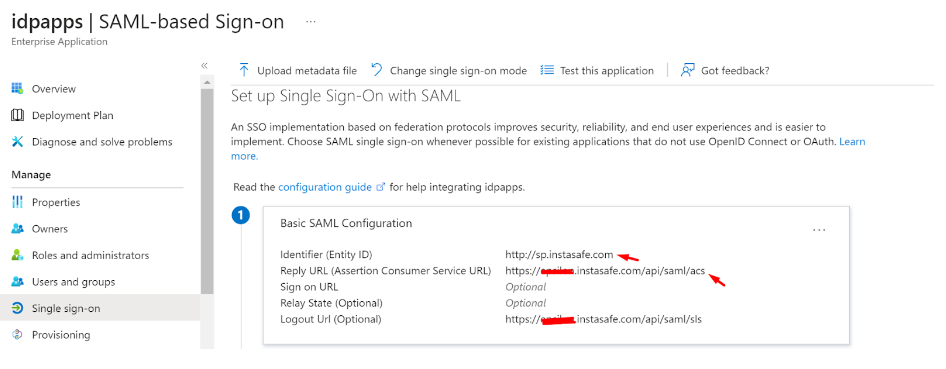

- Download the Metadata from Entra ID (or copy all required values like Certificate, Entity ID, ACS URL, etc.) to be used later

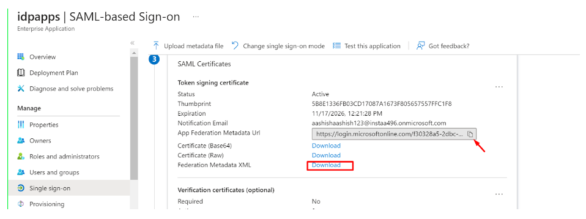

- Login to the InstaSafe ISA Portal with Admin credentials
- Navigate to Authentication Profile >> SAML
- Click on ‘Add’

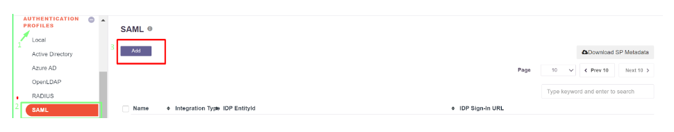

- The values from Entra ID (copied earlier) can be manually entered here, or automatically populated by uploading the IdP Metadata file (downloaded earlier)
- Click ‘Add’

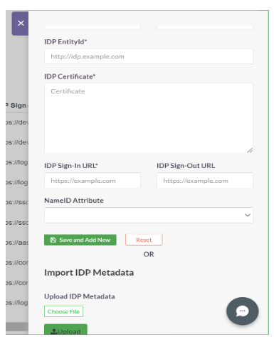

- Once created, the SAML profile will be available to view

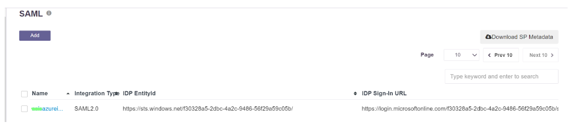

- The SAML Authentication profile can be assigned to the User Group synced from Entra ID
    -   Navigate to User Groups
    -   Locate and expand the User Group synced from Entra ID
    -   Click on ‘Edit’
    -   In the ‘Authentication Profile’ drop-down, select the SAML profile created
    -   Click on ‘Update’

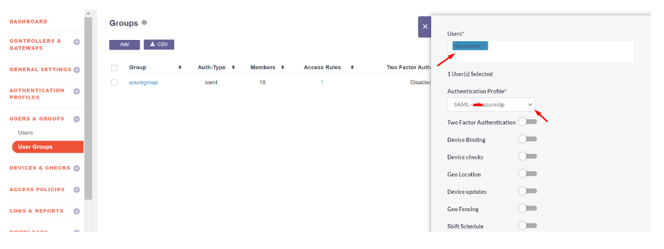

Please refer the below video on the Microsoft Entra ID configuration.

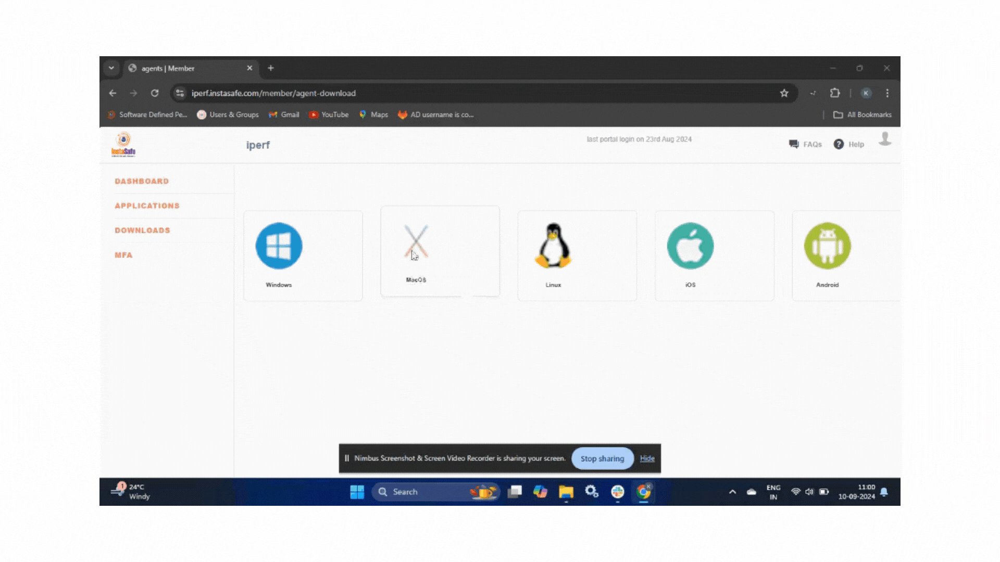

## **OpenLDAP Integration**

**Prerequisites for creating an user on an OpenLDAP server**

1.To create a user on an OpenLDAP server, right-click on the OU (Organizational Unit), select New, and then choose User.

2.Enter the user details and click OK to create the user.

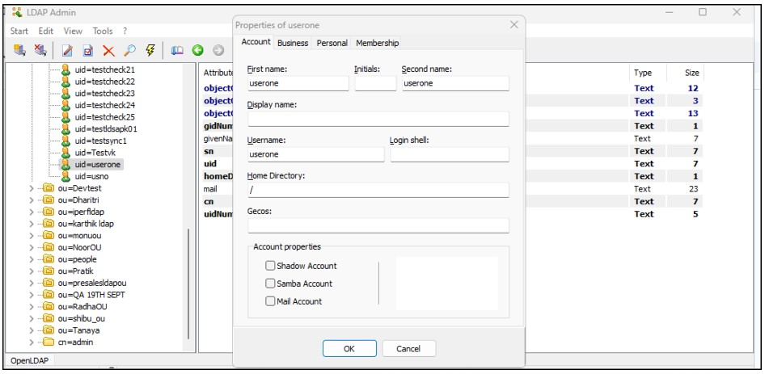

3.Next, click on the user's profile to set a password for the user.

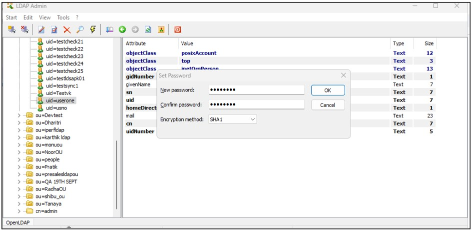

4.To create a group on an OpenLDAP server, right-click on the OU (Organizational Unit), select New, and then choose Group.

5.Enter the group details, add members to the group, and click **OK** to create the group.

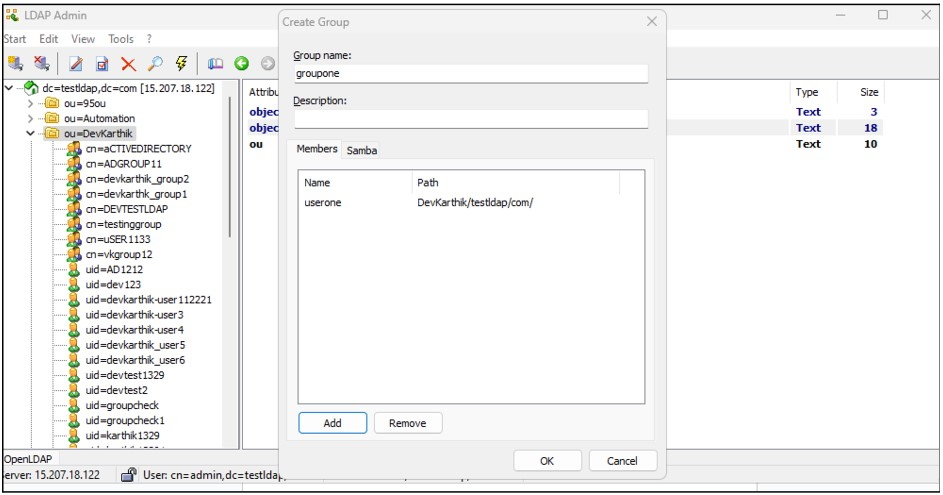

**Prerequisites for OpenLDAP Integration**

For successfully integrating the OpenLDAP profile with the OpenLDAP server, ensure the following are adhered to:  

1.Since the OpenLDAP profile’s connection request will be an inbound connection to the OpenLDAP server, ensure that TCP port 389 (or 636 for LDAPS) is open on the Gateway firewall.  

2.Verify that the username (Bind DN) and password used for OpenLDAP integration are correct. 

3.The InstaSafe Gateway Agent must be able to communicate using its physical adapter’s private IP address with the OpenLDAP server’s private IP address on the appropriate TCP port (389 or 636). 

**Adding an OpenLDAP Authentication Profile on the ISA Web Console**

1.Log in to the ISA web console using administrator credentials.  

2.After logging in, click on AUTHENTICATION PROFILES in the left-hand menu.   

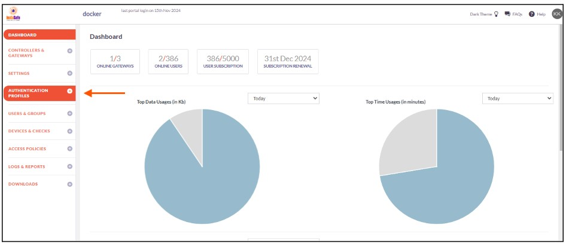

3.Under AUTHENTICATION PROFILES, click on OpenLDAP.  

4.On the OpenLDAP page, under OpenLDAP Profile, click on the Add button. 

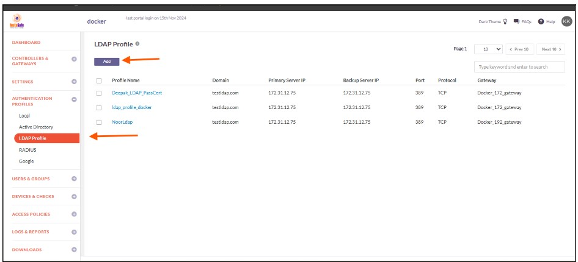

5.In the Create OpenLDAP Profile window, enter the following information under each field:  

- **Profile Name:** Enter a descriptive name for this profile. The name must not contain spaces. This field is mandatory.  

- **Domain:** Enter the domain name or identifier for the network. For example, openldap.local.This field must be filled-in and is not case-sensitive.  

- **Gateway:** Select the Gateway name through which the OpenLDAP server can be accessed. For example, "Gateway BLR-Data-Centre." This field must be selected from the available options.

- **Primary Server IP:** Enter the private IP address of the OpenLDAP server. This field must be filled-in.  

- **Backup Server IP:** Enter the private IP address of the backup OpenLDAP server (if applicable).  

- **Bind User (DN):** Enter the Distinguished Name (DN) of the user that will bind with the OpenLDAP server. The Bind DN user does not need administrator privileges; a normal user will suffice. This field is mandatory.  

- **Base DN:** Enter the Base DN of the domain. The Base DN defines where in the directory tree the search will start. For example:  
    - Without container: `dc=openldap,dc=local`  
    - With container: `ou=users,dc=openldap,dc=local`  

This field is mandatory. 

- **Filter:** An OpenLDAP filter helps locate specific users or groups in the directory. A filter specifies the conditions that records must meet to be included in the search results. For example:(&(objectClass=person)(memberOf=cn=LDAP-Training,ou=users,dc=openldap,dc=local)).  

The **GID Number** will be available in the OpenLDAP server under the group profile. The admin needs to copy the GID number and add it to the filter.

Example:

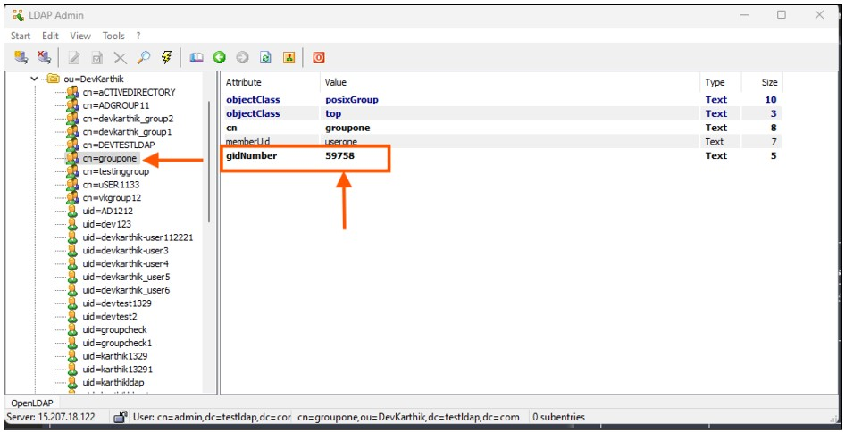

- **Port:** Enter the port number Open LDAP server for example : 389

- **Protocol:** Enter the protocol number for OpenLDAP server for example : Tcp

- **Authentication Type:** The administrator has the option to select either Certificate or Password + Certs. The type set here will be the authentication method for the AD users. This field must be filled-in with the options available.

- Click on **Save** to create this profile. This will create an AD profile and the new profile will be displayed on the page.

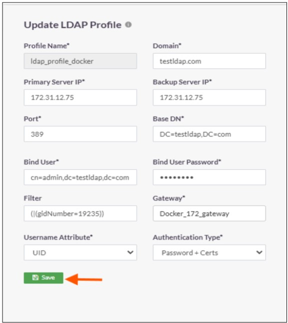

6.Click on the profile name of the Open LDAP profile.

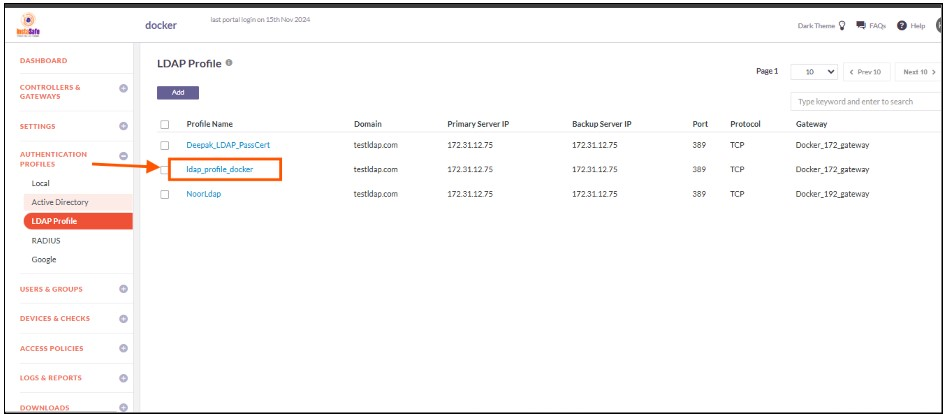

7.In the Open LDAP Profile window, Click on Set Password.

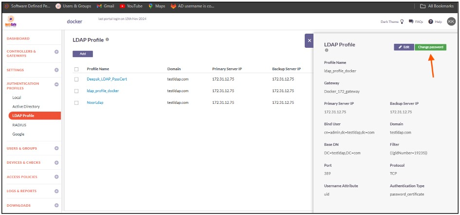

8.Under New Password, enter the password for the username set in the profile. In this article, it is Administrator.

9.Under Confirm Password, confirm the password.

10.Click on Save.

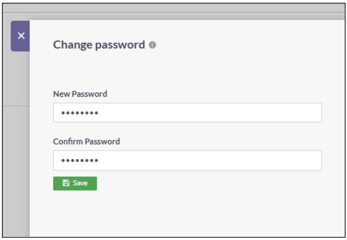

11.Enable the check-box of the newly created Open LDAP profile and click on Sync Now.

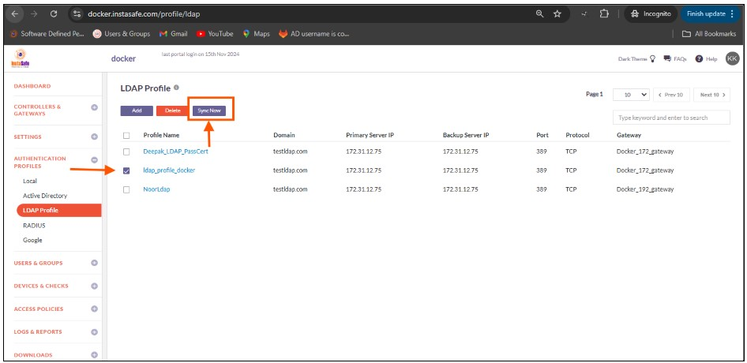

12.If the parameters in the profile have been set correctly, the profile will sync with OpenLDAP and fetch the users and user groups from it. Note: The Open LDAP profile will sync with the Open LDAP server every one hour.

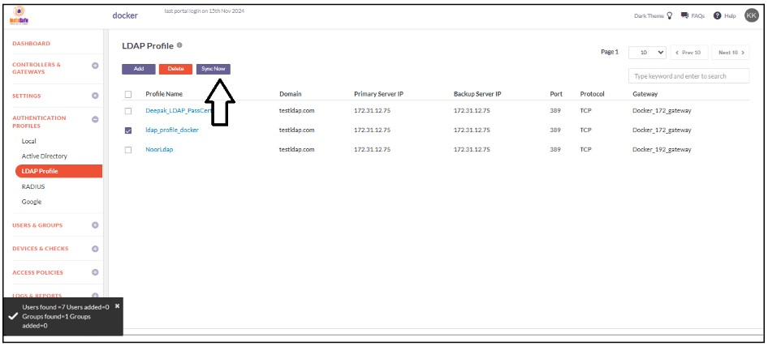

13.To view the imported users, on the left-side menu click on USERS & USER GROUPS and then click on Users.

14.You should be able to see the users imported from Open LDAP on this page.

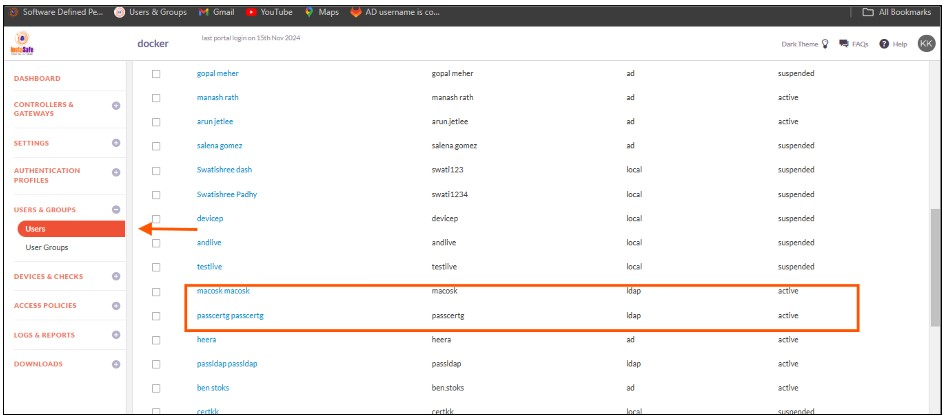

15.On the left-side menu, click on User Groups.

16.You should be able to see the user groups imported from Open LDap on this page.

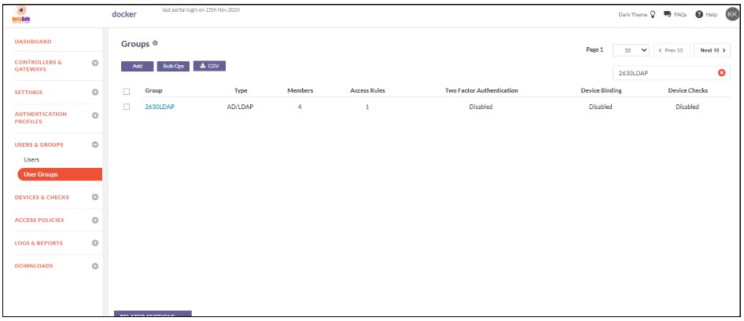

Now that the Open LDAP users and user groups are integrated into the ISA web console, further constraints and conditions such as Multi-factor Authentication (MFA), Device Binding, Device Checks, and Geo Binding can now be set. Further, to allow these users access to corporate resources, access rules must be created.

## **ISA AD Integration for Radius**

The following are the steps to use AD authentication with InstaSafe Secure Access 

**1. Create a security group**

Create a security group in Active Directory Users and Computers called VPNusers. Everyone could have access but it's a good policy to identify the VPN Users and have granular access control.

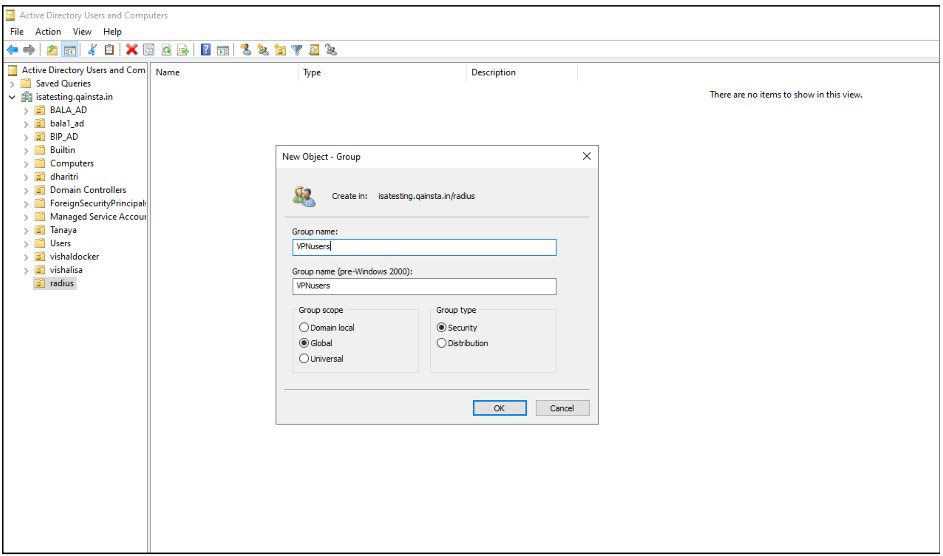

**2.Add Users to Security Group**

Add user accounts that use the InstaSafe VPN to this group. 

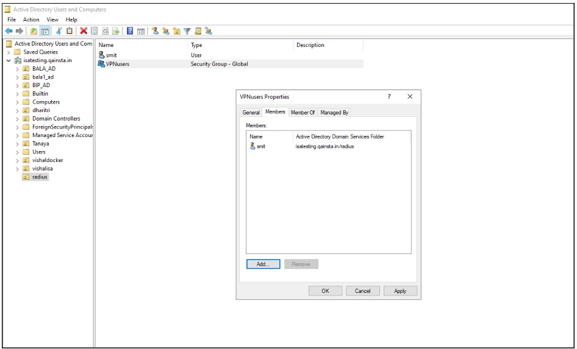

**3.Add “Network Policy and Access Service” Role**

On the Active Directory Check if the “Network Policy and Access Services” role exists under Roles in Server Manager. 
Otherwise, click right-click Roles and select Add Role.

Click Next to add role in the wizard

Select “ Network Policy and Access Services” under the Roles to be added and click Next

Under Role Services, select Network Policy Server and Click Next

Once the Role is added, it appears under Roles in the Server Manager

**4. Add Radius Client**

Expand the **Network Policy and Access Services** node, go to **NPS (Local) > RADIUS Clients and Servers**, right-click **RADIUS Clients** and choose **New**

Fill in the below fields

**Friendly name:** Enter InstaSafe VPN or anything deemed appropriate 

**Address (IP or DNS):** Enter the LAN IP address of the InstaSafe Gateway. 
For example: 192.168.1.77. 
Please confirm the IP address from the InstaSafe Support Team 

**Shared Secret:** Select Manual, set a password and save the shared secret. 

This secret is required to be configured later on the my.instasafe.net portal.

**5. Add Network Policy** 

Under **NPS (Local) > Policies** right-click **Network Policies** and select **New** 

In the **Policy name field**, enter **Allow InstaSafe**. 

Type of network access server: **Unspecified** 

Click Next

In the **Specify Conditions** window, click **Add**

Select Windows Groups and click Add

Click **Add Groups** and add the group **VPNusers** (or whatever group is needed)

Back in the **Specify Conditions** window, click **Next**

Select **Access granted**

Put the new policy before policies preventing the connection. Please note the Processing Order should be high for **“Allow InstaSafe”** Policy.

**6. Configure Authentication Methods** 

In the Configure Authentication Methods window, check **Unencrypted authentication (PAP, SPAP)**

Skip the next wizard window (Constraints) and click Next, Next, Finish until the end.

**7. Configuring RADIUS Authentication Profile on the ISA Web Console**

- Log in to the ISA web console using administrator credentials.  

- Click on AUTHENTICATION PROFILES in the left-hand menu.

- Under AUTHENTICATION PROFILES click on RADIUS.  

- On the RADIUS page, under RADIUS Profile, click on the Add button. 

- In the Create RADIUS Profile window, enter the following information under each field:  

    - **Profile Name:** Enter a descriptive name for this profile. The name must not contain spaces. This field is mandatory. 
    - **Gateway to reach RADIUS:** Select the Gateway name through which the OpenLDAP server can be accessed. For example, "Gateway BLR-Data-Centre." This field must be selected from the available options
    - **RADIUS Server IP:** Enter the private IP address of the RADIUS server. This field must be filled-in
    - **Backup RADIUS Server IP:** Enter the private IP address of the backup RADIUS server
    - **Port:** Enter the port number Open LDAP server for example Radius server port : 1812
    - **Radius Secret:** Enter the shared secret configured manually while adding the radius client in the “Network Policy and Access Service”

- Click on **Save** to create this profile. This will create a RADIUS profile and the new profile will be displayed on the page.

- Open the user profile And Assign the Authentication Profile to the user profile.

To verify that InstaSafe Secure Access is using AD authentication, please start the InstaSafe Agent and enter the AD username in the email format (username@domain) and the AD password for the user. If the connection is successful, the AD integration is complete. If the connection is unsuccessful, please contact support@instasafe.com or call InstaSafe Support for assistance.

## **SAML Authentication**

**SAML 2.0 configuration with AZURE AD**

SAML Authentication will be configured where InstaSafe ISA shall serve as the Service Provider (SP) and Entra ID shall serve as the Identity Provider (IdP).

- Log in to portal.azure.com and select Microsoft Entra ID
- Click on ‘Enterprise applications’ in the dashboard panel on the left
- Click on ‘New application’

- Click on ‘Create your own application’
- Provide a custom name like instasafeisa and click ‘Create’

- Expand the newly created Application
- Click on ‘Single sign-on’ and then ‘Set up single sign-on’

- Fill up the details of your SP (InstaSafe ISA)
    -   Identifier (Entity ID): http://companyname.instasafe.com
    -   Reply URL (ACS URL): https://companyname.instasafe.com/api/saml/acs
    -   Logout URL: https://companyname.instasafe.com/api/saml/acs

- Download the Metadata from Entra ID (or copy all required values like Certificate, Entity ID, ACS URL, etc.) to be used later

- Login to the InstaSafe ISA Portal  with Admin credentials
- Navigate to Authentication Profile >> SAML
- Click on ‘Add’

- The values from Entra ID (copied earlier) can be manually entered here, or automatically populated by uploading the IdP Metadata file (downloaded earlier)
- Click ‘Add’

- Once created, the SAML profile will be available to view

- The SAML Authentication profile can be assigned to the User Group synced from Entra ID
    -   Navigate to User Groups
    -   Locate and expand the User Group synced from Entra ID
    -   Click on ‘Edit’
    -   In the ‘Authentication Profile’ drop-down, select the SAML profile created

- Click on ‘Update’

## **OAuth2**

OAuth2 (Open Authorization version 2) is a widely adopted authorization framework that provides a secure method for allowing third-party applications to access a user's data and resources without exposing their credentials. OAuth2 enables users to grant limited access to their resources on one platform to a third-party application without requiring the user to share their login information.
OAuth2 is primarily used for secure delegated access and is crucial for managing permissions across various services in a user-friendly, safe manner.

**OAuth2 is used for:**

1. Applications Requiring Secure, Delegated Access: OAuth is designed to allow third-party applications to securely access a user's resources (such as Google Calendar or Dropbox files) without needing the user's credentials. This prevents sensitive data from being exposed and allows users to manage permissions more granularly.

1. Single Sign-On (SSO) Across Services: OAuth simplifies user authentication across multiple services and applications. OAuth enables a user to log into multiple services using a single set of credentials (e.g., using their Google or Facebook account), enhancing the user experience and reducing password fatigue.

1. Mobile and Web Application Security: OAuth is frequently used to secure access to mobile and web applications. By using OAuth, applications can authenticate users securely without handling or storing their passwords, reducing the risk of credential theft.

1. Integration Between Third-Party Services: OAuth is designed to enable seamless integrations between various third-party services, such as when a user grants permission for an app to access their information on another platform (e.g., integrating with social media or cloud storage services).

1. Compliance with Security Regulations: Many organizations in regulated industries (such as finance, healthcare, and government) need OAuth to comply with security standards and to ensure that user data is accessed only by authorized, trusted applications.

**Use Cases of OAuth2:**

1. **Social Media Login (Single Sign-On - SSO):** OAuth is widely used for enabling **Single Sign-On (SSO)** for web and mobile applications. Instead of creating and remembering multiple usernames and passwords for different services, users can log in using their **Google, Facebook, or Twitter** credentials. OAuth simplifies this by handling authentication while ensuring that the user’s credentials remain secure.

    **Example:** An employee logs into an HR management system using their Google account. The OAuth process allows the system to access the employee’s basic profile information, like their email address, without requiring the employee to manually enter their credentials.

2. **Third-Party Application Integrations:** OAuth is used to grant third-party applications access to user data across various services, ensuring that the user can securely integrate their accounts across different platforms.

    **Example:** A photo-editing application needs to access a user’s photos stored in Google Photos. The user grants the app access via OAuth, allowing the app to edit the photos without exposing the user’s Google credentials.

3. **Secure API Access:** OAuth is commonly employed for granting **secure API access** to third-party developers. This ensures that applications can securely interact with the APIs of other services on behalf of the user, without the need to expose the user’s sensitive information.

    **Example:** A travel app integrates with a flight booking system's API to fetch the latest flight schedules for a user. OAuth ensures that only authorized apps can access this data, and the user’s credentials remain protected.

4. **Mobile and Web Applications Authentication:** OAuth is frequently used for **authentication** in both mobile and web applications. Users can log into their apps using OAuth-based services to ensure their credentials are not directly stored by the application, reducing the risk of credential theft.

    **Example:** A mobile banking app allows users to log in using an OAuth process that authenticates their credentials via a secure identity provider. This eliminates the need for the app to store sensitive login information.

5. **Secure Cloud Services Access:** Cloud services often use OAuth to allow authorized access to cloud-hosted data (e.g., Google Cloud, Microsoft Azure, or Dropbox). OAuth provides a secure, scalable solution for granting and managing permissions for cloud applications.

    **Example:** An organization integrates its internal document management system with a cloud storage provider like **Dropbox**. OAuth allows employees to securely access and upload documents to Dropbox without manually logging in each time.

6. **Data Sharing Between Platforms:** OAuth enables users to securely share their data between multiple platforms without directly exposing their credentials. This is often used for services that integrate with other platforms to provide enhanced functionality.

    **Example:** A user might authorize a fitness tracking app to share their data (e.g., steps, calories burned) with their social media accounts. OAuth grants the app permission to post updates to the user’s feed while keeping credentials safe.

7. **Secure Payment Systems Integration:** Many online payment systems, such as **PayPal** or **Stripe**, use OAuth to enable third-party applications to securely process payments on behalf of users.

    **Example:** An e-commerce platform integrates with PayPal, allowing users to make payments via OAuth, ensuring that payment information is handled securely by PayPal without exposing sensitive data.

8. **Enterprise Systems and Access Control:** In enterprises, OAuth can be used to manage and control access to internal systems. OAuth helps implement **Single Sign-On (SSO)** and ensures that access to sensitive data is limited to authorized applications and users.

    Example: Employees of an organization authenticate using OAuth to access internal tools and resources like CRM systems, email, and document repositories. This improves user experience while keeping the systems secure.

9. **IoT Device Authentication:** OAuth is used in **Internet of Things (IoT)** devices to securely authenticate devices and control access to resources. It ensures that only authorized devices can interact with cloud services or other connected devices.

    **Example:** A smart thermostat uses OAuth to securely connect to a user’s smart home application, allowing the thermostat to access temperature settings and data without exposing the user’s login credentials.

**Steps To Configure The OAuth2 with AZURE**

- Log in to the Azure Entra id as Administrator
- Go to App Registration section 
- Click on the New Registration (+)

- Now, Enter The application name and click on the Register button

- After registering the app successfully, it will be listed on all application pages under App Registration.
- Now, click on the application.

- Go to the overview section 
- Click on the Add a Redirect URI

- Now, click on the Add URI

- Now log in to the Instasafe Console as an administrator
- Navigate to the OAuth page under the Authentication Profile
- Click on the Add button and copy the Redirect URI

- Now, paste the Redirect URL in the Azure portal Application URI section
- Now Click on the Save Button

- Now, navigate to the Certificate and Secrets page and click on the new client secret button.

- Now add the Description and choose the expiry time for the secret 
- Click on the add button

- After the successful addition of the secret, it will be displayed under the Client Secret
- Now, Copy the Value of the secret

- Now Go to the overview page of the Application and copy the tenant ID and client ID

- Login to the instasafe console as an Admin user
- Navigate to the Authentication profile >> OAuth
- Click on the Add button to create a new OAuth profile for Azure

- Add the profile name 
- Select Provider as Azure and the details 
- Tenant ID and client ID should be added which were copied earlier in Figure - Figure no - 1.10.
- Now click on the save button

- After the successful addition of the OAuth profile, it will display on the Oauth page.
- Search for the Created OAuth profile and click on that
- It will display two buttons Edit and Set client secret 
- Click on the  Set Client Secret Button 

- Add the secret which was created in the Azure Application

- Navigate to the user group section 
- Search for the user group for which the OAuth Authentication will be configured
- Click on the group and click on the Edit Button

- Select the authentication Profile as Oauth-azure auth which was created in figure no -Figure no - 1.12

- After the Updation Auth type should be changed to OAuth as shown below.

**Conclusion:**

OAuth2 is an essential tool for **secure authorization** and **delegated access** across applications, APIs, and services. By using OAuth2, users can safely authenticate and authorize third-party applications to interact with their data without exposing their credentials. This framework is especially important for securing user data, integrating with cloud and third-party services, and ensuring compliance with security and privacy standards.

# **Configure Passwordless Authentication**

- Login to the instasafe console as an admin
- Click on AUTHENTICATION PROFILE >> Passwordless
- Click on Add Button

- Enter a Profile name and Select primary Auth as Hardware key  and Fallback Passwordles Auth option as password.

- Click on the **Save and Add New** button

- Now the profile will list over the passwordless page 

- After the successful creation of a passwordless Profile that can be used for a single user or a User Group.
- To assign that passwordless in the user profile click on USERS & GROUPS >> Users
- Search for the user and select the user which will be assigned to a passwordless profile
- Click on the Edit button

- Click on the Authentication Profile and select the passwordless profile which was created earlier.

- Click on the Update button to save the Authentication profile of the User as passwordless.

- To assign that passwordless in the UserGroup profile click on USERS & GROUPS >> Users
- Search for UserGroup and select the UserGroup which will assign to a passwordless profile.
- Click on the Edit button

- Click on the Authentication Profile and select the passwordless profile which was created earlier.
- Click on the Update button to save the Authentication profile of UserGroup as passwordless which will apply to all the members of the group as passwordless authentication

- Login to the instance console with the user which enabled passwordless Authentication
- Click on the profile icon. Then click on the MFA option

- Now click on the Resister key under FIDO Keys

- For Windows hello option will display user can choose either the hello option or the Hardware key by clicking on the use another device option

After verifying/adding the hello it will save and allow the user to login via passwordless

- After the successful registration of the hardware key, _Hardware key registered successfully_ message will display

**Console Login Through The Passwordless Hardware Key**

- After successfully registering the hardware key, when the User logs in Next time, it will directly ask for the Hardware key instead of the password

- The user will log in to instasafe after verification of the Hardware Key

**Configuring Passwordless Authentication with Digital Certificate**

- Login to the instasafe console as an admin credential
- Click on AUTHENTICATION PROFILE >> Passwordless
- Now click on Add Button

- Enter a Profile name and Select primary Auth as Digital Certificate  and Fallback Auth option as password
- Now click on the Save and AddNew button

- Now the profile will list over the Passwordless page 

- After the successful creation of a passwordless profile, it can be used for a single user or a User Group.
- To assign that passwordless in the user profile, click on USERS & GROUPS >> Users
- Search for the user and select the user which will be assigned to a passwordless profile
- Now click on the Edit button

- Now choose the passwordless profile with a digital certificate.

**Installation Process of Digital Certificate** 

- Login to the instasafe console with the user for which the passwordless digital certificate authentication is configured.

- Enter the password and  click on sign in

- After Successful login Navigate to the Download section in the Dashboard Menu
- Download the instasafe web  agent 

- Install the web agent to set up  the digital certificate

- Enter the credential of a user for  which the digital certificate is configured and click on login

- After the Successful installation of the agent installation, a success message will appear
- Then click on the ok button of the pop-up message

**Instasafe Agent access with Digital certificate**

- After the agent is installed, the digital certificate will be installed on the computer.
- Enter the URL in the browser 
- A certificate prompt will open for Digital certificate passwordless authentication click on ok

- After clicking on the ok, the login page will appear.

- Now enter your username and click on sign in.

- The user will be directly redirected to the dashboard page without asking for any password

**Instasafe Agent access with Digital certificate**

- After the installation of the agent when the user tries to log in next time Then the certificate will appear
- Select the certificate and click on ok for passwordless digital certificate-based login

- Now enter the username which is configured for passwordless and click on sign in

- After sign-in, the user will connect to the agent successfully without asking for the Password

