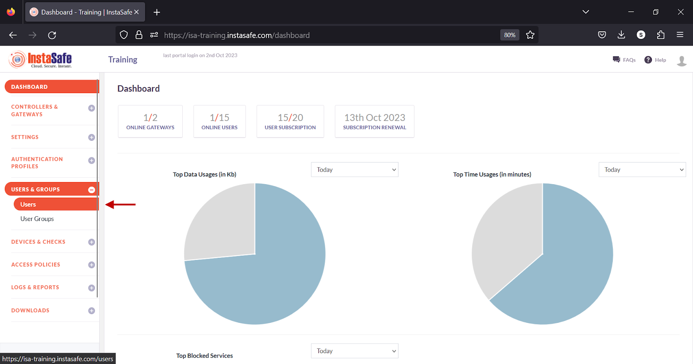
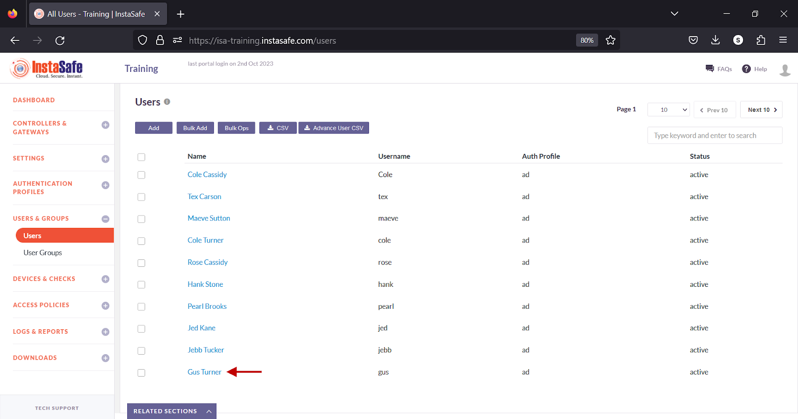
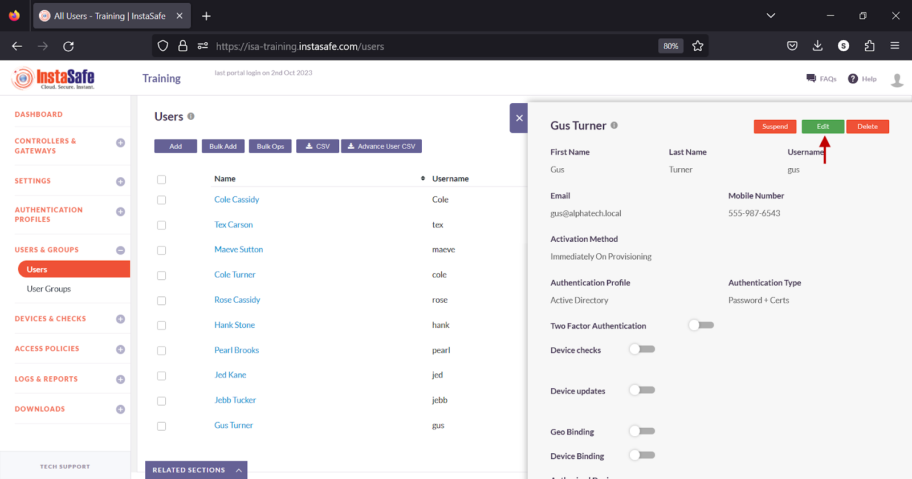
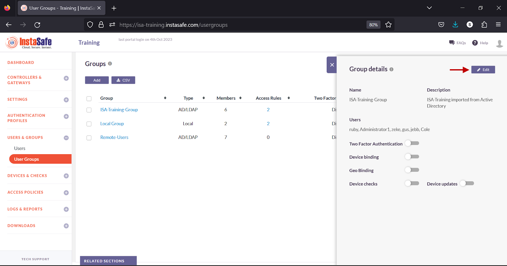
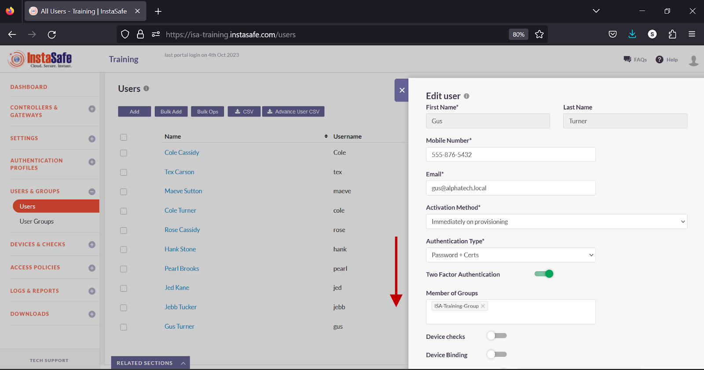
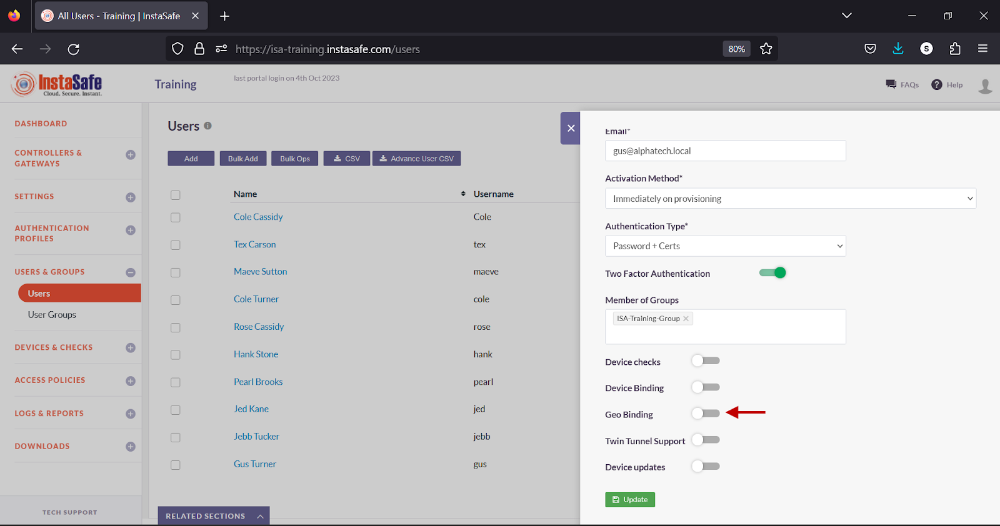
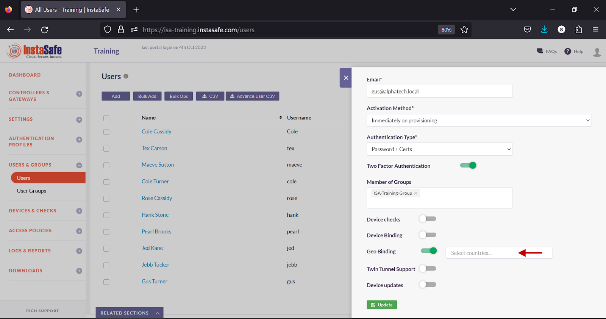
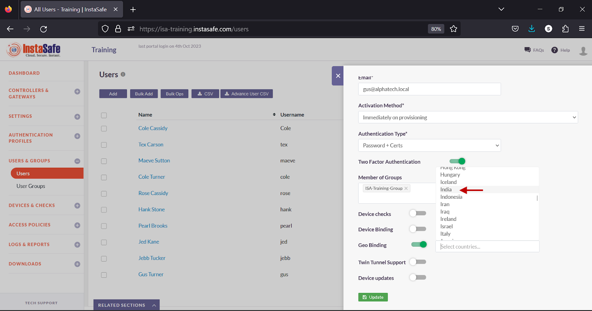

# Configuring Geo Binding

Geo Binding helps ISA administrators to restrict the ISA User Agent connection to specific countries, thus further securing remote access to corporate resources. Geo Binding can be configured per user and per user group. More than one country can be selected as the source of the User Agent connection. 

For the purpose of this article, the end-user device shown is a Windows PC.

- Log into the ISA web console using administrator credentials 
- Navigate to the USERS & GROUPS > Users page.

- Click on the name of a user

- Alternatively, click on the name of a user group on the User Groups page.

- In the user window, click Edit

- Alternatively, in the Group details window, click Edit.

- Scroll Down

- Turn on the Geo Binding toggle.

- Click inside the Select countries box.

- Select the countries you want to allow the user or the user group to connect from. 

- Click Update to save the change.

**Conclusion**

Geo Binding adds one more layer of security to the ISA User Agent connection process by restricting users to connect from certain allowed countries. If a user attempts to connect from a country not configured under Geo Binding, the connection is refused.
