# Configuring Two-Factor Authentication

Two-Factor Authentication (TFA) adds one more layer of security to the ISA User Agent connection process, in addition to the username-password and certificate method of authentication. When TFA is enabled for a user or user group, the User Agent is presented with a menu to select the method to receive a One-Time Password (OTP).  Once the user selects the method, the user is prompted to enter the OTP. On successful verification of the OTP, the Agent proceeds to complete the connection and establishes a tunnel. 

_The MFA push notification menu is not displayed for MacOS and Linux users. Instead, the OTP field is displayed without giving the option to the user to choose the method to receive the OTP._

1. Here is the workflow of the User Agent connection when TFA is enabled:
1. The ISA User Agent connects to the ISA authentication server over TLS port 443. The server prompts for the username and password (if configured). If Always-On mode is enabled, it would prompt for username and password only once, at the time of installation. 
1. Once the username and password authentication is successful, the server makes API calls for validating Device Binding, Geo Binding, and Device Checks, if configured. 
1. If authentication and compliance is successful, the server sends push notification to select the method to receive OTP.
1. User selects the method and the Agent forwards it to the server
1. The server prompts for OTP
1. User enters the OTP and the Agent forwards the OTP to the server
1. Server verifies the OTP and, if verified, it proceeds to complete the connection.

The menu to select the method to receive the OTP has the following options:

- **TOTP on Authenticator** -  Time-based OTP generated on the InstaSafe Authenticator app installed on a mobile device. 
- **Approve Push Notification on Authenticator** – Approval by clicking Approve on the push notification received on the InstaSafe Authenticator app.
- **OTP via SMS** – OTP received via SMS on the user’s phone. A valid phone number must be entered in the user profile to receive OTP.
- **OTP via Email** – OTP received via email. A valid email address must be entered in the user profile to receive OTP.

This article describes the step-by-step method to configure TFA on the ISA web console. For the purpose of this article, the end-user device shown is a Windows PC.

- Log into the ISA web console using administrator credentials 
- Navigate to the USERS & GROUPS > Users page.

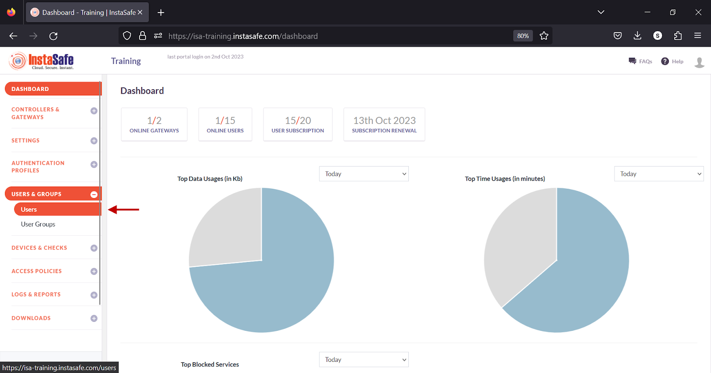

- Click on the name of a user
    - Alternatively, click on the name of a user group on the User Groups page.

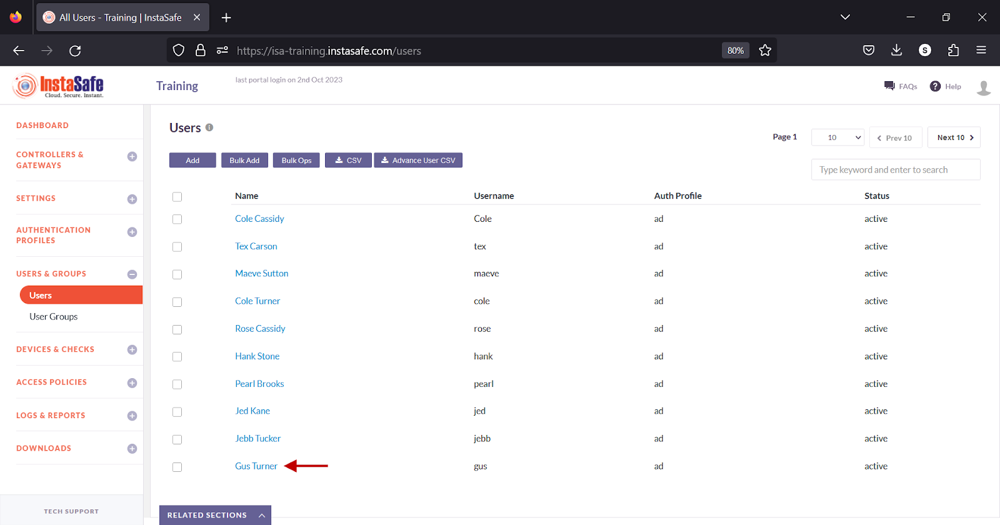

- In the user window, click Edit

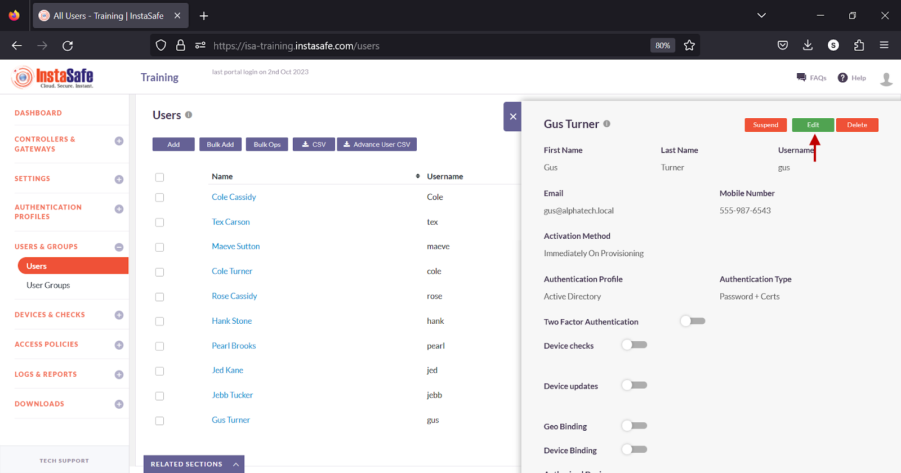

- Alternatively, in the Group details window, click Edit.

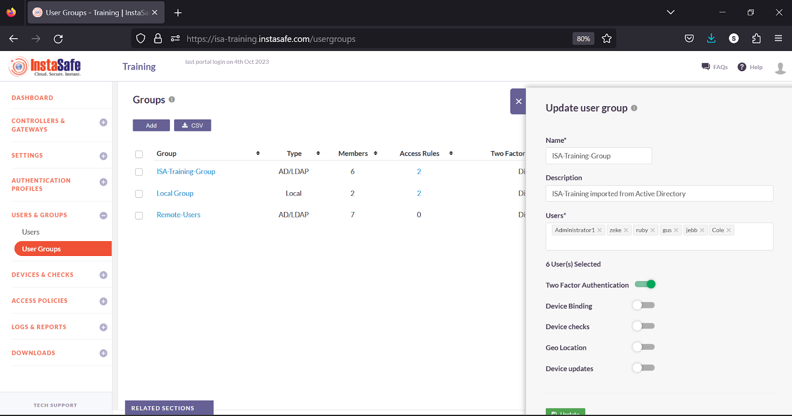

- Turn on the Two Factor Authentication toggle.

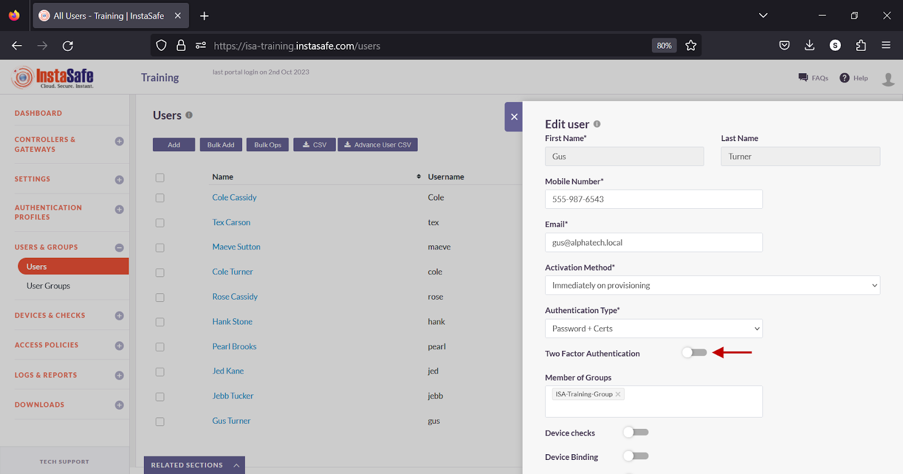

- Scroll down.

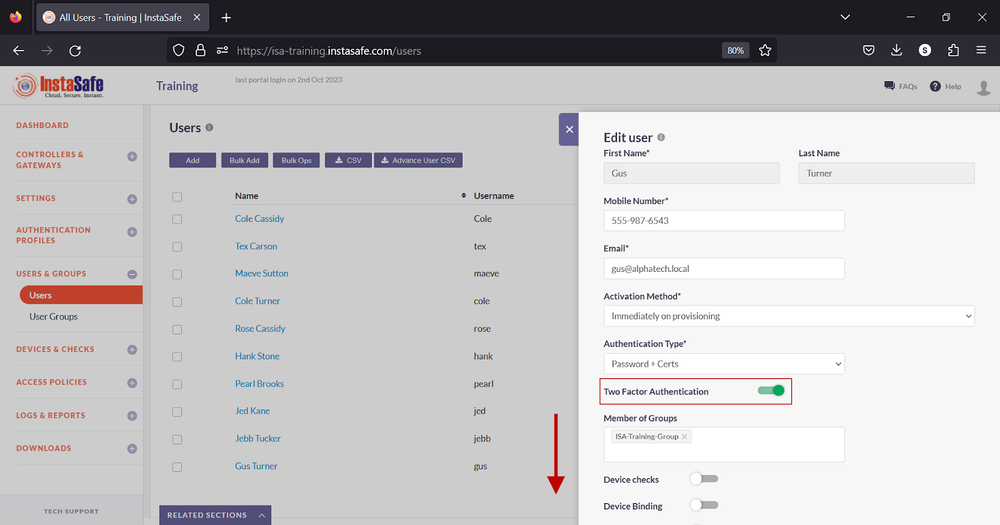

- Click Update to save the change.

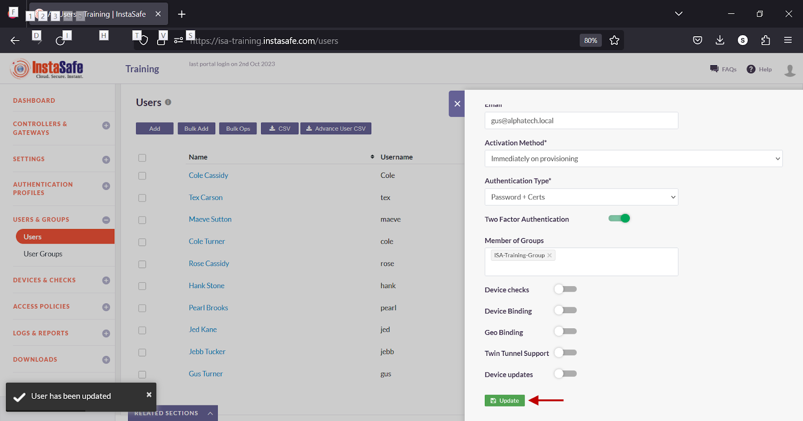

**Testing**

- On the  end-user device, start the ISA User Agent. 

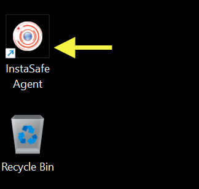

- Enter the username and password of the user (if Authentication Type is set to Password+Certs).

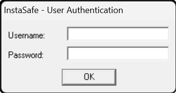

- Click OK to submit the credentials. 

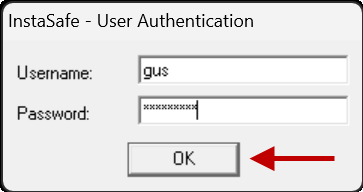

- When the user is prompted to select a method to receive the OTP, select the method.  

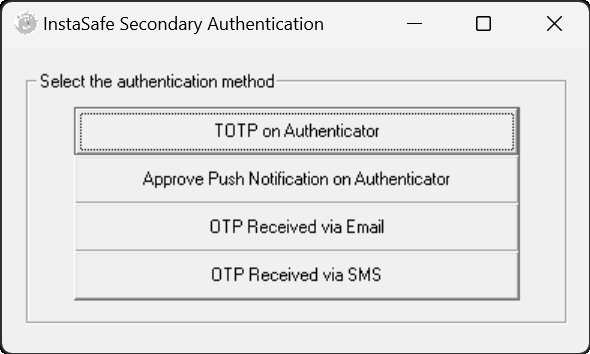

- On the OTP prompt, enter the OTP received via the InstaSafe Authenticator app, Email or SMS.

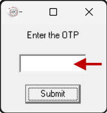

Click Submit to the submit the OTP. 

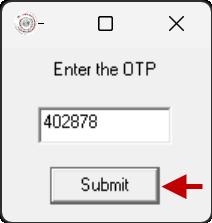

- Alternatively, click Approve on the push notification received on the InstaSafe Authenticator app. 

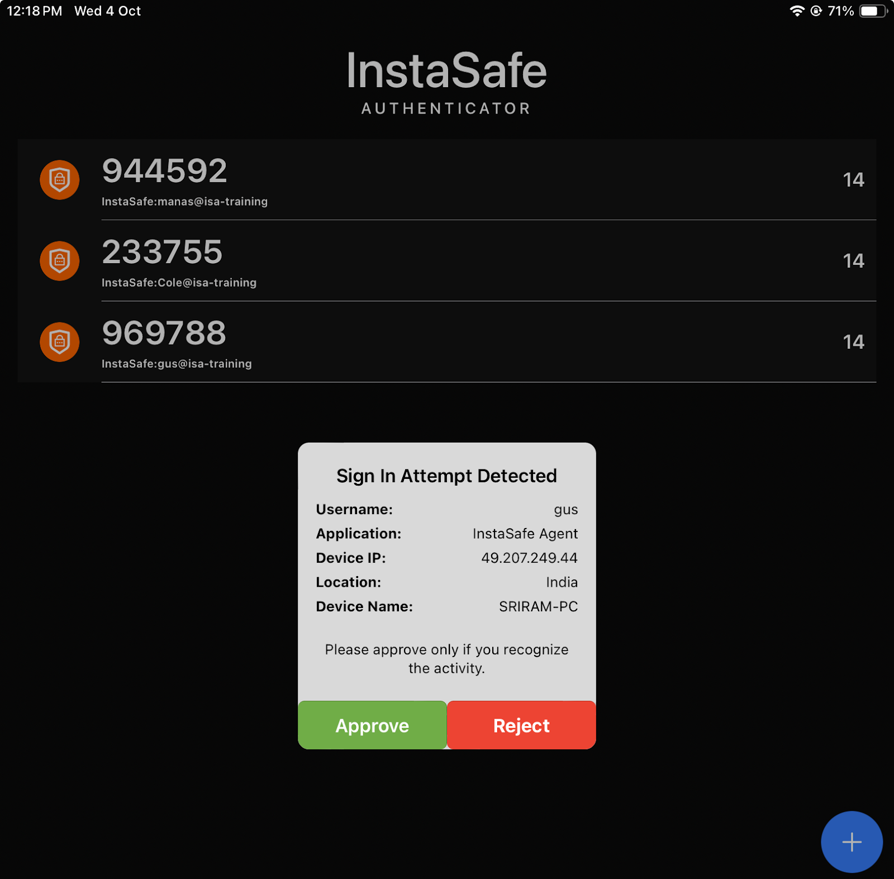

**Methods of receiving OTP**

- TOTP on InstaSafe Authenticator

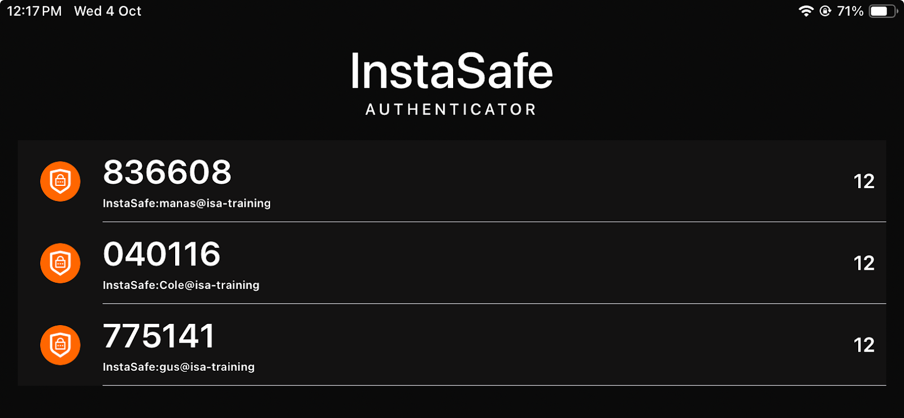

- OTP Received via Email

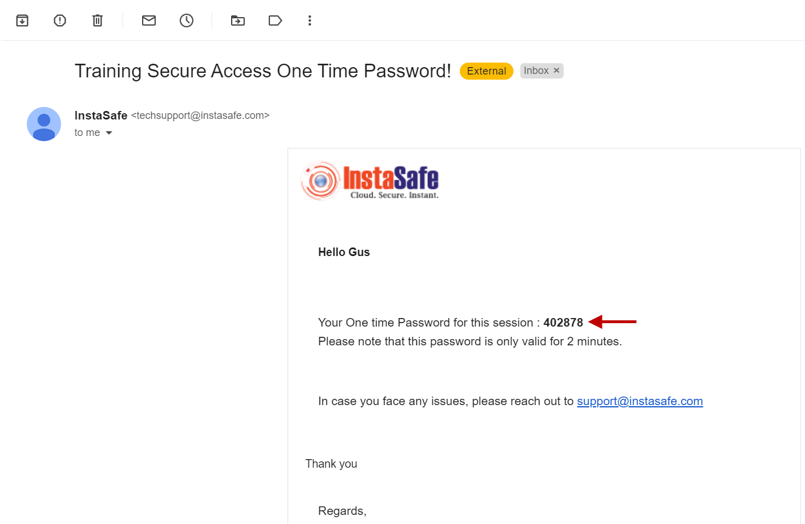

- OTP Received via SMS

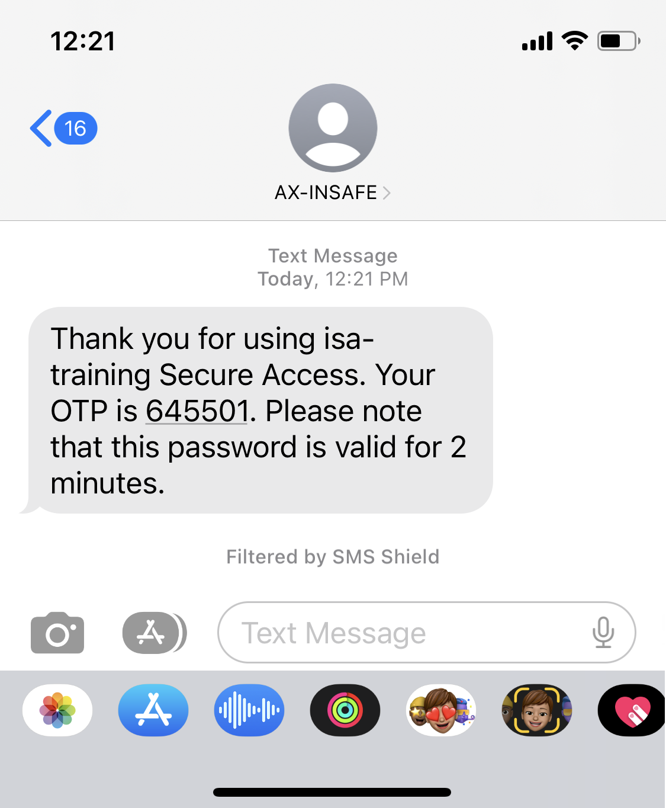

**Conclusion**

Two-Factor Authentication (TFA) adds one more layer of security to the ISA User Agent connection to access corporate resources. The objective of TFA is to create a layered defence that makes it more difficult for an unauthorized person to access a target, such as a physical location, computing device, network or database. 

If one factor is compromised or broken, the attacker still has at least one or more barriers to breach before successfully breaking into the target. 
