# Editing, Disabling, and Deleting Sub-admins

**Sub-Admins**

The sub-admin role is created by the ISA web console administrator or admin. Sub-admins are configured to do a particular activity and have limited access. The administrator defines the rights and roles of the sub-admins and can further control them by authorizing read or write permission to any feature within the ISA web console like User, Application, ACL, Controller, Gateway.

**Edit a Sub-Admin Role**

- Log into the ISA web portal with administrator credentials with rights to create sub-admins, such as the Company Admin. 
- Navigate to the SUB ADMINS & ROLES > Sub Admin Roles page.
- On the Sub Admin Roles page, click on the name of the sub-admin role.

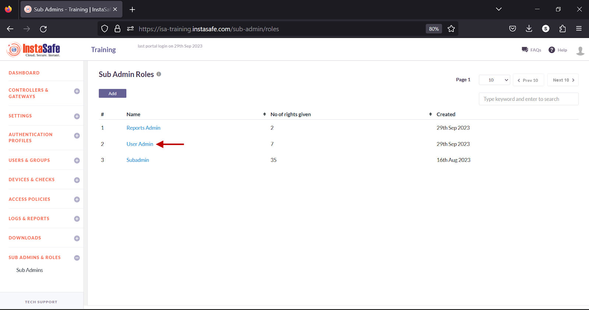

- On the Sub Admin Role Details window, click the Edit button.

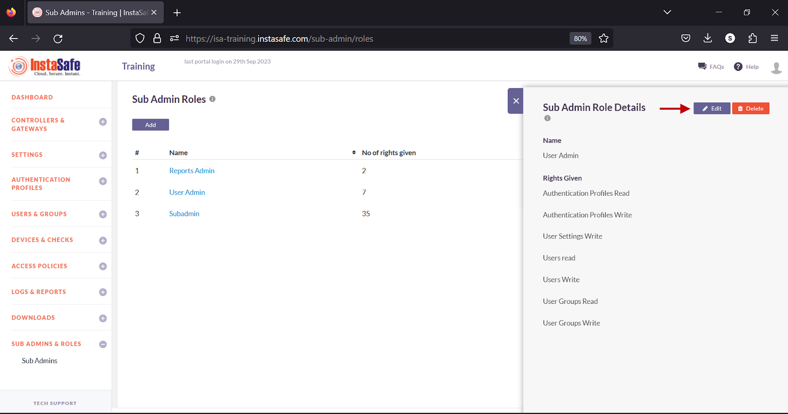

- Select the checkboxes next to the features to enable or disable the read or write permissions for this sub-admin.
- Click Save and Add new to update the change.
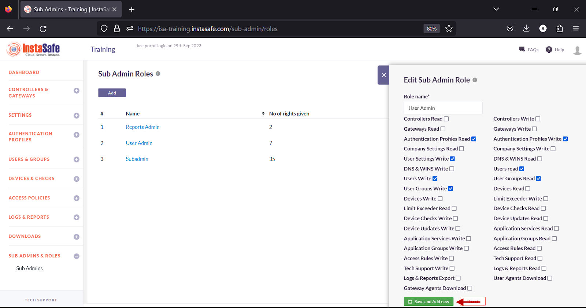

**Delete a Sub-Admin Role**

- On the Sub Admin Roles page, click on the name of the sub-admin role.

- On the Sub Admin Role Details window, click the Delete button.

- In the pop-up window, click the Yes, Delete it button.

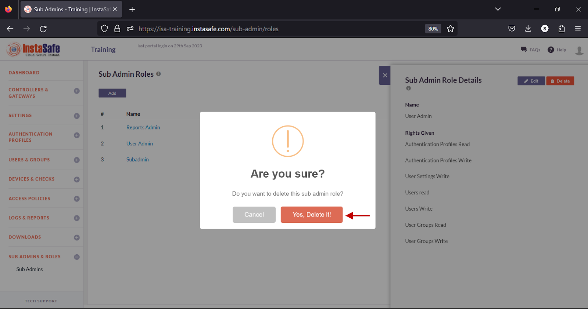

**Edit a Sub-Admin**

- Navigate to the Sub Admins page.
- On the Sub Admins page, click on the username of the sub-admin.

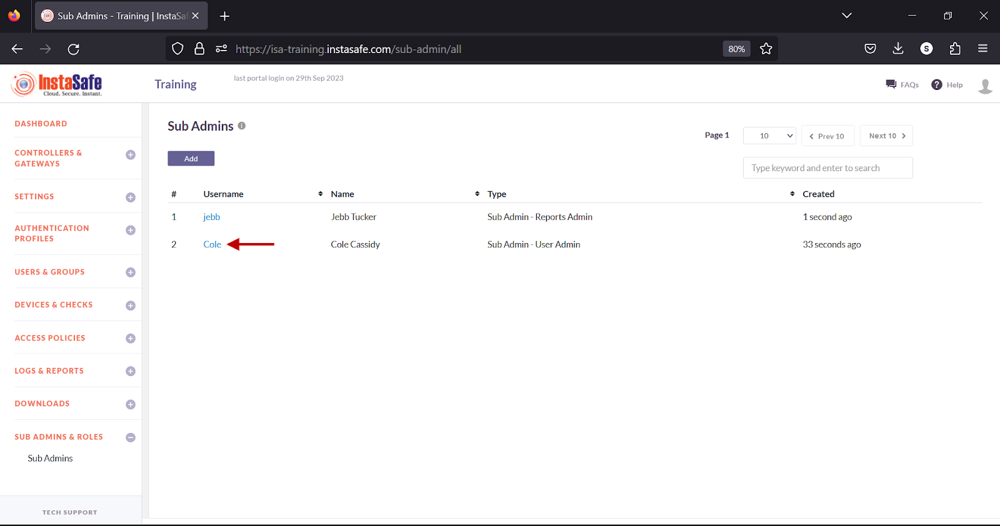

- In the Edit Admin Details window, click the Edit button at the top.

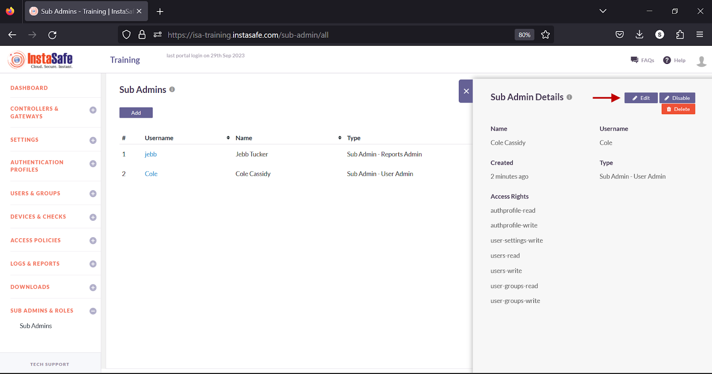

- In the Edit Sub Admin window, click the Role drop-down and select the object that has the roles defined for this sub-admin.

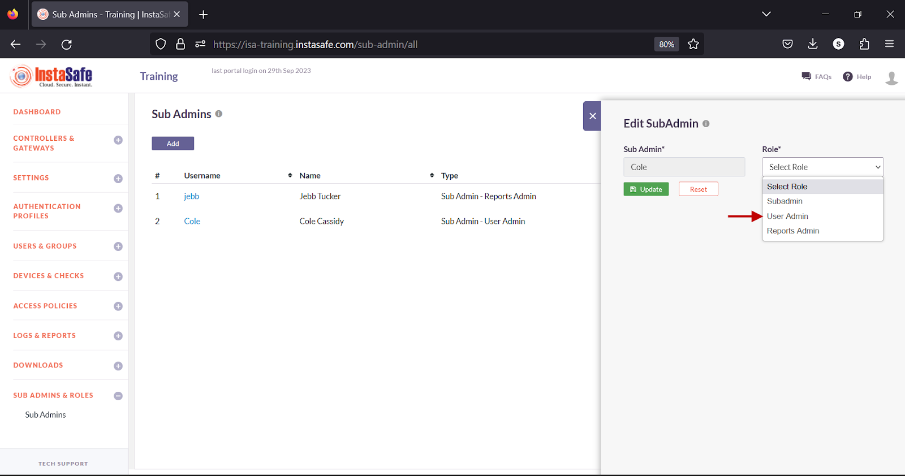

- Click Update to save the change.

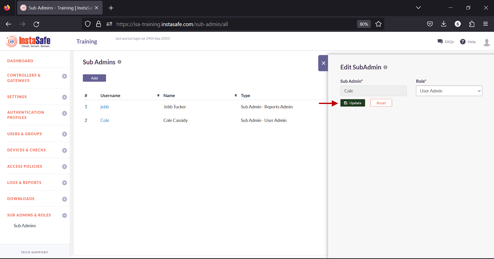

- Alternatively, click Reset to set the fields to its default settings.

**Disable a Sub-Admin**

- On the Sub Admins page, click on the username of the sub-admin.
- In the Edit Admin Details window, click the Disable button at the top.

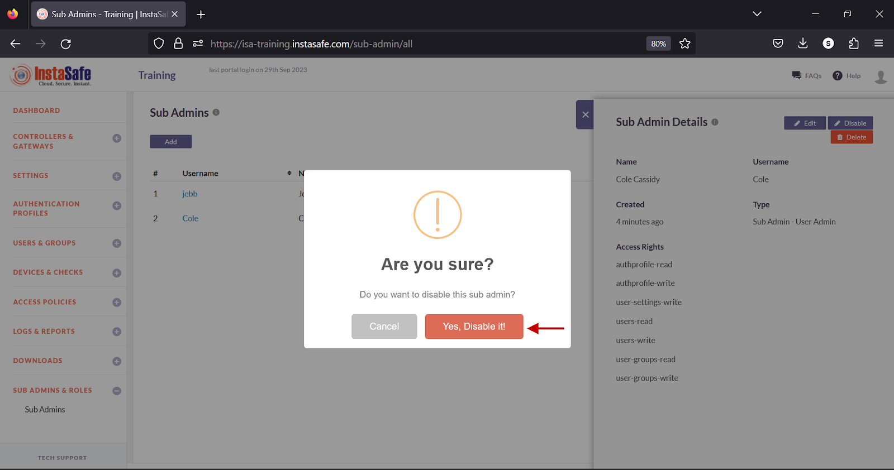

- In the pop-up window, click the Yes, Disable it button.

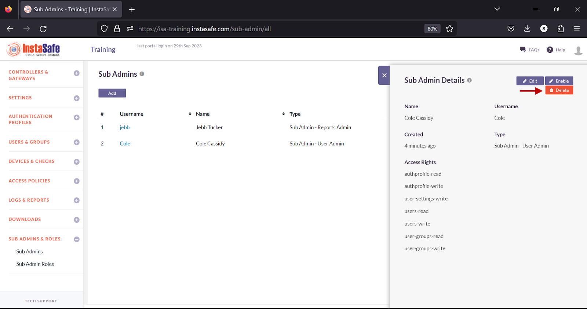

_Disabling a user will return the user to end-user role with only Agent Download and Profile Settings options accessible._

**Delete a Sub-Admin**

- On the Sub Admins page, click on the username of the sub-admin.
- In the Edit Admin Details window, click the Delete button at the top.

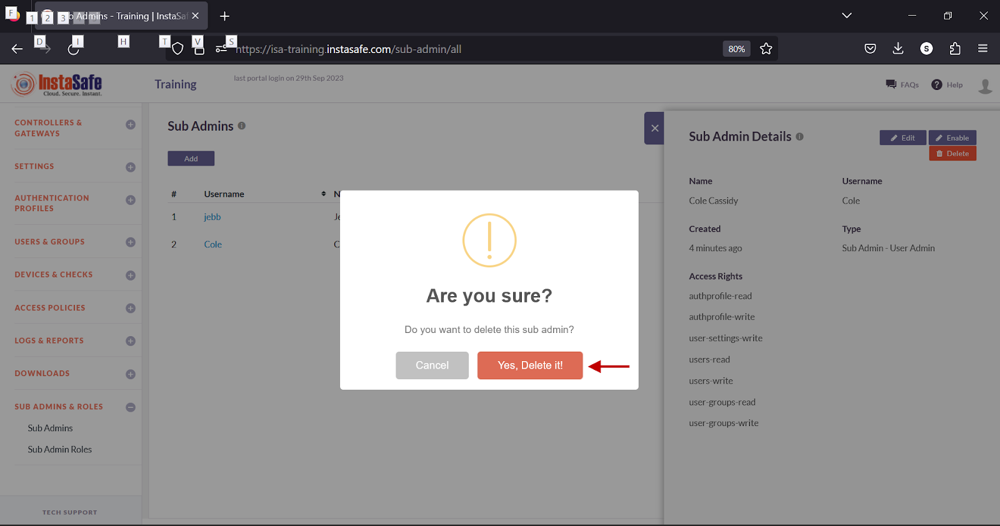

- In the pop-up window, click the Yes, Delete it button.

_Deleting a user will not delete the user from the Users page. Instead, it will return the user to end-user role with only Agent Download and Profile Settings options accessible._

**Conclusion**

Sub-admin roles allow administrators to grant restricted access to users of the ISA web portal by assigning read/write permissions to specific features within the portal.
