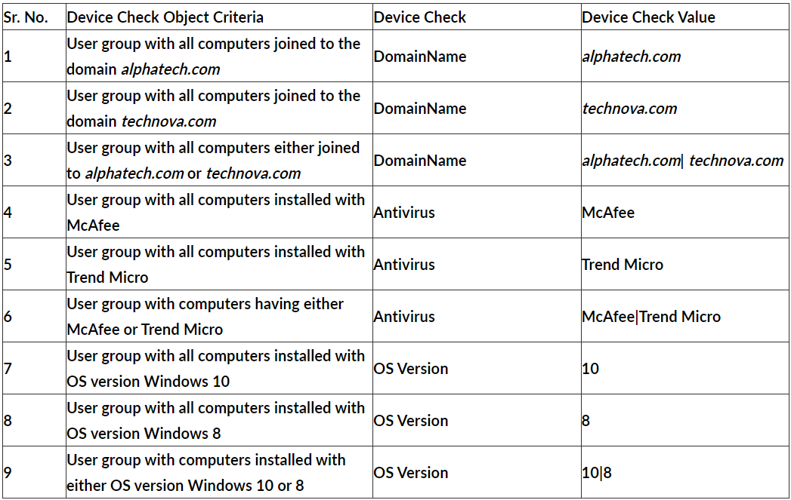

# **Device Checks**

InstaSafe Secure Access (ISA) allows administrators to define rules that check endpoint devices for mandatory compliances. These rules determine whether a device is allowed to connect. As a result, non-compliant endpoints are prevented from accessing corporate resources.

On the ISA web console, administrators can create objects for each type of Device Checks. For more information on configuring Device Checks, refer to Configuring Device Checks for Windows Clients.

**Examples of Device Check**

Imagine a scenario where Device Check needs to be performed on a user group with the following criteria:

- Users must have either Windows 8 or Windows 10 OS versions.
- Users must be joined to the 'alphatech.com' domain.
- Users must have either McAfee or Trend Micro Endpoint Protection installed.

<!-- To meet these criteria, using the table above, the following Device Checks can be configured for the user group:

(Device Check Object 9) &&

(Device Check Object 1) && 

(Device Check Object 6)  

- && refers to logical AND operation. This means that even if one of the above checks doesn’t hold true, Device Checks will not permit the user to connect the ISA Agent from that device
- Device Checks can be applied individually for specific users, instead of at the user group level
- Device Check objects of the same type must be configured with one single rule when applied to a user or user group.  -->

For example:
     To check for installed antivirus software, do not assign two separate Device Check objects to a user or group, one for McAfee and another for Trend Micro. Instead, create a single object with the 'Check Value' set to 'McAfee|Trend Micro' and apply it to the user or user group.
