# Configuring Device Checks for Windows Clients

InstaSafe Secure Access (ISA) enables administrators to define rules that check endpoint devices for mandatory compliances. These rules determine whether a device is allowed to connect. As a result, non-compliant endpoints are prevented from accessing corporate resources.

On the ISA web console, administrators can create objects for each type of Device Checks.

Currently the following types of Device Checks can be created:

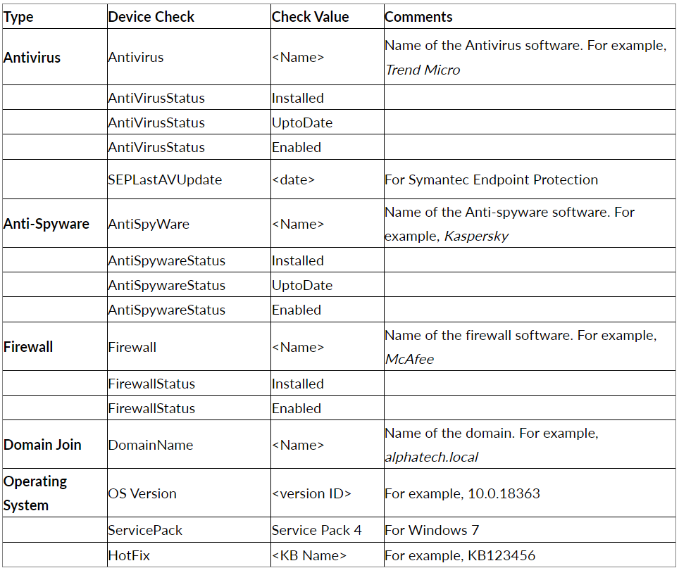

- Device Checks of the same type must be configured by creating one Device Check object with multiple values. For example, the Device Check type of Windows OS version may contain the values 8, 10, or 11. Each value must be separated by the ‘pipe symbol’ as in "8|10|11".
- Once a Device Check object is created, the object must be added to a user or user group.
- When multiple objects are added to a user or user group, the connecting device must meet all the conditions defined in the objects. If the connecting device fails to meet any one of the conditions, the connection will be refused.
- A Device Check object can be created with two values separated by the pipe symbol “|” for OR operation, where either of the conditions must be true.
- When enforcing Device Check on a user or user group multiple Device Check objects, all the conditions must be true. This means that if one of the checks doesn’t hold true, Device Check will not permit the user to connect the ISA User Agent from that device.

For more information on Device Check, refer to Device Check Explained.

- Log into the ISA web console with administrator credentials.
- Navigate to the DEVICES & CHECKS > Device Checks page.

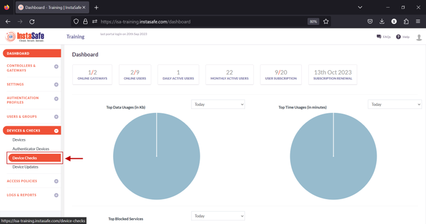

- Click on Add.

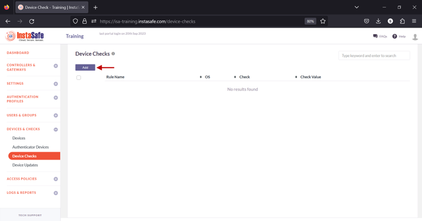

- On the Add device check window, enter the following information:

    a. Rule Name: Enter a name for this object, preferably that which illustrates the condition defined in the object. For example, Windows Version.

    b. OS: click on the drop-down list to select the operating system. In this example, Microsoft Windows.

    c. Check: click the drop-down list to select the condition to check for. For example, OS Version.

    d. Check value: enter the value for the condition defined under Check. For example, 8, 10, or 11. Multiple values can be entered here by separating them with the pipe symbol. 

    e. Click Save and Add New. 

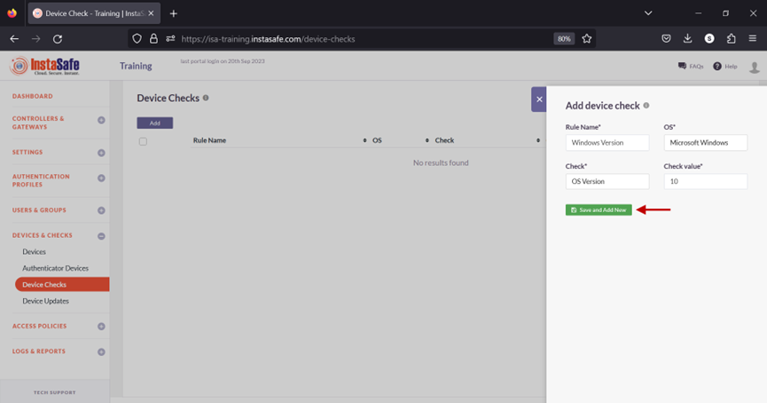

- The new Device Check object has been created.

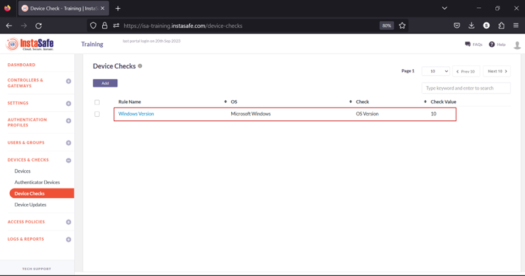

- Navigate to the USERS & GROUPS > Users page.

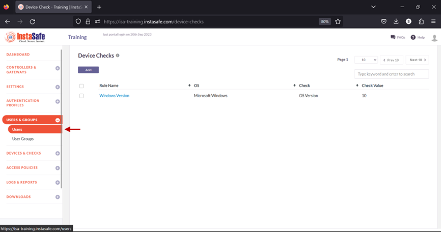

- On the Users page, click on the name of a user to edit it.

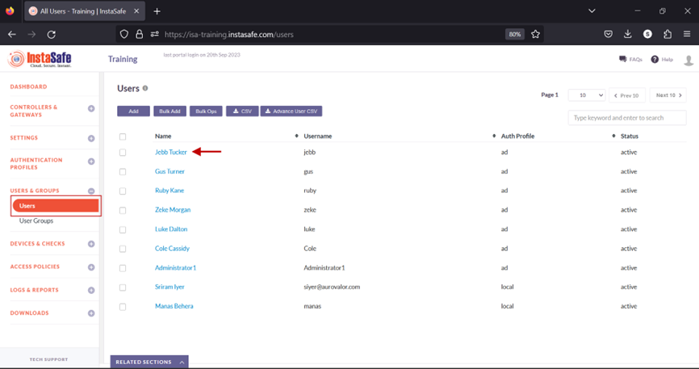

- Click the Edit button.

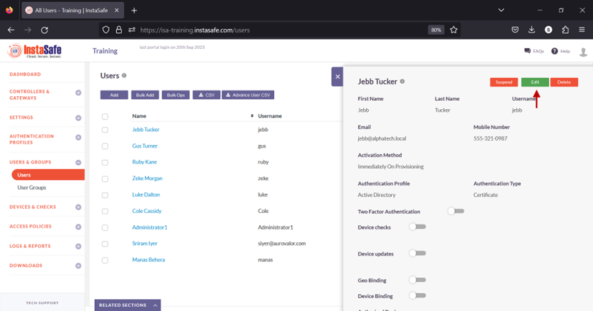

- Scroll Down.

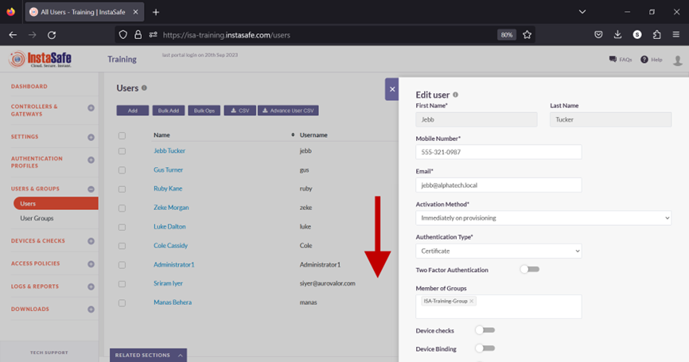

- Toggle the Device checks button to enable it.

- Click inside the Select device checks box. 

- From the drop-down list, select the Device Check object.

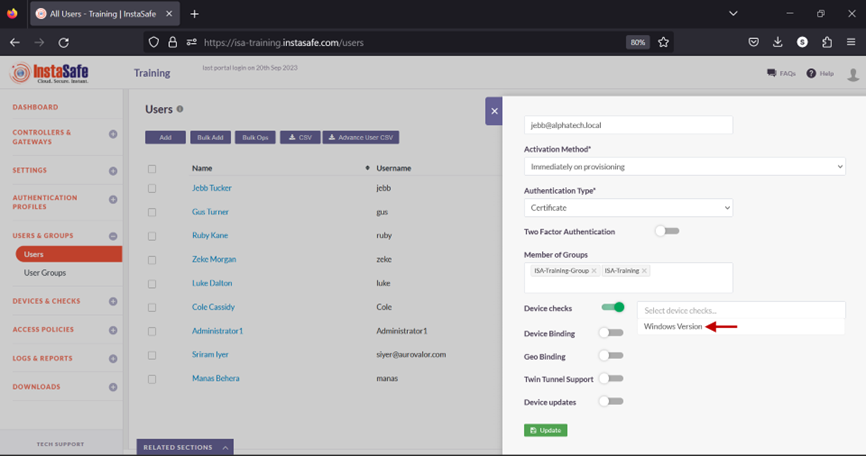

- Click Update at the bottom to save this change.

This user must meet the condition defined in the Device Check object before being able to connect the ISA User Agent successfully. 

**Add a Device Check Object and assign to a user group**

1.Navigate to the DEVICES & CHECKS > Devices page and click the Add button
2.On the Add device check window, enter the following information:

- Rule Name: Enter a name for this object, preferably that which illustrates the condition defined in the object. In this example, Antivirus.
- OS: click on the drop-down list to select the operating system. In this example, Microsoft Windows.
- Check: click the drop-down list to select the condition to check for. For example, Antivirus.
- Check value: enter the name or names of the antivirus software. In this example, Windows Defender|Trend Micro. Since multiple values are entered, they are separated by the pipe symbol. 
- Click Save and Add New. 

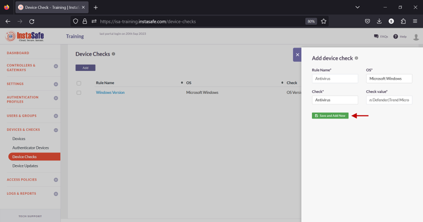

3.The new object will be listed on the page.

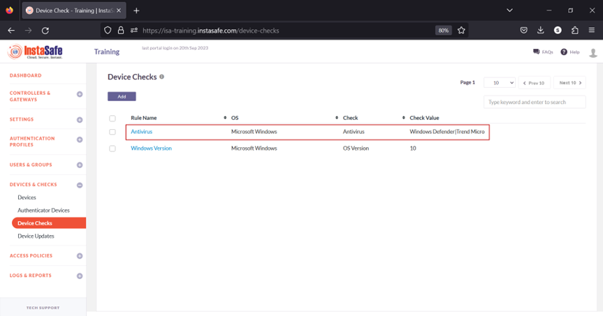

4.Navigate to the USERS & GROUPS > User Groups page.

5.Click on the name of a user group listed here.
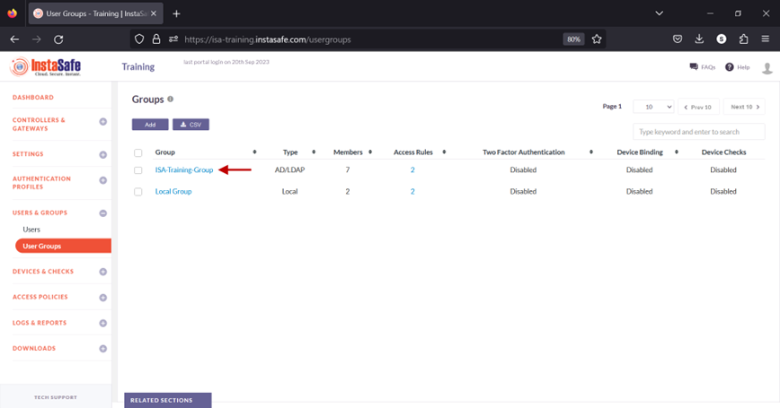

6.In the Group details window, click the Edit button.

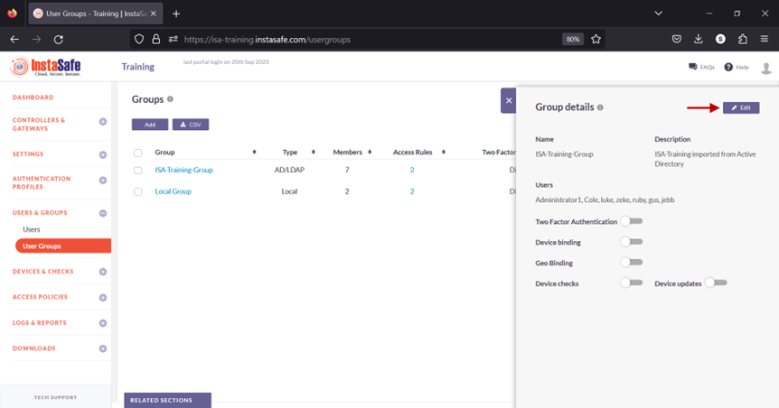

7.Toggle the Device checks button to enable it.

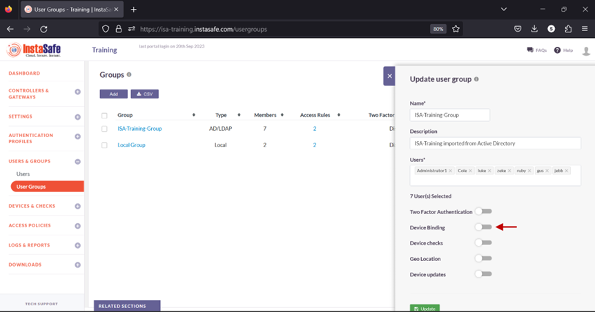

8.Click inside the Select device checks box. 

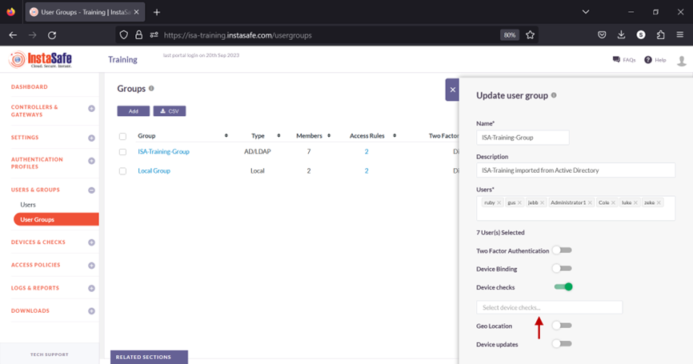

9.From the drop-down list, select the Device Check objects one by one to add it. 

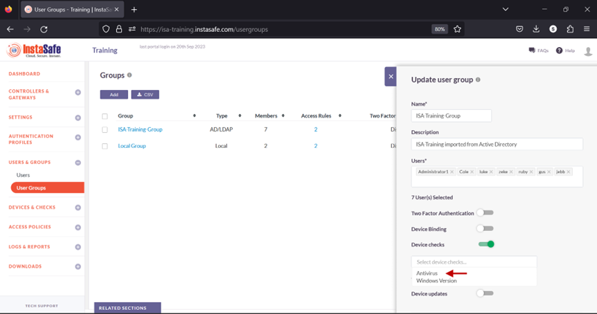

10.Click Update to save the change. 

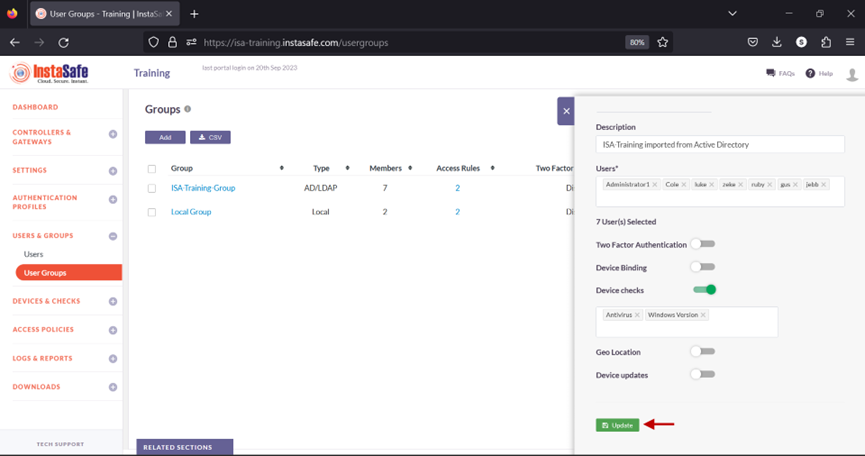

Users in this group must meet all the conditions defined in the Device Check objects before being able to connect the ISA User Agent successfully. If even one of the conditions is not met, the ISA User Agent connection will fail with a similar error message:

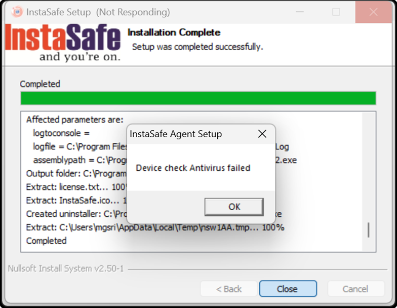

**Examples of other Device Check Failures**

| Domain Name Check Failed | In Domain Check Failed | OS Version Check Failed |
| ------ | ------ | ------ |
| 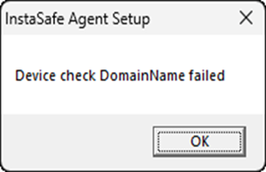 | 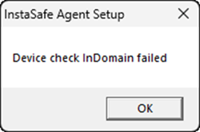 |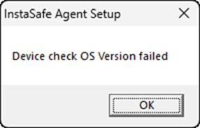 |

**Conclusion**

​Device Check is an effective way to further secure shared resources by forcing the remote end-devices to fulfil certain parameters before remotely accessing them.  
