# Configuring Device Binding on the ISA Web Console Using Manual Device Registration Details (Windows Client)

One method of Device Registration occurs when Instasafe Secure Access (ISA) automatically captures certain device identification details when an ISA User Agent connects to the ISA Controller.  

When a user's device information is auto-captured, the default status of the device is pending approval. Until approved or activated by the administrator, users with Device Binding enabled in their user group will be unable to connect using the ISA User Agent from the device. The ISA web portal administrator can manually activate, suspend, or delete the device.

However, this task can be daunting in the case of a large number of devices requiring approval or other status changes.  The Bulk Ops option on the Devices page automates this process by changing the statuses of a large number of devices at once. For more information on Bulk Ops, refer to the KB article Performing Bulk Operation on Device List.

Another method is to register devices manually.  Manual device registration is only required rarely.  Manual device registration requires the administrator to obtain the following information from the client OS:

1. MAC Address of the physical network adapter
2. Operating System Name
3. BIOS Serial Number
4. Universally Unique Identifier (UUID)

Using these parameters, it is possible to enforce Device Binding on users. Device Binding will ensure that the users are allowed to make connections only from those devices registered in the ISA web console.  This will eliminate attacks due to stolen or shared passwords. A user can be bound to multiple devices.

**Manual Device Registration**

1.On the Windows client, open Windows PowerShell and enter the following command:

a. Get-netadapter
    
b. systeminfo | findstr /B /C:"OS Name" /C:"OS Version"

c. wmic bios get serialnumber
    
d. wmic path win32_computersystemproduct get uuid

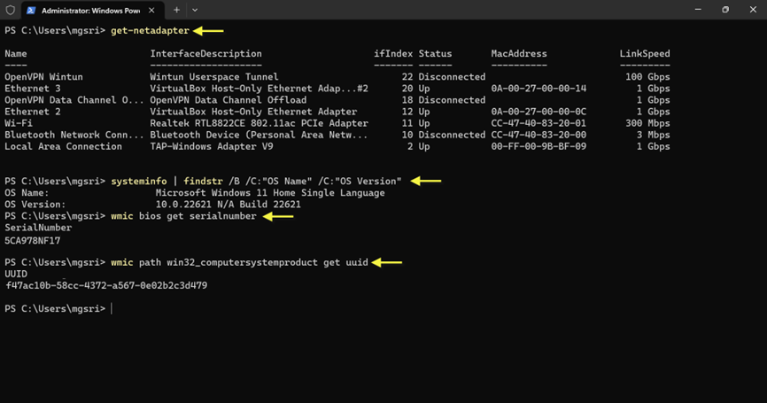

2.Log into the ISA web console using admin credentials

3.Navigate to the DEVICES & CHECKS > DEVICES page. 

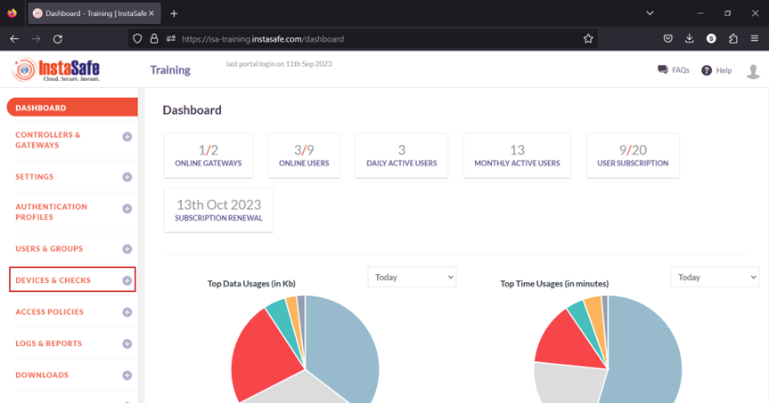

4.Click Add the button.

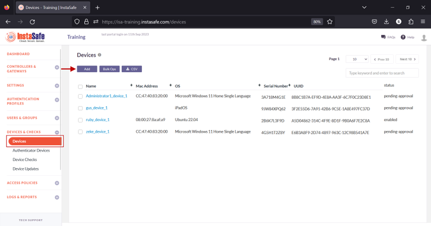

5.On the Add Device window, enter the following information:

a. Name: Enter a name for this device. The name must not have spaces.  Hyphens or underscores are allowed.

b. OS: Select the OS name obtained from the command executed in PowerShell.
    
c. MAC Address: Enter the MAC address of the physical network adapter that connects to the ISA Controller using the information obtained from the command executed in PowerShell.
    
d. Serial Number: Enter the BIOS serial number obtained from the command executed in PowerShell.

e. UUID: Enter the UUID obtained from the command executed in PowerShell.
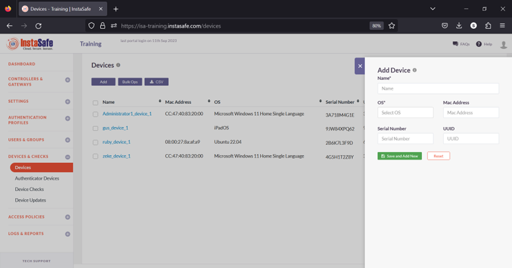

6.Click Save and Add New.

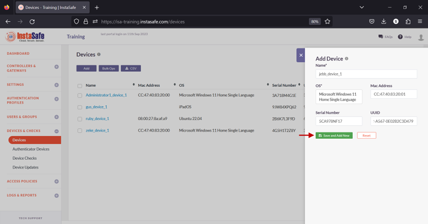

7.The new device will be listed on the Devices page. The device is automatically activated and, under status, will be shown as enabled.

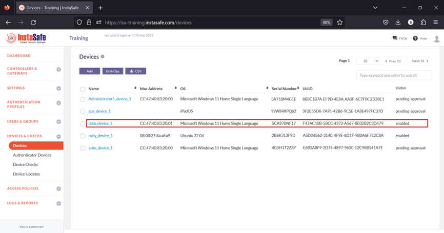

8.Navigate to the USERS & GROUPS > Users page.

9.On this page, click on the name of the user that requires binding. In this example, it is Jebb Tucker.

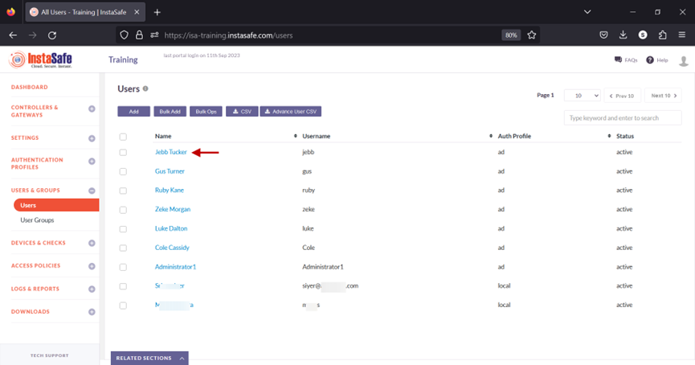

10.In the edit user window, click on Edit and scroll down the window.

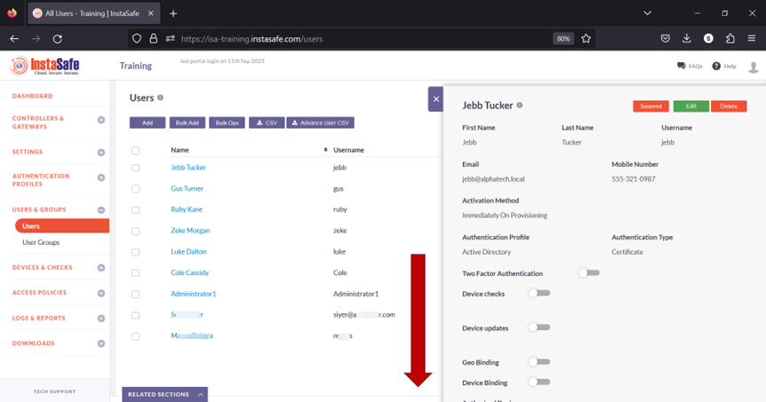

11.Toggle the Device Binding button to enable it. 

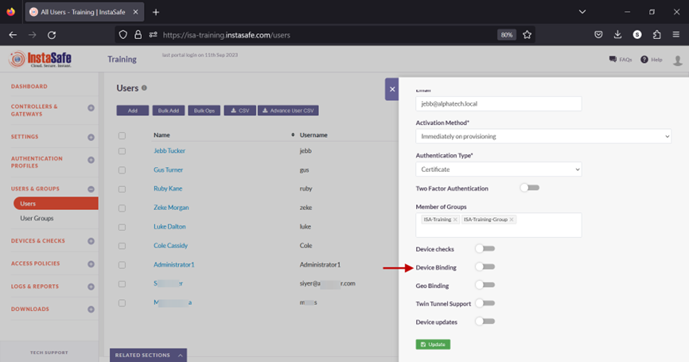

12.Click inside the Select devices box to list the device names. 

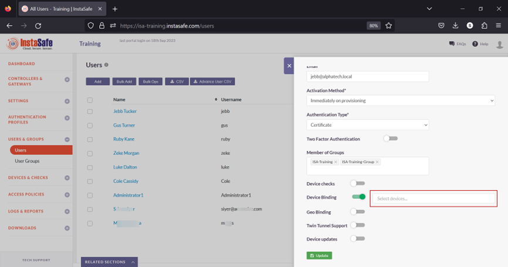

13.Select the device name for the user. In this example, _jebb_device_1_. 

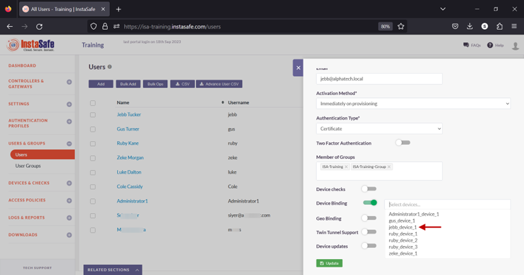

14.Click on Update at the bottom to save this configuration. 

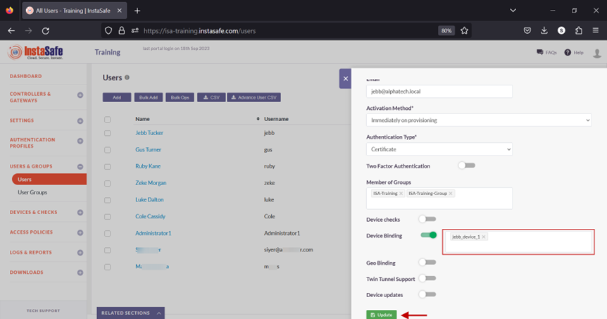

15.A message at the bottom, User has been updated, indicates the configuration has been updated. Click on the “X” button to close this window. 

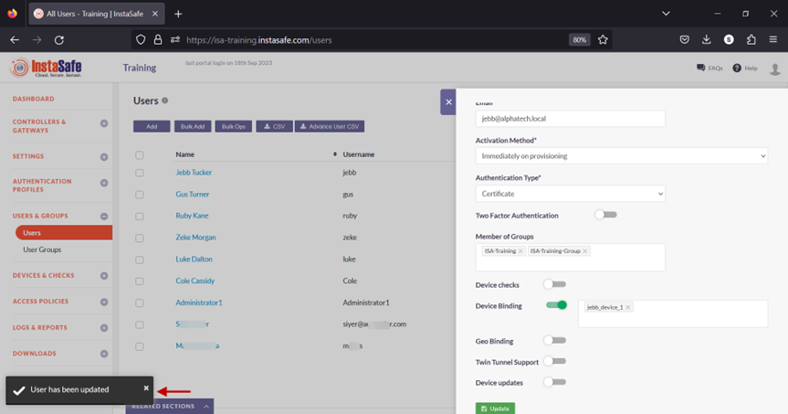

16.Next, we will test Device Binding by connecting the user Jebb Tucker from a different device than the device the user is bound to. 

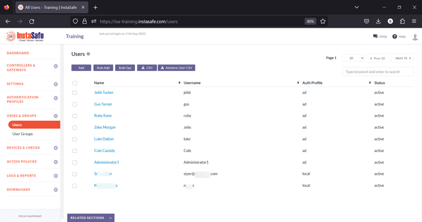

In the event you are unable to configure Device Binding by following these steps, please contact your organization's IT Team.

If you are an administrator of the organization's ISA Account and need assistance, contact InstaSafe Support at  [support@instasafe.com](support@instasafe.com).
