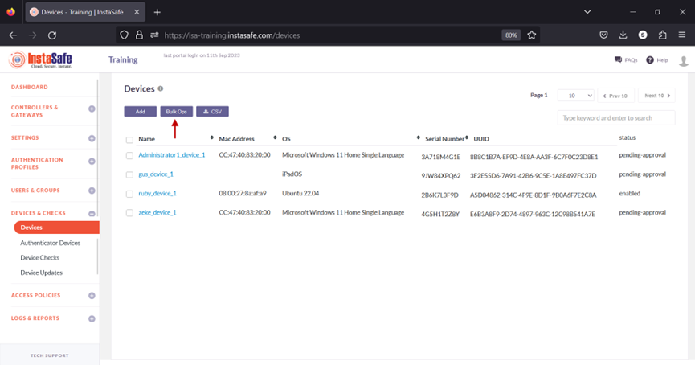
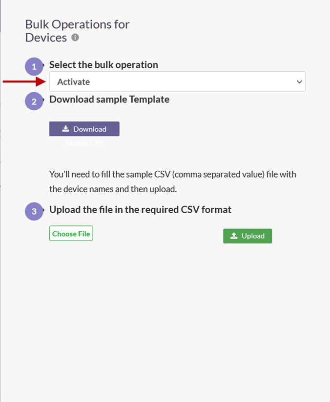
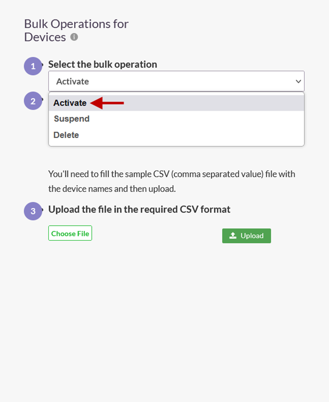
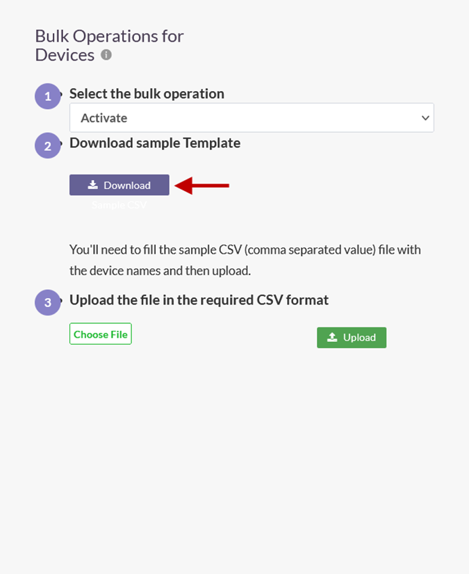
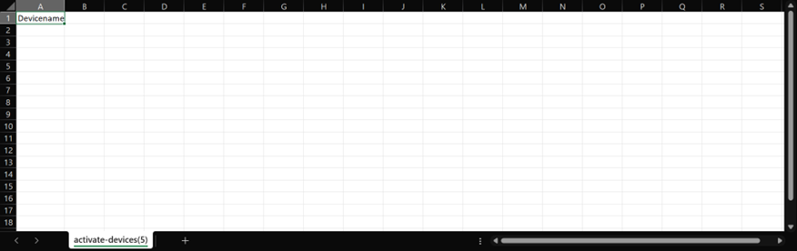
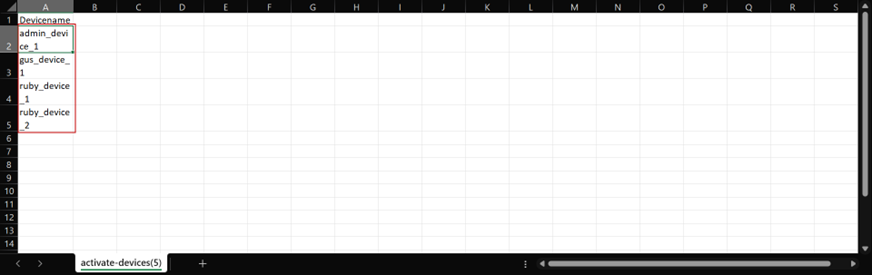
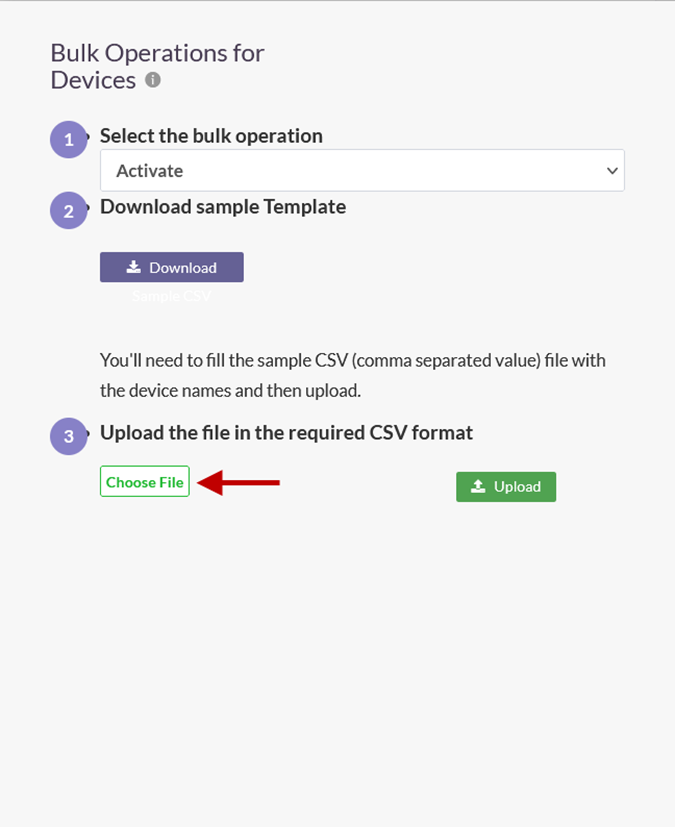
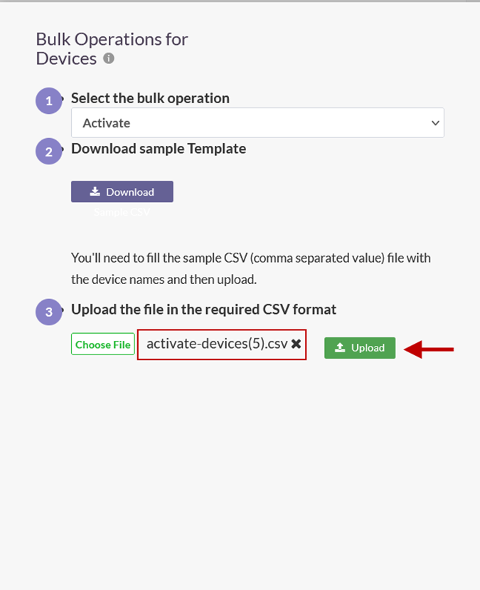
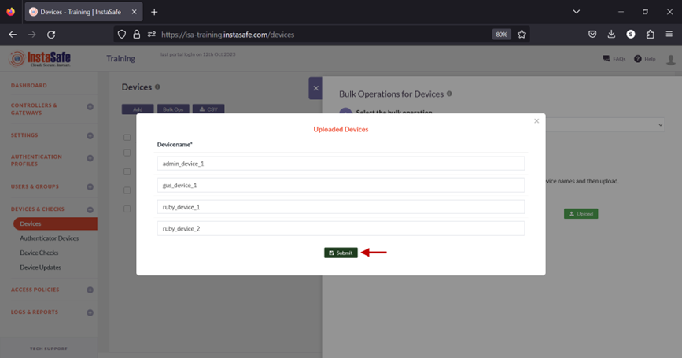

# Performing Bulk Operation on Device List

When a user's device information is captured, the default status of the device is pending approval. Until approved or activated by the administrator, users with Device Binding enabled in their user group will be unable to connect using the ISA User Agent from the device. The ISA web portal administrator can manually activate, suspend, or delete the device.

However, this task can be daunting in the case of a large number of devices requiring approval or other status changes. 

The Bulk Ops option on the Devices page automates this process by changing the statuses of a large number of devices at once.

This article describes the step-by-step process of this operation.

- Log into the ISA web portal with administrator credentials
- Navigate to the DEVICES & CHECKS > Devices page.
- Click Bulk Ops at the top.

- Click the Select the bulk operation drop-down. Listed in this field are the following operations:

a. Activate – Activate the device and set the device status to _enabled_.

b. Suspend – Suspend the device and set the device status to _suspend_. Under this status, if Device Binding is enabled for the user, or the user group, remote users will not able to connect using the ISA User Agent.

c. Delete – Delete the device from the Devices page. When a user attempts to connect, the device information of the user will be auto-captured and displayed on the Devices page with status set to _pending-approval_.

- After selecting the bulk operation, click the Download button to download the template file for device names. 

- Open the template in a spreadsheet application. By default, the file is empty with a column titled Devicename.

- Enter the names of the devices under the Devicename column and save it. 

- Back on the Bulk Operations for Devices window, click Choose File and select the saved template file.

- Click Upload.        

- On the Uploaded Devices window, click Submit.

- On the Devices page, device statuses are updated according to the bulk operation. If the operation is set to delete devices from the template file, the device will be removed from this page. 

In the event you are unable to perform Bulk Ops by following these steps, contact your organization's IT Team.

If you are an administrator of the organization's ISA account and need assistance, contact InstaSafe Support.
