## **Configuring Device Binding Using Automatic Device Registration Details**

Device Registration occurs when Instasafe Secure Access (ISA) automatically captures certain device identification details when an ISA User Agent connects to the ISA Controller.  The information captured during Device Registration are:

1. MAC Address of the physical network adapter
2. Operating System Name
3. BIOS Serial Number
4. Universally Unique Identifier (UUID)

The above information is captured irrespective of whether the User Agent is able to successfully connect to the ISA Controller.

Using these parameters, it is possible to enforce Device Binding on users. Device Binding will ensure that the users are allowed to make connections only from those devices registered in the ISA web console. This will eliminate attacks due to stolen or shared passwords. A user can be bound to multiple devices.

In addition to configuring Device Binding using automatically captured parameters, the ISA web console allows admins to register devices manually.  

This article describes the process of configuring Device Binding using automatic Device Registration. 

- Log into the ISA web console using admin credentials
- Navigate to the DEVICES & CHECKS > DEVICES page. 

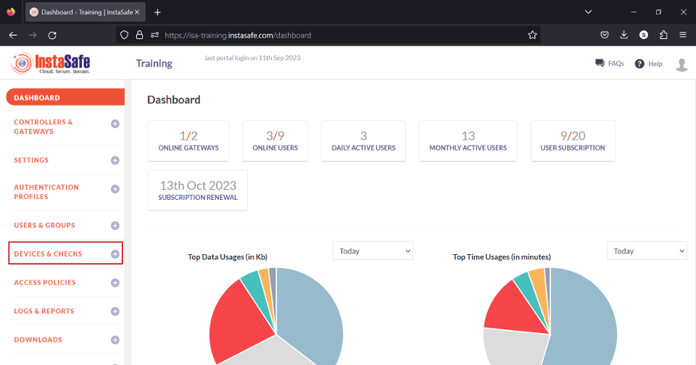

- The information of automatically captured devices will be listed here. Each device will be listed with their automatically created name. The name is the concatenation of the username of the remote user, the string “device”, and a number separated by underscores. The number represents the number of devices this user has connected with. For example, the user _Ruby_ has connected with one device, an Ubuntu client. If the same user connects from a Windows client, a new entry will be created and listed with an identical name but the number increased to two. For the purpose of this article, we select the device profile name “_ruby_device_1_” and bind it to the user _Ruby_.

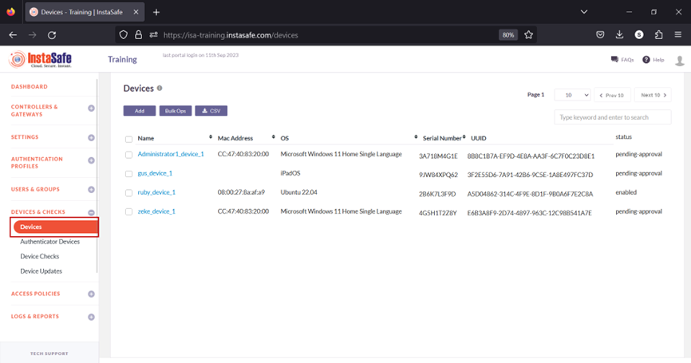

When a user's device information is captured, the default status of the device is Pending Approval. Until the device is approved or activated, if the user or the user group has Device Binding enabled, the user will not be able to connect from the device. Click the name of the device. For updating the statuses of a large number of devices at once, refer to Performing Bulk Operation on Device List.

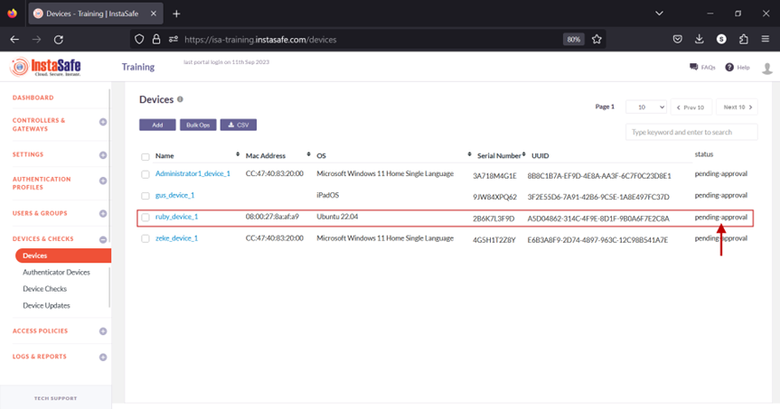

- On the Device Details window, click Activate.

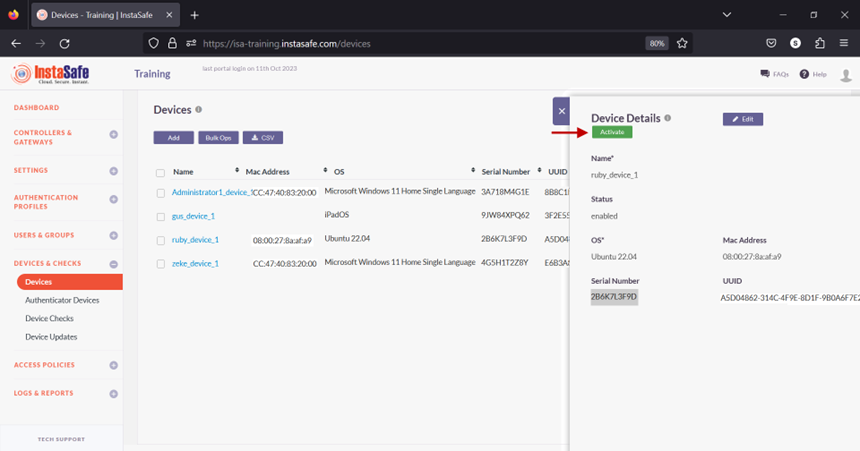

- On the pop-up window, click Yes, Activate it!.

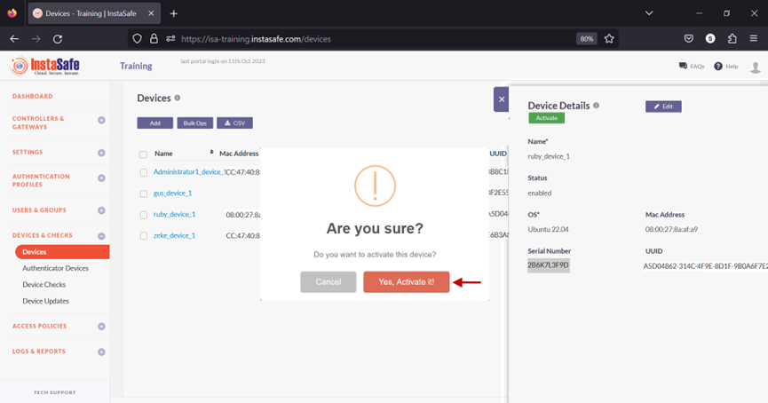

- The device has been activated.

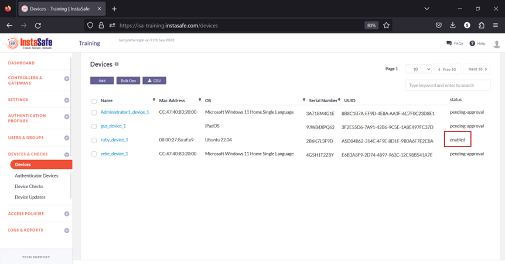

- Navigate to the USERS & GROUPS > Users page.
- On this page, click on the name Ruby Kane

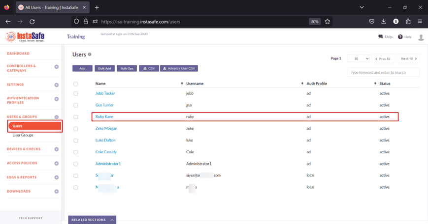

- In the edit user window, click on Edit.

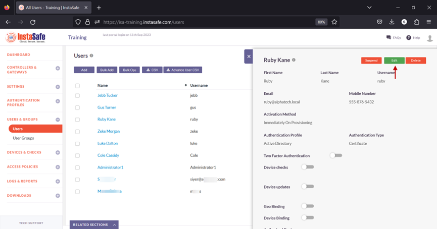

- Scroll down and toggle the Device Binding button to enable it. Then click inside the Select devices box to list the device names. Select the device name for the user. In this example, _ruby_device_1_.

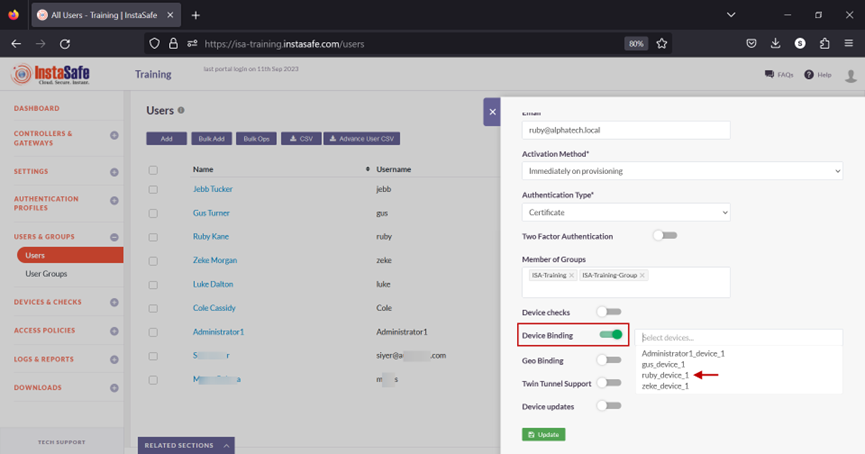

- Click on Update at the bottom to save this configuration. 

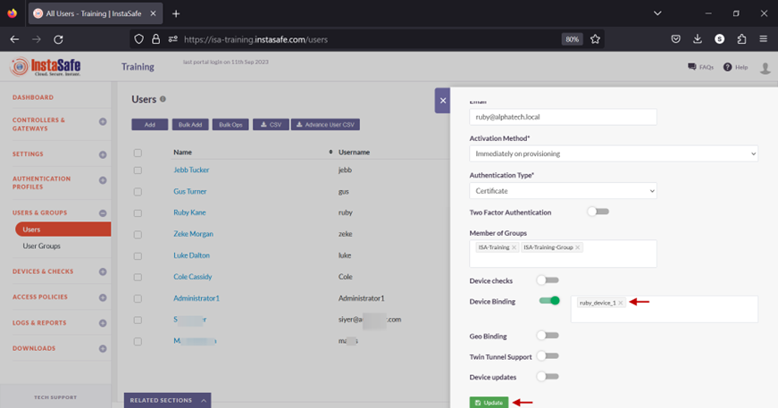

- A message at the bottom, User has been updated, indicates the configuration has been updated. Click on the “X” button to close this window. 

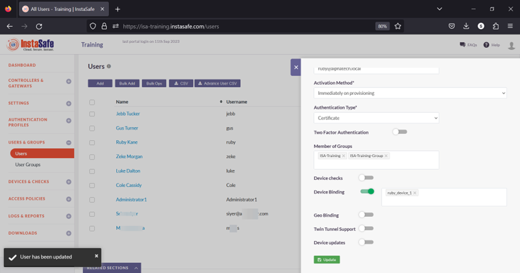

- Next, we will test Device Binding by connecting the user Ruby Kane from a different device than the device the user is bound to. 

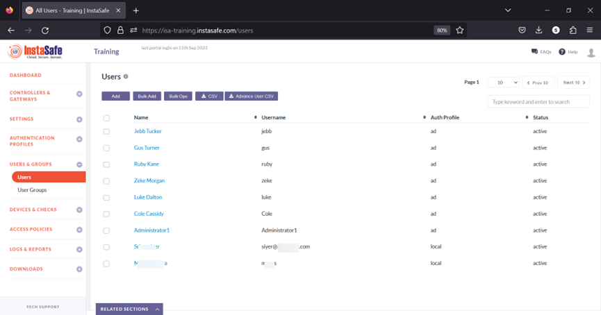

In the event you are unable to configure Device Binding by following these steps, please contact your organization's IT Team

If you are an administrator of the organization's ISA Account and need assistance, contact InstaSafe Support at [support@instasafe.com](support@instasafe.com).
