# Configuring Microsoft Active Directory (AD) Integration on the ISA Web Console

Microsoft Active Directory (AD): Microsoft Active Directory (AD) is a directory service developed by Microsoft for Windows domain networks. It provides authentication and authorization mechanisms, as well as a framework for organizing and managing resources in a networked environment.

AD stores information about network resources, including users, computers, and services, and allows administrators to manage access to these resources. It also enables network administrators to create and enforce security policies, and to automate network management tasks. AD is a core component of the Microsoft Windows Server operating system and is widely used in enterprise environments.

InstaSafe Secure Access (ISA) supports robust multi-directory support, enabling seamless integration with corporate Active Directory infrastructure for streamlined user provisioning within the ISA console.

This article provides a step-by-step guide on configuring an authentication profile that integrates Microsoft AD servers for user provisioning and authentication.

**Prerequisites for AD Integration**

For successfully integrating the AD profile with the AD server, ensure the following are adhered to:

- Since the AD profile’s connection request will be an inbound connection to the AD server, make sure TCP port number 389 is open on the Gateway firewall.
- Ensure the username and password used in AD integration is correct.
- The InstaSafe Gateway Agent must be able to communicate using its physical adapter’s private IP address with the AD server’s private IP address on TCP port number 389.

**Adding an AD Authentication Profile on the ISA Web Console**

1.Login to the ISA web console with administrator credentials

2.After logging in, on the left-hand menu click on AUTHENTICATION PROFILES

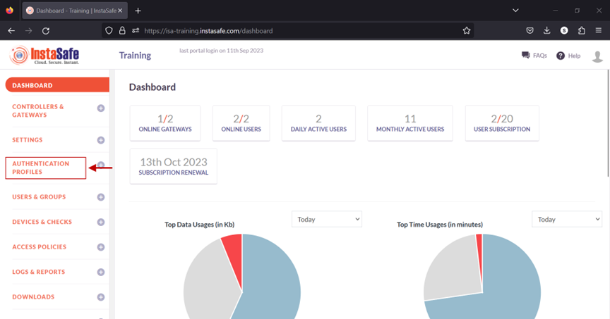

3.Under AUTHENTICATION PROFILES, click on Active Directory

4.On the Active Directory page, under Active Directory Profile click on the Add button

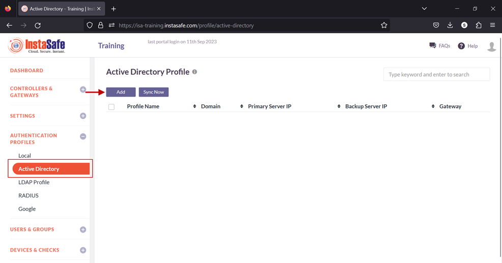

5.In the Create Active Directory Profile window, enter the following information under each field:

- **Profile Name:** Enter a descriptive name for this profile. The name must not contain spaces. This field must be filled-in.
- **Domain:** Enter the domain name of the network. For the purpose of this article, the domain name Alphatech.local has been entered. The domain name is not case sensitive. This field must be filled-in.
- **Connected Gateway:** Click on the field and select the Gateway name through which this server can be accessed. For this article, the Gateway BLR-Data-Centre has been selected. This field must be filled-in with the options available.  
- **Primary Server IP:** Enter the private IP address of the Windows server. This field must be filled-in. 
- **Secondary Server IP:** Enter the private IP address of the back-up Windows server.
- **Bind User:** Enter the username that will bind with AD. The username need not have administrator privileges. A normal user will suffice. This field must be filled-in.
- **Base DN:** Enter the Base DN of the domain. A Base DN can be the domain name of the network, entered in the format, for example, dc=alphatech,dc=local. Or it could include a container name. For example,cn=users,dc=alphatech,dc=local. This field is mandatory to be filled-in. Base DN helps AD in identifying where to begin the search for a user or user group. This field must be filled-in.
- **Filter:** An AD filter helps AD locate the user or user group. A filter specifies the conditions that must be met for a record to be included in the collection that results from a query. The filter entered on the picture below is (&(objectClass=user)(memberOf=CN=ISA-Training,CN=users,DC=alphatech,DC=local)) 

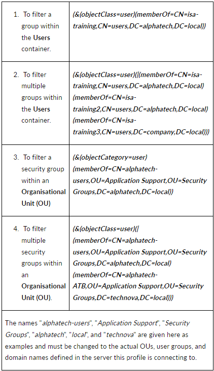

- **Require SSL/TLS secure connection:** Set this to disabled
- **Primary DNS Server IP:** Enter the IP address of the DNS server configured in the network
- **Secondary DNS Server IP:** Enter the IP address of the secondary DNS server configured in the network
- **Primary WINS Server IP:** Enter the IP address of the WINS server configured in the network
- **Secondary WINS Server IP:** Enter the IP address of the secondary WINS server configured in the network
- **Authentication Type:** The administrator has the option to select either Certificate or Password + Certs. The type set here will be the authentication method for the AD users.  This field must be filled-in with the options available.
- Click on **Save and Add** new to create this profile. This will create an AD profile and the new profile will be displayed on the page.
 
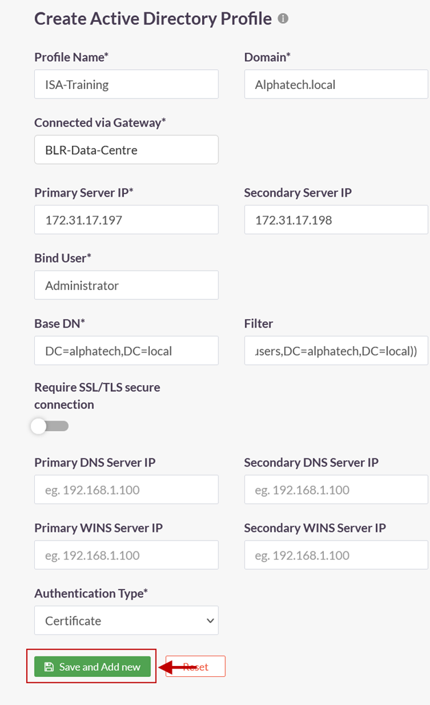

6.Click on the profile name of the AD profile.

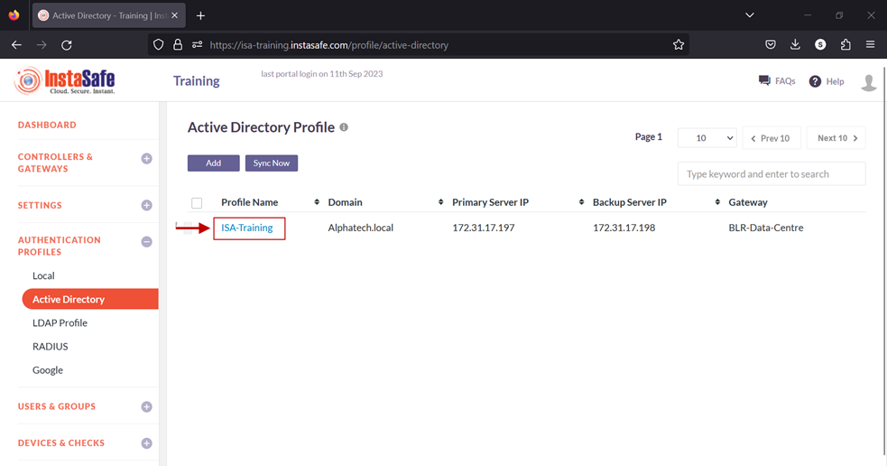

7.In the AD Profile window, Click on Set Password. 

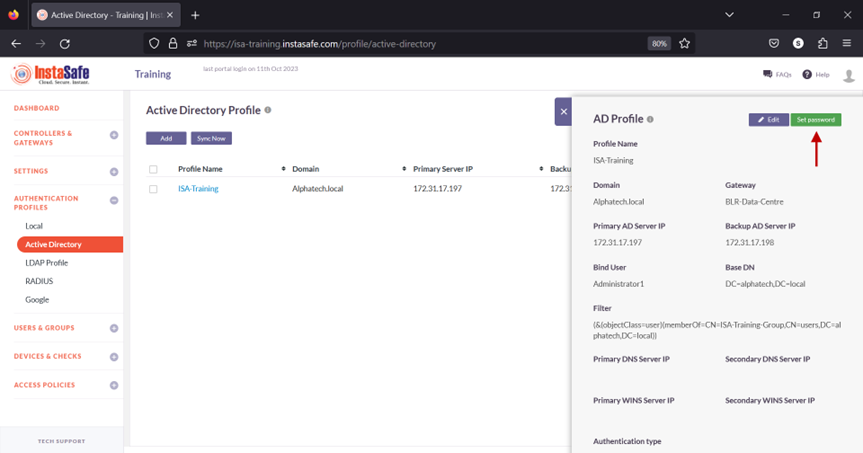

8.Under New Password, enter the password for the username set in the profile. In this article, it is Administrator.

9.Under Confirm Password, confirm the password.

10.Click on Save. 

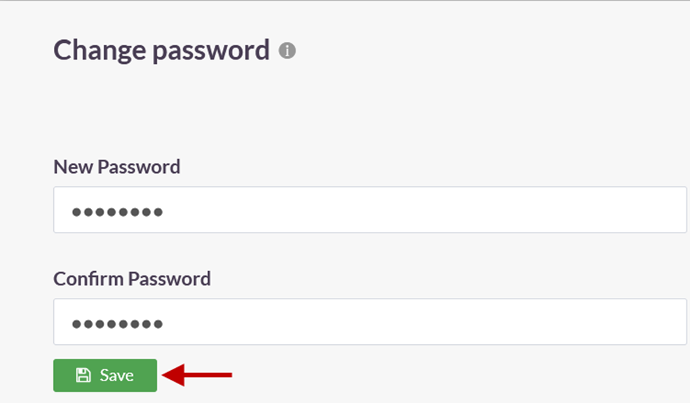

A notification on the bottom left-hand corner will indicate that the password is being set. **Note:** It is recommended to wait for a maximum of two minutes before syncing the profile. This is because, when the AD Profile is newly added or edited, the background daemon service, Instasafe Helper, will restart. The daemon might take a maximum of two minutes to restart. Therefore, after adding or editing the profile,  the sync may have a lag time of up to two minutes.

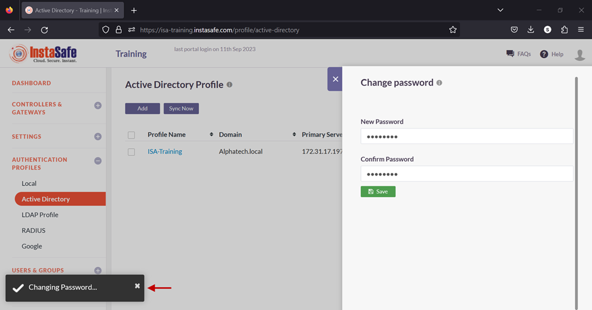

11.Enable the check-box of the newly created AD profile and click on Sync Now. 

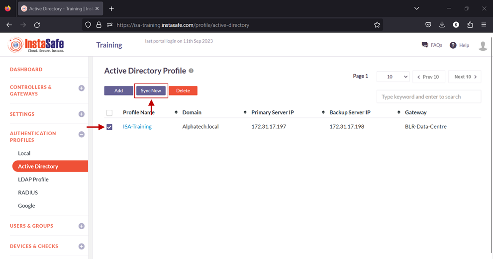

12.If the parameters in the profile have been set correctly, the profile will sync with AD and fetch the users and user groups from it. Note: The AD profile will sync with the AD server every one hour.

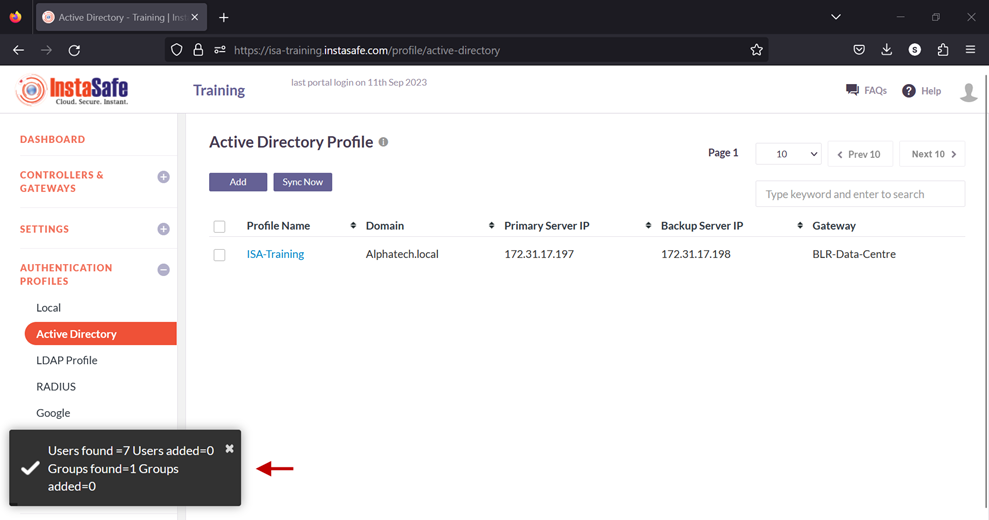

13.To view the imported users, on the left-side menu click on USERS & USER GROUPS and then click on Users.

14.You should be able to see the users imported from AD on this page. 

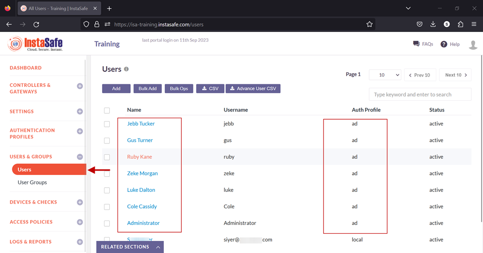

15.On the left-side menu, click on User Groups.

16.You should be able to see the user groups imported from AD on this page. 

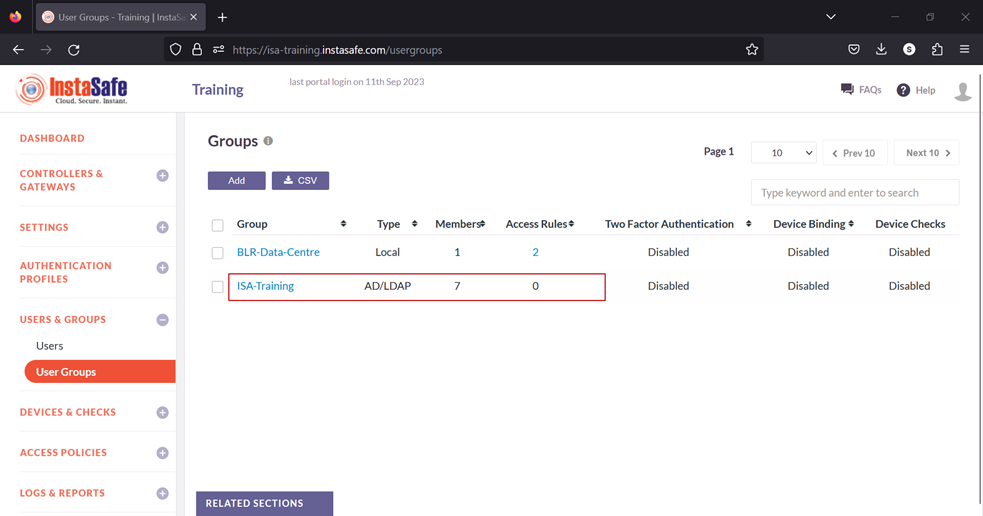

Now that the AD users and user groups are integrated into the ISA web console, further constraints and conditions such as Multi-factor Authentication (MFA), Device Binding, Device Checks, and Geo Binding can now be set. Further, to allow these users access to corporate resources, access rules must be created.    
