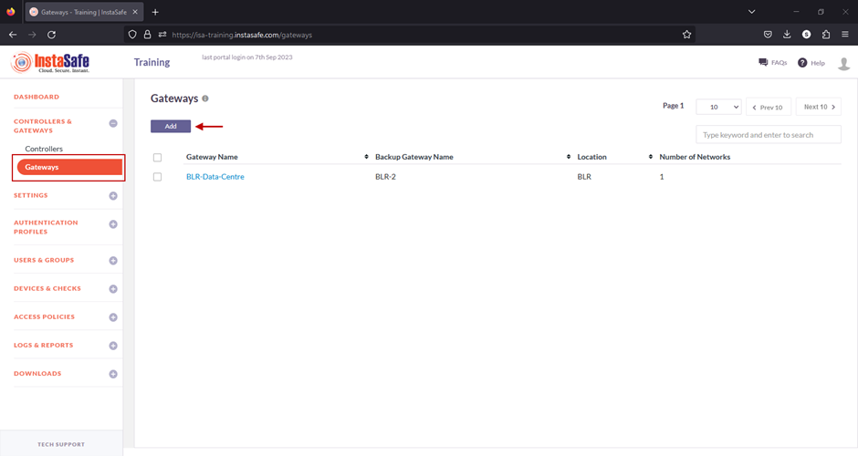
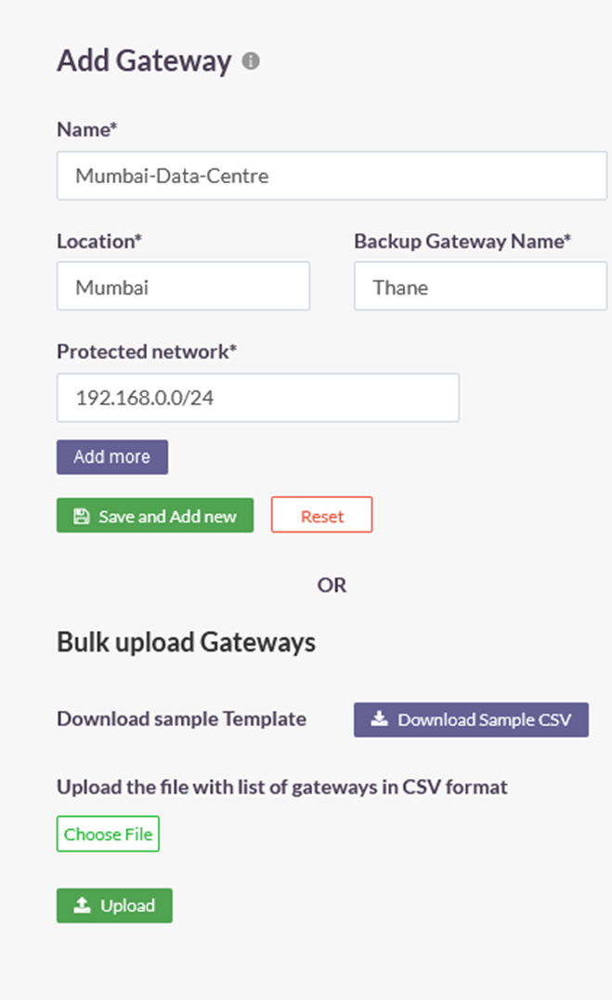
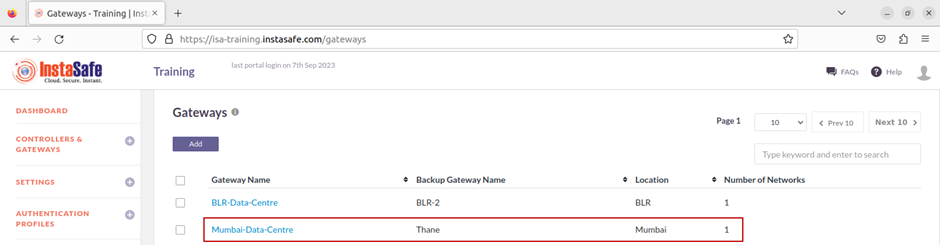
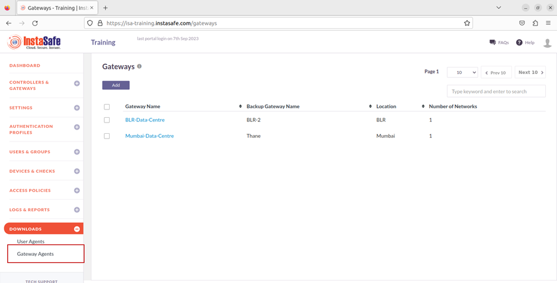
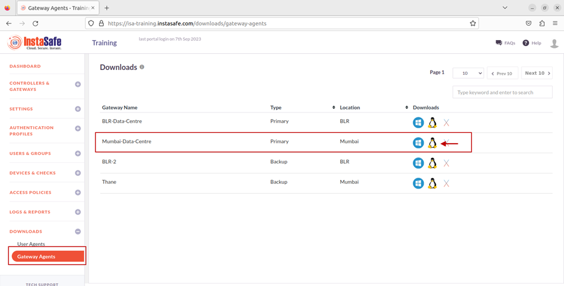

# Adding a Gateway Profile on the ISA Web Console

Before deploying the ISA Gateway at the corporate network edge, a Gateway profile must be created on the ISA web console. When creating the profile, you can specify the IP addresses of your internal resources and services that need to be accessed by remote users.

This article describes the step-by-step process of creating a Gateway profile.

**Adding a Gateway Profile in ISA Web Console**

1.Login to the ISA web console with your administrator credentials

2.After logging in, navigate to the CONTROLLERS & GATEWAYS > Gateways page.

3.Here, click on the Add button at the top of the page.

4.On the Add Gateway window, enter the following information:

- Name: Give a name for the Gateway. The name must allow an administrator to easily identify the nature and purpose of the Gateway. The name must not have spaces. In the example below, the name Mumbai-Data-Centre is separated by hyphens.
- Location: This is the name of the location of the resources.
- Backup Gateway Name: Enter the name of the back-up Gateway. It is best-practice to deploy a back-up Gateway to ensure uninterrupted flow of traffic in the event of failure of the primary Gateway.
- Protected Network: Enter here the internal IP address and/or the IP subnet-ID of the resource or resources that is required to be accessed by your remote users. The IP addresses must be entered using the slash notation with the subnet ID. For example, to add a single host of IP address 192.168.1.1, enter 192.168.1.1/32; to add a subnet enter the subnet id followed by slash and the network id 192.168.1.0/24. In this example, the subnet 192.168.0.0/24 has been entered.
- Add More: More than one resource can be added to the Gateway profile.
- Click on Save and Add new to create the Gateway profile.
- Optionally, under Bulk upload Gateways you may add multiple Gateways at once by uploading a file with the Gateway names and other information in CSV format. Click on Download Sample CSV for the format for bulk-adding Gateways.

5.Once created, the Gateway will be listed on this page with Gateway Name, Backup Gateway Name, Location, and Number of Networks. In this example, the number of networks is one.

6.Next, on the left-side menu, under Downloads, click on Gateway Agents.

7.On the Downloads page, you can see all the Gateways added and their respective back-up Gateways listed by Name, Type, and Location.

Further, under Downloads, you can download the Gateway Agent software for each Gateway. The Gateway Agent software can be downloaded for Windows, Linux, and OS X operating systems. 

