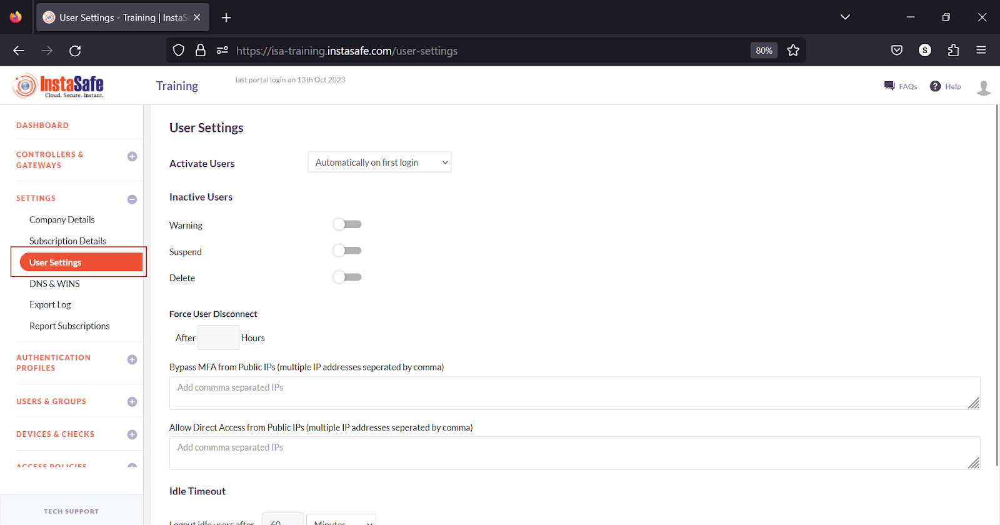
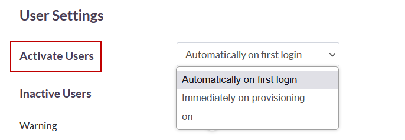
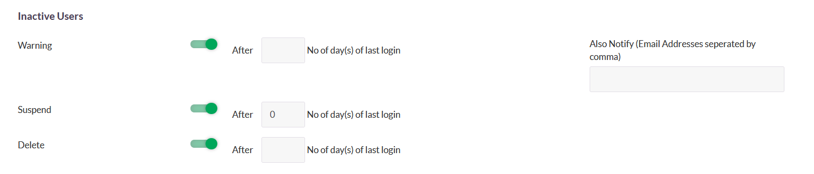
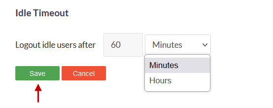

# User Settings

The User Settings page under the Settings menu allows the ISA web portal administrator to set global parameters to InstaSafe Secure Access (ISA) users. The options configured here will affect users on the USERS & GROUPS > Users page.

**Activate Users** - There are three options here. 

1. **Automatically on first login** - Select this option to activate and set the status of the users to "Active" after the users log in successfully to the web portal for the first time or after completion of authentication while connecting using the ISA User Agent. 

2. **Immediately on provisioning** - Select this option to activate and set the status of the users to "Active" immediately after adding users to the ISA web portal or importing users from Active Directory or LDAP. 

3. **On** - Select this option to activate the status of the users on a specific date and time. On selecting this option, the option to set the date and time is displayed to the right. 

**Inactive users** - These options allow the administrator to define the action to be taken on inactive users. There are three options available:

1. **Warning** - Enable this option to specify the number of days since the users' last login before setting the status of the users to "Warning". On the Also Notify field, set the email addresses, separated by commas, to send an email to the addresses specified.  

2. **Suspend** - Enable this option to specify the number of days since the users' last login before setting the status of the users to "Suspended". 

3. **Delete** - Enabling this option allows the administrator to specify the number of days since users' last login before deleting the users. 

**Force User Disconnect** - Set the number of hours before disconnecting all users. 

**Bypass MFA from Public IPs (multiple IP addresses separated by comma)** - This option will bypass the IP addresses entered in the field from Multi-Factor Authentication. 

**Allow Direct Access from Public IPs (multiple IP addresses separated by comma)** - IP addresses entered in this field prevents users access to corporate resources through the secure tunnel established by the ISA User Agent, forcing the user to access the resource directly.

**Idle Timeout**  - Specify the number of minutes or hours before idle login sessions are logged out. 

- On the Logout idle users after option, set the number  of minutes or hours. Click the drop-down to select Minutes or Hours. The minimum time is 60 minutes or 1 hour. 
- This is applicable to users connecting using the ISA User Agent and not applicable to users or administrators logged into the web portal. 

Save – Click **Save** to save the configuration on this page.

