# Microsoft Entra ID Integration

- Log in to portal.azure.com and select Microsoft Entra ID

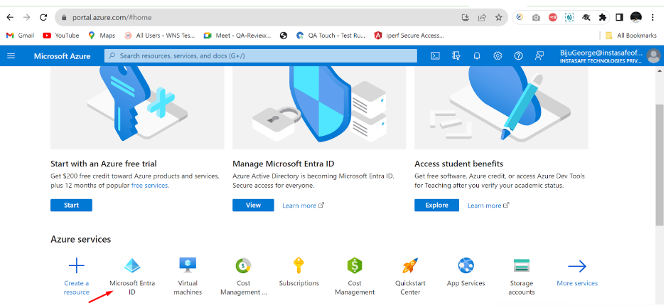

- Click on ‘App registrations’ in the dashboard panel on the left
- Then click on ‘New registration’, provide a custom name, and register the application

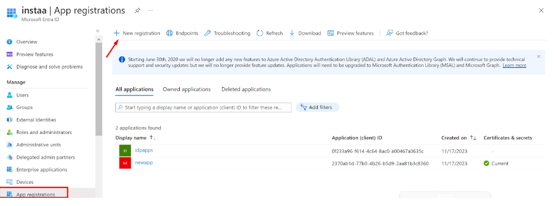

- After the new application is registered/created, select the application to expand
- Switch to the ‘API permissions’ tab
- Click on ‘Add a permission’ and grant permissions as per the screenshot below

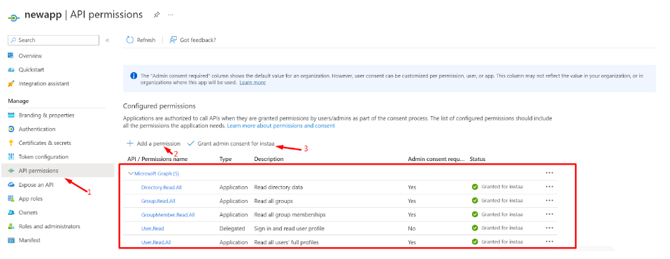

- Now, switch to the ‘Certificate and secrets’ section of the application and click on ‘Client secrets’ and then ‘+ New client secret’
- A new Client secret will be generated
- Make sure to copy the Value and save it carefully for later use (while configuring the Sync profile in the InstaSafe ISA portal)
- This Client secret value will only be displayed once at the time of generation, and won’t be visible again to Entra ID Admins (once viewed)

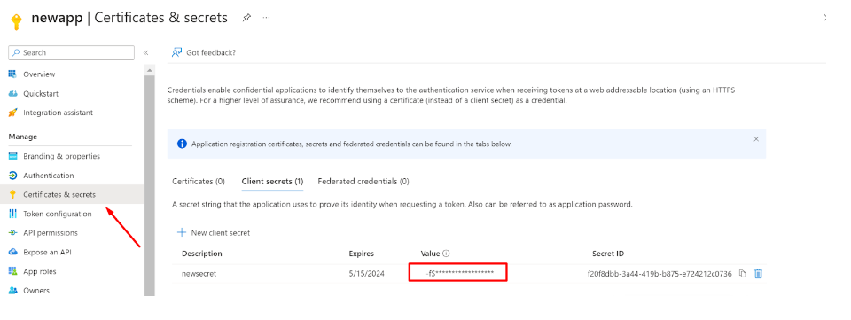

- Now, switch to the Overview section
- Copy the Application (client) ID for later use
- Copy the Directory (tenant) ID

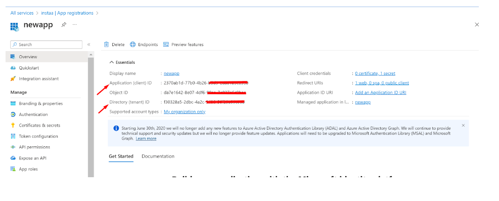

**User Sync**

- Login to the InstaSafe ISA Portal with Admin credentials
- Navigate to Authentication Profile >> Azure AD

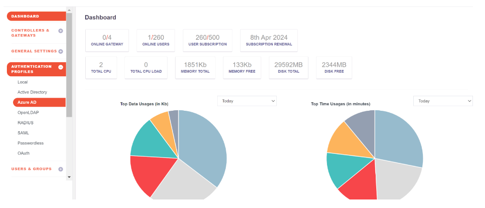

- Click on the Add button
- Fill up the details from Entra ID
    - Profile Name: <Any custom name>
    - Domain: abc.instasafe.com (example)
    - Tenant ID: <copied earlier>
    - Client Id: <copied earlier>
    - AzureAD Groups: <Name of the User Groups created for InstaSafe ISA>
Click the ‘Save and Add new’ button

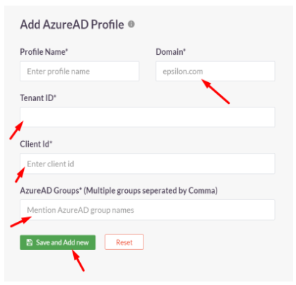

- Once the profile is created, Users and Groups from Entra ID can be synced to the InstaSafe ISA Portal by selecting the profile and clicking ‘Sync Now’

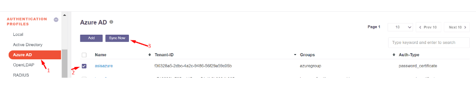

- After a successful sync, Users and Groups from Entra ID will be available in the InstaSafe ISA Portal

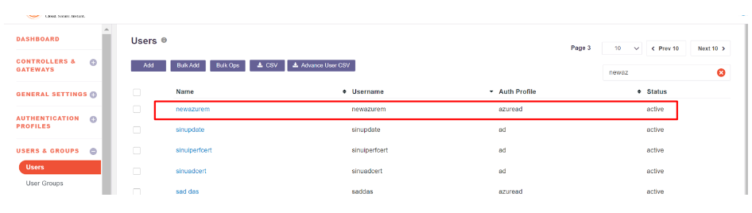

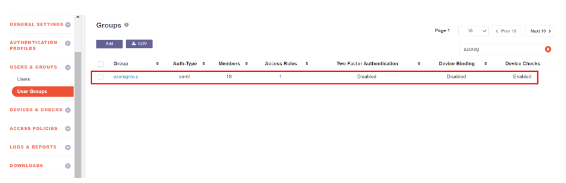

**User Authentication (SAML 2.0)**

In this step, SAML Authentication shall be configured where InstaSafe ISA shall serve as the Service Provider (SP) and Entra ID shall serve as the Identity Provider (IdP).

- Log in to portal.azure.com and select Microsoft Entra ID
- Click on ‘Enterprise applications’ in the dashboard panel on the left
- Click on ‘New application’

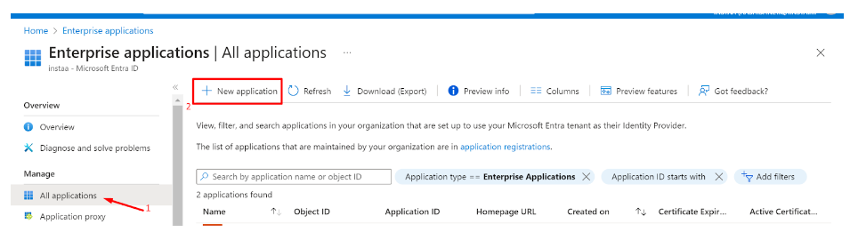

- Click on ‘Create your own application’
- Provide a custom name like instasafeisa and click ‘Create’

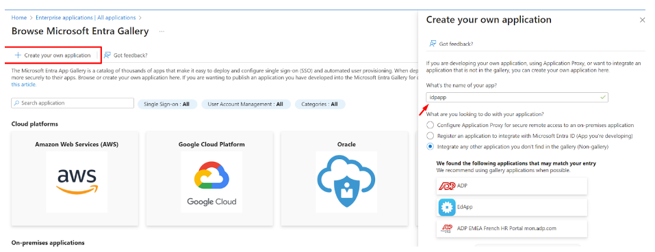

- Expand the newly created Application
- Click on ‘Single sign-on’ and then ‘Set up single sign on’

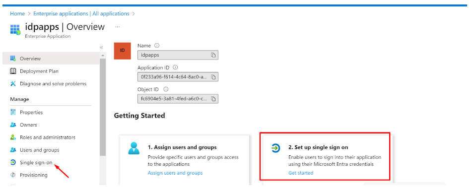

Fill up the details of your SP (InstaSafe ISA)

Identifier (Entity ID): http://abc.instasafe.com

Reply URL (ACS URL): https://abc.instasafe.com/api/saml/acs

Logout URL: https://abc.instasafe.com/api/saml/acs

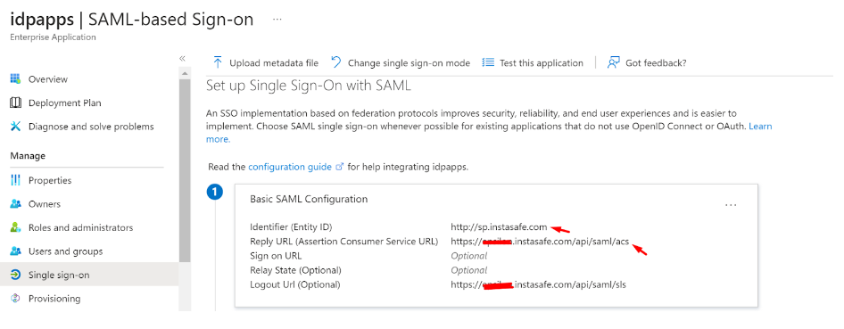

- Download the Metadata from Entra ID (or copy all required values like Certificate, Entity ID, ACS URL, etc.) to be used later

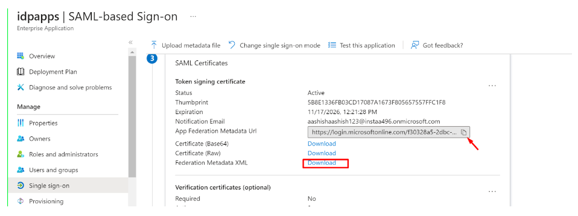

- Login to the InstaSafe ISA Portal with Admin credentials
- Navigate to Authentication Profile >> SAML
- Click on ‘Add’

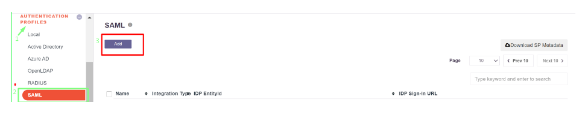

- The values from Entra ID (copied earlier) can be manually entered here, or automatically populated by uploading the IdP Metadata file (downloaded earlier)
- Click ‘Add’

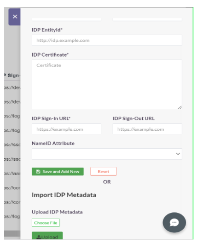

- Once created, the SAML profile will be available to view

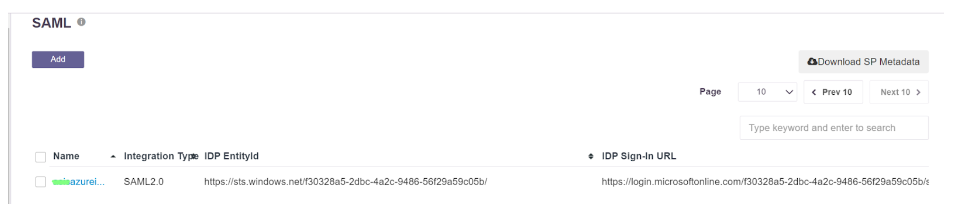

- The SAML Authentication profile can be assigned to the User Group synced from Entra ID
    -   Navigate to User Groups
    -   Locate and expand the User Group synced from Entra ID
    -   Click on ‘Edit’
    -   In the ‘Authentication Profile’ drop-down, select the SAML profile created
    -   Click on ‘Update’

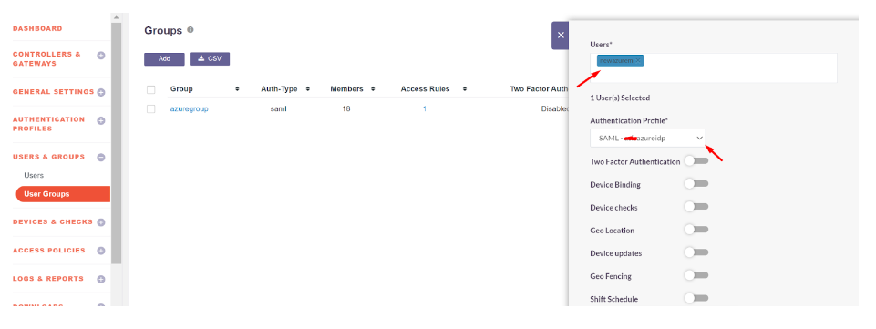

Please refer the below video on the Microsoft Entra ID configuration.

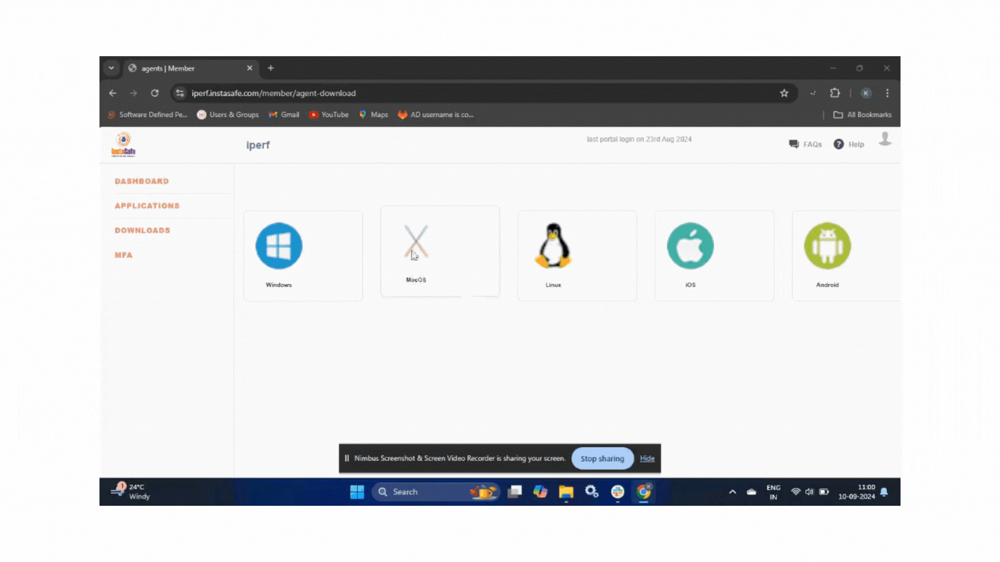
