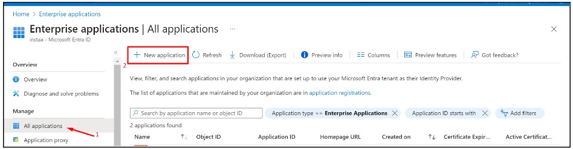
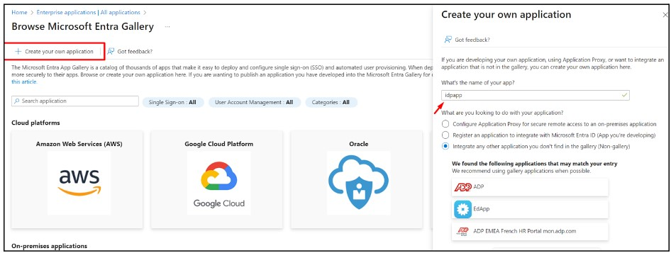
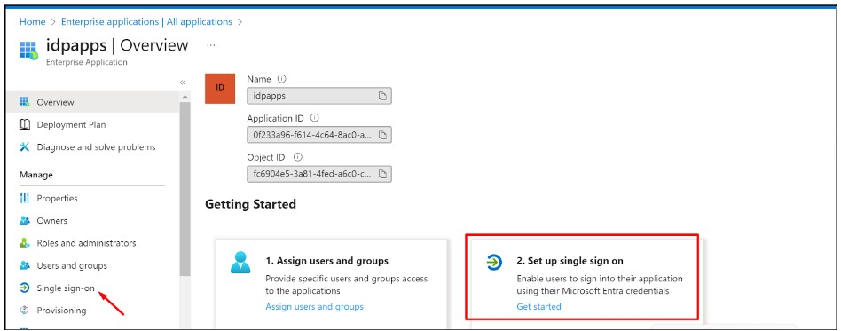
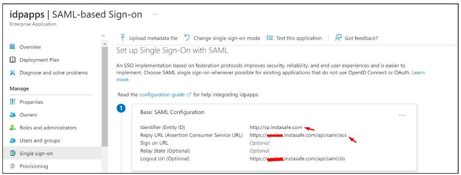
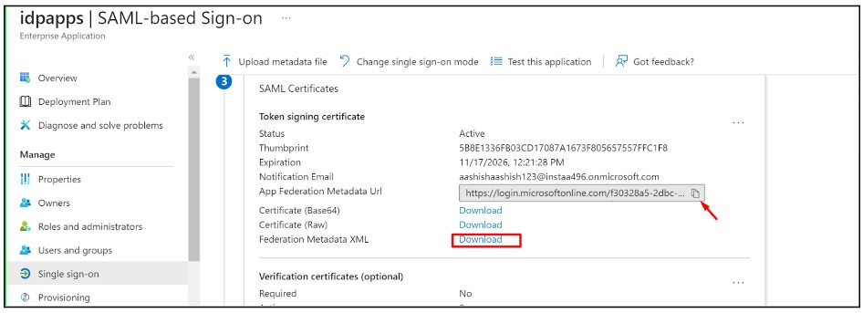
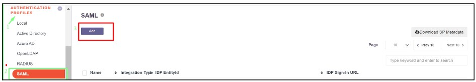
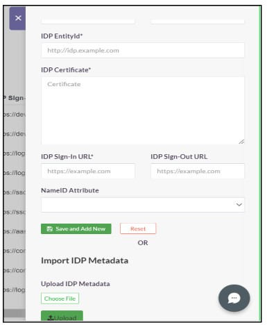
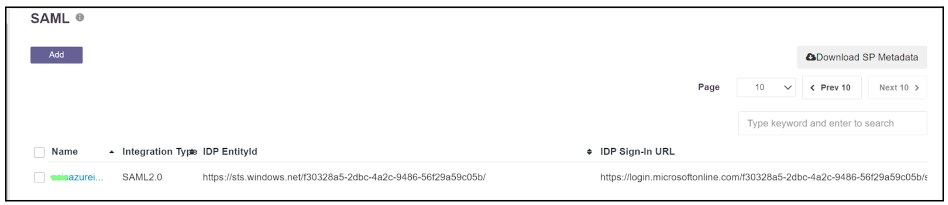
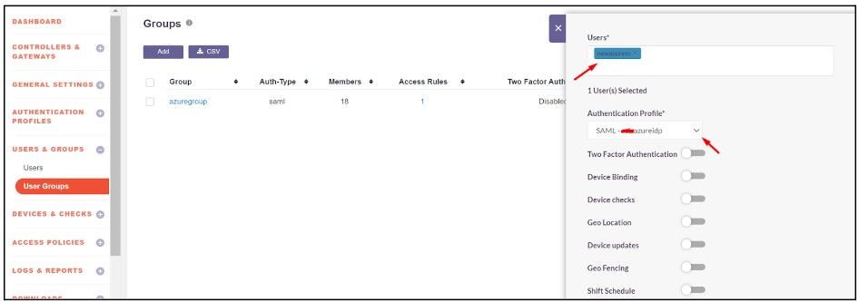

# SAML Authentication

**SAML 2.0 configuration with AZURE AD**

SAML Authentication will be configured where InstaSafe ISA shall serve as the Service Provider (SP) and Entra ID shall serve as the Identity Provider (IdP).

- Log in to portal.azure.com and select Microsoft Entra ID
- Click on ‘Enterprise applications’ in the dashboard panel on the left
- Click on ‘New application’

- Click on ‘Create your own application’
- Provide a custom name like instasafeisa and click ‘Create’

- Expand the newly created Application
- Click on ‘Single sign-on’ and then ‘Set up single sign-on’

- Fill up the details of your SP (InstaSafe ISA)
    -   Identifier (Entity ID): http://companyname.instasafe.com
    -   Reply URL (ACS URL): https://companyname.instasafe.com/api/saml/acs
    -   Logout URL: https://companyname.instasafe.com/api/saml/acs

- Download the Metadata from Entra ID (or copy all required values like Certificate, Entity ID, ACS URL, etc.) to be used later

- Login to the InstaSafe ISA Portal  with Admin credentials
- Navigate to Authentication Profile >> SAML
- Click on ‘Add’

- The values from Entra ID (copied earlier) can be manually entered here, or automatically populated by uploading the IdP Metadata file (downloaded earlier)
- Click ‘Add’

- Once created, the SAML profile will be available to view

- The SAML Authentication profile can be assigned to the User Group synced from Entra ID
    -   Navigate to User Groups
    -   Locate and expand the User Group synced from Entra ID
    -   Click on ‘Edit’
    -   In the ‘Authentication Profile’ drop-down, select the SAML profile created

- Click on ‘Update’

