# OpenLDAP Integration

**Prerequisites for creating an user on an OpenLDAP server**

1.To create a user on an OpenLDAP server, right-click on the OU (Organizational Unit), select New, and then choose User.

2.Enter the user details and click OK to create the user.

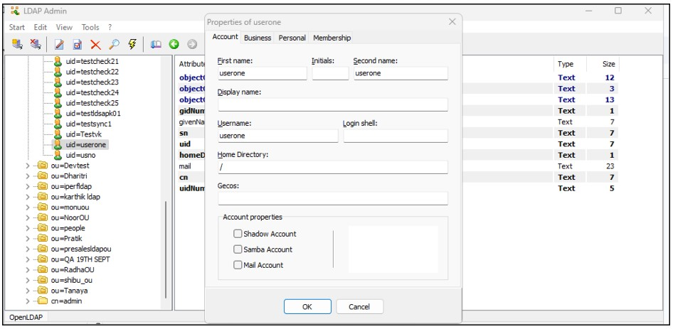

3.Next, click on the user's profile to set a password for the user.

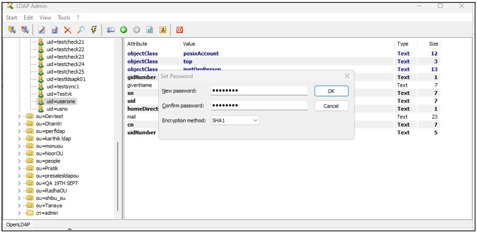

4.To create a group on an OpenLDAP server, right-click on the OU (Organizational Unit), select New, and then choose Group.

5.Enter the group details, add members to the group, and click **OK** to create the group.

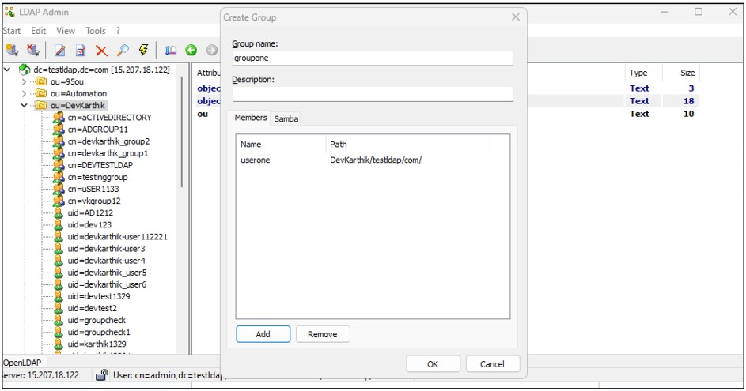

**Prerequisites for OpenLDAP Integration**

For successfully integrating the OpenLDAP profile with the OpenLDAP server, ensure the following are adhered to:  

1.Since the OpenLDAP profile’s connection request will be an inbound connection to the OpenLDAP server, ensure that TCP port 389 (or 636 for LDAPS) is open on the Gateway firewall.  

2.Verify that the username (Bind DN) and password used for OpenLDAP integration are correct. 

3.The InstaSafe Gateway Agent must be able to communicate using its physical adapter’s private IP address with the OpenLDAP server’s private IP address on the appropriate TCP port (389 or 636). 

**Adding an OpenLDAP Authentication Profile on the ISA Web Console**

1.Log in to the ISA web console using administrator credentials.  

2.After logging in, click on AUTHENTICATION PROFILES in the left-hand menu.   

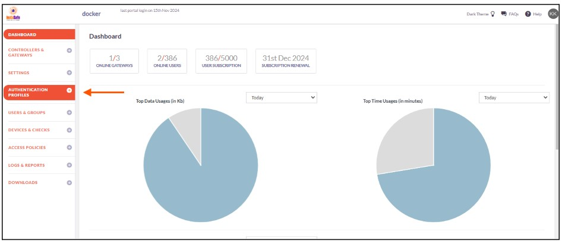

3.Under AUTHENTICATION PROFILES, click on OpenLDAP.  

4.On the OpenLDAP page, under OpenLDAP Profile, click on the Add button. 

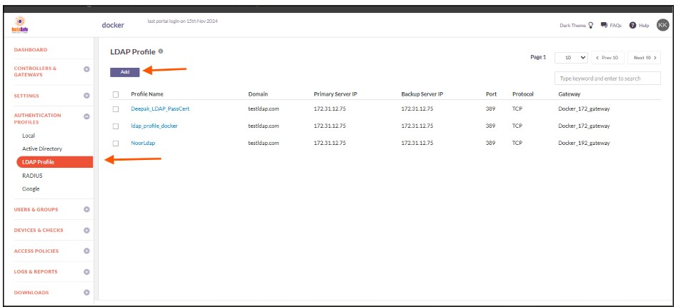

5.In the Create OpenLDAP Profile window, enter the following information under each field:  

- **Profile Name:** Enter a descriptive name for this profile. The name must not contain spaces. This field is mandatory.  

- **Domain:** Enter the domain name or identifier for the network. For example, openldap.local.This field must be filled-in and is not case-sensitive.  

- **Gateway:** Select the Gateway name through which the OpenLDAP server can be accessed. For example, "Gateway BLR-Data-Centre." This field must be selected from the available options.

- **Primary Server IP:** Enter the private IP address of the OpenLDAP server. This field must be filled-in.  

- **Backup Server IP:** Enter the private IP address of the backup OpenLDAP server (if applicable).  

- **Bind User (DN):** Enter the Distinguished Name (DN) of the user that will bind with the OpenLDAP server. The Bind DN user does not need administrator privileges; a normal user will suffice. This field is mandatory.  

- **Base DN:** Enter the Base DN of the domain. The Base DN defines where in the directory tree the search will start. For example:  
    - Without container: `dc=openldap,dc=local`  
    - With container: `ou=users,dc=openldap,dc=local`  

This field is mandatory. 

- **Filter:** An OpenLDAP filter helps locate specific users or groups in the directory. A filter specifies the conditions that records must meet to be included in the search results. For example:(&(objectClass=person)(memberOf=cn=LDAP-Training,ou=users,dc=openldap,dc=local)).  

The **GID Number** will be available in the OpenLDAP server under the group profile. The admin needs to copy the GID number and add it to the filter.

Example:

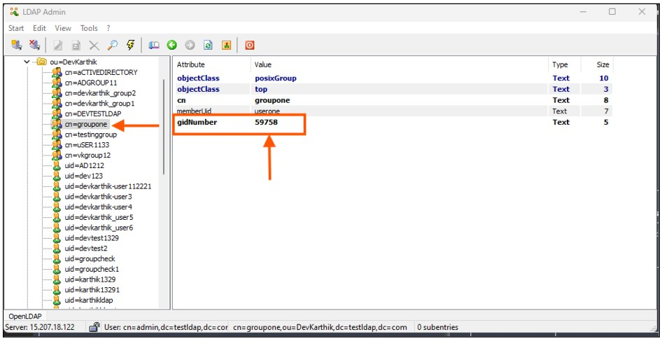

- **Port:** Enter the port number Open LDAP server for example : 389

- **Protocol:** Enter the protocol number for OpenLDAP server for example : Tcp

- **Authentication Type:** The administrator has the option to select either Certificate or Password + Certs. The type set here will be the authentication method for the AD users. This field must be filled-in with the options available.

- Click on **Save** to create this profile. This will create an AD profile and the new profile will be displayed on the page.

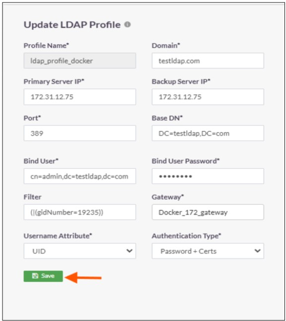

6.Click on the profile name of the Open LDAP profile.

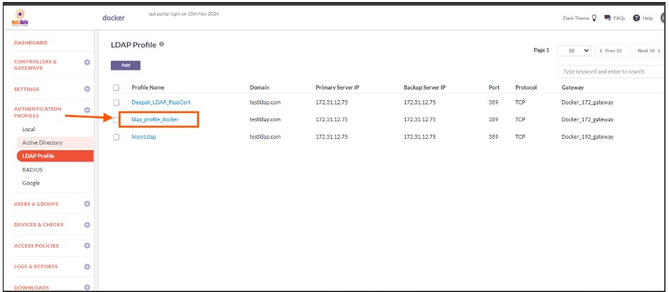

7.In the Open LDAP Profile window, Click on Set Password.

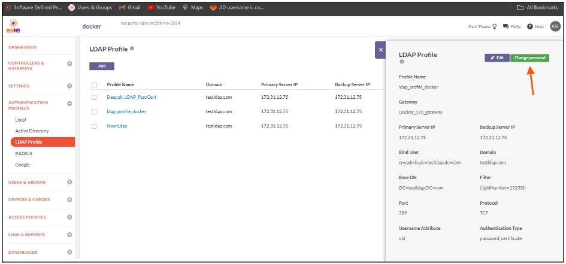

8.Under New Password, enter the password for the username set in the profile. In this article, it is Administrator.

9.Under Confirm Password, confirm the password.

10.Click on Save.

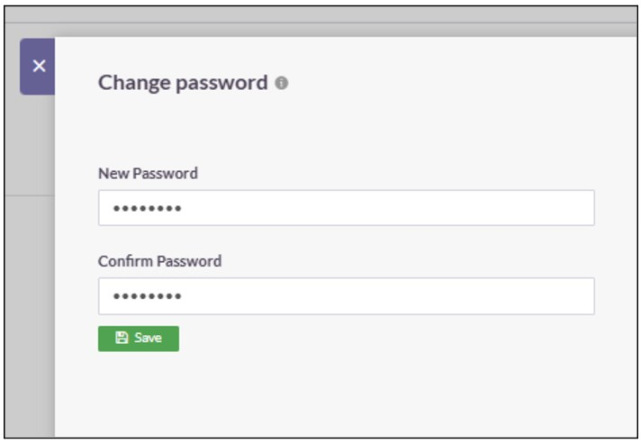

11.Enable the check-box of the newly created Open LDAP profile and click on Sync Now.

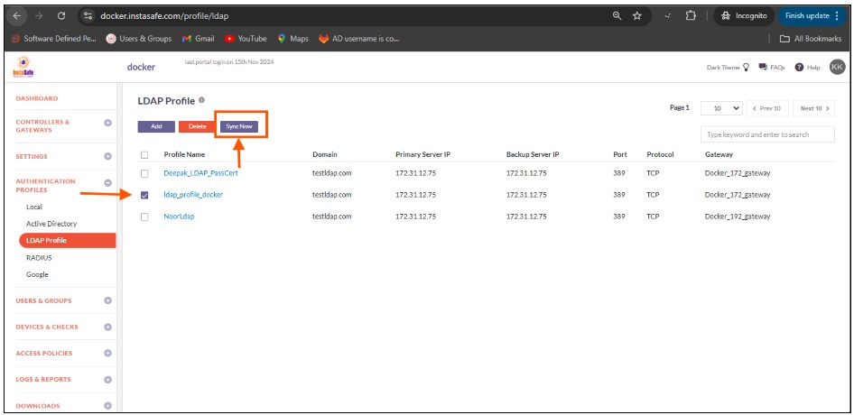

12.If the parameters in the profile have been set correctly, the profile will sync with OpenLDAP and fetch the users and user groups from it. Note: The Open LDAP profile will sync with the Open LDAP server every one hour.

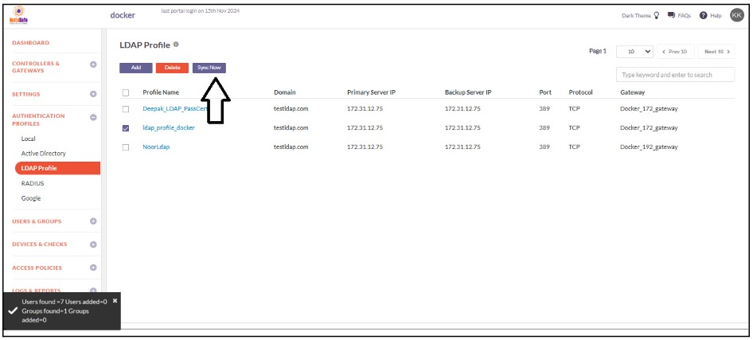

13.To view the imported users, on the left-side menu click on USERS & USER GROUPS and then click on Users.

14.You should be able to see the users imported from Open LDAP on this page.

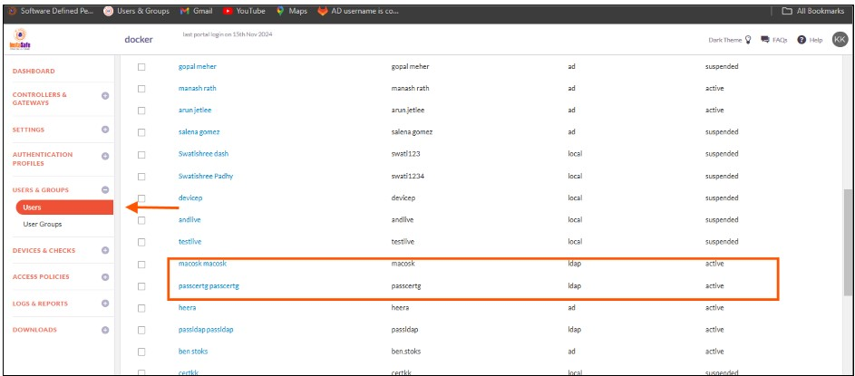

15.On the left-side menu, click on User Groups.

16.You should be able to see the user groups imported from Open LDap on this page.

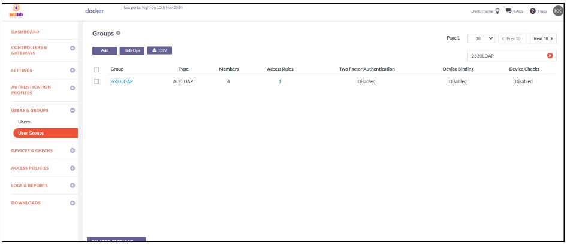

Now that the Open LDAP users and user groups are integrated into the ISA web console, further constraints and conditions such as Multi-factor Authentication (MFA), Device Binding, Device Checks, and Geo Binding can now be set. Further, to allow these users access to corporate resources, access rules must be created.
