# InstaSafe AD Integration for Radius

The following are the steps to use AD authentication with InstaSafe Secure Access 

**1. Create a security group**

Create a security group in Active Directory Users and Computers called VPNusers. Everyone could have access but it's a good policy to identify the VPN Users and have granular access control.

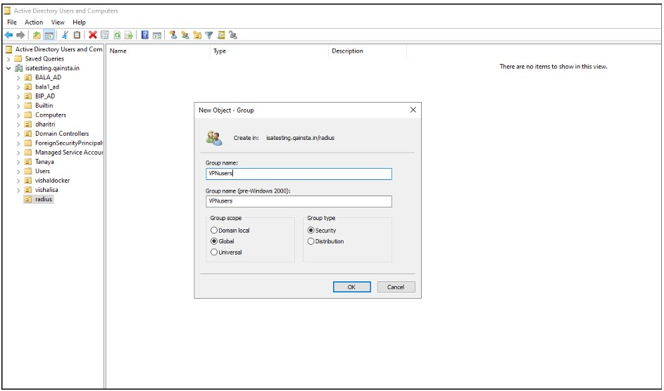

**2.Add Users to Security Group**

Add user accounts that use the InstaSafe VPN to this group. 

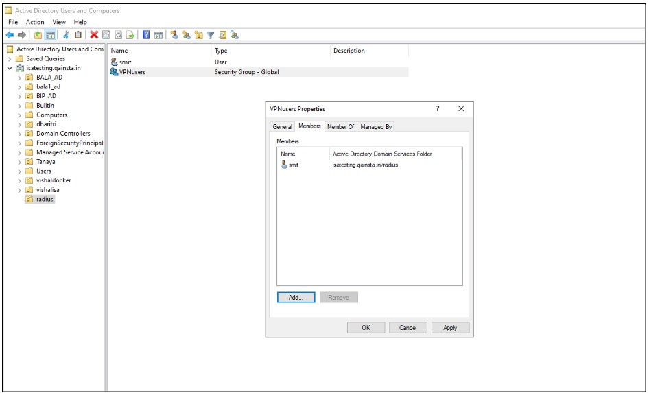

**3.Add “Network Policy and Access Service” Role**

On the Active Directory Check if the “Network Policy and Access Services” role exists under Roles in Server Manager. 
Otherwise, click right-click Roles and select Add Role.

Click Next to add role in the wizard

Select “ Network Policy and Access Services” under the Roles to be added and click Next

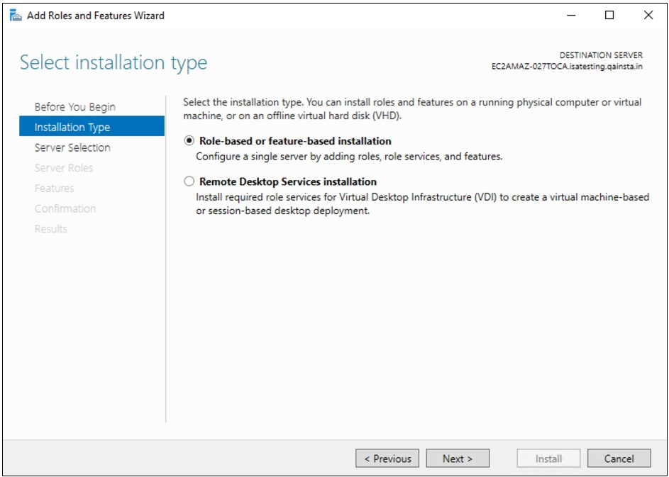

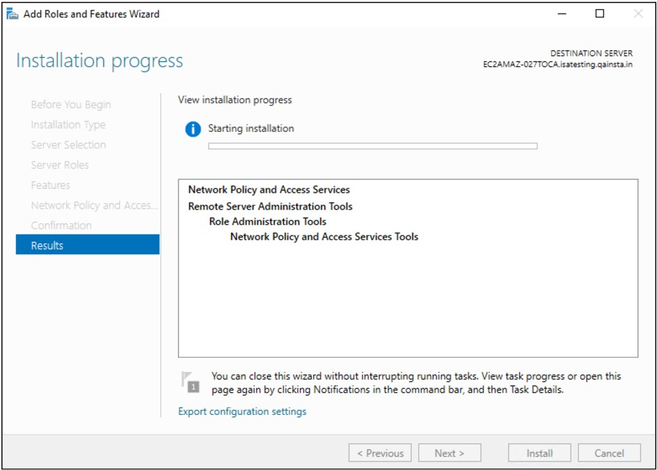

Under Role Services, select Network Policy Server and Click Next

Once the Role is added, it appears under Roles in the Server Manager

**4. Add Radius Client**

Expand the **Network Policy and Access Services** node, go to **NPS (Local) > RADIUS Clients and Servers**, right-click **RADIUS Clients** and choose **New**

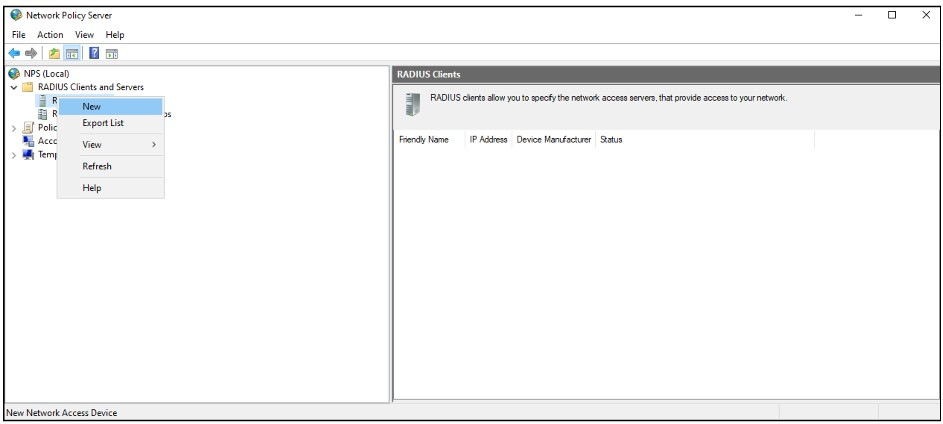

Fill in the below fields

**Friendly name:** Enter InstaSafe VPN or anything deemed appropriate 

**Address (IP or DNS):** Enter the LAN IP address of the InstaSafe Gateway. 
For example: 192.168.1.77. 
Please confirm the IP address from the InstaSafe Support Team 

**Shared Secret:** Select Manual, set a password and save the shared secret. 

This secret is required to be configured later on the my.instasafe.net portal.

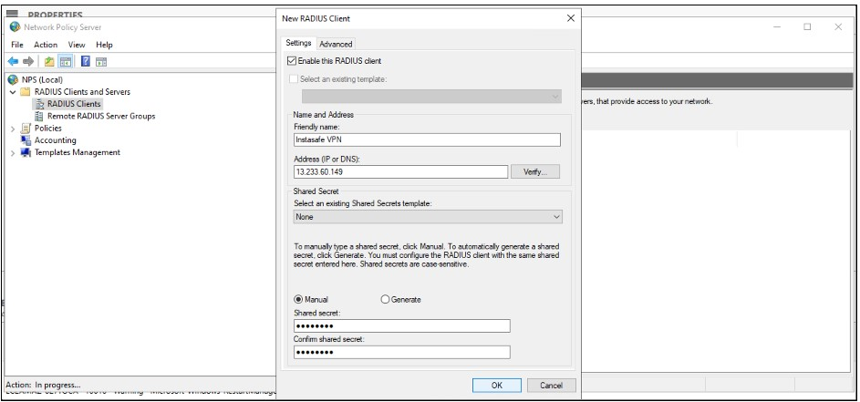

**5. Add Network Policy** 

Under **NPS (Local) > Policies** right-click **Network Policies** and select **New** 

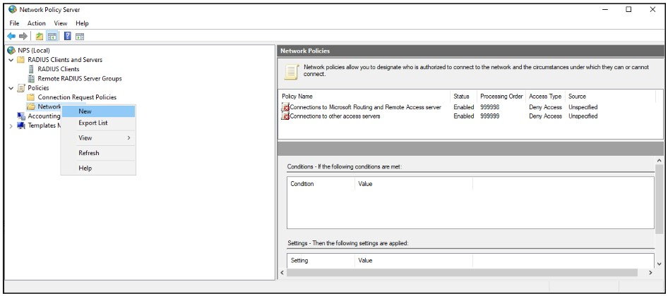

In the **Policy name field**, enter **Allow InstaSafe**. 

Type of network access server: **Unspecified** 

Click Next

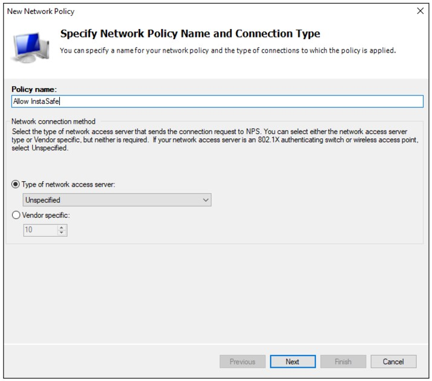

In the **Specify Conditions** window, click **Add**

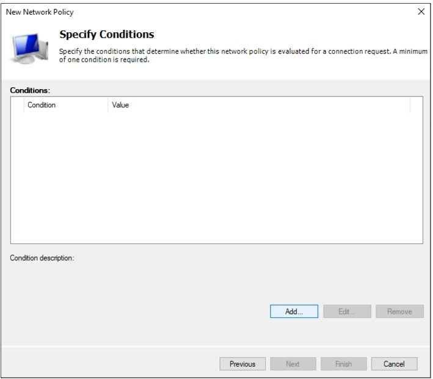

Select Windows Groups and click Add

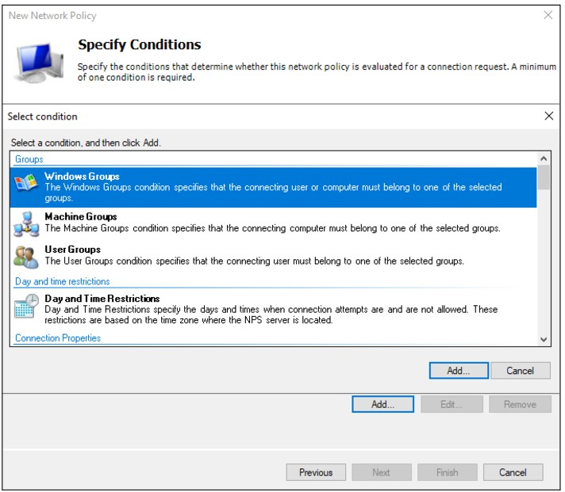

Click **Add Groups** and add the group **VPNusers** (or whatever group is needed)

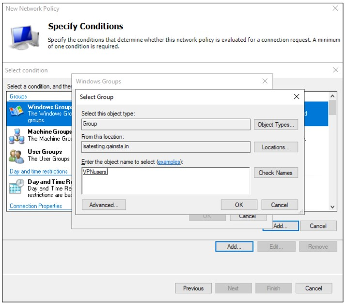

Back in the **Specify Conditions** window, click **Next**

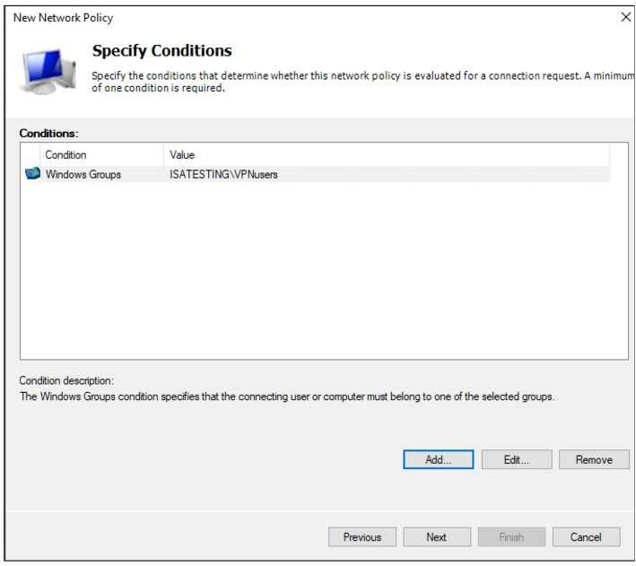

Select **Access granted**

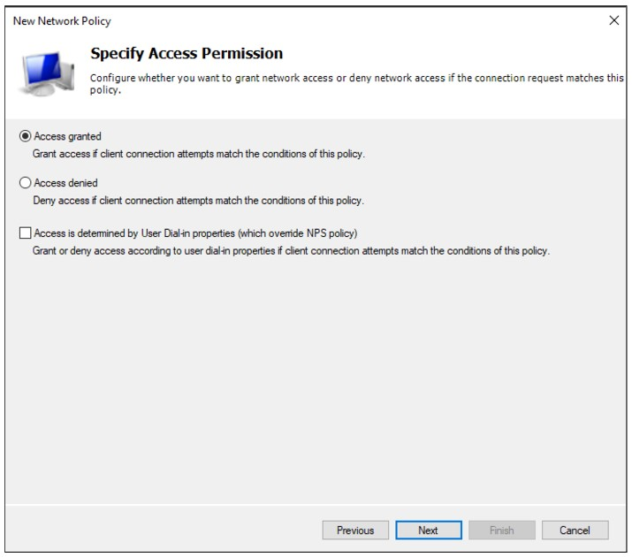

Put the new policy before policies preventing the connection. Please note the Processing Order should be high for **“Allow InstaSafe”** Policy.

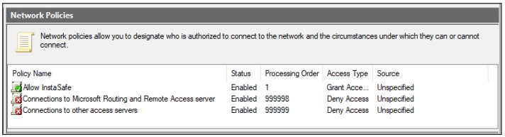

**6. Configure Authentication Methods** 

In the Configure Authentication Methods window, check **Unencrypted authentication (PAP, SPAP)**

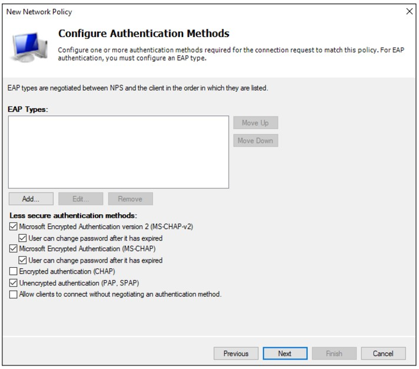

Skip the next wizard window (Constraints) and click Next, Next, Finish until the end.

**7. Configuring RADIUS Authentication Profile on the ISA Web Console**

- Log in to the ISA web console using administrator credentials.  

- Click on AUTHENTICATION PROFILES in the left-hand menu.

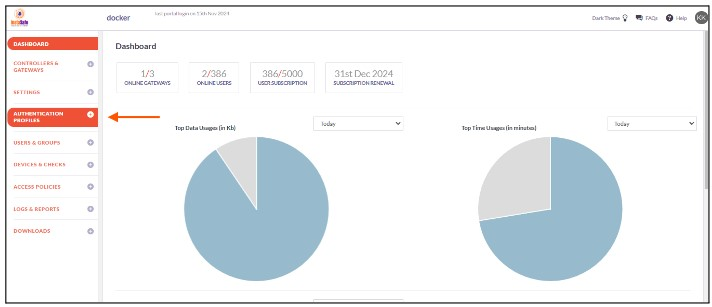

- Under AUTHENTICATION PROFILES click on RADIUS.  

- On the RADIUS page, under RADIUS Profile, click on the Add button. 

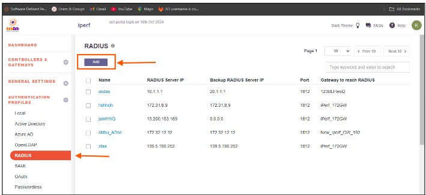

- In the Create RADIUS Profile window, enter the following information under each field:  

    - **Profile Name:** Enter a descriptive name for this profile. The name must not contain spaces. This field is mandatory. 
    - **Gateway to reach RADIUS:** Select the Gateway name through which the OpenLDAP server can be accessed. For example, "Gateway BLR-Data-Centre." This field must be selected from the available options
    - **RADIUS Server IP:** Enter the private IP address of the RADIUS server. This field must be filled-in
    - **Backup RADIUS Server IP:** Enter the private IP address of the backup RADIUS server
    - **Port:** Enter the port number Open LDAP server for example Radius server port : 1812
    - **Radius Secret:** Enter the shared secret configured manually while adding the radius client in the “Network Policy and Access Service”

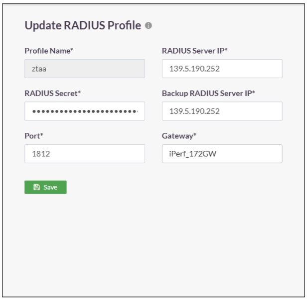

- Click on **Save** to create this profile. This will create a RADIUS profile and the new profile will be displayed on the page.

- Open the user profile And Assign the Authentication Profile to the user profile.

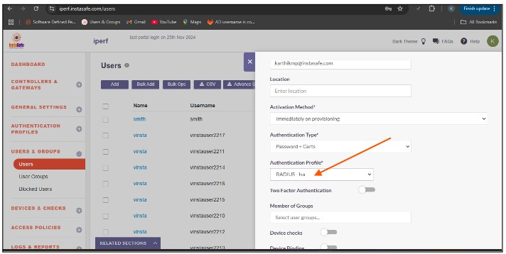

To verify that InstaSafe Secure Access is using AD authentication, please start the InstaSafe Agent and enter the AD username in the email format (username@domain) and the AD password for the user. If the connection is successful, the AD integration is complete. If the connection is unsuccessful, please contact support@instasafe.com or call InstaSafe Support for assistance.

