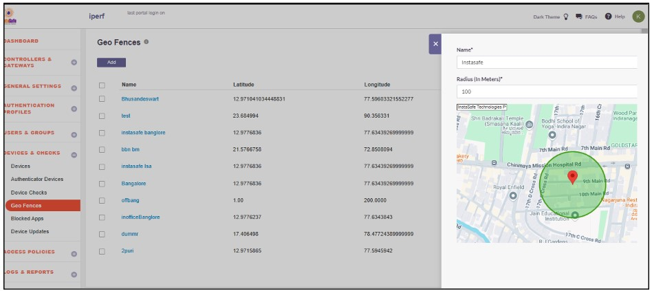
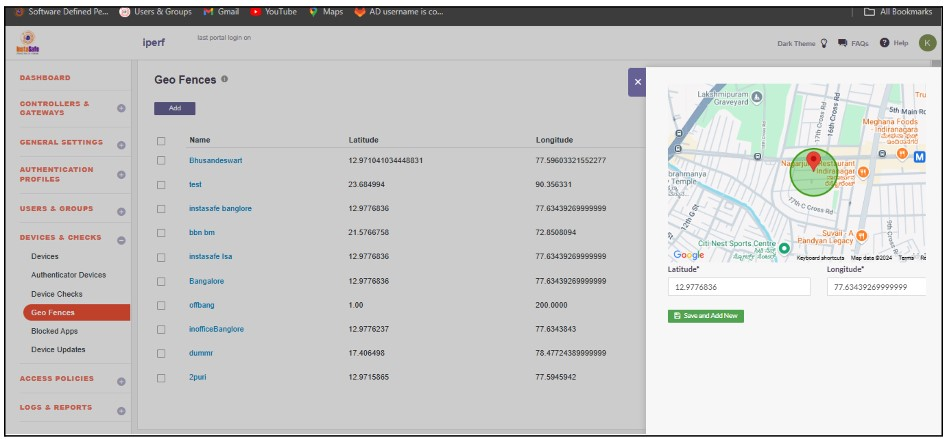
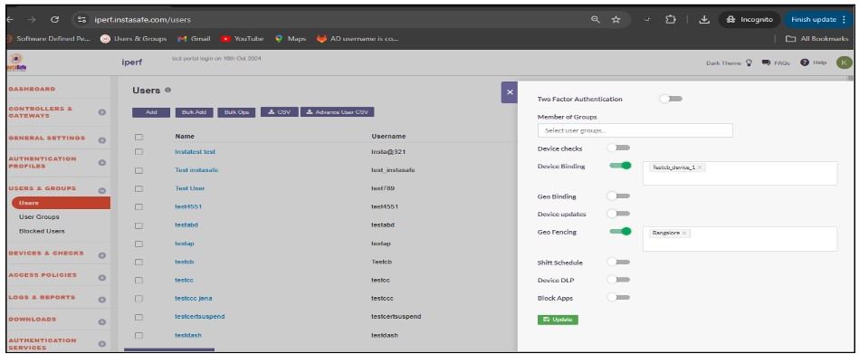
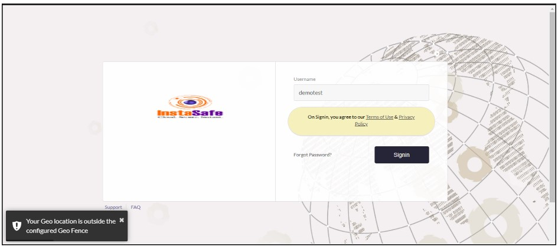
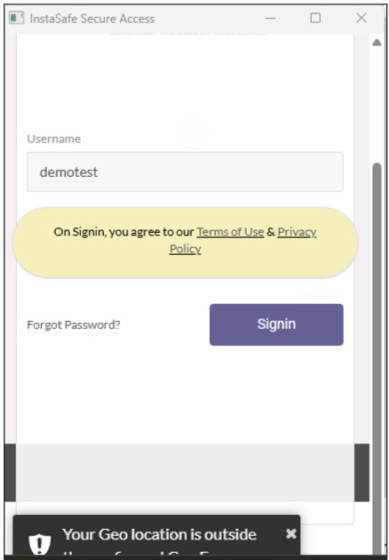
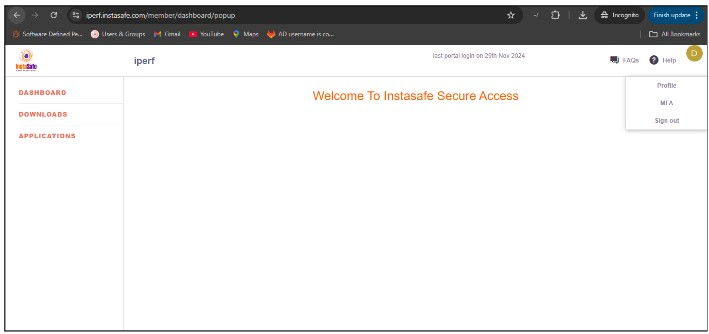

# Geofence Configuration

- Login to the InstaSafe ISA Portal with admin credentials

- Navigate to **Devices and Checks** -> **Geofence**

- Click on the ‘Add’ button and enter the Geofence details

- After entering the location, the latitude and longitude will update automatically. If needed, the admin can manually update the latitude and longitude.

- Assign the geofence to the user profile.

When geofencing is enabled for a user, they are allowed to log in or access the application only within the geolocation radius configured by the admin. If the end user is outside the configured geofence radius, they will not be able to log in to InstaSafe and will receive an error message stating, '**Your geolocation is outside the configured geofence**.'

When the end user returns to the configured geofence range, they should be able to log in to the agent and end-user console without any errors.

