# OAuth2

OAuth2 (Open Authorization version 2) is a widely adopted authorization framework that provides a secure method for allowing third-party applications to access a user's data and resources without exposing their credentials. OAuth2 enables users to grant limited access to their resources on one platform to a third-party application without requiring the user to share their login information.
OAuth2 is primarily used for secure delegated access and is crucial for managing permissions across various services in a user-friendly, safe manner.

**OAuth2 is used for:**

1. Applications Requiring Secure, Delegated Access: OAuth is designed to allow third-party applications to securely access a user's resources (such as Google Calendar or Dropbox files) without needing the user's credentials. This prevents sensitive data from being exposed and allows users to manage permissions more granularly.

1. Single Sign-On (SSO) Across Services: OAuth simplifies user authentication across multiple services and applications. OAuth enables a user to log into multiple services using a single set of credentials (e.g., using their Google or Facebook account), enhancing the user experience and reducing password fatigue.

1. Mobile and Web Application Security: OAuth is frequently used to secure access to mobile and web applications. By using OAuth, applications can authenticate users securely without handling or storing their passwords, reducing the risk of credential theft.

1. Integration Between Third-Party Services: OAuth is designed to enable seamless integrations between various third-party services, such as when a user grants permission for an app to access their information on another platform (e.g., integrating with social media or cloud storage services).

1. Compliance with Security Regulations: Many organizations in regulated industries (such as finance, healthcare, and government) need OAuth to comply with security standards and to ensure that user data is accessed only by authorized, trusted applications.

**Use Cases of OAuth2:**

1. **Social Media Login (Single Sign-On - SSO):** OAuth is widely used for enabling **Single Sign-On (SSO)** for web and mobile applications. Instead of creating and remembering multiple usernames and passwords for different services, users can log in using their **Google, Facebook, or Twitter** credentials. OAuth simplifies this by handling authentication while ensuring that the user’s credentials remain secure.

    **Example:** An employee logs into an HR management system using their Google account. The OAuth process allows the system to access the employee’s basic profile information, like their email address, without requiring the employee to manually enter their credentials.

2. **Third-Party Application Integrations:** OAuth is used to grant third-party applications access to user data across various services, ensuring that the user can securely integrate their accounts across different platforms.

    **Example:** A photo-editing application needs to access a user’s photos stored in Google Photos. The user grants the app access via OAuth, allowing the app to edit the photos without exposing the user’s Google credentials.

3. **Secure API Access:** OAuth is commonly employed for granting **secure API access** to third-party developers. This ensures that applications can securely interact with the APIs of other services on behalf of the user, without the need to expose the user’s sensitive information.

    **Example:** A travel app integrates with a flight booking system's API to fetch the latest flight schedules for a user. OAuth ensures that only authorized apps can access this data, and the user’s credentials remain protected.

4. **Mobile and Web Applications Authentication:** OAuth is frequently used for **authentication** in both mobile and web applications. Users can log into their apps using OAuth-based services to ensure their credentials are not directly stored by the application, reducing the risk of credential theft.

    **Example:** A mobile banking app allows users to log in using an OAuth process that authenticates their credentials via a secure identity provider. This eliminates the need for the app to store sensitive login information.

5. **Secure Cloud Services Access:** Cloud services often use OAuth to allow authorized access to cloud-hosted data (e.g., Google Cloud, Microsoft Azure, or Dropbox). OAuth provides a secure, scalable solution for granting and managing permissions for cloud applications.

    **Example:** An organization integrates its internal document management system with a cloud storage provider like **Dropbox**. OAuth allows employees to securely access and upload documents to Dropbox without manually logging in each time.

6. **Data Sharing Between Platforms:** OAuth enables users to securely share their data between multiple platforms without directly exposing their credentials. This is often used for services that integrate with other platforms to provide enhanced functionality.

    **Example:** A user might authorize a fitness tracking app to share their data (e.g., steps, calories burned) with their social media accounts. OAuth grants the app permission to post updates to the user’s feed while keeping credentials safe.

7. **Secure Payment Systems Integration:** Many online payment systems, such as **PayPal** or **Stripe**, use OAuth to enable third-party applications to securely process payments on behalf of users.

    **Example:** An e-commerce platform integrates with PayPal, allowing users to make payments via OAuth, ensuring that payment information is handled securely by PayPal without exposing sensitive data.

8. **Enterprise Systems and Access Control:** In enterprises, OAuth can be used to manage and control access to internal systems. OAuth helps implement **Single Sign-On (SSO)** and ensures that access to sensitive data is limited to authorized applications and users.

    Example: Employees of an organization authenticate using OAuth to access internal tools and resources like CRM systems, email, and document repositories. This improves user experience while keeping the systems secure.

9. **IoT Device Authentication:** OAuth is used in **Internet of Things (IoT)** devices to securely authenticate devices and control access to resources. It ensures that only authorized devices can interact with cloud services or other connected devices.

    **Example:** A smart thermostat uses OAuth to securely connect to a user’s smart home application, allowing the thermostat to access temperature settings and data without exposing the user’s login credentials.

# Steps To Configure The OAuth2 with AZURE

- Log in to the Azure Entra id as Administrator
- Go to App Registration section 
- Click on the New Registration (+)

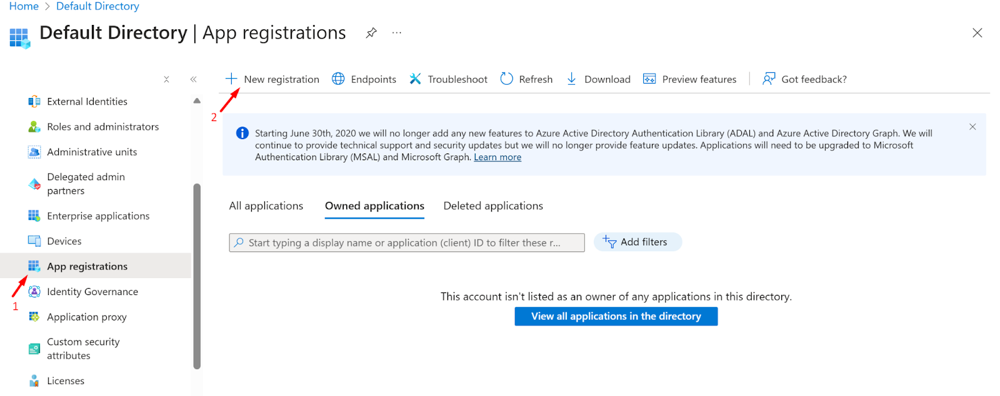

- Now, Enter The application name and click on the Register button

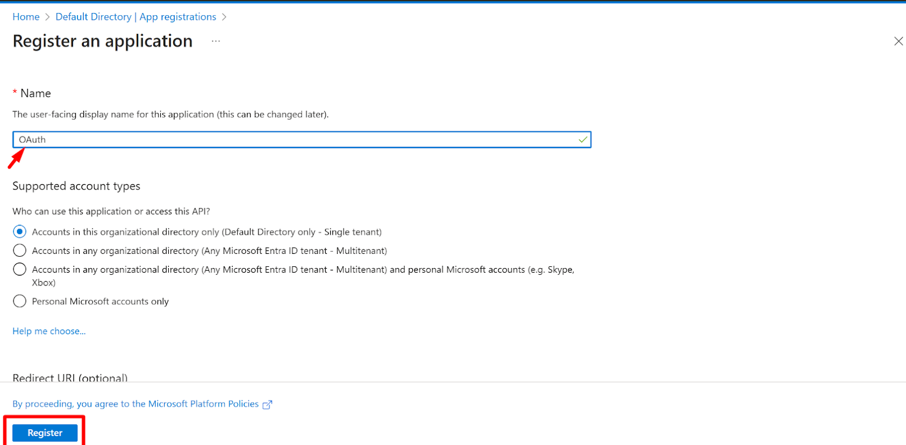

- After registering the app successfully, it will be listed on all application pages under App Registration.
- Now, click on the application.

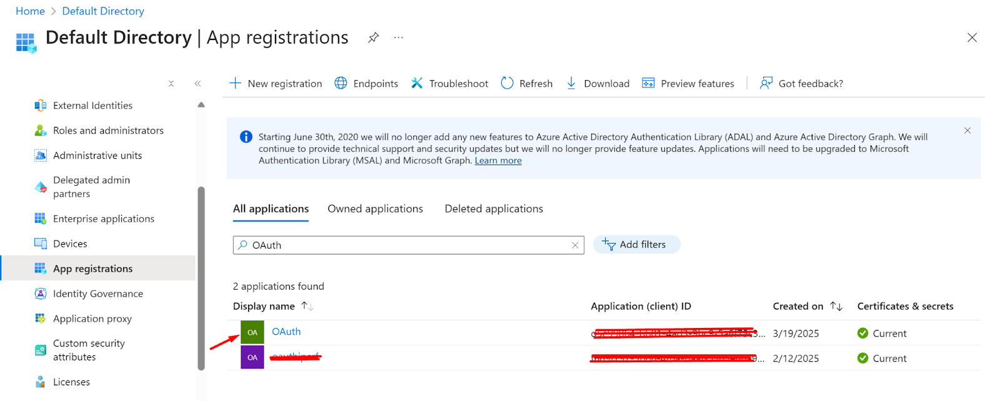

- Go to the overview section 
- Click on the Add a Redirect URI

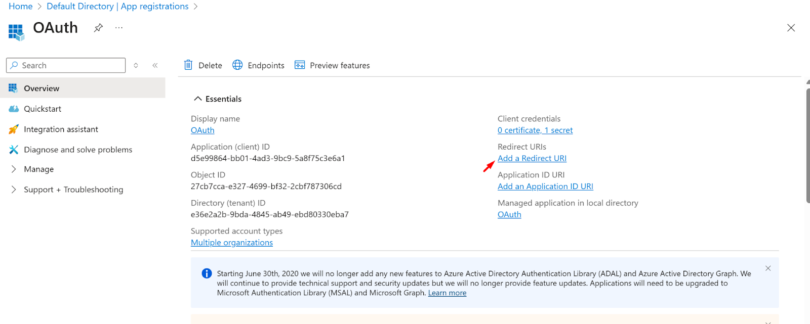

- Now, click on the Add URI

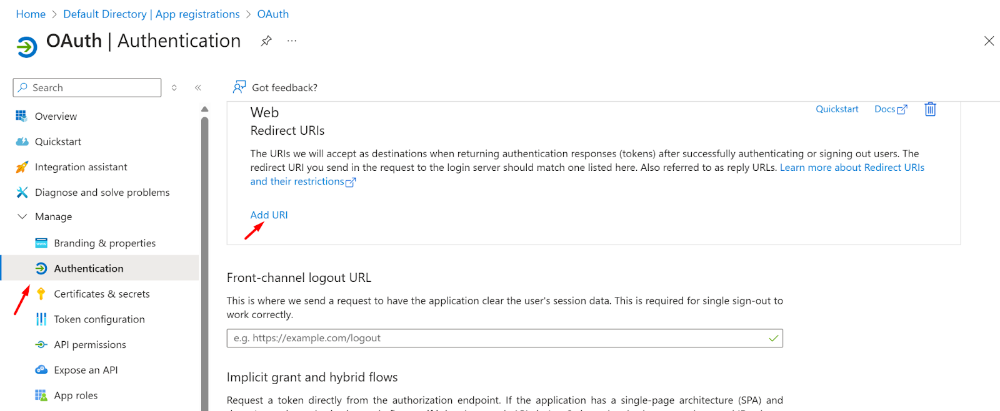

- Now log in to the Instasafe Console as an administrator
- Navigate to the OAuth page under the Authentication Profile
- Click on the Add button and copy the Redirect URI

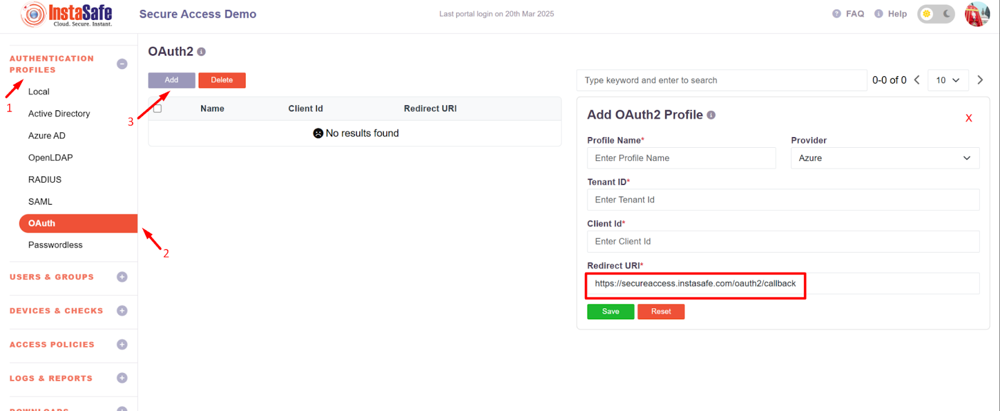

- Now, paste the Redirect URL in the Azure portal Application URI section
- Now Click on the Save Button

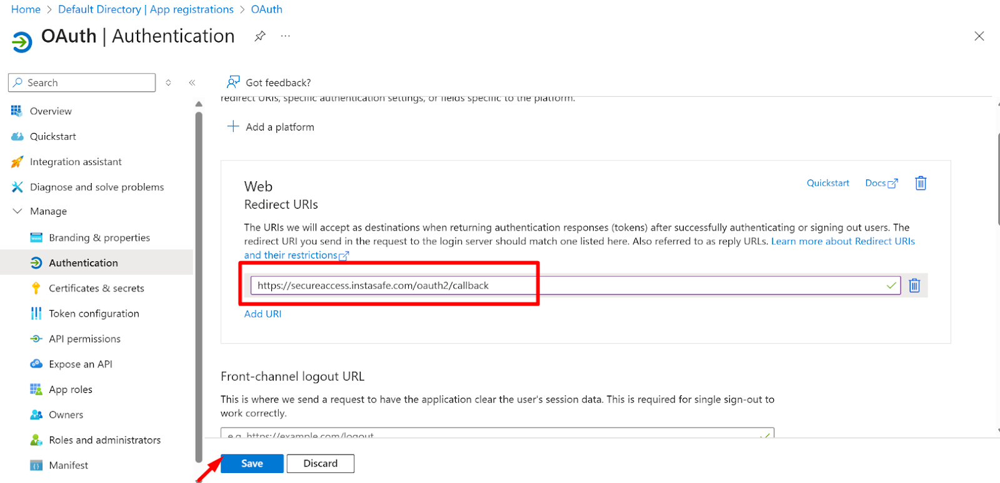

- Now, navigate to the Certificate and Secrets page and click on the new client secret button.

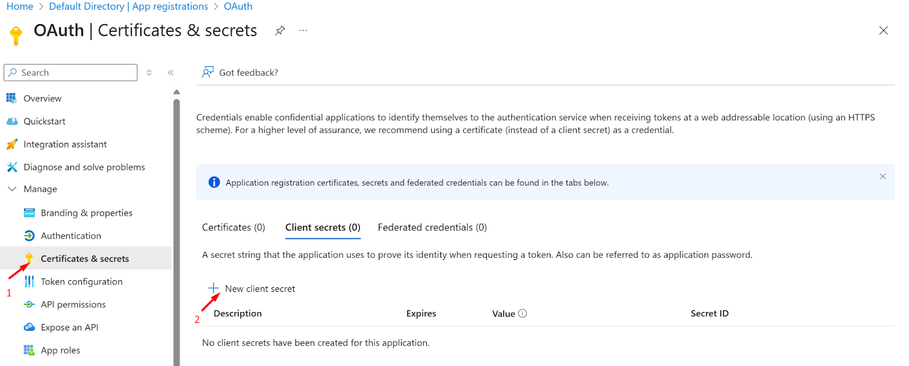

- Now add the Description and choose the expiry time for the secret 
- Click on the add button

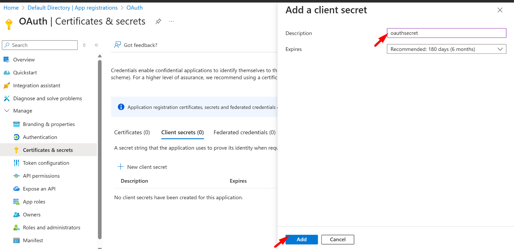

- After the successful addition of the secret, it will be displayed under the Client Secret
- Now, Copy the Value of the secret

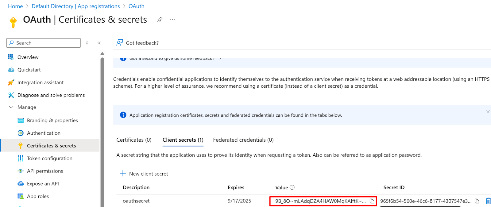

- Now Go to the overview page of the Application and copy the tenant ID and client ID

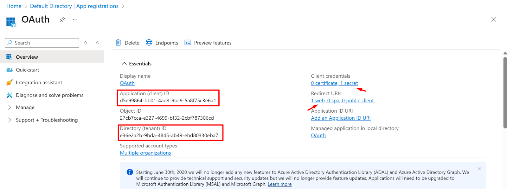

- Login to the instasafe console as an Admin user
- Navigate to the Authentication profile >> OAuth
- Click on the Add button to create a new OAuth profile for Azure

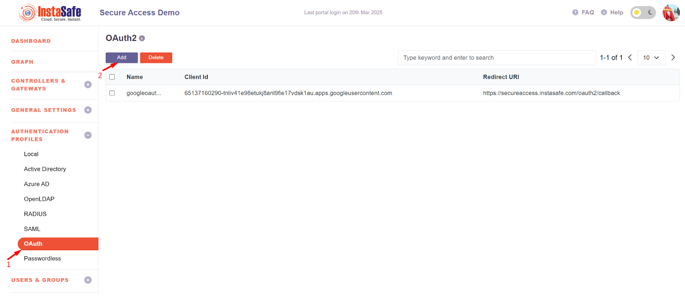

- Add the profile name 
- Select Provider as Azure and the details 
- Tenant ID and client ID should be added which were copied earlier in Figure - Figure no - 1.10.
- Now click on the save button

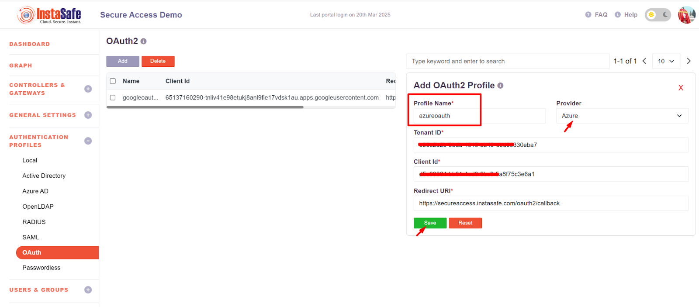

- After the successful addition of the OAuth profile, it will display on the Oauth page.
- Search for the Created OAuth profile and click on that
- It will display two buttons Edit and Set client secret 
- Click on the  Set Client Secret Button 

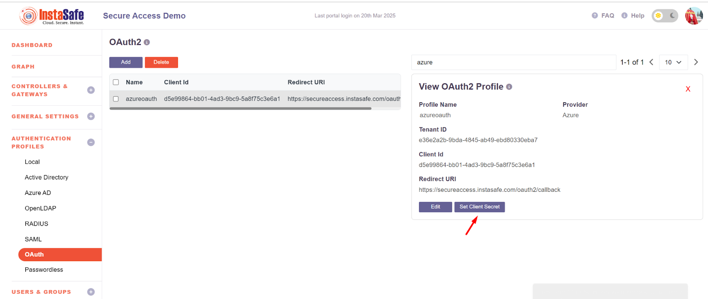

- Add the secret which was created in the Azure Application

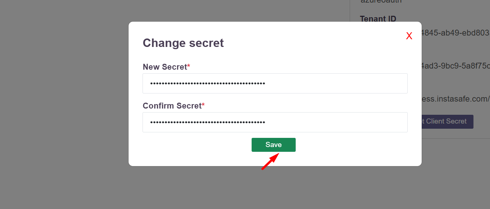

- Navigate to the user group section 
- Search for the user group for which the OAuth Authentication will be configured
- Click on the group and click on the Edit Button

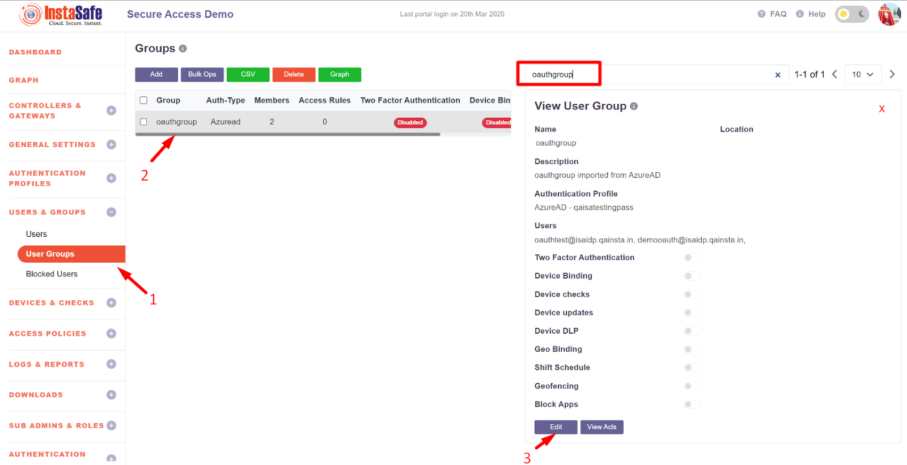

- Select the authentication Profile as Oauth-azure auth which was created in figure no -Figure no - 1.12

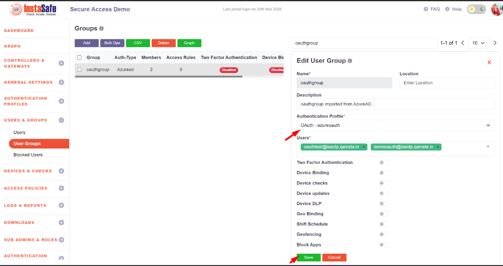

- After the Updation Auth type should be changed to OAuth as shown below.

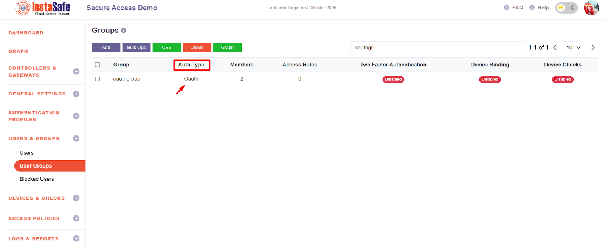

**Conclusion:**

OAuth2 is an essential tool for **secure authorization** and **delegated access** across applications, APIs, and services. By using OAuth2, users can safely authenticate and authorize third-party applications to interact with their data without exposing their credentials. This framework is especially important for securing user data, integrating with cloud and third-party services, and ensuring compliance with security and privacy standards.
