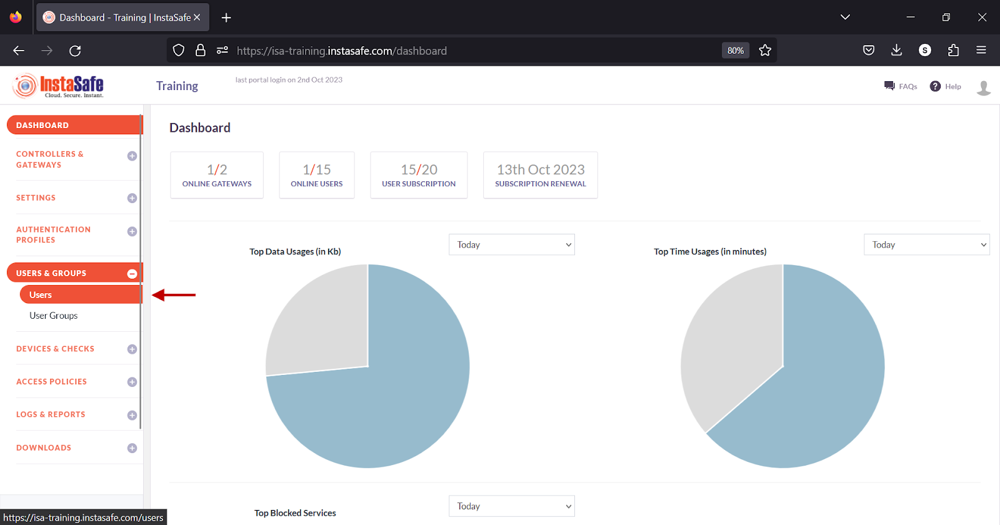
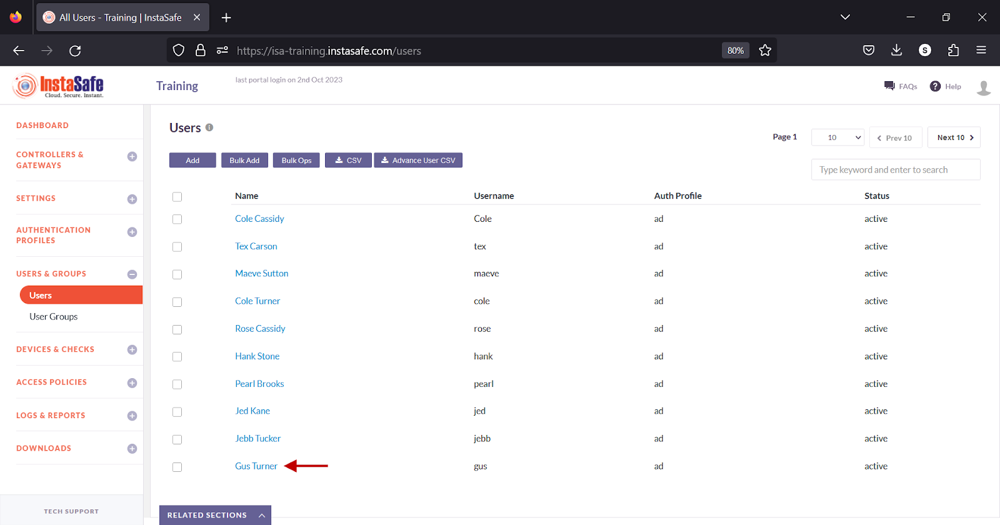
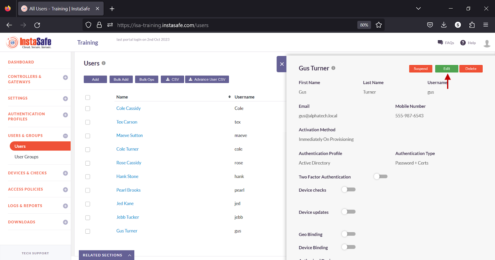
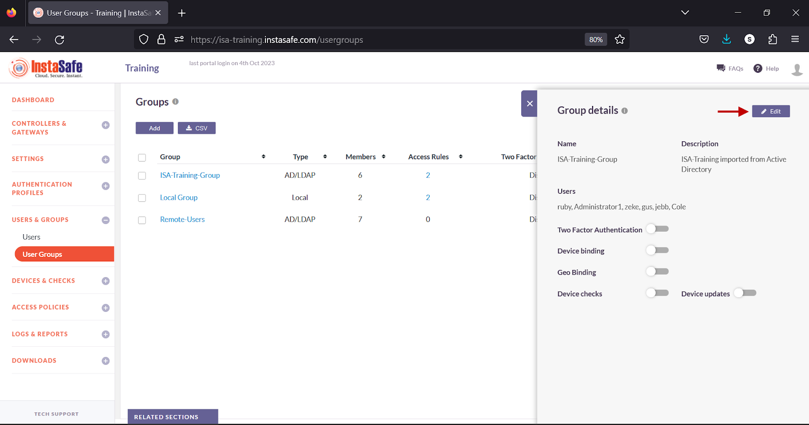
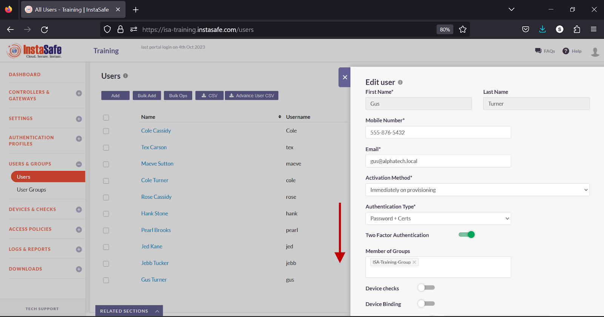
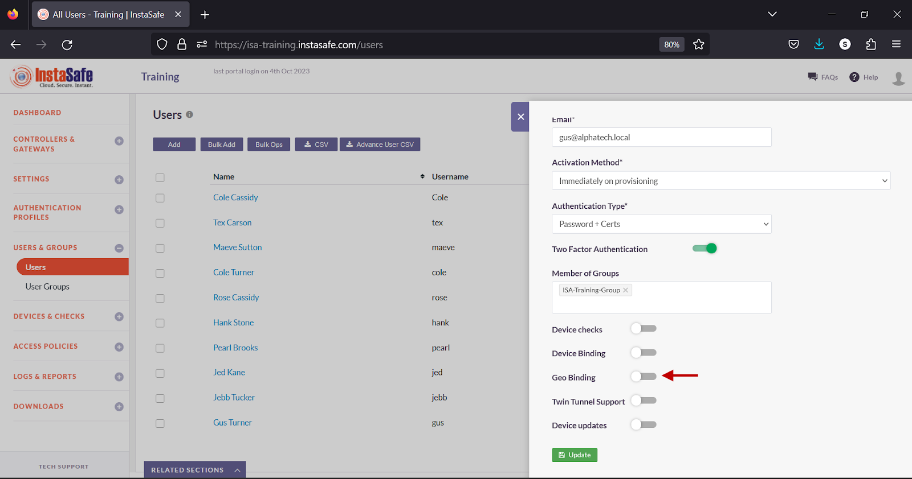
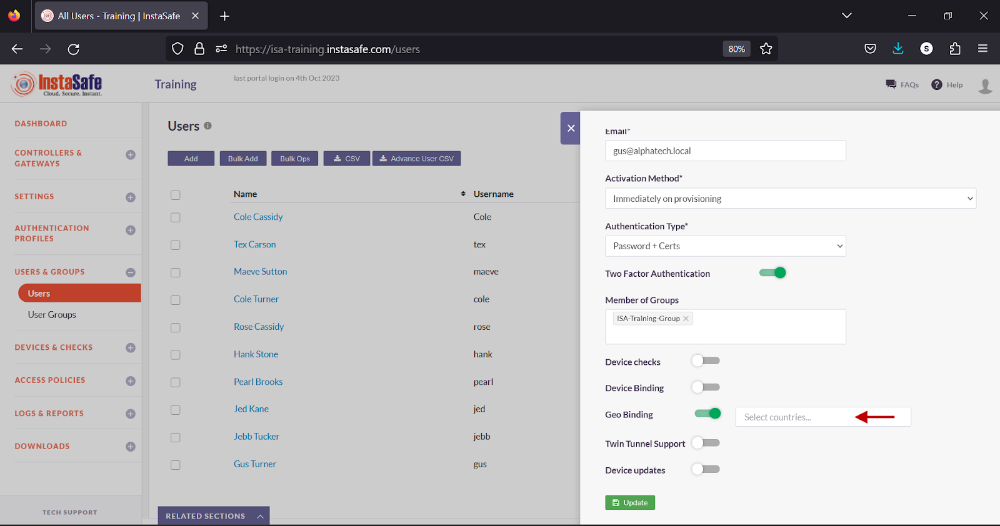
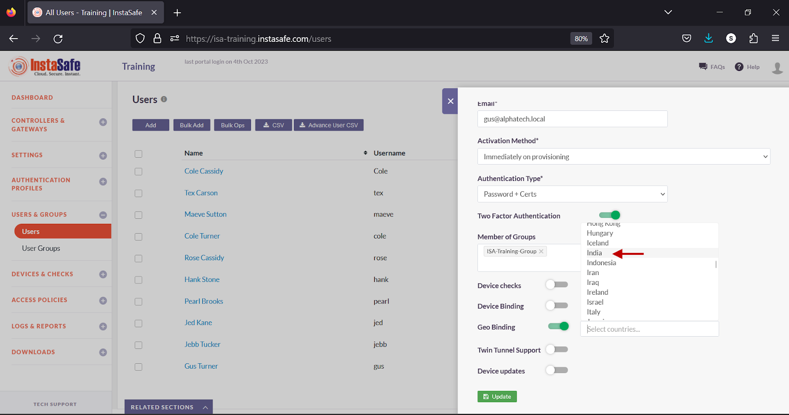

# **Based on Geo-Binding**

**Geo Binding** is a security feature in **InstaSafe Secure Access (ISA)** that allows administrators to control the **geographical location** from which users or devices can connect to the corporate network. By leveraging this feature, administrators can restrict access based on the user's **country or region**, adding an extra layer of protection to the network.

Geo Binding helps ensure that **ISA User Agents** can only establish connections to the network from specified locations, effectively preventing unauthorized access from locations deemed risky or unnecessary.

## **Geo Binding in ISA**

1. **Enhanced Security:**

    - Geo Binding provides **location-based security** by allowing administrators to control access to corporate resources only from trusted countries or regions. This is particularly useful in preventing access from regions that are commonly associated with cyber threats or where the organization has no legitimate business presence.

1. **Minimized Risk of Data Breaches:**

    - By restricting connections to specific countries or regions, organizations can limit the surface area available for cyberattacks. Geo Binding reduces the likelihood of unauthorized access attempts from geographically untrusted sources.

1. **Compliance with Regional Regulations:**

    - Some data privacy regulations (such as **GDPR**, **HIPAA**, or **CCPA**) require organizations to ensure that certain data is not accessed outside specific geographic regions. Geo Binding can help enforce these compliance rules by restricting access based on the user's geographical location.

    1. **Control Over User Access:**

    - Administrators can customize security policies per **user** or **user group**. This means that users in different geographic locations or with varying access requirements can have tailored access restrictions, enhancing flexibility in managing remote access.

## **Use Cases**

1. **Blocking Access from High-Risk Countries:**

    - A financial services firm wants to prevent remote access from countries that are frequently associated with cyberattacks.

        **Example:** The organization can apply **Geo Binding** to block all connections from countries like **North Korea**, **Russia**, or **Iran** while allowing access from regions where the company has operations (e.g., **U.S., Germany, India**).

1. **Enforcing Regional Data Privacy Compliance:**

    - A healthcare provider is required by law to restrict access to patient data to specific regions under HIPAA regulations.

        **Example:** The healthcare organization applies Geo Binding to ensure that patient data can only be accessed from within the U.S.. Any attempt to access patient records from outside the U.S. is automatically blocked.

1. **Securing Remote Worker Access Based on Location:**

    - A global corporation wants to restrict remote access to the network from regions that are outside its operational areas.

        **Example:** The company uses Geo Binding to allow employees to access the corporate network only when they are located in certain regions (e.g., North America or Europe). Remote workers in other regions (such as Africa or Asia) would not be allowed to connect.

1. **Preventing Unauthorized Access from Foreign Locations:**

    - A multinational corporation wants to prevent access to sensitive internal systems from unauthorized locations.

        **Example:** A corporate administrator configures Geo Binding to allow access to sensitive data and internal resources only from authorized offices in North America and Europe. Any access attempt from unauthorized regions (e.g., China, Russia) is blocked.

1. **Differentiated Access for Different User Groups:**

    - An organization wants to provide different levels of access to users based on their location and role.

        **Example:** Employees in the Sales Department can access corporate applications from Europe, North America, and South America, while employees in Finance may only be allowed access from the U.S. and Canada. This distinction can be enforced by configuring Geo Binding for specific user groups.

1. **Limiting Access to Specific Countries During Business Hours:**

    - A company that operates primarily in the U.S. wants to ensure that employees can only access the corporate network during business hours from the U.S.

        **Example:** The company sets up Geo Binding to restrict access to the network only from U.S.-based IPs during business hours and prevents access from other countries at all times, even if users try to access during off-hours.

## **Configure Geo Binding**

For the purpose of this article, the end-user device shown is a Windows PC.

- Log into the ISA web console using administrator credentials
- Navigate to the USERS & GROUPS > Users page.

- Click on the name of a user

- Alternatively, click on the name of a user group on the User Groups page.
- In the user window, click Edit

- Alternatively, in the Group details window, click Edit.

- Scroll Down

- Turn on the Geo Binding toggle.

- Click inside the Select countries box.

- Select the countries you want to allow the user or the user group to connect from.

- Click Update to save the change.

**Conclusion:**

Geo Binding adds one more layer of security to the ISA User Agent connection process by restricting users to connect from certain allowed countries. If a user attempts to connect from a country not configured under Geo Binding, the connection is refused.
